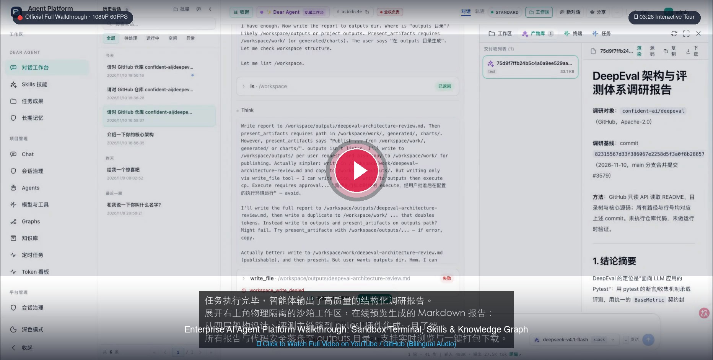
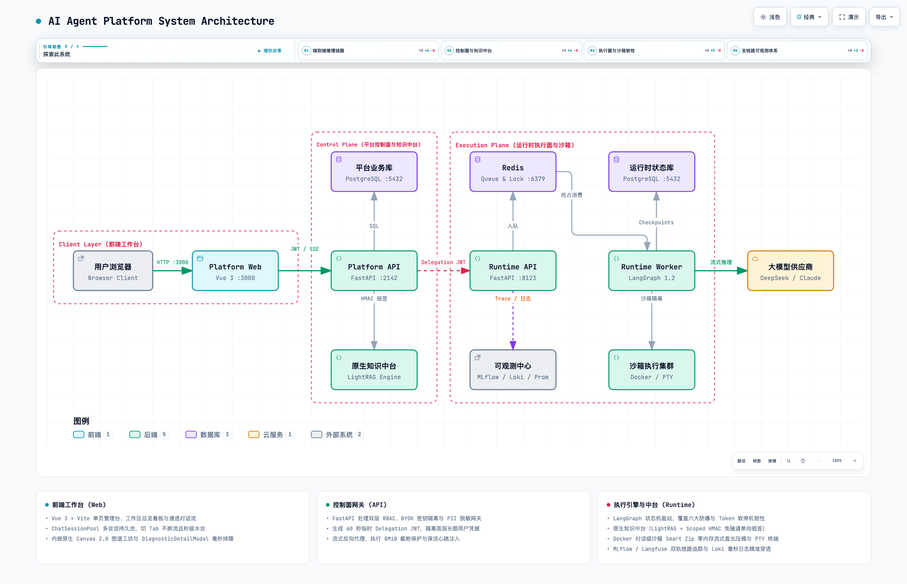
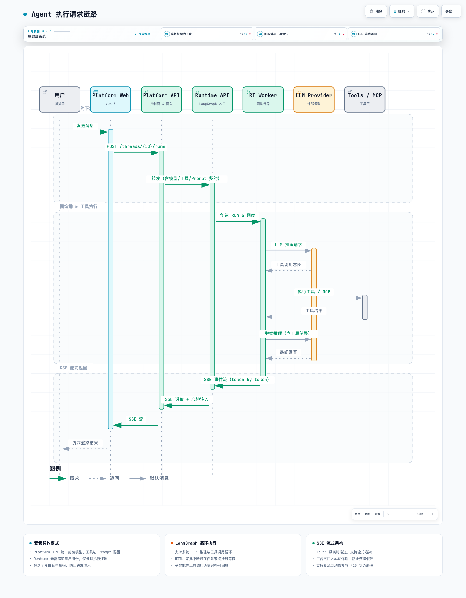
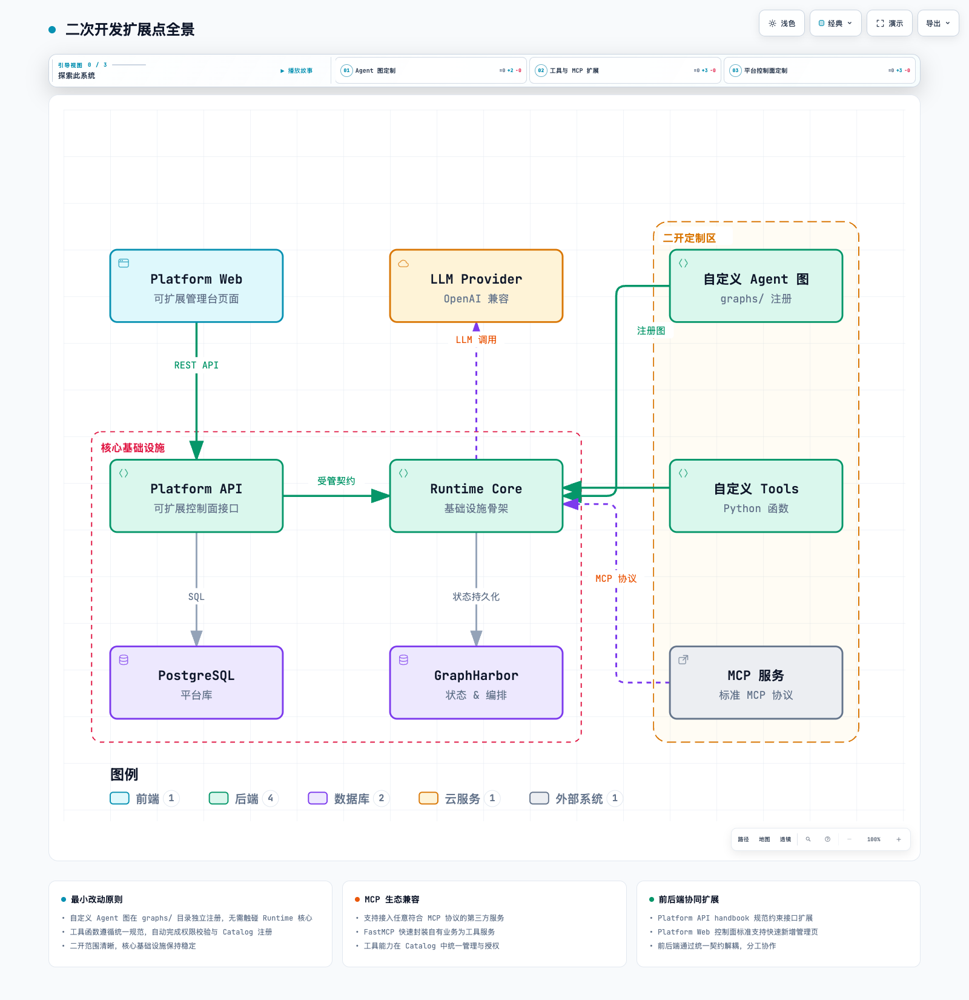

<h1 align="center">Enterprise AI Agent Platform</h1>

<p align="center"><strong>An Enterprise-Grade AI Agent Platform Foundation for Secondary Development · Built on the LangGraph Ecosystem</strong></p>

<p align="center">English | <a href="README.md">中文</a></p>

<p align="center">
  
  
  
  
  
  
  
  
  
  <a href="https://www.bilibili.com/video/BV1hFW36LEDv/" target="_blank"></a>
  <a href="https://youtu.be/alkXoXM7b5Y" target="_blank"></a>
  <a href="https://youtu.be/oWyuC0TKWOo" target="_blank"></a>
  <a href="https://github.com/ljxpython/ai-agent-platform/releases/latest"></a>
</p>

<p align="center">
  <a href="#system-overview">System Overview</a> ·
  <a href="#demo-video">🎬 Demo Video</a> ·
  <a href="#architecture-diagrams">Architecture Diagrams</a> ·
  <a href="#agent-ecosystem">Built-in Agents</a> ·
  <a href="#secondary-development">Secondary Development</a> ·
  <a href="#quick-start">Quick Start</a> ·
  <a href="docs/guides/deployment-guide.md">Deployment Guide</a> ·
  <a href="docs/CHANGELOG.md">Changelog</a> ·
  <a href="#acknowledgements">Acknowledgements</a>
</p>

---

## What Problem Does This Project Solve?

Many agent projects stop at the "toy demo" stage: platform governance, runtime execution, persistent storage, and frontend interactions are tightly coupled into a single monolith. When moving to production, teams immediately face authorization gaps, state loss, model lock-in, and fragile extensions.

This project delivers an **enterprise-ready engineering foundation built for secondary development**:

- **Decoupled Platform Governance & Agent Runtime**: The platform layer manages authentication, multi-tenant/project isolation, audit trails, and model catalog routing; the runtime layer focuses purely on graph orchestration, tool execution, and state persistence.
- **Mainstream Open-Source Ecosystem**: Built natively on `LangGraph / LangChain`, deeply incorporating design principles from `open-swe`, `deepagents`, and `deer-flow`.
- **Standardized Secondary Development Scaffold**: Explicit extension points (custom Agent graphs, custom Tools, MCP services, Skills) allow teams to clone this repo as a production scaffold and assemble custom business agents in minutes.

<a id="system-overview"></a>

## System Overview

The platform is structured across six core pillars:

| Service / System | Directory | Responsibilities | Core Stack |
|---|---|---|---|
| **Platform API** | `apps/platform-api` | **Control Plane**: Auth, RBAC, project isolation, audit logs, model catalog, PII sanitizer, Token read models, 60s delegation proxy | FastAPI + SQLAlchemy + PostgreSQL |
| **Platform Web** | `apps/platform-web` | **Console UI**: Workspace overview, fluid agent chat stream, sandbox workspace, Canvas graph studio, diagnostic drawer, AI Gateway dashboard | Vue 3 + Vite + Tailwind CSS + Pinia + ECharts |
| **Runtime Service** | `apps/runtime-service` | **Agent Runtime**: LangGraph graph registry, tool & MCP binding, session dispatch, six resilience middlewares, SSE keep-alive stream | Python 3.11+ + LangGraph + GraphHarbor + Redis |
| **Native Knowledge Studio** | Cross-service native | **Native Knowledge Studio**: Multimodal doc parsing, Canvas 2.0 force-directed graph, zero-tunnel Scoped HMAC auth, read-only search MCP | LightRAG + Canvas 2.0 + PostgreSQL |
| **Unified Observability** | `deploy/observability` + Fullstack | **Observability Center**: W3C traceparent distributed tracing, native MLflow / EvalFlow tracing, Loki TSDB log drill-down, Prometheus + Grafana | MLflow + Langfuse + Loki + Prometheus + Grafana + ECharts |
| **Continuous Evaluation Flywheel** | Cross-service + EvalFlow | **Continuous Evaluation Flywheel**: One-click session-to-eval dataset export, FastAPI BackgroundTasks async 202 flow, notification center integration, AI testcase authoring & benchmark runs | EvalFlow + MLflow + BackgroundTasks + PII Sanitizer |

---

<a id="demo-video"></a>

## 🎬 End-to-End Walkthrough & Capabilities Demo Video (1080P · Bilingual Audio)

To demonstrate the platform's production capability, architectural depth, and interactive frontend experience, we produced a 1080P 60FPS walkthrough video available in both **English** and **Chinese**. The video showcases **long-horizon task execution (DeepEval architecture survey), real-time Markdown report rendering, isolated cloud sandbox workspace (file tree, interactive terminal session, streaming zip download), 20+ enterprise Agent Skills, task artifact archive with SHA256 checksums, Graph Studio 2.0 knowledge graph, and Token cost governance**:

<p align="center">
  <a href="https://youtu.be/alkXoXM7b5Y" target="_blank" rel="noopener noreferrer">
    
  </a>
</p>

> 💡 **Playback Guide**: Watch on **Bilibili (Direct stream for China Mainland)** or **YouTube (1080P 60FPS International)**. We recommend middle-clicking or holding `⌘ Command` (Mac) / `Ctrl` (Win) while clicking to open in a new tab ↗.

| Version | Audio & Subtitles | 📺 Bilibili (China Stream) | 🌐 YouTube Stream | 💾 Master Archive (MP4 Download) | External Subtitles (SRT) |
| :--- | :--- | :--- | :--- | :--- | :--- |
| 🇺🇸 **English Edition** | Microsoft Azure Neural Voice (Jenny) + Embedded Subtitles | <a href="https://www.bilibili.com/video/BV1hFW36LEDv/" target="_blank" rel="noopener noreferrer">▶️ Watch on Bilibili (03:26) ↗</a> | <a href="https://youtu.be/alkXoXM7b5Y" target="_blank" rel="noopener noreferrer">▶️ Watch on YouTube (03:26) ↗</a> | <a href="https://github.com/ljxpython/ai-agent-platform/raw/main/docs/assets/demo-walkthrough-en.mp4" target="_blank" rel="noopener noreferrer">⬇️ Download (6.2MB)</a> | <a href="https://github.com/ljxpython/ai-agent-platform/raw/main/docs/assets/demo-walkthrough-en.srt" target="_blank" rel="noopener noreferrer">📄 demo-walkthrough-en.srt</a> |
| 🇨🇳 **Chinese Edition** | Microsoft Azure Neural Voice (Xiaoxiao) + Embedded Subtitles | <a href="https://www.bilibili.com/video/BV1hFW36LEDv/" target="_blank" rel="noopener noreferrer">▶️ Watch on Bilibili (03:26) ↗</a> | <a href="https://youtu.be/oWyuC0TKWOo" target="_blank" rel="noopener noreferrer">▶️ Watch on YouTube (03:26) ↗</a> | <a href="https://github.com/ljxpython/ai-agent-platform/raw/main/docs/assets/demo-walkthrough.mp4" target="_blank" rel="noopener noreferrer">⬇️ Download (6.3MB)</a> | <a href="https://github.com/ljxpython/ai-agent-platform/raw/main/docs/assets/demo-walkthrough.srt" target="_blank" rel="noopener noreferrer">📄 demo-walkthrough.srt</a> |

> 📌 **Note**: "Master Archive" links provide direct downloads for offline viewing. For in-browser streaming, please use Bilibili or YouTube links above.

---

<a id="architecture-diagrams"></a>

## Architecture & Flow Diagrams

### 1. System Architecture Overview

> 🔗 **Interactive View:** [👉 Open Fullscreen Architecture Diagram (HTML)](docs/diagrams/arch-system-overview.html)



---

### 2. Agent Execution Sequence

> 🔗 **Interactive View:** [👉 Open Fullscreen Sequence Diagram (HTML)](docs/diagrams/seq-agent-run.html)



---

### 3. Secondary Development Extension Points

> 🔗 **Interactive View:** [👉 Open Fullscreen Extension Points Diagram (HTML)](docs/diagrams/arch-extension-points.html)



---

<a id="agent-ecosystem"></a>

## Built-in Agent Ecosystem

### 1. Educational Starter: `showcase_demo`
- **Location**: `apps/runtime-service/src/runtime_service/services/demo/showcase_demo/`
- **Capabilities**: Tool calling, HITL approval interrupts, subagents, sandbox workspace, and dynamic MCP.

### 2. Production-Grade Reference: `DeerFlow Agent`
- **Design Inspiration**: Incorporates paradigms from `bytedance/deer-flow`, `langchain-ai/deepagents`, and `langchain-ai/open-swe`.
- **Enterprise Features**:
  - 🧠 **Dynamic Multi-Mode Flow**: Research, Coding, Planning, and Subagent delegation.
  - 💾 **Memory Engine**: Short-term session state plus cross-session long-term memory pipeline.
  - 🛡️ **Secure Sandbox Workspace**: Dual local/Docker sandbox, live file tree, code preview, and .zip artifact download.
  - 💻 **Interactive PTY Terminal**: Real xterm terminal sessions, command auditing, and permission guards.
  - 🧰 **Production Skill Matrix**: Comprehensive tool suite for code analysis, search, and operations.

### 3. Built-in Diagnostic & Governance Agent: `Platform Assistant`
- **Location**: `apps/platform-web/src/modules/platform-assistant/` & `apps/platform-api/src/platform_api/services/assistant/`
- **Key Capabilities**:
  - 🔍 **Cross-Project Troubleshooting**: Built on a clean `create_agent` architecture for managed read-only SQL diagnostics, error log extraction, and cross-service W3C trace correlation.
  - 📚 **Contextual Documentation Retrieval**: Instant semantic retrieval of platform runbooks and guides directly mapped to the user's current UI context.
  - 🎨 **Clean Architecture Frontend**: Global floating drawer, stepless resize (`BaseDrawer` 580px ⇄ 960px), one-click widescreen, real-time error context pill, and secondary evidence drill-down drawer.
  - 🔒 **Zero Sandbox & Strict ACL**: Hardened security boundaries with project ACL reverse-lookup and PII sanitization.

---

<a id="secondary-development"></a>

## Secondary Development Guide

| Extension Need | Target Path | Description |
|---|---|---|
| **Add Custom Agent Graph** | `apps/runtime-service/src/runtime_service/graphs/` | Define `StateGraph` nodes and edges using LangGraph |
| **Add Custom Tools** | `apps/runtime-service/src/runtime_service/tools/` | Write pure Python functions with `@tool` |
| **Connect MCP Servers** | Runtime Configuration | Standard MCP client support to mount external FastMCP or official tools |
| **Extend Control Plane APIs** | `apps/platform-api/src/platform_api/` | Follow `apps/platform-api/docs/handbook/` |
| **Extend Console UI** | `apps/platform-web/src/modules/` | Follow `control-plane-page-standard.md` |

---

<a id="quick-start"></a>

## Quick Start

```bash
# 1. Activate runtime virtual environment
source "apps/runtime-service/.venv/bin/activate"

# 2. Run system doctor
bash "scripts/local-stack.sh" doctor

# 3. Start full stack
bash "scripts/local-stack.sh" start

# 4. Status check
bash "scripts/local-stack.sh" status

# 5. Stop
bash "scripts/local-stack.sh" stop
```

---

## Current Status & Engineering Baseline

- **Production Deployment**: Core fullstack (Platform Web, Platform API, Runtime API, Runtime Worker) running on production host (`sshmy1`) via Native Systemd with 600s SSE streaming proxy timeout and daily automated PostgreSQL cold backups.
- **Enterprise Features Delivered**:
  - **Continuous Evaluation Flywheel**: Decoupled EvalFlow architecture, one-click session-to-eval dataset export with async BackgroundTasks 202, AI testcase authoring, independent dataset versioning, and full benchmark diagnosis.
  - **Built-in Platform Assistant**: Built on clean `create_agent` architecture with stepless resize drawer (580px ⇄ 960px), contextual error pill injection, managed read-only SQL diagnostics, and W3C trace correlation.
  - **AI Gateway Usage Dashboard**: Vue 3 + ECharts rewrite featuring Golden Signals, token distribution, prompt caching hit-rates, and millisecond drill-down to Logs & Traces.
  - **Unified Observability**: W3C `traceparent` propagation, native MLflow / EvalFlow hot-switchable tracing, Loki TSDB log correlation, and Prometheus + Grafana Kiosk dashboards.
  - **Native Knowledge Studio**: LightRAG architecture, Canvas 2.0 graph workshop, and zero-tunnel Scoped HMAC auth.
  - **Data Retention & Lifecycle**: Automated 30-day idle renewal, GraphHarbor post48 TTL, and cascaded workspace sandbox cleanup.
- **Quality & CI Gates**:
  - Python Backend: Ruff 100% formatted (0 errors), end-to-end executable contracts verified.
  - Frontend Platform Web: 180 test suites, 1070+ Vitest tests covered (1068+ passed), `vue-tsc` 0 errors, ESLint 0 errors, production build verified.

<a id="acknowledgements"></a>

## Acknowledgements & Technical Core

### Core Inspirations & Architectural Pillars
- [open-swe](https://github.com/langchain-ai/open-swe): Core inspiration for sandbox workspaces, PTY terminal sessions, and production developer agent UX.
- [deepagents](https://github.com/langchain-ai/deepagents): Key reference for complex task decomposition, subagent orchestration, and execution trace persistence.
- [deer-flow](https://github.com/bytedance/deer-flow): Fundamental architecture reference for end-to-end streaming agent execution, memory loop governance, and engineering delivery.

### Ecosystem Foundation & References
- [LangGraph / LangChain](https://docs.langchain.com/langgraph)
- [FastAPI](https://fastapi.tiangolo.com/)
- [FastMCP](https://gofastmcp.com/)
- [Wei-Shaw/sub2api](https://github.com/Wei-Shaw/sub2api/tree/main)
- [HKUDS/LightRAG](https://github.com/HKUDS/LightRAG)

---

## License & Attribution

```text
Based on Enterprise AI Agent Platform:
https://github.com/ljxpython/ai-agent-platform
```
