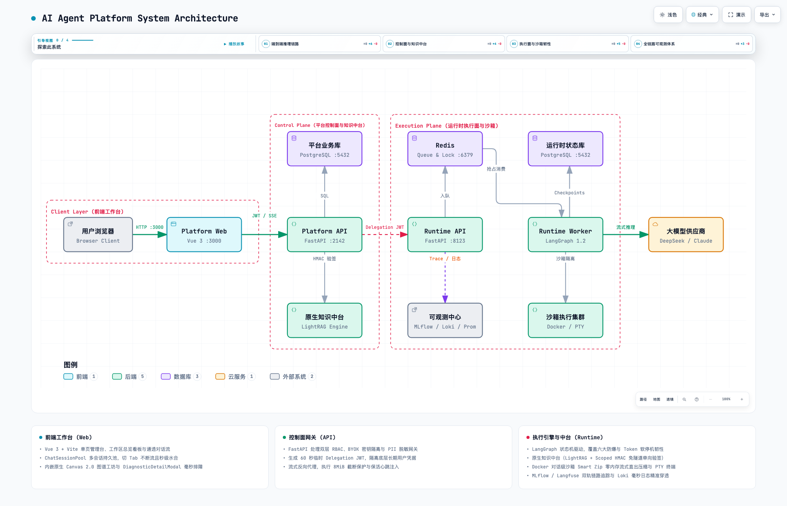
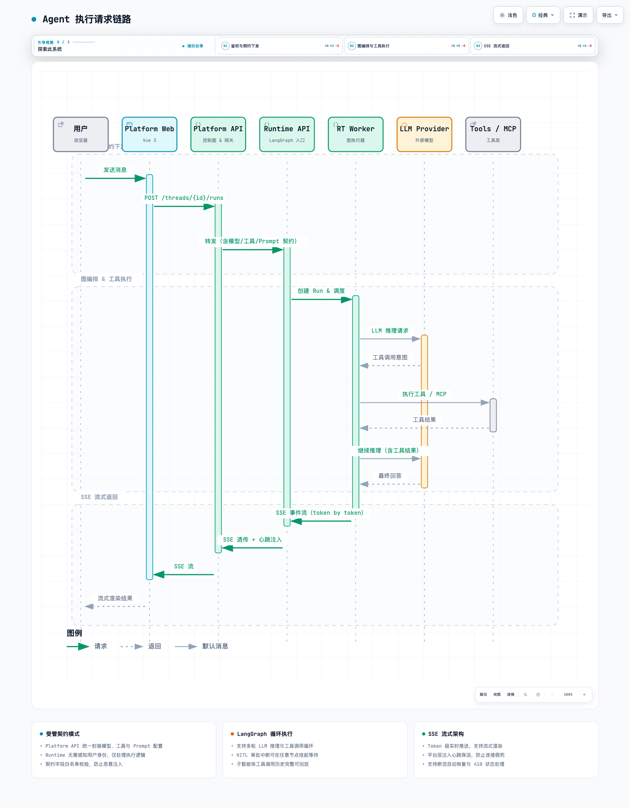
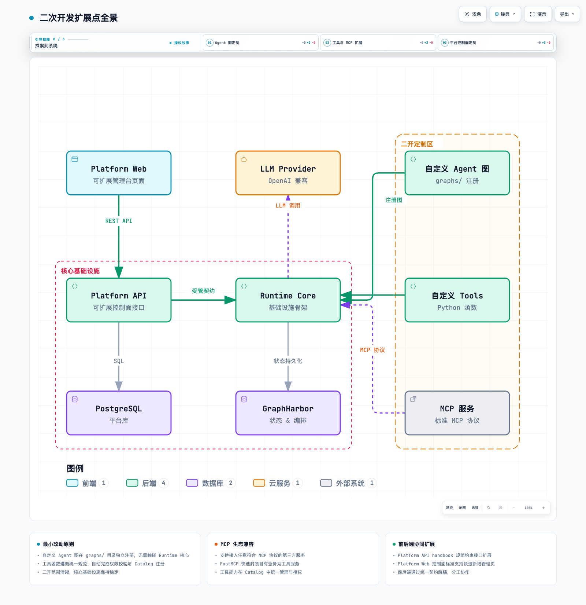
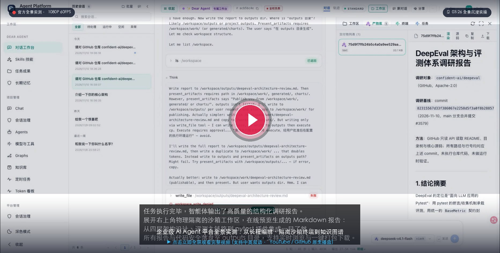
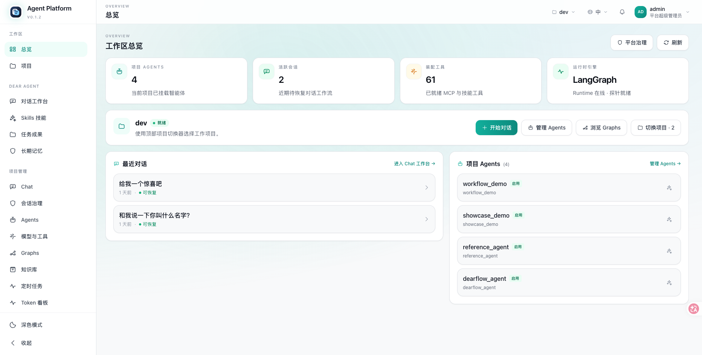
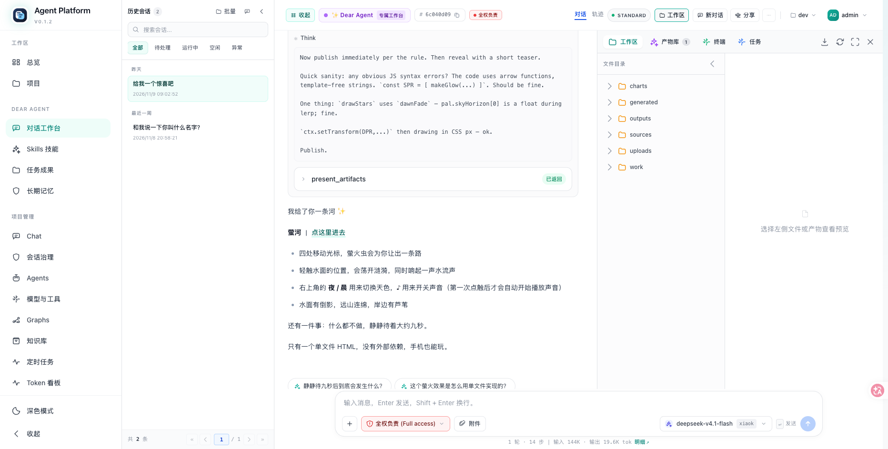
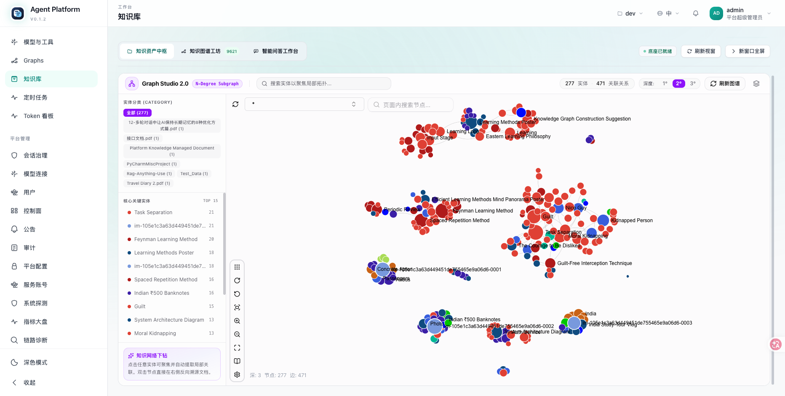
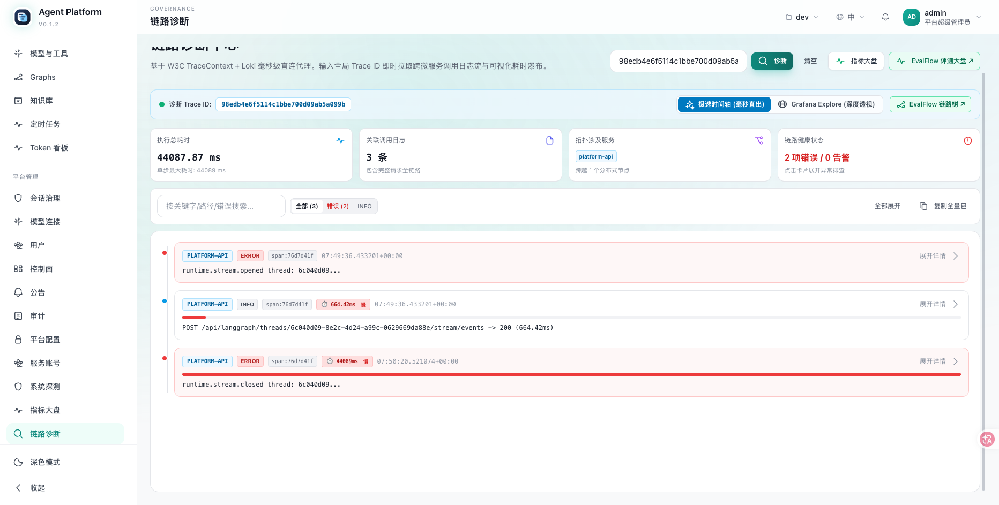
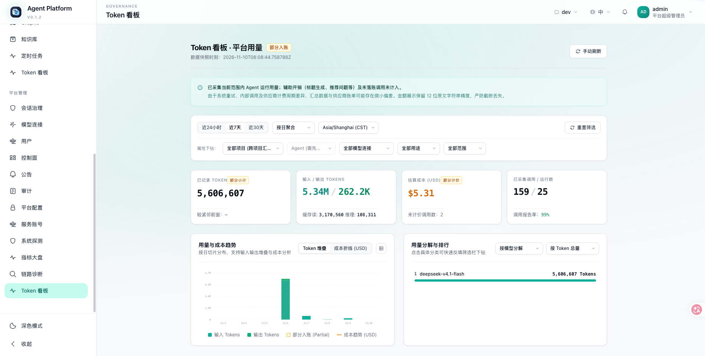
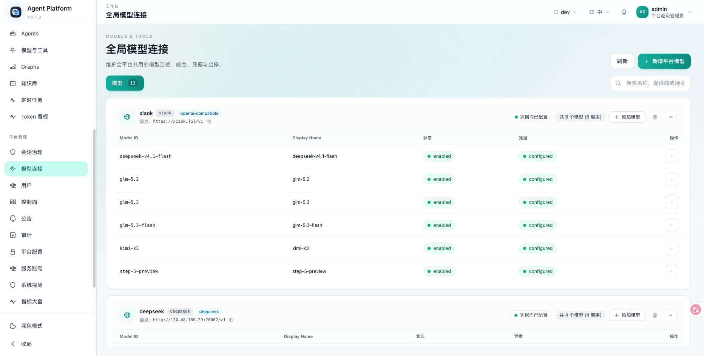

<h1 align="center">企业级 AI Agent 平台</h1>

<p align="center"><strong>面向二次开发与企业落地的 AI Agent 平台底座 · 基于 LangGraph 生态体系</strong></p>

<p align="center"><a href="README.en.md">English</a> | 中文</p>

<p align="center">
  
  
  
  
  
  
  
  
  <a href="https://www.bilibili.com/" target="_blank"></a>
  <a href="https://youtu.be/oWyuC0TKWOo" target="_blank"></a>
  <a href="https://youtu.be/alkXoXM7b5Y" target="_blank"></a>
  <a href="https://github.com/ljxpython/ai-agent-platform/releases/latest"></a>
</p>

<p align="center">
  <a href="#system-overview">系统总览</a> ·
  <a href="#demo-video">🎬 演示视频</a> ·
  <a href="#architecture-diagrams">架构与链路图解</a> ·
  <a href="#production-resilience">生产级工程韧性</a> ·
  <a href="#agent-ecosystem">内置智能体生态</a> ·
  <a href="#secondary-development">二次开发指南</a> ·
  <a href="#frontend-showcase">前端体验与工作台</a> ·
  <a href="#quick-start">快速开始</a> ·
  <a href="docs/guides/deployment-guide.md">部署手册</a> ·
  <a href="docs/CHANGELOG.md">更新日志</a> ·
  <a href="#acknowledgements">致谢与技术核心</a>
</p>

---

## 项目定位：解决什么问题？

很多团队做 Agent 容易停留在 Demo 阶段：平台治理、运行时执行、状态存储和前端交互全揉成一个“大泥球”，一到生产落地就面临权限缺失、状态丢失、模型切换困难、二开举步维艰、长任务上下文瞬爆与工具死循环的问题。

本项目为解决这一痛点而生，提供一个**可直接用于二次开发、快速搭建企业私有 AI Agent 平台**的工程底座：

- **解耦平台治理与 Agent 执行**：平台层专职负责认证鉴权、多租户/项目隔离、审计回溯、模型 Catalog 治理；Agent 运行时专职负责图编排、工具装配与状态机运转。两层通过 60 秒受管短时委托凭证（Delegation JWT）通信，互不污染。
- **拥抱主流开源生态，不造封闭轮子**：全面基于 `LangGraph / LangChain` 系列生态设计，深度吸收 `open-swe`、`deepagents` 与 `deer-flow` 的工程思想，原生支持复杂图编排、状态持久化、多轮工具调用循环与人机协同（HITL）审批中断。
- **全栈工程韧性与安全防御**：内置上下文防爆（Spill-to-Disk 溢出落盘与虚拟折叠）、Token 预算软停机、调研边际收敛刹车、弹性 MCP 容错加载、纯 Docker 沙箱流式直出压缩，从根源保障复杂长任务稳定运行。
- **标准化二次开发骨架**：预留清晰的扩展点（自定义 Agent 图、自定义 Tools、标准 MCP 服务、Skills 技能），其他企业可以直接拉取作为模板，快速装配自有垂直业务 Agent。

<a id="system-overview"></a>

## 系统总览

整个系统由五大核心支柱体系分层构建，各司其职：

| 服务 / 子系统 | 目录 | 职责定位 | 核心技术栈 |
|---|---|---|---|
| **Platform API** | `apps/platform-api` | **控制面核心**：认证鉴权、双层 RBAC、项目隔离、审计日志、模型 Catalog 治理、PII 脱敏网关、Token 聚合读模型、60s 委托反向代理 | FastAPI + SQLAlchemy + PostgreSQL |
| **Platform Web** | `apps/platform-web` | **工业级管理控制台**：工作区总览四联看板、无界流式对话、沉浸式沙箱 Workspace、Canvas 图谱工坊、就地排障诊断中心 | Vue 3 + Vite + Tailwind CSS + Pinia |
| **Runtime Service** | `apps/runtime-service` | **Agent 执行引擎**：LangGraph 图注册、工具与 MCP 装配、会话调度、六大防爆中间件、SSE 事件流保活推送 | Python 3.11+ + LangGraph + GraphHarbor + Redis |
| **Native Knowledge Studio** | 跨服务原生集成 | **原生知识中台**：多模态文档解析、Graph Studio 2.0 Canvas 力导向图谱工坊、单向免隧道 Scoped HMAC 鉴权、只读知识检索 MCP | LightRAG + Canvas 2.0 + PostgreSQL |
| **Unified Observability** | `deploy/observability` + 全栈 | **全链路可观测中心**：W3C traceparent 跨微服务穿透、**MLflow / EvalFlow 原生链路追踪（支持热切）**、Loki TSDB 毫秒日志穿透、Prometheus + Grafana Kiosk 大盘 | MLflow + Langfuse + Loki + Prometheus + Grafana |

<a id="architecture-diagrams"></a>

## 架构与链路图解

### 1. 系统架构全景图

> 🔗 **交互式网页体验：** [👉 打开全屏交互式架构图 (HTML)](docs/diagrams/arch-system-overview.html)（基于 Archify 生成，支持节点语义聚焦、视口缩放、深浅主题切换与全要素搜索）



- **前端工作台（Client Layer）**：Vue 3 单页应用，包含紧凑工作区看板、对话流、沙箱 Workspace、原生图谱工坊与毫秒排障抽屉。
- **平台控制面（Control Plane）**：Platform API 处理所有的用户身份鉴权、双层 RBAC 权限与审计，向后动态签发 60 秒超短 TTL 的受管 Delegation JWT。
- **运行时执行面（Execution Plane）**：Runtime API 与 Worker 解耦，由 LangGraph 状态机驱动智能体，状态由 GraphHarbor 统一落库，支持长时间运行与断点恢复。
- **原生知识中台（Knowledge Studio）**：基于 LightRAG 架构，提供 Canvas 2.0 力导向图谱工坊与只读检索 MCP，采用单向 Scoped HMAC 验签，无需反向穿透隧道。
- **沙箱与外部生态（Sandbox & Cloud）**：纯 Docker 沙箱流式直出压缩，标准 MCP 插件与外部多 Provider 大模型无缝接入。
- **全链路可观测中心（Observability Center）**：基于 W3C `traceparent` 标准，支持 **MLflow / EvalFlow 原生全景追踪** 与 Langfuse 双轨热切换，结合 Loki 实现根据单一 `trace_id` 毫秒级对齐微服务上下文日志。

---

### 2. Agent 执行请求链路时序

> 🔗 **交互式网页体验：** [👉 打开全屏交互式时序图 (HTML)](docs/diagrams/seq-agent-run.html)（支持三阶段分段探索与完整链路追踪）



- **阶段一（鉴权与契约组装）**：Platform API 拦截用户请求，从数据库读取当前项目启用的模型参数、可用工具白名单和系统 Prompt，组装成受保护的“受管契约”下发给 Runtime。
- **阶段二（图编排与工具循环）**：Runtime Worker 接管任务，驱动 LangGraph 状态机向 LLM 发起推理；当模型决定调用工具或 MCP 时，进入工具执行/人机审批流，完成后携带结果继续推理。
- **阶段三（SSE 流式保活透传）**：执行状态以 Server-Sent Events（SSE）形式实时推送，网关层自动注入保活心跳与 8MiB 截断保护，前端支持流式打字渲染与断流自愈。

---

### 3. 二次开发扩展点全景

> 🔗 **交互式网页体验：** [👉 打开全屏交互式扩展点图 (HTML)](docs/diagrams/arch-extension-points.html)（清晰划定二开边界）



- **二开业务定制区（右侧）**：业务开发者主要编写自定义 Agent 图、业务 Tools 和挂载 MCP 插件。
- **核心基础设施骨架（左下）**：认证、网关、状态持久化、SSE 传输通道等基础设施开箱即用，一般无需做侵入性修改。

---

<a id="production-resilience"></a>

## 生产级工程韧性与安全防御

针对复杂长程任务、代码分析与深度调研场景中极易出现的系统假死、内存泄露与大模型失控等顽疾，平台实装了完整的工业级防御机制：

- 🛡️ **智能体上下文防爆体系 (Context Blowup Defense)**：
  - **Spill-to-Disk 溢出落盘**：当单次工具输出超过阈值（如全库搜索或大数据倾倒）时自动落盘并返回摘要引用，杜绝单轮暴涨数万 Token 撑爆上下文。
  - **历史工具视口虚拟折叠 (Ephemeral Pruning)**：长程任务自动折叠历史多轮工具的冗余原始输出，大长会话回放 Token 压降 58% ~ 82%，压缩触发率降至 0。
  - **Head+Tail 物理截断**：文件读取与终端输出严格执行首尾 50 行截断保护，坚决阻断超大文件瞬爆内存。
- 🛑 **Token 预算韧性与优雅停机 (Budget Hardening)**：
  - 上下文保留策略提升为复合保留 $\ge 40\%$ 输入预算或最近 16 条完整消息，彻底终结残暴截断引发的失忆死循环。
  - 引入 `exit_behavior="end"` 优雅软收尾机制，当单次运行预算耗尽时自动温和终止并输出总结，绝不崩溃抛出红条。
- 🚦 **深度调研预算约束与刹车 (Research Budget Brake)**：
  - 重构调研类技能，确立严格预算门禁（常规 3~5 次搜索、2~4 篇精读全文）与边际效用递减评估原则，彻底根治无限递归顺藤摸瓜调用 250+ 次工具导致的超时卡死。
- 🔌 **弹性 MCP 装配与容错降级 (Resilient MCP Loading)**：
  - MCP 服务装配期实装 10 秒超时隔离与全局异常捕获，运行期自动降级，彻底废除“单一工具加载失败即自杀退出”的反模式。
- 📦 **纯 Docker 对话级沙箱流式压缩 (Smart Zip Streaming)**：
  - 沙箱文件归档淘汰 Base64 JSON 全内存缓冲，采用 `ZIP_STORED` 零内存流式连接池直出传输，9.4MB 产物归档耗时从 21.5s 压降至 0.36s（提速 98.3%）。
- ⏳ **会话与运行时数据生命周期治理 (Retention Governance)**：
  - 支持 30 天闲置/查看发送自动续期与通用 TTL；会话物理回收时级联清理绑定的 Workspace 沙箱目录与临时状态，杜绝磁盘堆积。

---

<a id="agent-ecosystem"></a>

## 内置智能体生态与技能矩阵

仓库内置了两套具有不同使命的智能体示例，兼顾了快速上手学习与极端复杂场景落地：

### 1. 教学入门智能体：`showcase_demo`
- **定位**：初学者了解平台机制的最小样板间。
- **源码位置**：`apps/runtime-service/src/runtime_service/services/demo/showcase_demo/`
- **覆盖能力**：
  - ✅ **基础与高级工具调用 (Tool Calling)**
  - ✅ **人机协同审批中断 (HITL - Human-in-the-Loop)**
  - ✅ **子智能体协作与调用轨迹基础回放**
  - ✅ **沙箱安全工作区 (Workspace) + 产物实时预览**
  - ✅ **MCP 工具集成与动态装配**

### 2. 生产级标杆智能体：`DeerFlow Agent`
- **定位**：真正面向生产级任务工程的复杂智能体实现，验证平台对极端复杂场景的承载力。
- **设计思想**：深度吸收 `bytedance/deer-flow`、`langchain-ai/deepagents` 与 `langchain-ai/open-swe` 的工程设计范式。
- **生产级核心特质**：
  - 🧠 **全流程多模式切换**：支持探索研究（Research）、工程代码编写（Coding）、长效规划（Planning）与任务分发子智能体多模式动态调度。
  - 💾 **三层记忆闭环引擎 (Memory Pipeline)**：异步后台提取（主请求耗时 < 5ms）、Prescreen 成本门禁、中文混合分词 + IDF + 双池 MMR 多样性检索、近重复合并与平滑淘汰。
  - 🛡️ **安全沙箱隔离工作区**：本地隔离沙箱与 Docker 容器沙箱双模式，原生支持文件树浏览、代码高亮预览与成果 Smart Zip 流式下载。
  - 💻 **交互式终端 (PTY)**：基于 xterm 的真实终端会话，支持命令审计、防越权拦截、终端划词一键入 Chat 与多终端保活。

### 3. 企业级 20+ Skills 矩阵
已全量完成对齐与触发验证的生产级技能矩阵，开箱即用：

| 领域分类 | 核心 Skills | 能力说明 |
|---|---|---|
| **学术与科研** | `systematic-literature-review`<br>`academic-paper-review` | 针对 arXiv 与专业学术文献进行系统化文献检索、元分析、方法论对照与论文精读评审。 |
| **数据与可视化** | `data-analysis`<br>`chart-visualization` | 自动化数据清洗、统计建模、趋势分析，自动编写并渲染规范的交互式数据图表。 |
| **深度联网调研** | `deep-research`<br>`github-deep-research` | 跨源多轮搜索引擎检索、权威信源比对（带 GitHub Token 鉴权提升限流至 5000/hr，内置 5 轮边际收敛刹车）。 |
| **代码与工程设计** | `frontend-design`<br>`web-design-guidelines`<br>`skill-creator`<br>`skill-reviewer` | 符合现代化前端视觉基线规范的组件编写、代码文档化、自定义技能生成与规范合规性评审。 |

---

<a id="secondary-development"></a>

## 二次开发指南：如何接入你的业务？

### 扩展点代码速查

| 扩展需求 | 目标代码路径 | 开发说明 |
|---|---|---|
| **新增自定义 Agent 图** | `apps/runtime-service/src/runtime_service/graphs/` | 基于 LangGraph 编写 `StateGraph`，定义节点与边，并在统一入口注册 |
| **新增自定义工具 (Tools)** | `apps/runtime-service/src/runtime_service/tools/` | 使用 `@tool` 装饰器编写纯 Python 函数，平台自动提取 JSON Schema 供模型调用 |
| **接入第三方 MCP 服务** | `apps/runtime-service` 配置文件 | 标准 MCP 客户端开箱即用，通过配置快速挂载外部 FastMCP / 官方 MCP 工具服务 |
| **扩展控制面 API** | `apps/platform-api/src/platform_api/` | 遵循 `apps/platform-api/docs/handbook/` 规范新增 REST 端点与数据模型 |
| **管理台页面二次开发** | `apps/platform-web/src/modules/` | 遵循 `control-plane-page-standard.md` 页面标准，快速扩建控制台视图 |

---

<a id="frontend-showcase"></a>

## 前端体验与工作台

<a id="demo-video"></a>

### 🎬 全景实操与核心能力实测视频 (1080P · 中英双语专业配音 · 双轨内嵌字幕)

为让你身临其境感受平台在生产环境下的实际质感与工程纵深，我们制作了 1080P 60FPS 高清全景端到端实操视频，并提供**中文原版**与**英文国际版**双语母带。视频完整呈现了**真实下发重度长程调研任务（深度剖析 DeepEval 仓库架构）、任务完成万字报告呈现、展开隔离沙箱 Workspace（文件树/终端交互/Zip打包）、20+ 工业级 Skills 技能矩阵、全局任务成果归档库、Graph Studio 2.0 知识图谱工坊与 Token 精准成本核算**：

<p align="center">
  <a href="https://youtu.be/oWyuC0TKWOo" target="_blank" rel="noopener noreferrer">
    
  </a>
</p>

> 💡 **在线观看指南**：国内网络推荐点击 **Bilibili (免翻墙 1080P 秒开)**；海外推荐 **YouTube (1080P 60FPS)**。建议使用鼠标滚轮中键单击，或按住 `⌘ Command` (Mac) / `Ctrl` (Win) 单击以便在**新标签页**打开播放 ↗。

| 版本 | 语言与解说 | 📺 哔哩哔哩 (国内免翻墙) | 🌐 YouTube 官方 1080P | 💾 离线母带归档 (MP4 文件下载) | 📝 外挂字幕 (SRT) |
| :--- | :--- | :--- | :--- | :--- | :--- |
| 🇨🇳 **中文原版** | 微软官方神经网络专业知性女声 + 华文黑体内嵌字幕 | <a href="https://www.bilibili.com/" target="_blank" rel="noopener noreferrer">▶️ Bilibili 在线播放 ↗</a> | <a href="https://youtu.be/oWyuC0TKWOo" target="_blank" rel="noopener noreferrer">▶️ YouTube 播放 (03:26) ↗</a> | <a href="https://github.com/ljxpython/ai-agent-platform/raw/main/docs/assets/demo-walkthrough.mp4" target="_blank" rel="noopener noreferrer">⬇️ 下载母带 (6.3MB)</a> | <a href="https://github.com/ljxpython/ai-agent-platform/raw/main/docs/assets/demo-walkthrough.srt" target="_blank" rel="noopener noreferrer">📄 demo-walkthrough.srt</a> |
| 🇺🇸 **英文国际版** | 微软官方 Jenny 纯正美音 + 专业技术术语内嵌字幕 | <a href="https://www.bilibili.com/" target="_blank" rel="noopener noreferrer">▶️ Bilibili 双语播放 ↗</a> | <a href="https://youtu.be/alkXoXM7b5Y" target="_blank" rel="noopener noreferrer">▶️ YouTube 播放 (03:26) ↗</a> | <a href="https://github.com/ljxpython/ai-agent-platform/raw/main/docs/assets/demo-walkthrough-en.mp4" target="_blank" rel="noopener noreferrer">⬇️ 下载母带 (6.2MB)</a> | <a href="https://github.com/ljxpython/ai-agent-platform/raw/main/docs/assets/demo-walkthrough-en.srt" target="_blank" rel="noopener noreferrer">📄 demo-walkthrough-en.srt</a> |

> 📌 **注**：表格中的“离线母带归档”为原始 MP4 文件直连下载通道（非网页流媒体播放）。在线观看请优先点击上方 Bilibili 或 YouTube 通道。

---

平台控制台历经多次工业级重构，消灭了早期简陋的 Demo 样貌，全面演进为高质感、高信息密度的企业级控制台：

### 1. 工业级工作区总览 (Workspace Overview)
四联核心指标看板（会话量、活跃 Agent、装配工具、运行时探针状态）、紧凑 Header 与主辅双栏高能工作流，告别空洞留白与冗余文案：



---

### 2. 通透对话流与沉浸式沙箱 (Chat & Sandbox Workspace)
支持 Think 思考过程实时折叠展开、敏感工具 HITL 人机协同审批、秒级快照水合、三段式会话侧边栏与右侧弹性沙箱 Workspace（文件树、代码高亮、Smart Zip 流式打包下载与 PTY 交互式终端）：



---

### 3. 原生知识中台工坊 (Native Knowledge Studio)
基于 LightRAG 架构深度自研，支持多模态文档解析状态追踪、Canvas 2.0 力导向图谱工坊（节点聚焦与聚类探索）与只读检索 MCP，采用单向 Scoped HMAC 鉴权，免去反向穿透隧道：



---

### 4. 分布式链路排障中心 (Trace & Logs DevTools)
对标大厂体验，基于 W3C `traceparent` 标准，输入全局 Trace ID 即可一键穿透跨微服务毫秒级对齐的上下文日志流与耗时瀑布，支持 **MLflow / EvalFlow 原生全景追踪树** 与 Langfuse 双轨秒级直达：



---

### 5. 平台与项目级 Token 用量看板 (Token Dashboard)
支持多时区按日切片、输入输出 Tokens 堆叠、缓存读命中统计与原文字符串级 12 位高精度成本核算，可按模型、Agent、项目下钻分析：



---

### 6. 全局模型连接与 Catalog 治理 (Model Management)
统一治理全平台与项目共用的模型连接、端点防重、凭据隔离与 BYOK（自带密钥）资产库，支持 OpenAI、Claude、DeepSeek、Qwen、Doubao 等多 Provider 动态接入与无感热切换：



---

<a id="quick-start"></a>

## 快速开始

### 运行环境准备

- **Python**：3.11+（各服务独立依赖隔离，推荐使用 uv）
- **Node.js**：18+ / pnpm 9+
- **PostgreSQL**：14+（平台控制面与运行时执行面双库物理隔离）
- **Redis**：6.0+（支持会话队列与分布式临时缓存）

### 1. 本地原生多进程启动（开发推荐）

```bash
# 1. 激活 runtime 虚拟环境（确保依赖已安装）
source "apps/runtime-service/.venv/bin/activate"

# 2. 运行健康自检，检查数据库、Redis 连接与配置文件
bash "scripts/local-stack.sh" doctor

# 3. 自动执行数据库迁移并拉起全栈进程 (Runtime API、Worker、Platform API、Platform Web)
bash "scripts/local-stack.sh" start

# 4. 查看当前栈运行状态与端口占用
bash "scripts/local-stack.sh" status

# 5. 停止本地全栈服务
bash "scripts/local-stack.sh" stop
```

首次运行的配置初始化、数据库建表及密码配置，请查阅 [非容器化本地部署手册](docs/guides/deployment-guide.md)。

使用 Codex/Git Worktree 并行开发时，先阅读 [Worktree 开发与资源隔离规范](docs/standards/worktree-development.md)，在各 Worktree 执行 `init`、`deps`、`start`。各环境独立分配端口、数据库、Redis 和 Workspace，实际访问地址由 `status` 输出。

新 Worktree 继承主目录各 app 的 `.env` 并重写隔离字段，默认本地账号 `admin / admin123`；首次启动复用主库项目、Agent、模型与策略等基础配置，不复制对话历史，后续启动保留本环境改动。

---

### 2. Docker / Docker Compose 启动

```bash
# 选项 A：仅启动 runtime-service 执行层
docker compose -f apps/runtime-service/deploy/docker-compose.runtime-service.yml \
  --env-file apps/runtime-service/deploy/.env.runtime-service up -d

# 选项 B：启动全栈 stack（前后端独立暴露端口）
docker compose -f deploy/docker-compose.stack.yml --env-file deploy/.env.stack up -d

# 选项 C：启动全栈 stack（带 Nginx 反向代理，单端口统一入口）
docker compose -f deploy/docker-compose.stack.nginx.yml --env-file deploy/.env.stack up -d
```

完整容器指南见 [deploy/README.md](deploy/README.md) 与 [容器化零到一运行指南](docs/guides/zero-to-one-container-deploy.md)。

---

### 3. 默认访问入口与健康检查

| 模块 | 默认本地地址 | 最小健康检查指令 |
|---|---|---|
| **Platform Web** | `http://127.0.0.1:3000` | 浏览器直接访问前端管理界面 |
| **Platform API** | `http://127.0.0.1:2142` | `curl -fsS "http://127.0.0.1:2142/_system/health"` |
| **Runtime Service** | `http://127.0.0.1:8123` | `curl -fsS "http://127.0.0.1:8123/ready"` |

---

## 仓库结构速览

```text
ai-agent-platform/
├── apps/
│   ├── platform-api/       # 平台控制面后端 (FastAPI, 权限/项目/审计/Catalog/Token读模型)
│   ├── platform-web/       # 平台控制面前端 (Vue 3, 统一管理台与流式工作区)
│   └── runtime-service/    # LangGraph 执行运行时 (图编排/工具装配/状态机/防爆中间件)
├── deploy/                 # Docker Compose 编排与可观测性集群配置 (Loki/Prometheus/Grafana)
├── docs/                   # 架构设计、场景指南与跨服务标准体系
│   ├── architecture/       # 系统架构沉淀与概念透析专篇 (六维标准)
│   ├── diagrams/           # 交互式架构与时序图表 (Archify HTML)
│   ├── guides/             # 开发者指南、部署手册与数据库运维规范
│   └── standards/          # 跨服务通信、错误信封与追踪标准
├── scripts/                # 本地栈启停管理 (local-stack.sh) 与一致性检查脚本
└── AGENTS.md               # 团队工程规范与 AI 协同开发指南
```

---

## 按目标阅读文档

- 🚀 **我想把环境跑起来：**
  - [本地开发快速上手](docs/guides/local-dev.md)
  - [本地/服务器部署手册](docs/guides/deployment-guide.md)
  - [环境变量矩阵总览](docs/guides/env-matrix.md)
- 📐 **我想深入理解架构：**
  - [系统架构文档总索引](docs/architecture/README.md)
  - [系统拓扑图与进程全景](docs/architecture/01-overview/01-system-topology.md)
  - [跨服务通信与契约规范](docs/standards/README.md)
- 🛠️ **我想进行代码二开：**
  - [AI 与开发者协作规范 (AGENTS.md)](AGENTS.md)
  - [Platform API 开发手册](apps/platform-api/docs/handbook/development-playbook.md)
  - [Platform Web 开发手册](apps/platform-web/docs/frontend-development-playbook.md)
  - [Runtime Service 标准体系](apps/runtime-service/docs/standards/README.md)
- 🐳 **我想做生产容器化发布：**
  - [容器化部署配置指南](deploy/README.md)
  - [容器升级与日常运维 Runbook](docs/runbooks/container-update-runbook.md)

---

## 当前状态与工程基线

- **生产环境运行状态**：核心全栈（Platform Web、Platform API、Runtime API、Runtime Worker）已稳定部署在生产主机（`sshmy1`），基于 Native Systemd 守护集群热重启运行，Nginx 反代流式超时调优至 600s，PostgreSQL 每日定时轮转冷备份。
- **全栈特性已交付闭环**：
  - **全链路可观测体系**：MLflow / EvalFlow 原生链路追踪与会话评测适配全栈上线，支持环境变量热切换，多租户项目物理隔离；Prometheus + Grafana Kiosk 大盘内嵌；Loki TSDB 毫秒日志与 W3C `traceparent` 全链路对齐。
  - **原生知识中台**：LightRAG 体系原生集成，Canvas 2.0 力导向图谱工坊、智能问答 Studio、多模态文档解析状态透出与 Scoped HMAC 免隧道单向自治已全量通过实测。
  - **控制面与治理**：双层 RBAC、项目隔离、PII 脱敏、Token 看板可重建聚合读模型全量实装。
  - **智能体运行时韧性**：六大防爆中间件（溢出落盘、虚拟折叠、50行截断、预算软停机、调研刹车、弹性 MCP）全部投入生产。
- **代码质量与门禁总检**：
  - **Python 后端全仓**：Ruff 100% 格式化清零（0 errors），保持端到端可执行契约回归全绿。
  - **前端 Platform Web**：全仓 161 套测试套件、979+ 项 Vitest 单元测试全部通过（100% pass），`vue-tsc` 0 错误，ESLint 0 错误，生产构建一次性成功。

---

## 支持与交流

如果你在企业内部落地 Agent 平台、使用 LangGraph 进行二次开发或使用 MCP 扩展能力时遇到问题，欢迎交流探讨：

个人微信号：


---

<a id="acknowledgements"></a>

## 致谢与技术核心

本项目在持续演进过程中，深度受益于以下开源项目与核心工程思想：

### 核心灵感与架构支柱（Technical Core）
- [open-swe](https://github.com/langchain-ai/open-swe)：提供了现代化沙箱工作区（Artifacts Workspace）、多终端 PTY 会话流及工业级工程交互模型的核心灵感。
- [deepagents](https://github.com/langchain-ai/deepagents)：提供了复杂长程任务分解、子智能体协同编排及调用历史轨迹持久化的关键设计参考。
- [deer-flow](https://github.com/bytedance/deer-flow)：提供了生产级端到端智能体流式执行、记忆闭环治理与全链路工程落地的核心思想。

### 生态基石与重要参考
- [LangGraph / LangChain](https://docs.langchain.com/langgraph)：提供了卓越的状态图编排核心与智能体运行时抽象。
- [FastAPI](https://fastapi.tiangolo.com/)：高并发控制面与异步网关接口的可靠基石。
- [FastMCP](https://gofastmcp.com/)：模型上下文协议（MCP）工程化落地的重要参考。
- [Wei-Shaw/sub2api](https://github.com/Wei-Shaw/sub2api/tree/main)：提供了极具质感的前端后台工作台排布与交互美学启发。
- [HKUDS/LightRAG](https://github.com/HKUDS/LightRAG)：知识检索与图结构 RAG 探索的重要参考。

---

## 开源协议与引用规范

本项目以开源方式持续演进，欢迎学习、参考与基于本项目搭建商业化产品。若你在公开技术分享、衍生开源项目或商业发行版中使用了本项目的代码或架构设计，请注明原项目出处：

```text
Based on Enterprise AI Agent Platform:
https://github.com/ljxpython/ai-agent-platform
```
