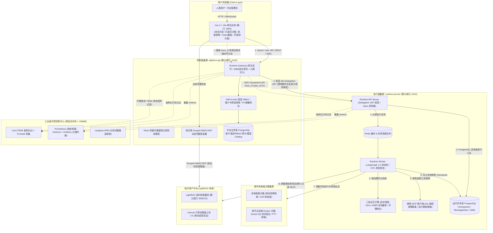

# 系统架构拓扑与进程全景

如果第一次看这个仓库的代码，很容易被各种目录绕晕。其实只要把整套系统当成一个**分工明确的现代化数字工厂**，它的结构就很直观：

- **`platform-web`（前厅接待与工作台）**：前端界面，用户在这里打字聊天、沉浸式操作沙箱 Workspace、查阅 Token 用量与可观测大屏。
- **`platform-api`（控制面中枢与安全防线）**：处理用户登录、双层 RBAC 权限裁决、审计留痕、模型 Catalog 与 BYOK 密文治理、向后签发零信任短时凭证。它绝不下厨炒菜（不装载任何 LangGraph 依赖）。
- **`runtime-service`（智能体执行车间）**：真正调度大模型、驱动 LangGraph 状态图、装配弹性工具/MCP、执行记忆闭环与人机协同（HITL）审批。
- **`knowledge-studio`（原生知识中台）**：结合 LightRAG 图结构，负责多模态知识上传、异步图谱提取（Graph Studio 2.0）、零隧道单向验签与项目级只读 MCP 检索。
- **`observability-stack`（工业级可观测双轨制大盘）**：对标大厂体验，基于 W3C `traceparent` 标准头贯穿微服务，由 Prometheus + Grafana + Loki + Promtail 超轻量矩阵（常驻内存仅 186MB）与 Langfuse 共同提供毫秒级链路穿透。

---

### 全景交互式架构图谱（支持在预览中直接拖拽、高亮、切换主题）

<iframe src="./system-topology-interactive.html" width="100%" height="680px" frameborder="0" style="border: 1px solid #e2e8f0; border-radius: 8px; margin-bottom: 24px;"></iframe>

> 无法加载 iframe 时，也可直接使用浏览器打开查看：[system-topology-interactive.html](system-topology-interactive.html)

---

### 静态拓扑连线与进程依赖（Mermaid 源码视图）

---

## 运行时实际存在的服务与进程清单

当你在本地或生产主机运行平台时，各子系统承担着高度分工的职责：

| 进程 / 服务 | 所在目录 / 容器 | 默认端口 | 核心定位与职责 |
|---|---|---|---|
| **Platform Web** | `apps/platform-web` | `3000` (Vite) | 工业级前端工作台。承接管理后台、流式对话、沉浸式沙箱、轨迹甘特图与日志排障大盘。 |
| **Platform API** | `apps/platform-api` | `2142` (FastAPI) | 平台控制面核心。负责 IAM、双层 RBAC、模型 Catalog 治理、PII 脱敏网关、Token 聚合读模型及受管反向代理。 |
| **Runtime API** | `apps/runtime-service` | `8123` (FastAPI) | 智能体接口接入层。只认 Delegation JWT，负责会话初始化、MessageInbox 咨询锁入队与对外 SSE 推流。 |
| **Runtime Worker** | `apps/runtime-service` | 无外部端口 | 状态机执行工人。消费 Redis 任务，驱动 LangGraph 状态机运转、执行工具调用与异步记忆提取。 |
| **LightRAG Service** | `lightrag-service` | `8000` | 知识检索服务。提供多模态知识图谱解析、单向自治验签与项目级只读检索 MCP。 |
| **Observability 矩阵** | `deploy/docker-compose.observability.yml` | `3100`(Loki) `9090`(Prom) `3001`(Grafana) | 分布式可观测性。Loki + Promtail + Prometheus + Grafana 四容器协同，常驻总内存仅 186.47MB。 |

除了上述计算进程，系统严格采用**三轨物理隔离存储**：
1. **平台业务库（Platform PostgreSQL）**：存放用户表、项目隔离表、双层 RBAC 权限、审计记录、模型配置（BYOK）与 Token 聚合投影。
2. **运行时专库（Runtime PostgreSQL + Redis）**：存放 LangGraph Checkpoints 检查点、MessageInbox 收件箱、Skills 技能包元数据与调度队列。
3. **知识中台专库（LightRAG Storage / Vector / Graph）**：物理隔离存放知识图谱实体、多模态文档解析切片与只读知识索引。

---

## 为什么一定要分成三层？

初学者常问：**为什么不直接让前端连 Runtime，或者干脆把 API 和 Runtime 写在一个 Python 项目里？**

有三个非常实际的原因：

1. **防止前端直接拿到大模型权限**
   如果前端直接调用 Runtime，用户一旦在浏览器抓包，就能拿到底层大模型的调用凭证，甚至能绕过项目权限直接操作数据库。通过 `platform-api` 挡在中间，前端永远只持有普通用户的登录 Cookie/Token，没有任何底层资源的直接权限。

2. **慢任务不能阻塞快业务**
   Agent 跑一个复杂任务（比如写代码、爬网页、查数据）可能需要 30 秒甚至数分钟。如果跟平时的登录、修改用户信息写在一个进程里，一旦几个大模型请求卡住，整个管理后台都跟着打不开。把 Worker 和控制面拆开后，后厨哪怕排大队，前厅照样能秒开。

3. **两套数据完全解耦**
   平台管理关注的是“这个用户属于哪个项目、有什么权限”；Agent 执行关注的是“上一步工具输出了什么、下一步该调哪个函数”。把这两类数据分别存在不同的库里，后续给 Runtime 扩容、清空测试会话或者做集群备份时，不会伤到平台账号数据。

---

## 核心代码入口速查

想亲自去翻代码时，认准这几个入口文件：

- **前端路由与挂载**：`apps/platform-web/src/main.ts` 与 `apps/platform-web/src/router/routes.ts`
- **控制面后端入口**：`apps/platform-api/src/platform_api/main.py`
- **控制面网关代理逻辑**：`apps/platform-api/src/platform_api/modules/runtime_gateway/`
- **运行时服务入口**：`apps/runtime-service/src/runtime_service/webapp.py`
- **本地多进程编排脚本**：`scripts/local-stack.sh`
