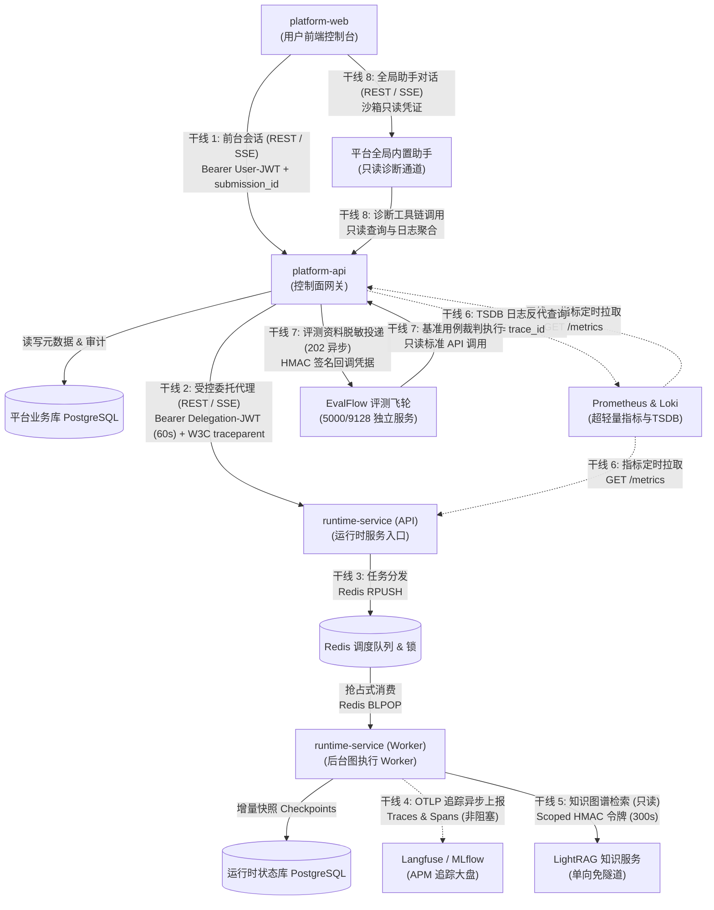
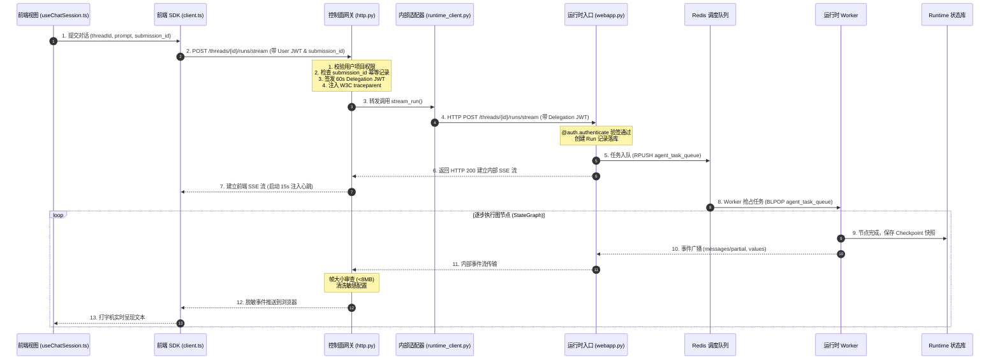
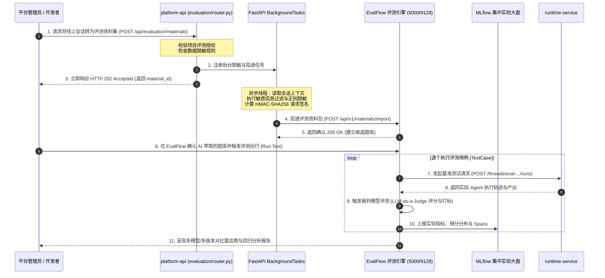

# 02-01 服务间通信全景矩阵深度解密

> **模块定位与核心价值**：建立整套分布式系统的**通信总线契约与调用全景地图**。
> 明确回答在复杂的微服务协同与多智能体执行环境下，各个独立子系统在什么时机、用什么协议、带什么凭证调用谁，彻底杜绝服务间职责混乱、超时配置冲突、凭证越权以及重试引发雪崩的严重架构隐患。
> 本篇作为横切规范（Cross-Cutting）的第一篇，承接 [01-overview/02-tech-stack.md](../01-overview/02-tech-stack.md) 的统一技术选型基线，全面升级为涵盖持续评测飞轮与全局诊断助手的 **8 大骨干通信干线**，并为后文深入解析分布式追踪 [04-trace-and-observability.md](04-trace-and-observability.md) 与各服务内部实现奠定契约依据。

---

## 零、 知识前置与链路上下文（Knowledge Bridges）

在深入阅读各个接口细节前，必须先理清四大底层通信概念，以及整仓通信干线的全局拓扑网络。

### 1. 前置必备概念速查

- **概念 1：为什么存在多种通信协议（HTTP REST vs. SSE vs. Redis List vs. OTLP）？**
  - **HTTP REST**：用于确定性的单次查询与元数据提交（如登录鉴权、拉取助手列表、修改项目配额、评测用例交付），具有强一致性的 HTTP 状态码体系；
  - **SSE（Server-Sent Events）**：用于服务端向客户端的单向流式输出（大模型逐字生成、实时思考状态推送、流式日志下发），基于单 HTTP 长连接，协议开销与穿透防火墙能力远优于双向 WebSocket；
  - **Redis List / PubSub**：用于微服务内部快慢请求的物理隔离与异步解耦。API 毫秒级接单后投递队列即释放 Web 线程，后台 Worker 抢占式消费，实现高并发场景下的削峰填谷；
  - **OTLP（OpenTelemetry Protocol）**：工业级标准遥测数据传输协议，基于 HTTP/Protobuf，用于运行时非阻塞向 Langfuse 或 MLflow 上报高维度的 Agent 执行追踪树（Traces & Spans）。
- **概念 2：业务提交幂等凭据（`submission_id`）**
  - 在移动端或网络不稳定场景下，用户点击一次“发送”，客户端可能因首包网络超时而触发底层的自动重试，发起两次真实的 HTTP POST；
  - 如果服务端接口无状态，会创建两个重复的 Run 并重复扣除模型费用。系统通过在客户端不可变生成 `submission_id`（UUID），配合控制面网关的毫秒级准入去重，彻底阻断重复计费与并发写冲突。
- **概念 3：透明反代与业务网关的本质差别**
  - 普通反向代理（如 Nginx）仅工作在 TCP/HTTP 协议层转发字节流，完全不感知 LLM 业务；
  - 平台的 `runtime_gateway` 是具备深度业务感知的智能网关：负责校验用户项目权限、动态换发内部短时委托凭证（Delegation JWT）、审查 SSE 帧尺寸防撑爆内存（8MB 上限），并在大模型思考静默时定时注入保活心跳（`: heartbeat`）。
- **概念 4：零信任委托凭据（Delegation JWT）与单向验签**
  - 严禁前台用户的长效登录 Token 直接透传至底层的执行引擎；
  - 控制面网关扮演信任中枢：验签前台凭证后，临时签发生存期仅为 **60 秒** 的内部 Delegation JWT，且严格限制其 Project ID 与 Thread 操作范围，即使单次网络拦截也无法用于越权攻击。

### 2. 8 大通信干线全局拓扑



---

## 一、 对立视角：简易原型 vs 生产架构（Naive vs. Production）

### 1. 初学者的常规写法（Naive Demo）
很多初学者搭建 AI Agent 平台时，系统内部通信往往演变成一张混乱的蜘蛛网：
- 前端直接拿到 Runtime 接口地址发请求，绕过控制面；
- 某个 Agent 节点卡死 2 分钟，前端整个界面死锁转圈，刷新页面后输入内容全部丢失；
- 各微服务之间通过配置一个长期固定的全局 `ADMIN_API_KEY` 互相调用，没有任何权限范围、操作粒度或有效生存期限制；
- 评测系统直接连接业务数据库读取用户会话表，甚至把评测任务塞进业务主进程跑，导致数据库连接池被打爆；
- 排查线上故障全靠登录服务器 `tail -f` 翻日志文件，多容器并发下日志完全穿插错乱。

### 2. 生产环境下的致命缺陷
- **安全边界全线沦陷**：前端一旦被恶意脚本攻击或反编译，底层模型调用凭据与内网地址全部泄露；
- **微服务雪崩效应**：当下游大模型响应缓慢时，所有请求堆积在 Web 进程中，数秒内耗尽连接池与内存，导致平台登录与鉴权全面瘫痪；
- **重试风暴与幽灵计费**：网络瞬断时，客户端无脑重试会短时间内发出成百上千次相同请求，引发后台重复建 Run 与灾难性模型账单；
- **评测侵入打死主业务**：线上大促或高峰期，一旦评测任务并发跑几十个 Agent，瞬间吃光机器 IOPS 与算力，正常用户会话被活活拖死。

### 3. 本项目的架构升级与设计取舍（Trade-offs）
- **通信干线严格收敛为 8 条**：严禁出现未受控的私下调用（例如前端绝对不直连 Runtime，Worker 绝对不直连平台业务库，EvalFlow 绝不读取 Agent 源码与业务表）；
- **快慢进程彻底物理隔离**：控制面 API 处理毫秒级管理业务，秒级至分钟级的 Agent 思考任务全部交由 Redis 队列解耦给 Worker 异步执行；
- **零信任动态受控委托**：服务间仅流转生存期 **<= 60 秒** 的短时 Delegation JWT，且严格限制其租户、项目与会话操作边界；
- **全链路分级超时与幂等去重**：各干线设置差异化的超时阈值，并在网关层通过 `submission_id` 实现秒级幂等识别与流式加入（Join Stream）。

---

## 二、 源码精准坐标映射（Code Pointer Map）

以下是当前生产分支 8 条通信干线两端的核心发起与接收代码绝对路径：

| 通信干线 | 核心发起方路径 | 核心接收方路径 | 关键类 / 函数 / 契约 |
|---|---|---|---|
| **干线 1 (Web -> API)<br>前台用户会话** | [client.ts](../../../apps/platform-web/src/services/langgraph/client.ts) | [http.py](../../../apps/platform-api/src/platform_api/modules/runtime_gateway/presentation/http.py) | `LangGraphClient.streamRun()`, `stream_thread_run()`, `X-Submission-Id` |
| **干线 2 (API -> Runtime)<br>内部受控委托代理** | [runtime_client.py](../../../apps/platform-api/src/platform_api/adapters/langgraph/runtime_client.py) | [platform.py](../../../apps/runtime-service/src/runtime_service/auth/platform.py)<br>[webapp.py](../../../apps/runtime-service/src/runtime_service/webapp.py) | `LangGraphRuntimeClient.stream_run()`, `@auth.authenticate`, W3C `traceparent` |
| **干线 3 (Runtime API -> Worker)<br>运行时异步任务调度** | [webapp.py](../../../apps/runtime-service/src/runtime_service/webapp.py) | [runtime/](../../../apps/runtime-service/src/runtime_service/runtime) | `RPUSH agent_task_queue`, `BLPOP`, `ExecutionBudgetMiddleware` |
| **干线 4 (Worker -> APM)<br>运行时 APM 链路追踪** | [observability/](../../../apps/runtime-service/src/runtime_service/observability) | `Langfuse` / `MLflow` 收集器 | `setup_agent_trace()`, OTLP Exporter, `TRACING_PROVIDER` |
| **干线 5 (Worker -> LightRAG)<br>领域知识中台检索** | [knowledge_mcp.py](../../../apps/runtime-service/src/runtime_service/services/mcp/knowledge_mcp.py) | `lightrag-service` (端口 8000) | `ProjectKnowledgeSearchClient`, Scoped HMAC 鉴权 |
| **干线 6 (Prom/Loki <-> 微服务)<br>可观测指标与日志反代** | Prometheus 抓取器 / 前端排障抽屉 | [service.py](../../../apps/platform-api/src/platform_api/modules/observability/service.py)<br>[http.py](../../../apps/platform-api/src/platform_api/modules/runtime_gateway/presentation/http.py) | `ObservabilityService.query_trace_logs()`, `/metrics`, LogQL 防自回声过滤 |
| **干线 7 (API <-> EvalFlow)<br>持续评测飞轮流水线** | [materials.py](../../../apps/platform-api/src/platform_api/modules/evaluation/materials.py)<br>[router.py](../../../apps/platform-api/src/platform_api/modules/evaluation/router.py) | `EvalFlow` 后端 (`5000`) 与 Nginx (`9128`) | `BackgroundTasks` 异步 202 投递、HMAC 回调验签、`targets.py` 执行绑定 |
| **干线 8 (Web Assistant -> API)<br>平台内置助手诊断通道** | [modules/platform-assistant/](../../../apps/platform-web/src/modules/platform-assistant) | [router.py](../../../apps/platform-api/src/platform_api/modules/platform_assistant/router.py)<br>[service.py](../../../apps/platform-api/src/platform_api/modules/platform_assistant/service.py) | `AssistantService.read()`, `diagnostics.py`, 只读沙箱凭证与证据链留存 |

---

## 三、 8 条通信干线权威参数对照矩阵

| 参数维度 | 干线 1（前台业务） | 干线 2（内部受控） | 干线 3（任务调度） | 干线 4（APM 追踪） | 干线 5（知识中台） | 干线 6（可观测双轨） | 干线 7（评测飞轮） | 干线 8（内置助手） |
|---|---|---|---|---|---|---|---|---|
| **调用两端** | `platform-web` -> `platform-api` | `platform-api` -> `runtime-service` | `Runtime API` -> `Runtime Worker` | `runtime-service` -> `Langfuse/MLflow` | `runtime-service` -> `LightRAG` | `Prometheus/Loki` <-> 微服务 | `platform-api` <-> `EvalFlow` | `Web Assistant` -> `API Assistant` |
| **通信协议** | HTTP/1.1 或 H2 (REST / SSE) | 内网 HTTP/1.1 (带 W3C 协议头) | Redis List / PubSub | HTTP REST / OTLP (Protobuf) | 单向 HTTP REST (无反向隧道) | HTTP GET / LogQL | HTTP REST (202 异步 / JSON) | HTTP REST / SSE |
| **认证凭证** | `Bearer User-JWT` | `Bearer Delegation-JWT` (60s) | 内网隔离 / Redis 密码认证 | `Langfuse Key` / `MLflow URI` | `Scoped HMAC/JWT` 凭据 | 内网网络隔离 / 签名代理 | HMAC 签名凭据 + 白名单 | 沙箱只读 Token (绑定用户) |
| **有效生存期** | 1 小时 ~ 7 天 (支持刷新) | **严格 60 秒** (过期即废) | 依赖 Redis Key TTL | 永久链路树归档 | **300 秒** (即用即验) | 指标 15s 抓取 / 日志保留 7 天 | 任务有效期或 24 小时 | 当前会话生命周期 |
| **超时配置** | 检索 10s；流式 600s | 同步 10s；流式透传保持 | Worker 任务最长 600s | 异步非阻塞 (3s 丢弃) | 严格 10.0s (防下游死锁) | 抓取 5s / LogQL 3s | 投递 10s；评测执行按用例 | 诊断 15s；问答流式 120s |
| **重试策略** | 指数退避 (1~15s) 最多 5 次 | 内部不盲目重试，故障抛出 | 依赖 Checkpoint 原地恢复 | 失败静默丢弃 (零侵入业务) | 单会话最多 4 次 (防死循环) | 定时失败标记为 DOWN | 失败重试 3 次 (带退避) | 失败直接反馈友好提示 |
| **幂等机制** | 强制携带 `submission_id` | 透传上游 `submission_id` | 任务 UUID 去重 | 依赖 `trace_id` / `span_id` | 幂等查询 (只读) | 标签去重 | `material_id` / `task_id` 幂等 | `client_msg_id` 会话去重 |
| **防雪崩措施** | 8MB 帧审查 + 心跳注入 | 连接池上限 + 熔断降级 | 队列积压报警 + 丢弃旧任务 | 采样率动态调节 (可降级) | 实体缓存 + 并发阈值硬顶 | 专有只读连接池 + 语句超时 | 202 异步解耦 + 独立数据库 | 只读权限拦截一切写操作 |

---

## 四、 端到端函数级调用时序（Function-Level Trace）

### 1. 前台用户会话端到端执行流（干线 1 -> 2 -> 3）



### 2. 持续评测飞轮 202 异步萃取与跨机裁判时序（干线 7）



---

## 五、 核心实现高保真伪代码（High-Fidelity Pseudocode）

### 1. 前端客户端：携带幂等标识与指数退避重试控制器

```typescript
// 对应真实源码：apps/platform-web/src/services/langgraph/client.ts
interface StreamRunOptions {
  threadId: string;
  assistantId: string;
  input: Record<string, unknown>;
  submissionId: string; // 唯一幂等编号（UUID）
}

async function streamRunWithRetry(options: StreamRunOptions) {
  const retryDelays = [1000, 2000, 4000, 8000, 15000]; // 指数退避间隔（毫秒）
  let attempt = 0;

  while (attempt <= retryDelays.length) {
    try {
      // 提交时始终携带相同的 submissionId，确保重试不会导致服务端重复创建 Run
      return await executeFetchStream({
        url: `/api/v1/threads/${options.threadId}/runs/stream`,
        method: "POST",
        headers: {
          "Content-Type": "application/json",
          "X-Submission-Id": options.submissionId,
        },
        body: JSON.stringify({
          assistant_id: options.assistantId,
          input: options.input,
        }),
      });
    } catch (err: any) {
      // 遇到不可重试的错误（4xx 客户端参数错误、401 鉴权失效、403 无权限）直接抛出
      if (err.status >= 400 && err.status < 500) {
        throw err;
      }

      attempt++;
      if (attempt > retryDelays.length) {
        throw new Error(`连接失败，已达到最大重试次数 (${attempt})`);
      }

      const delay = retryDelays[attempt - 1];
      console.warn(`[Network] SSE 连接异常，将在 ${delay}ms 后进行第 ${attempt} 次重试...`);
      await new Promise((resolve) => setTimeout(resolve, delay));
    }
  }
}
```

### 2. 控制面网关：幂等识别、短时换签与流合并防护

```python
# 对应真实源码：apps/platform-api/src/platform_api/modules/runtime_gateway/presentation/http.py
import time
from fastapi import HTTPException, Request
from platform_api.core.security.tokens import create_runtime_delegation_token


async def handle_stream_submission(
    request: Request, thread_id: str, payload: dict, submission_id: str
):
    # 1. 检查 submission_id 幂等记录
    existing_run = await audit_service.get_run_by_submission_id(submission_id)
    if existing_run:
        if existing_run.is_running:
            # 如果之前的同名提交已经在执行中，绝不重复建 Run，直接加入现有流
            return await join_existing_run_stream(
                thread_id, existing_run.id, request
            )
        else:
            # 已经执行完毕的直接返回终态，防止用户重复刷单计费
            return existing_run.final_output

    # 2. 准入通过，签发严格 60 秒生存期的受控短时 Delegation JWT
    delegation_token = create_runtime_delegation_token(
        subject=request.state.user_id,
        project_id=request.state.project_id,
        scope={"operation": "run-create", "thread_id": thread_id},
        expires_in=60,  # 严格 60s
        secret=settings.runtime_delegation_secret,
    )

    # 3. 构造透传头：注入 W3C traceparent 维持全局分布式追踪
    headers = {
        "Authorization": f"Bearer {delegation_token}",
        "traceparent": request.state.traceparent,
    }

    # 4. 通过反向代理打到运行时接口
    return await upstream_runtime_client.post_stream(
        path=f"/threads/{thread_id}/runs/stream",
        headers=headers,
        body=payload,
    )
```

### 3. 评测资料 202 异步非阻塞物化投递与 HMAC 签名

```python
# 对应真实源码：apps/platform-api/src/platform_api/modules/evaluation/materials.py
import hashlib
import hmac
import json
import httpx
from fastapi import BackgroundTasks


async def submit_evaluation_materials(
    session_id: str,
    project_id: str,
    actor_id: str,
    background_tasks: BackgroundTasks,
):
    # 1. 快速校验权限并生成物化任务编号
    material_id = f"mat-{uuid4().hex[:12]}"

    # 2. 注册后台处理任务，绝不在主请求阻塞用户
    background_tasks.add_task(
        _async_extract_and_dispatch,
        material_id=material_id,
        session_id=session_id,
        project_id=project_id,
    )

    # 3. 立即响应 202 Accepted
    return {
        "status": "accepted",
        "material_id": material_id,
        "message": "评测资料抽取任务已投递后台处理",
    }


async def _async_extract_and_dispatch(
    material_id: str, session_id: str, project_id: str
):
    # a. 读取会话历史并执行数据脱敏（过滤手机号、密码、私钥）
    sanitized_messages = await extract_and_sanitize_session(session_id)

    # b. 组装评测物化报文并计算 HMAC 签名
    payload = {
        "material_id": material_id,
        "project_id": project_id,
        "session_id": session_id,
        "messages": sanitized_messages,
        "timestamp": int(time.time()),
    }
    body_bytes = json.dumps(payload, sort_keys=True).encode("utf-8")
    signature = hmac.new(
        settings.evalflow_shared_secret.encode("utf-8"),
        body_bytes,
        hashlib.sha256,
    ).hexdigest()

    # c. 投递给独立的 EvalFlow 服务
    async with httpx.AsyncClient(timeout=10.0) as client:
        await client.post(
            f"{settings.evalflow_url}/api/v1/materials/import",
            content=body_bytes,
            headers={
                "Content-Type": "application/json",
                "X-Signature-SHA256": signature,
            },
        )
```

---

## 六、 假想断电与极限场景推演（Thought Experiments）

### 场景 1：用户网络抖动，在 1 秒内连续狂点 5 次“发送”按钮
- **简易系统表现**：后端连续收到 5 个并发请求，数据库插入 5 个 Run，大模型收到 5 份相同提示词开始并发生成，平台白白扣除 5 份模型费用，前端界面收到 5 股互相打架的文字发生严重显示穿帮。
- **本系统表现**：
  1. 前端在点击第一下时生成唯一 `submission_id`，之后的 4 次重击由于绑定同一个输入框动作，携带完全一致的 `submission_id`；
  2. 控制面网关在收到第 1 个包时抢占锁并建立 Run 记录；
  3. 第 2 到第 5 个并发包到达网关时，检测到该 `submission_id` 已经在运行中，网关直接返回已存在的流式订阅句柄（Join Stream）；
  4. 后台 Worker 始终只有 1 个任务在跑，数据库状态单一有序，零额外模型计费。

### 场景 2：大模型进行深度推理（Reasoning），静默思考长达 50 秒不出字
- **简易系统表现**：前端在 45 秒时触发浏览器原生的 HTTP 读超时（ERR_HTTP_TIMEOUT），长连接中断，前端误报“服务已崩溃”，用户重试重新扣费。
- **本系统表现**：
  1. 控制面网关与内部客户端启动了心跳定时器；
  2. 每当内部长连接静默超过 15 秒，网关自动向下游注入一段空白的 SSE 注释帧（`: heartbeat\n\n`）；
  3. 浏览器与各类中间代理（如 Nginx、CDN）接收到有效字节，成功重置闲置计时器，长连接持续保持保活；
  4. 模型一旦思考完毕开始吐字，真实业务数据流平滑推送，用户无感。

### 场景 3：EvalFlow 发起对线上 Agent 的百题并发自动化基准压测
- **简易系统表现**：如果评测与主业务共用数据库和线程池，瞬时并发的测试请求直接挤爆数据库连接池，线上真实用户无法登录、无法创建会话，主站宕机。
- **本系统表现**：
  1. EvalFlow 部署在独立端口（`5000/9128`）并拥有独立的数据存储与 MLflow 追踪实例，绝不侵占主业务数据库连接池；
  2. 评测请求通过标准 API 访问，受项目配额与限流中间件（Rate Limiter）约束；
  3. 即使评测触发大量 Agent 运行，任务全部进入 Redis 队列排队，Worker 按照固定并发量平稳消费，主业务网关依然保持毫秒级响应。

---

## 七、 架构不变量清单（Architectural Invariants）

任何后续的二次开发、功能增补与代码重构，**绝不允许打破以下四条架构红线**：

1. **调用流向严格单向，绝不允许跨层私通**：
   - 前端绝对不直接暴露并访问 Runtime 端口；
   - 控制面绝对不把前台长效 User JWT 透传给底层执行引擎；
   - 后台 Worker 绝对不直连平台业务数据库（Platform DB）；
   - 评测系统（EvalFlow）绝对不直接读取 Agent 源码或共享 Python 虚拟环境。
2. **所有长任务创建必须强制绑定 `submission_id`**：
   - 发起 Run 的接口必须具备幂等识别凭据，严禁设计无幂等保护的盲目提交接口。
3. **干线 2 的委托凭证生存期不得超过 60 秒**：
   - 服务间委托凭证绝不允许被硬编码为永久 Token，必须动态计算 `now + 60`，从源头消灭内部凭证泄露隐患。
4. **评测与诊断渠道只能使用受限只读凭据**：
   - EvalFlow 与内置全局助手的后端调用，只能使用显式授权的只读诊断凭证，严禁授予写权限或直接修改业务元数据。
