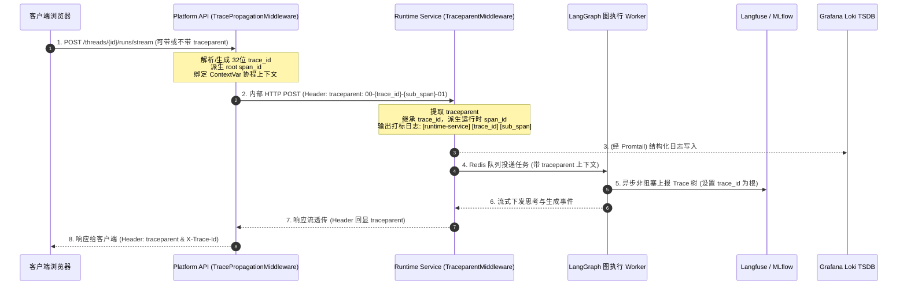
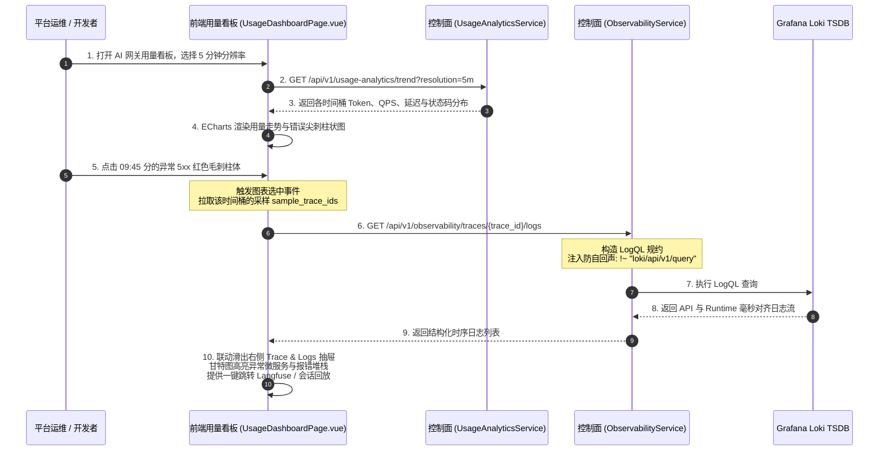

# 02-04 分布式全链路追踪与工业级可观测性体系深度解密

> **模块定位与核心价值**：建立整套系统的**分布式链路追踪、结构化日志关联、双轨 APM 与 AI 网关毫秒级下钻大盘**。
> 全面落实 W3C `traceparent`（`00-{trace_id}-{span_id}-01`）标准协议在跨微服务（Web -> API -> Runtime -> Worker）间的透明传导与派生；全链路实现 `[service] [trace_id] [span_id]` 结构化日志打标；基于 Grafana Loki + Promtail 建立超轻量微服务日志中心（4 容器常驻内存仅约 186 MiB）；彻底淘汰脆弱的“Grafana iframe 嵌板”，实装基于 **Vue 3 + ECharts 自研的 AI 网关用量与可观测大盘**，实现从“时序图表异常毛刺”到“毫秒级微服务对齐日志与 Trace 抽屉”的精细化下钻闭环。
> 本篇作为横切规范的核心篇章，承接 [01-communication-matrix.md](file:///Users/lijiaxin/PyCharmMiscProject/ai-agent-platform/docs/architecture/02-cross-cutting/01-communication-matrix.md) 确立的 8 大通信干线规范，并为后续展开控制面 Token 用量读模型 [04-platform-api/05-token-usage-and-read-models.md](file:///Users/lijiaxin/PyCharmMiscProject/ai-agent-platform/docs/architecture/04-platform-api/05-token-usage-and-read-models.md) 与场景回放奠定可观测基石。

---

## 零、 知识前置与链路上下文（Knowledge Bridges）

在深入阅读具体追踪代码前，必须掌握四大底层可观测性概念，以及追踪数据在全系统链路中的流动拓扑。

### 1. 前置必备概念速查

- **概念 1：W3C Trace Context（`traceparent`）标准规范**
  - 工业级分布式追踪标准定义了 4 段由连字符组成的 Header：`version-trace_id-parent_id-trace_flags`；
  - 标准格式示例：`00-4bf92f3577b34da6a3ce929d0e0e4736-00f067aa0ba902b7-01`；
  - `version`：固定为 `00`；`trace_id`：32 位小写十六进制全局唯一标识；`span_id`（parent_id）：16 位小写十六进制当前服务节点跨度标识；`trace_flags`：`01` 表示被采样。
  - **跨服务派生规约**：请求从 Platform API 转发至 Runtime Service 时，保持全局 `trace_id` 绝对不变，基于当前跨度生成新的 `span_id` 作为下游的 parent，从而在无侵入状态下构建出严谨的树状调用拓扑。
- **概念 2：可观测性三轨制（Prometheus 指标 + Loki 日志 + Langfuse/MLflow APM）**
  - **Metrics 轨（Prometheus）**：负责定量监控系统整体 QPS、HTTP 状态码分布、错误率与 P95/P99 延迟分位，向外暴露标准化 `/metrics` 端点；
  - **Logs 轨（Grafana Loki + Promtail）**：不建笨重的全文倒排索引，专对结构化标签（`service`、`trace_id`）做轻量 TSDB 索引，专职跨微服务毫秒级日志时序对齐；
  - **APM 追踪轨（Langfuse & MLflow 双轨可插拔）**：
    - 通用线上业务：通过 OTLP 异步上报至 Langfuse，展示 Prompt 提示词快照、Token 真实计费与复合智能体执行树；
    - 持续评测飞轮：接入集中式 MLflow 追踪服务（`5000`），管理大批量 TestCase 裁判打分、版本对比与指标雷达图。
- **概念 3：Python 异步协程中的 `ContextVar` 安全隔离**
  - 在 FastAPI / Starlette 异步事件循环中，单线程内会有海量协程并发交替执行。使用普通的线程局部变量（`threading.local`）会引发致命的跨请求数据串号！必须使用 `contextvars.ContextVar` 存储当前协程生命周期内的 Trace ID 与 Span ID，确保协程并发零污染。
- **概念 4：Loki TSDB 查询防自回声排除机制（Anti-Self-Echo）**
  - 当平台控制面通过反向代理查询 Loki 时，查询请求本身也会产生日志；如果 Promtail 抓取了这条“查询日志”并再次写入 Loki，下一次查询又会查出上次的查询流水，导致日志系统产生**指数级自引用死循环**。
  - 系统在查询引擎中显式注入排除规则：`!~ "loki/api/v1/query"`，从源头消灭自回声雪崩。

### 2. 全链路可观测性数据流动拓扑

```mermaid
flowchart TD
    subgraph ClientLayer ["用户端与前端控制台"]
        Web["Vue 3 控制台"]
        ECharts["自研 ECharts AI网关用量看板\n(1m/5m/1h/1d 分辨率)"]
        Drawer["Trace & Logs 毫秒级深钻抽屉"]
    end

    subgraph GatewayLayer ["控制面网关 (platform-api)"]
        TraceIn["TracePropagationMiddleware\n(生成/提取 traceparent)"]
        LogFormat1["StructuredLogFormatter\n([platform-api] [trace_id] [span_id])"]
        UsageModule["UsageAnalyticsService\n(Token 读模型与时序聚合)"]
        LokiProxy["ObservabilityService\n(防自回声 LogQL 代理)"]
    end

    subgraph RuntimeLayer ["执行引擎 (runtime-service)"]
        TraceOut["TraceparentMiddleware\n(派生子 Span，注入 ContextVar)"]
        LogFormat2["StructuredLogFormatter\n([runtime-service] [trace_id] [sub_span])"]
        MLflowTrack["MLflowTracer / LangfuseExporter\n(TRACING_PROVIDER 双轨上报)"]
    end

    subgraph StorageLayer ["超轻量可观测基座 (常驻 ~186MB)"]
        Promtail["Promtail 采集器\n(正则提取 service/trace_id 标签)"]
        Loki[(Grafana Loki TSDB)]
        Prom[(Prometheus 时序库)]
        MLflowDB[(MLflow / Langfuse 实验树)]
    end

    %% 数据流向
    Web -->|"1. HTTP 请求 (带/不带 traceparent)"| TraceIn
    TraceIn -->|"2. 注入 ContextVar & 派生 Header"| TraceOut
    TraceIn -.-> LogFormat1
    TraceOut -.-> LogFormat2

    LogFormat1 & LogFormat2 -->|"3. 控制台日志打标输出"| Promtail
    Promtail -->|"4. 结构化标签推入"| Loki

    TraceOut -->|"5. 异步非阻塞上报 Traces"| MLflowTrack
    MLflowTrack -->|"6. OTLP / REST"| MLflowDB

    %% 观测与深钻闭环
    Prom -.->|"定时抓取 /metrics"| TraceIn & TraceOut
    ECharts -->|"7. 查询用量趋势与分位耗时"| UsageModule
    ECharts -.->|"8. 命中异常毛刺 (点击柱状图)"| Drawer
    Drawer -->|"9. 携带 trace_id 穿透反查"| LokiProxy
    LokiProxy -->|"10. LogQL |= trace_id !~ query"| Loki
    LokiProxy -->>|"11. 毫秒对齐微服务流水"| Drawer
```

---

## 一、 对立视角：简易原型 vs 生产架构（Naive vs. Production）

### 1. 初学者的常规写法（Naive Demo）
很多初学者做 Agent 平台时，可观测体系通常极度简陋：
```python
# 简易日志记录（存在严重生产隐患）
@app.middleware("http")
async def naive_logging(request: Request, call_next):
    # 盲目信任客户端伪造的私有 Header，无采样控制，无跨度派生
    trace_id = request.headers.get("X-Trace-Id", str(uuid.uuid4()))
    logger.info(f"[{trace_id}] 开始处理请求: {request.url.path}")
    response = await call_next(request)
    return response
```
前端展示用量和日志时，要么直接在网页里内嵌一个 Grafana 仪表盘 iframe，要么让开发人员登录机器手动 `grep` 日志文件。

### 2. 生产环境下的致命缺陷
- **非标准私有 Header 导致全生态割裂**：使用自定义 `X-Trace-Id` 无法被业界标准 APM 工具（OTel、Jaeger、W3C 兼容中间件）识别，下游微服务无法构建父子 Span 调用树；
- **重型组件吞噬生产资源**：动辄盲目部署 ELK（Elasticsearch + Logstash），常驻内存直接吃掉 8GB~16GB，对中轻量级部署是毁灭性打击；
- **Loki 自回声死锁风暴**：平台代理查询 Loki 日志时，若代理接口自身也打印日志并被 Promtail 抓取，会导致每次查询都产生一条新的匹配日志，引发无限递归查询雪崩；
- **Grafana iframe 嵌板的体验灾难**：
  - **跨域鉴权泥潭**：Grafana 的 RBAC 租户权限与业务系统割裂，Cookie 跨域与反向代理极其脆弱；
  - **深浅色主题断层**：无法与宿主前端 Tailwind 主题同步，深浅模式切换时白屏刺眼；
  - **无法形成毫秒下钻闭环**：iframe 内部是黑盒，用户在图表上看到一个 5xx 尖刺，**根本无法一键联动弹出右侧抽屉拉取关联的微服务对齐日志与会话回放**！

### 3. 本项目的架构升级与设计取舍（Trade-offs）
- **全面落实 W3C `traceparent` 标准协议**：严格遵循 `00-{trace_id}-{span_id}-01` 规约，网关进站统一校验/生成，微服务出站自动派生子跨度，HTTP 响应头双向回显；
- **超轻量 186MB 四容器矩阵**：Promtail + Loki + Prometheus + Grafana，对元数据标签建立 TSDB 索引，实测生产常驻总内存仅 **186.47 MiB**（CPU < 1%）；
- **阻断 Loki 自回声日志污染**：在 API 网关代理查询 Loki 端点时，显式配置 `!~ "loki/api/v1/query"` 排除规则，彻底根除自引用死锁；
- **APM 追踪双轨热插拔（`TRACING_PROVIDER`）**：原生支持通用业务追踪（Langfuse）与持续评测飞轮集中实验追踪（MLflow），环境变量一键切换；
- **Vue 3 + ECharts 自研 AI 网关用量看板**：彻底废弃 iframe 方案，原生实现 1m/5m/1h/1d 分辨率聚合、状态码分布与分位耗时，**实现“点击异常柱体 -> 秒级弹出右侧抽屉 -> 穿透查询微服务对齐日志”的教科书级可观测闭环**。

---

## 二、 源码精准坐标映射（Code Pointer Map）

以下是当前生产分支分布式追踪与可观测系统的真实代码绝对路径：

| 模块职责 | 核心代码绝对路径 | 关键类 / 函数 / 变量 |
|---|---|---|
| **W3C 追踪中间件 (Platform-API)** | [observability.py](file:///Users/lijiaxin/PyCharmMiscProject/ai-agent-platform/apps/platform-api/src/platform_api/core/observability.py) | `TracePropagationMiddleware`, `current_trace_id_ctx`, `current_span_id_ctx` |
| **W3C 追踪中间件 (Runtime-Service)**| [trace.py](file:///Users/lijiaxin/PyCharmMiscProject/ai-agent-platform/apps/runtime-service/src/runtime_service/api/middleware/trace.py) | `TraceparentMiddleware`, 继承 Trace 并派生下游子 Span |
| **结构化日志格式化器** | [logging.py (API)](file:///Users/lijiaxin/PyCharmMiscProject/ai-agent-platform/apps/platform-api/src/platform_api/core/logging.py)<br>[logging.py (Runtime)](file:///Users/lijiaxin/PyCharmMiscProject/ai-agent-platform/apps/runtime-service/src/runtime_service/logging.py) | `StructuredLogFormatter`, 注入 `[service] [trace_id] [span_id]` 统一前缀 |
| **Prometheus 监控指标暴露** | [metrics.py (API)](file:///Users/lijiaxin/PyCharmMiscProject/ai-agent-platform/apps/platform-api/src/platform_api/core/metrics.py)<br>[metrics.py (Runtime)](file:///Users/lijiaxin/PyCharmMiscProject/ai-agent-platform/apps/runtime-service/src/runtime_service/api/metrics.py) | `/metrics` 路由端点, 路径归一化 `normalize_metric_path` |
| **Loki 排障代理与自回声阻断** | [service.py](file:///Users/lijiaxin/PyCharmMiscProject/ai-agent-platform/apps/platform-api/src/platform_api/modules/observability/service.py) | `ObservabilityService.query_trace_logs()`, 过滤规则 `!~ "loki/api/v1/query"` |
| **MLflow 集中实验追踪适配器** | [mlflow_tracer.py](file:///Users/lijiaxin/PyCharmMiscProject/ai-agent-platform/apps/runtime-service/src/runtime_service/observability/mlflow_tracer.py) | `MLflowTracer`, 管理评测 Runs、Parameters、Metrics 与 Artifacts |
| **Langfuse APM 追踪适配器** | [langfuse.py](file:///Users/lijiaxin/PyCharmMiscProject/ai-agent-platform/apps/runtime-service/src/runtime_service/observability/langfuse.py) | `setup_agent_trace()`, OTLP 异步非阻塞上报 |
| **AI 网关用量时序读模型后端** | [service.py](file:///Users/lijiaxin/PyCharmMiscProject/ai-agent-platform/apps/platform-api/src/platform_api/modules/usage_analytics/service.py)<br>[router.py](file:///Users/lijiaxin/PyCharmMiscProject/ai-agent-platform/apps/platform-api/src/platform_api/modules/usage_analytics/router.py) | `UsageAnalyticsService.get_usage_trend()`, 1m/5m/1h/1d 分辨率聚合 |
| **前端自研 AI 网关用量看板** | [UsageDashboardPage.vue](file:///Users/lijiaxin/PyCharmMiscProject/ai-agent-platform/apps/platform-web/src/modules/usage/pages/UsageDashboardPage.vue)<br>[GatewayUsageTab.vue](file:///Users/lijiaxin/PyCharmMiscProject/ai-agent-platform/apps/platform-web/src/modules/usage/components/GatewayUsageTab.vue) | Vue 3 + ECharts 原生大盘，多分辨率切换、状态码过滤、图表毛刺点击下钻 |
| **前端 Trace-to-Logs 诊断穿透抽屉**| [GatewayLogsTable.vue](file:///Users/lijiaxin/PyCharmMiscProject/ai-agent-platform/apps/platform-web/src/modules/usage/components/GatewayLogsTable.vue) | 毫秒级日志流水瀑布流、跨微服务时序对齐甘特图、异常高亮与脱敏排障包导出 |
| **前端有界错误缓冲区** | [errorBuffer.ts](file:///Users/lijiaxin/PyCharmMiscProject/ai-agent-platform/apps/platform-web/src/core/errors/errorBuffer.ts) | `ErrorRingBuffer(capacity=10)`, 全局 ErrorBoundary 防白屏守护 |

---

## 三、 真实数据结构与报文（Real Payloads & DB Schemas）

### 1. W3C `traceparent` 标准格式与跨服务派生规约

```text
HTTP/1.1 200 OK
traceparent: 00-4bf92f3577b34da6a3ce929d0e0e4736-00f067aa0ba902b7-01
X-Trace-Id: 4bf92f3577b34da6a3ce929d0e0e4736
X-Request-Id: 4bf92f3577b34da6a3ce929d0e0e4736
```

- **微服务跨度派生规约**：
  1. `Platform API` 收到请求：若无 Header 则自动生成全局 `trace_id = 4bf92f3577b34da6a3ce929d0e0e4736`（32 位小写十六进制），生成当前根 `span_id = a1b2c3d4e5f60718`（16 位小写十六进制）；
  2. `Platform API` 转发请求给 `Runtime Service`：在 HTTP Header 中注入派生跨度：`traceparent: 00-4bf92f3577b34da6a3ce929d0e0e4736-a1b2c3d4e5f60718-01`；
  3. `Runtime Service` 解析后：继承相同的 `trace_id`，生成下游执行跨度 `span_id = 9988776655443322`，并以 `a1b2c3d4e5f60718` 为父节点，完成链路树状关联。

### 2. 结构化标准日志打标格式与 Promtail 正则流水线

```text
2026-11-19 10:15:30.123 [INFO] [platform-api] [4bf92f3577b34da6a3ce929d0e0e4736] [a1b2c3d4e5f60718] POST /api/v1/threads/th_987/runs/stream - 200 OK - 15ms
2026-11-19 10:15:30.145 [INFO] [runtime-service] [4bf92f3577b34da6a3ce929d0e0e4736] [9988776655443322] LangGraph Worker executing node: model_reasoning
```

Promtail 正则流水线解析配置：
```yaml
# Promtail 抓取与标签提取规约
scrape_configs:
  - job_name: aiplatform-microservices
    static_configs:
      - targets: [localhost]
        labels:
          env: production
    pipeline_stages:
      - regex:
          expression: '^(?P<time>\S+ \S+) \[(?P<level>\w+)\] \[(?P<service>[^\]]+)\] \[(?P<trace_id>[a-f0-9]{32})\] \[(?P<span_id>[a-f0-9]{16})\] (?P<message>.*)$'
      - labels:
          level:
          service:
          trace_id:
          span_id:
```

### 3. Loki 真实 LogQL 查询与防自回声排除报文

平台控制面查询指定链路日志时的真实调用：
```http
GET /loki/api/v1/query_range?query={job=~"systemd-journal|app-file-logs"} |= "4bf92f3577b34da6a3ce929d0e0e4736" !~ "loki/api/v1/query"&start=1763518530000000000&end=1763522130000000000 HTTP/1.1
Host: 127.0.0.1:3100
Accept: application/json
```
- **核心语法剖析**：
  - `{job=~"systemd-journal|app-file-logs"}`：在系统日志或文件日志的流选择器中过滤；
  - `|= "4bf92f35..."`：行过滤（Line Filter），仅提取包含目标 32 位 `trace_id` 的记录；
  - `!~ "loki/api/v1/query"`：**防自回声正则否定匹配**，彻底剔除查询请求自身在网关产生的代理流水。

### 4. AI 网关用量分析时序聚合报文（Usage Trend Payload）

前端向控制面拉取时序大盘数据的标准报文：
```json
{
  "project_id": "proj-default",
  "resolution": "5m",
  "start_time": "2026-11-19T00:00:00Z",
  "end_time": "2026-11-19T10:00:00Z",
  "series": [
    {
      "timestamp": "2026-11-19T09:45:00Z",
      "total_requests": 1420,
      "success_requests": 1412,
      "failed_requests": 8,
      "input_tokens": 854000,
      "output_tokens": 128500,
      "latency_p50_ms": 185.4,
      "latency_p90_ms": 420.1,
      "latency_p99_ms": 1240.8,
      "status_codes": {
        "200": 1412,
        "429": 5,
        "500": 3
      },
      "sample_trace_ids": [
        "4bf92f3577b34da6a3ce929d0e0e4736",
        "8ca12e4412ab34cd56ef780123456789"
      ]
    }
  ]
}
```

---

## 四、 端到端函数级调用时序（Function-Level Trace）

### 1. 全链路追踪透传与双轨 APM 上报时序



### 2. AI 网关大盘时序毛刺到毫秒日志与 Trace 抽屉深钻闭环



---

## 五、 核心实现高保真伪代码（High-Fidelity Pseudocode）

### 1. W3C `traceparent` 解析、生成与跨协程派生中间件

```python
# 对应真实源码：apps/platform-api/src/platform_api/core/observability.py
import contextvars
import re
import secrets
from starlette.middleware.base import BaseHTTPMiddleware
from starlette.requests import Request
from starlette.responses import Response

current_trace_id_ctx = contextvars.ContextVar(
    "current_trace_id_ctx", default=None
)
current_span_id_ctx = contextvars.ContextVar(
    "current_span_id_ctx", default=None
)

TRACEPARENT_REGEX = re.compile(r"^00-([a-f0-9]{32})-([a-f0-9]{16})-[a-f0-9]{2}$")


class W3CTraceMiddleware(BaseHTTPMiddleware):

    async def dispatch(self, request: Request, call_next) -> Response:
        traceparent = request.headers.get("traceparent")
        if traceparent and (match := TRACEPARENT_REGEX.match(traceparent)):
            trace_id = match.group(1)
            parent_span_id = match.group(2)
        else:
            trace_id = secrets.token_hex(16)  # 生成 32 位十六进制全局链路 ID
            parent_span_id = None

        # 为当前服务节点派生唯一的 16 位 Span ID
        current_span_id = secrets.token_hex(8)

        # 写入协程安全上下文（ContextVar）
        t_token = current_trace_id_ctx.set(trace_id)
        s_token = current_span_id_ctx.set(current_span_id)

        request.state.trace_id = trace_id
        request.state.span_id = current_span_id
        request.state.parent_span_id = parent_span_id

        # 构造向下游派生的 traceparent
        request.state.downstream_traceparent = (
            f"00-{trace_id}-{current_span_id}-01"
        )

        try:
            response: Response = await call_next(request)
            # 在响应头回显标准 W3C 头与兼容追踪头
            response.headers["traceparent"] = (
                request.state.downstream_traceparent
            )
            response.headers["X-Trace-Id"] = trace_id
            response.headers["X-Request-Id"] = trace_id
            return response
        finally:
            current_trace_id_ctx.reset(t_token)
            current_span_id_ctx.reset(s_token)
```

### 2. 防自回声污染的 Loki LogQL 代理查询引擎

```python
# 对应真实源码：apps/platform-api/src/platform_api/modules/observability/service.py
import httpx
from platform_api.config import Settings


class ObservabilityService:

    def __init__(self, settings: Settings):
        self._settings = settings

    async def query_trace_logs(
        self, trace_id: str, limit: int = 200
    ) -> dict[str, any]:
        loki_url = self._settings.loki_url.rstrip("/")

        # 核心防自回声语法：否定匹配查询端点自身，绝不让查询日志自我放大
        logql = (
            f'{{job=~"systemd-journal|app-file-logs"}} '
            f'|= "{trace_id}" '
            f'!~ "loki/api/v1/query"'
        )

        endpoint = f"{loki_url}/loki/api/v1/query_range"
        params = {
            "query": logql,
            "limit": limit,
            "direction": "FORWARD",  # 时序正序对齐
        }

        async with httpx.AsyncClient() as client:
            try:
                resp = await client.get(
                    endpoint,
                    params=params,
                    timeout=self._settings.loki_timeout_seconds,
                )
                if resp.status_code != 200:
                    return {"status": "error", "logs": [], "error": resp.text}

                # 解析 Loki 统一 JSON 结构并格式化为前端甘特流水
                data = resp.json()
                parsed_logs = self._parse_loki_streams(data)
                return {"status": "success", "logs": parsed_logs}
            except httpx.RequestError as exc:
                return {
                    "status": "unavailable",
                    "logs": [],
                    "error": str(exc),
                }
```

### 3. 前端 ECharts 时序毛刺点击联动 Trace/Logs 抽屉控制器

```typescript
// 对应真实源码：apps/platform-web/src/modules/usage/components/GatewayUsageTab.vue
import * as echarts from 'echarts'
import { ref } from 'vue'

const isDrawerOpen = ref(false)
const selectedTraceId = ref('')
const activeLogs = ref<any[]>([])

function initUsageChart(chartDom: HTMLElement, trendData: any[]) {
  const chart = echarts.init(chartDom)

  chart.setOption({
    xAxis: { type: 'category', data: trendData.map(d => d.timestamp) },
    yAxis: [{ type: 'value', name: 'Tokens' }, { type: 'value', name: 'Errors' }],
    series: [
      { name: 'Total Tokens', type: 'line', data: trendData.map(d => d.total_tokens) },
      { name: 'Failed Requests', type: 'bar', yAxisIndex: 1, data: trendData.map(d => d.failed_requests) }
    ]
  })

  // 关键事件：点击图表柱体实现毫秒深钻
  chart.on('click', async (params: any) => {
    const bucket = trendData[params.dataIndex]
    if (bucket && bucket.sample_trace_ids && bucket.sample_trace_ids.length > 0) {
      selectedTraceId.value = bucket.sample_trace_ids[0]
      isDrawerOpen.value = true

      // 携带选中的 trace_id 穿透拉取跨微服务对齐日志瀑布流
      activeLogs.value = await fetchTraceLogs(selectedTraceId.value)
    }
  })
}
```

---

## 六、 假想断电与极限场景推演（Thought Experiments）

### 场景 1：Loki 代理查询自身日志引发的“自回声无限死锁雪崩”
- **简易系统表现**：控制台每次执行查询，网关都会生成一条包含 `trace_id` 的查询访问日志；Promtail 采集后推入 Loki；下一次用户刷新页面时，返回的数据中多了一条上次查询的记录，导致日志量以指数级 $2^N$ 速度爆炸，磁盘几分钟被垃圾查询日志填满。
- **本系统表现**：
  1. 控制面在调用 Loki API 时，严格使用 `!~ "loki/api/v1/query"` 规则；
  2. Promtail 哪怕收集到了网关访问 Loki 的日志行，Loki 查询引擎在做文本匹配时也会被强制丢弃该行；
  3. 控制台仅渲染真实的微服务业务日志，自回声死锁被永久阻断在查询算子之外。

### 场景 2：APM 收集器（Langfuse 或 MLflow）突发故障宕机
- **简易系统表现**：如果运行时服务使用同步阻塞式 HTTP 请求上报追踪数据，一旦 APM 收集器挂掉，所有正在运行的 Agent 任务全部在工具调用后卡死 30 秒超时，导致用户前台所有对话全面失败。
- **本系统表现**：
  1. `setup_agent_trace` 与 OTLP Exporter 采用完全异步非阻塞的后台队列；
  2. 上报请求设置严格的 **3 秒超时**；
  3. 一旦探测到网络不通或 HTTP 500，静默丢弃遥测数据帧并记录轻量告警，**智能体的主流程图执行与流式推送绝不发生中断**，业务高可用坚如磐石。

### 场景 3：突发 500 报警与线上事故应急排查
- **简易系统表现**：运维收到报警，登录云服务器，面对多台机器的多个 Docker 容器，不知道该翻哪个日志文件；由于并发请求密集，几千行日志混杂在一起，很难把前台一个报错与后台具体哪个大模型调用或哪个 SQL 挂掉关联起来。
- **本系统表现**：
  1. 报警或用户反馈自带前端回显的 `X-Trace-Id`（如 `4bf92f35...`）；
  2. 运维在 AI 网关大盘中输入该 ID，或直接在 ECharts 异常毛刺柱体上一键点击；
  3. 系统在 50 毫秒内直出 `platform-api` 接收请求、验签换签、转发 `runtime-service`、分发 Worker、执行模型节点并抛出异常的**完整微服务毫秒对齐甘特流**；
  4. 故障原因（如大模型 API 欠费返回 402、或工具沙箱缺少依赖）一目了然，定位时间从小时级骤降至秒级。

---

## 七、 架构不变量清单（Architectural Invariants）

任何后续的二次开发与架构演进，**绝不允许打破以下四条核心红线**：

1. **必须严格遵循 W3C `traceparent` 标准格式规范**：
   - 全链路微服务通信跨度必须使用 `00-{trace_id}-{span_id}-01` 标准格式，微服务之间向下游调用必须派生新的子 `span_id`，严禁退回私有自定义非标准 Header。
2. **Prometheus 与 Loki 保持极简轻量，常驻内存增量控制在 250MB 以内**：
   - 严禁在日志中引入全文字段倒排索引（禁止倒退回重型 ES/ELK）；严禁在微服务中开启高开销的侵入式字节码探针；坚决守护四容器 186MB 的超轻量底座。
3. **严格执行 Loki 防自回声日志过滤规则**：
   - 网关在代理执行 LogQL 查询时，必须将自身查询路径 `loki/api/v1/query` 排除在匹配结果之外，严禁形成递归日志风暴。
4. **前端错误绝对不允许导致应用白屏崩溃**：
   - 所有核心视图必须受全局 `ErrorBoundary` 保护，未捕获异常必须进入有界环形缓冲区（`ErrorRingBuffer(capacity=10)`），并提供就地可导出的脱敏排障包。
5. **AI 网关大盘必须保持原生自研与毫秒下钻闭环**：
   - 坚决杜绝倒退回用 iframe 嵌入通用 Grafana 看板的反模式；图表组件必须与平台的 `trace_id` 及 Loki 日志抽屉深度绑定，保障极致的下钻排障体验。
