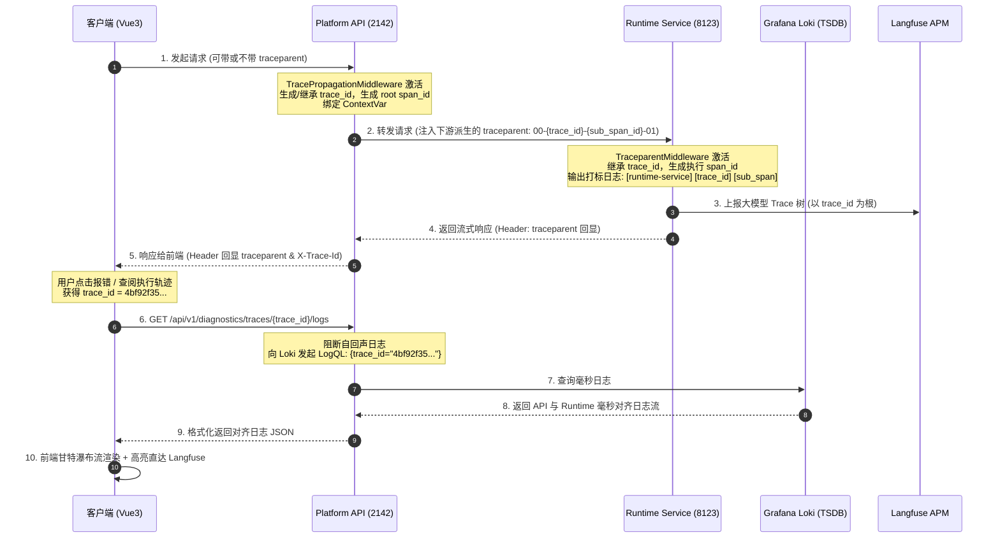

# 02-04 分布式全链路追踪与工业级可观测性体系深度解密

> **模块定位与核心价值**：建立整套系统的**分布式链路追踪、结构化日志关联与指标监控双轨制体系**。
> 全面落实 W3C `traceparent`（`00-{trace_id}-{span_id}-01`）标准协议跨微服务传导与结构化日志 `[service] [trace_id] [span_id]` 打标；基于 Grafana Loki + Promtail 建立超轻量微服务日志中心（生产 4 容器常驻内存仅 186.47MB）；在前端实装可观测诊断中心与 Explore 联动，实现凭单一 `trace_id` 毫秒级穿透展示跨服务对齐日志瀑布流，并直达 Langfuse 链路树。

---

## 零、 知识前置与上下文串联（Knowledge Bridges）

在阅读具体追踪代码前，必须掌握三个底层追踪概念，以及追踪数据在全系统链路中的坐标。

### 1. 前置必备概念速查

- **概念 1：W3C Trace Context（`traceparent`）标准规范**
  - 分布式追踪标准定义了 4 段组成的头：`version-trace_id-parent_id-trace_flags`；
  - 示例：`00-4bf92f3577b34da6a3ce929d0e0e4736-00f067aa0ba902b7-01`；
  - `version`：固定 `00`；`trace_id`：32 位十六进制全局链路标识；`span_id`（parent_id）：16 位十六进制当前节点跨度；`trace_flags`：`01` 表示被采样。
  - **跨服务派生**：请求从 Platform API 转发至 Runtime Service 时，保持 `trace_id` 不变，生成新的 `span_id`，从而构建出清晰的微服务调用父子关系。
- **概念 2：可观测性双轨制（Prometheus 指标 + Loki 日志 + Langfuse APM）**
  - **Metrics 轨（Prometheus）**：定量监控系统的 QPS、错误率、P95/P99 耗时分位，向外暴露标准 `/metrics` 端点；
  - **Logs 轨（Grafana Loki + Promtail）**：按元数据标签（`service`、`trace_id`）做 TSDB 索引，专职毫秒级日志流水对齐；
  - **APM 轨（Langfuse）**：专职 LLM 领域的 Token 消耗、提示词快照与复合智能体调用树。
- **概念 3：Python 异步编程中的 `ContextVar` 协程安全隔离**
  - 在 FastAPI / Starlette 异步事件循环中，多个 HTTP 请求交替执行。使用 `contextvars.ContextVar` 存储当前协程的 Trace ID 与 Span ID，杜绝跨请求变量污染与串号。

### 2. 链路上下文坐标

- **输入来源（上游）**：
  前端发起请求，网关层通过 `TracePropagationMiddleware` 解析或生成 W3C `traceparent`，注入 `ContextVar`。
- **跨服务传递（中继）**：
  Platform API 向 Runtime Service 发送 HTTP 请求时，自动在 Header 注入下游派生的 `traceparent`，并在 Delegation JWT 中携带 `platform_trace_id`。
- **输出去向（下游与存储）**：
  1. 两端微服务在输出日志时统一自动打标 `[service] [trace_id] [span_id]`；
  2. Promtail 实时收集并推送至 Loki；
  3. Runtime Service 将 `trace_id` 注入 Langfuse 客户端生成根 Trace；
  4. HTTP 响应头回显 `traceparent`、`X-Trace-Id` 与 `X-Request-Id`；
  5. 前端捕获报错或输入 `trace_id`，通过自研轻量后端代理 API 直查 Loki，渲染出跨服务毫秒对齐甘特流。

---

## 一、 对立视角：简易原型 vs 生产架构（Naive vs. Production）

### 1. 初学者的常规写法（Naive Demo）
```python
# 简易日志记录（存在严重生产隐患）
@app.middleware("http")
async def naive_logging(request: Request, call_next):
    # 盲目信任客户端伪造的 Header
    trace_id = request.headers.get("X-Trace-Id", str(uuid.uuid4()))
    logger.info(f"[{trace_id}] 开始处理请求: {request.url.path}")
    response = await call_next(request)
    return response
```

### 2. 生产环境下的致命缺陷
- **非标准私有 Header 导致生态割裂**：使用私有 `X-Trace-Id` 无法被标准 APM 工具（OTel、Loki、Jaeger）识别，跨服务无法建立标准化父子 Span 拓扑；
- **重型日志组件吞噬系统资源**：许多团队盲目部署 ELK（Elasticsearch），内存动辄吃掉 8G~16G，给轻量化部署带来灾难；
- **Loki 自回声污染死锁**：前端或平台代理查询 Loki 日志时，若查询请求本身也输出日志并被抓取，会导致查询请求自己记录自己，引发日志无限递归放大；
- **Langfuse 跨租户路由 404**：前端硬编码项目跳转链接，多租户或不同环境（本地/预发/生产）下跳转 Langfuse 详情页频频抛出 404 找不到 Trace。

### 3. 本项目的架构升级与设计取舍（Trade-offs）
- **全面落实 W3C `traceparent` 协议**：严格遵循 `00-{trace_id}-{span_id}-01` 规范，网关进站生成/校验，微服务出站自动派生子 Span，响应头双向回显；
- **186MB 超轻量可观测四容器矩阵**：选择 Promtail + Loki + Prometheus + Grafana，TSDB 索引标签，实测生产常驻总内存仅 **186.47 MiB**（CPU < 1%）；
- **阻断 Loki 自回声日志污染**：在 API 网关代理查询 Loki 端点时，显式配置日志记录器排除代理查询流水，彻底根治自引用污染；
- **三级自适应 Langfuse URL 构造器**：支持基于 `VITE_LANGFUSE_PROJECT_ID` 环境变量、项目级动态元数据与回退全局的三级自适应跳转，消除 404；
- **前端有界错误环形缓冲区 (Cap=10)**：全局 ErrorBoundary 拒绝白屏，就地弹出诊断抽屉，一键导出脱敏排障诊断包（Diagnostic Packet）。

---

## 二、 源码精准坐标映射（Code Pointer Map）

| 模块职责 | 核心代码路径 | 关键类 / 函数 / 变量 |
|---|---|---|
| **W3C 追踪中间件 (Platform-API)** | `apps/platform-api/src/platform_api/core/observability.py` | `TracePropagationMiddleware`, `current_trace_id_ctx`, `current_span_id_ctx` |
| **W3C 追踪中间件 (Runtime-Service)**| `apps/runtime-service/src/runtime_service/api/middleware/trace.py` | `TraceparentMiddleware`, 解析/派生子 Span |
| **结构化日志格式化器** | `apps/platform-api/src/platform_api/core/logging.py`<br>`apps/runtime-service/src/runtime_service/logging.py` | `StructuredLogFormatter`, 注入 `[service] [trace_id] [span_id]` |
| **Prometheus 监控指标暴露** | `apps/platform-api/src/platform_api/core/metrics.py`<br>`apps/runtime-service/src/runtime_service/api/metrics.py` | `/metrics` 路由端点, 路径归一化 `normalize_metric_path` |
| **Loki 排障代理与自回声阻断** | `apps/platform-api/src/platform_api/modules/diagnostics/router.py` | `query_trace_logs()`, 过滤探针与 Loki 自身查询日志 |
| **前端可观测性大屏** | `apps/platform-web/src/modules/observability/pages/ObservabilityDashboardPage.vue` | 内嵌 Grafana Kiosk、深浅主题联动、系统探测 |
| **前端 Trace-to-Logs 诊断穿透** | `apps/platform-web/src/modules/diagnostics/components/DiagnosticDetailModal.vue` | 毫秒级日志流水瀑布流、甘特条、Langfuse 外链直达 |
| **前端有界错误缓冲区** | `apps/platform-web/src/core/errors/errorBuffer.ts` | `ErrorRingBuffer(capacity=10)`, `useErrorBoundary` |

---

## 三、 真实数据结构与报文（Real Payloads & DB Schemas）

### 1. W3C `traceparent` 标准格式与跨服务派生

```text
HTTP/1.1 200 OK
traceparent: 00-4bf92f3577b34da6a3ce929d0e0e4736-00f067aa0ba902b7-01
X-Trace-Id: 4bf92f3577b34da6a3ce929d0e0e4736
X-Request-Id: 4bf92f3577b34da6a3ce929d0e0e4736
```

- **微服务跨度派生规约**：
  - `Platform API` 收到请求：生成 `trace_id = 4bf92f35...`（32位小写十六进制），生成根 `span_id = a1b2c3d4e5f60718`（16位小写十六进制）；
  - `Platform API` 转发给 `Runtime Service`：携带 Header `traceparent: 00-4bf92f35...-a1b2c3d4e5f60718-01`；
  - `Runtime Service` 提取后：继承相同的 `trace_id`，生成下游子跨度 `span_id = 9988776655443322`，并以 `a1b2c3d4e5f60718` 为 parent。

### 2. 结构化标准控制台与 Promtail 抓取日志格式
```text
2026-10-22 14:30:15.123 [INFO] [platform-api] [4bf92f3577b34da6a3ce929d0e0e4736] [a1b2c3d4e5f60718] Incoming POST /api/v1/threads/th_123/runs
2026-10-22 14:30:15.145 [INFO] [runtime-service] [4bf92f3577b34da6a3ce929d0e0e4736] [9988776655443322] LangGraph Worker dispatching task: node_execute
```

Promtail 解析该格式并提取标签：
```yaml
# promtail 配置提取示例
scrape_configs:
  - job_name: aiplatform-microservices
    static_configs:
      - targets: [localhost]
        labels:
          env: production
    pipeline_stages:
      - regex:
          expression: '^(?P<time>\S+ \S+) \[(?P<level>\w+)\] \[(?P<service>[^\]]+)\] \[(?P<trace_id>[a-f0-9]{32})\] \[(?P<span_id>[a-f0-9]{16})\] (?P<message>.*)$'
      - labels:
          level:
          service:
          trace_id:
          span_id:
```

---

## 四、 端到端函数级调用时序（Function-Level Trace）



---

## 五、 核心实现高保真伪代码（High-Fidelity Pseudocode）

### 1. W3C `traceparent` 解析与子跨度派生中间件

```python
# 对应源码：apps/platform-api/src/platform_api/core/observability.py 与 runtime_service
import contextvars
import re
import secrets
from starlette.middleware.base import BaseHTTPMiddleware
from starlette.requests import Request
from starlette.responses import Response

current_trace_id_ctx = contextvars.ContextVar(
    "current_trace_id_ctx", default=None
)
current_span_id_ctx = contextvars.ContextVar(
    "current_span_id_ctx", default=None
)

TRACEPARENT_REGEX = re.compile(r"^00-([a-f0-9]{32})-([a-f0-9]{16})-[a-f0-9]{2}$")


class W3CTraceMiddleware(BaseHTTPMiddleware):

    async def dispatch(self, request: Request, call_next) -> Response:
        traceparent = request.headers.get("traceparent")
        if traceparent and (match := TRACEPARENT_REGEX.match(traceparent)):
            trace_id = match.group(1)
        else:
            trace_id = secrets.token_hex(16)  # 32 位小写十六进制

        # 本微服务派生全新的 16 位 Span ID
        span_id = secrets.token_hex(8)

        t_token = current_trace_id_ctx.set(trace_id)
        s_token = current_span_id_ctx.set(span_id)

        request.state.trace_id = trace_id
        request.state.span_id = span_id

        try:
            response: Response = await call_next(request)
            # 双向回显标准 W3C 头与兼容头
            w3c_header = f"00-{trace_id}-{span_id}-01"
            response.headers["traceparent"] = w3c_header
            response.headers["X-Trace-Id"] = trace_id
            return response
        finally:
            current_trace_id_ctx.reset(t_token)
            current_span_id_ctx.reset(s_token)
```

### 2. 结构化日志格式化器（日志与 Trace 绑定）

```python
# 对应源码：apps/platform-api/src/platform_api/core/logging.py
import logging


class DistributedStructuredFormatter(logging.Formatter):

    def __init__(self, service_name: str):
        super().__init__()
        self.service_name = service_name

    def format(self, record: logging.LogRecord) -> str:
        trace_id = current_trace_id_ctx.get() or "-"
        span_id = current_span_id_ctx.get() or "-"
        timestamp = self.formatTime(record, self.datefmt)

        return (
            f"{timestamp} [{record.levelname}] [{self.service_name}] "
            f"[{trace_id}] [{span_id}] {record.getMessage()}"
        )
```

### 3. 前端自适应三级 Langfuse URL 构造器

```typescript
// 对应源码：apps/platform-web/src/modules/diagnostics/utils/langfuseUrl.ts
export function resolveLangfuseTraceUrl(
  traceId: string,
  projectId?: string
): string {
  const baseUrl = import.meta.env.VITE_LANGFUSE_BASE_URL || 'http://localhost:3000'
  const targetProject =
    projectId ||
    import.meta.env.VITE_LANGFUSE_PROJECT_ID ||
    'default'

  // 自适应三级路由，防 404
  return `${baseUrl}/project/${targetProject}/traces/${encodeURIComponent(traceId)}`
}
```

---

## 六、 架构不变量清单（Architectural Invariants）

任何后续二次开发与代码重构，绝不允许打破以下四条红线：

1. **必须严格遵循 W3C `traceparent` 标准格式**：全链路微服务通信跨度必须使用 `00-{trace_id}-{span_id}-01`，不得退回私有自定义非标准头。
2. **Prometheus 与 Loki 保持极简轻量**：严禁在日志中引入全文字段倒排索引；严禁在微服务中直接开启重型 APM 侵入式探针反噬业务性能；常驻内存增量必须控制在 250MB 以内。
3. **禁止 Loki 自回声日志污染**：网关在代理执行 LogQL 查询时，必须将自身查询路径加入日志排除白名单，严禁形成递归日志风暴。
4. **前端错误绝不允许导致应用白屏崩溃**：所有核心视图必须受全局 `ErrorBoundary` 保护，未捕获异常必须进入有界环形缓冲区（`Cap=10`），并提供就地可导出的脱敏排障包。
