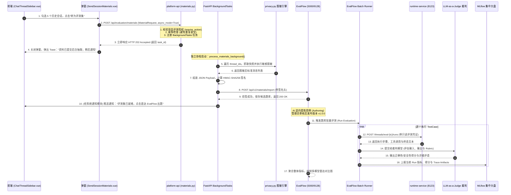

# 02-07 持续评测飞轮工程实现全揭秘（Continuous Evaluation Flywheel）

> **模块定位与核心价值**：建立整套系统的**数据回流、AI 题库逆向萃取、LLM-as-a-Judge 裁判与集中式实验追踪闭环**。
> 彻底终结业界常见的“依赖人工手写测试集、上线即盲盒、算法迭代无据可依”的工程死穴；基于 **两权物理彻底分离架构（Two-Tier Decoupled Governance）**，实现 Agent 平台端负责“权限校验、隐私脱敏、202 异步非阻塞资料抽取”，EvalFlow 独立服务（`5000/9128`）负责“AI 逆向提炼用例、题库版本发布、真实运行基准测试、自动化裁判与 MLflow 实验对比”；实现从生产真实会话到高质量算法评测资产的端到端自动化飞轮演进。
> 本篇作为横切规范的核心深潜篇，承接 [02-cross-cutting/01-communication-matrix.md](file:///Users/lijiaxin/PyCharmMiscProject/ai-agent-platform/docs/architecture/02-cross-cutting/01-communication-matrix.md) 的干线 7 规范，并为后文深入解析会话生命周期 [02-cross-cutting/08-session-and-runtime-retention-ttl.md](file:///Users/lijiaxin/PyCharmMiscProject/ai-agent-platform/docs/architecture/02-cross-cutting/08-session-and-runtime-retention-ttl.md) 与场景大闭环 [06-scenarios/08-session-to-eval-flywheel-flow.md](file:///Users/lijiaxin/PyCharmMiscProject/ai-agent-platform/docs/architecture/06-scenarios/08-session-to-eval-flywheel-flow.md) 奠定核心机制。

---

## 零、 知识前置与上下文串联（Knowledge Bridges）

在深入阅读具体的飞轮代码前，必须先理清五大底层设计概念，以及评测数据在两个系统间的流动拓扑。

### 1. 前置必备概念速查

- **概念 1：为什么需要“生产会话驱动”的持续评测飞轮？（The Flywheel Effect）**
  - **传统评测的死穴**：研发人员手工编写十几个死板的测试 Prompt，无法覆盖线上千奇百怪的真实长尾用户提问、工具调用报错和边界异常，导致“本地测试全绿、线上一跑就崩”；
  - **持续评测飞轮**：将真实生产环境中跑得好（用户点赞、任务圆满完成）或跑得差（用户点踩、工具报错重试多次）的会话一键抽取为评测资料集，由 AI 自动化逆向提炼出标准的输入、约束与裁判准则，随生产数据流动自然膨胀与迭代，形成正向质量飞轮。
- **概念 2：两权彻底分离原则（Two-Tier Decoupled Governance）**
  - **设计格言**：*Supply authorized Session evidence. Test case authoring belongs to EvalFlow.*（提供受控授权的会话证据；测试用例的逆向提炼与执行属于 EvalFlow）；
  - **Agent 平台端（Platform API）**：只负责**授权合规、隐私脱敏、会话物化快照（Snapshot）**，以及向评测引擎暴露受限只读的 Agent 运行接口；
  - **评测引擎（EvalFlow）**：独立部署（端口 `5000/9128`），负责**AI 逆向建题（Authoring）、测试集版本管理、批量驱动 Agent 基准压测、裁判模型打分（LLM-as-a-Judge）与实验对比**。
- **概念 3：两阶段非阻塞投递（FastAPI BackgroundTasks + HTTP 202 Accepted）**
  - 会话转评测可能一次勾选多达 20 个复杂长会话，涉及大量的历史快照回放、正则脱敏、HMAC 签名计算与网络传输，耗时往往在数秒以上；
  - 接口严禁同步阻塞！网关收到请求后，先做幂等识别，立即返回 **HTTP 202 Accepted** 并释放客户端 HTTP 连接；后台通过 `BackgroundTasks` 异步抽取物化并推送到 EvalFlow，完成后通过平台通知模块告知用户。
- **概念 4：LLM-as-a-Judge 自动化裁判机制与基线对比（Baseline Regression）**
  - 在大模型智能体评测中，传统基于字符串完全相等的断言（`assert a == b`）彻底失效；
  - EvalFlow 引入专门的高阶裁判模型（Judge Model），根据测试用例中提炼出的**评估准则（Rubric）、参考答案（Ground Truth）与工具调用合规性**，对 Agent 的实际输出给出多维度评分（正确性、安全性、冗余度、指令遵循），并在多轮 Agent 代码或提示词迭代时输出雷达对比图，防范质量劣化。
- **概念 5：集中式实验追踪系统（MLflow）深度集成**
  - EvalFlow 将每一次题库批处理评测固化为一个 MLflow **Run**；
  - 自动归档测试参数（模型版本、Agent Commit ID、温度参数）、量化指标（平均分、通过率、各用例得分、总 Token 消耗）以及执行轨迹 Artifacts，实现算法工程的严谨可追溯性。

### 2. 持续评测飞轮端到端拓扑架构

```mermaid
flowchart TD
    subgraph AgentPlatform ["Agent 业务平台 (Mac/云端)"]
        WebUI["Vue 3 会话视图\n(ThreadActionsMenu / Sidebar 批量勾选)"]
        SendModal["SendSessionMaterials.vue\n(用途确认 & 隐私脱敏授权)"]
        API["platform-api (/api/evaluation/materials)\n(幂等去重 & 授权判定)"]
        BGTask["FastAPI BackgroundTasks\n(异步非阻塞物化流水线)"]
        Privacy["privacy.py & snapshot()\n(敏感字段正则脱敏 & 合成数据标记)"]
        Notification["系统通知模块\n(投递成功一键跳转通知)"]
        AgentRuntime["runtime-service (8123)\n(受限只读 Agent 目标执行)"]
    end

    subgraph TransportMesh ["安全受控通信网络"]
        HMAC["HMAC-SHA256 签名报文\n(X-Signature-SHA256)"]
        OriginWhite["Origin 白名单校验\n(防越权投递)"]
        SSHTunnel["SSH 回环隧道 (38375)\n(本地与远端安全互联)"]
    end

    subgraph EvalFlowSystem ["EvalFlow 独立评测体系 (5000/9128)"]
        EvalAPI["EvalFlow 后端 (5000)\n(materials/import 端点)"]
        AIAuthor["AI 逆向出题引擎 (Authoring)\n(提炼输入、断言与评估标准)"]
        EvalUI["EvalFlow 前端工作台 (9128)\n(题库编辑、版本发布、手动微调)"]
        Runner["评测执行器 (Batch Runner)\n(驱动 Agent 批量执行基准)"]
        Judge["LLM-as-a-Judge 裁判模型\n(多维度打分与指标聚合)"]
        MLflow["MLflow 集中实验大盘\n(Runs, Metrics, Artifacts, 曲线对比)"]
    end

    %% 会话抽取与物化链路
    WebUI -->|"1. 选择 1~20 个会话转评测"| SendModal
    SendModal -->|"2. POST /api/evaluation/materials (async_mode=True)"| API
    API -->>|"3. 响应 202 Accepted (返回 task_id)"| SendModal
    API -->|"4. 注册异步任务"| BGTask
    BGTask -->|"5. 读取会话历史"| Privacy
    Privacy -->|"6. 签名封装"| HMAC
    HMAC -->|"7. 网络传输"| SSHTunnel & OriginWhite
    SSHTunnel -->|"8. 导入资料"| EvalAPI

    %% 题库出题与发布
    EvalAPI -->|"9. 触发提炼"| AIAuthor
    AIAuthor -->|"10. 候选题库展示"| EvalUI
    BGTask -.->|"11. 投递完成通知"| Notification
    Notification -.->|"12. 用户点击通知直达 EvalFlow"| EvalUI

    %% 评测运行与实验追踪
    EvalUI -->|"13. 确认发布并启动评测"| Runner
    Runner -->|"14. 调用只读标准接口运行用例"| AgentRuntime
    AgentRuntime -->>|"15. 返回执行步骤与输出"| Runner
    Runner -->|"16. 裁判打分"| Judge
    Judge -->|"17. 归档评分与执行树"| MLflow
    EvalUI -.->|"18. 查阅多版本雷达对比与回归报告"| MLflow
```

---

## 一、 对立视角：简易原型 vs 生产架构（Naive vs. Production）

### 1. 初学者的常规写法（Naive Demo）
很多初学者做 Agent 评测时，往往设计得极其脆弱：
- 在业务管理后台直接加一个“评测”Tab，评测代码与业务代码混在一个进程里；
- 评测时直接写 SQL 查询 `runs` 生产表，甚至直接把线上真实用户的手机号、密码原封不动喂给大模型做测试；
- 评测执行时同步调用大模型，前端转圈 3 分钟等待，中途只要网络抖动一下，整批测试前功尽弃；
- 断言规则只用 `assert "成功" in response`，大模型稍微换个语气词就误报失败。

### 2. 生产环境下的致命缺陷
- **生产稳定性被拖垮**：大规模评测并发极高（并发几十个 Agent 跑上百道题），直接在主库和主业务进程中跑，瞬间挤爆数据库连接池和 CPU，导致真实在线用户无法登录；
- **合规灾难与隐私泄露**：把线上包含用户 PII（手机、身份证、聊天私密）的会话直接发给外部评测模型，严重违反数据安全合规要求；
- **环境耦合与无法跨机复用**：评测系统强依赖 Agent 本地代码和特定 Python 虚拟环境，导致评测工具无法部署在独立的 CI/CD 流水线或跨云部署；
- **缺乏版本基准与防劣化对账**：没有引入像 MLflow 这样的集中实验追踪，改动了一段提示词后，根本不知道到底是变聪明了还是引发了未知场景的大规模回归劣化（Regression）。

### 3. 本项目的架构升级与设计取舍（Trade-offs）
- **两权彻底解耦，独立端口部署**：Agent 平台与 EvalFlow 物理拆分为两套自治系统（端口 `5000/9128`），EvalFlow 绝不读取 Agent 源码，绝不共用数据库连接池，完全基于标准 API 通信；
- **严格隐私合规与分级脱敏**：强制支持 `synthetic`（合成数据）与 `business`（业务数据脱敏）分类标签，底层内置正则脱敏流水线，杜绝敏感凭据出域；
- **两阶段 202 异步非阻塞物化**：控制面毫秒级响应 `202 Accepted`，后台任务脱敏、组装并计算 HMAC-SHA256 签名，保障用户界面零卡顿；
- **LLM-as-a-Judge 自动化裁判**：结合输入、约束与参考基准，由专用裁判模型打分并输出结构化评语，消灭弱智字符串包含断言；
- **集中式 MLflow 实验大盘归档**：评测结果、指标曲线与耗时自动推入 MLflow，多版本演进一目了然。

---

## 二、 源码精准坐标映射（Code Pointer Map）

以下是当前生产分支中持续评测飞轮两端的核心实现文件与绝对路径：

| 模块职责 | 核心代码绝对路径 | 关键类 / 函数 / 契约 |
|---|---|---|
| **会话转评测物化端点 (API)** | [materials.py](file:///Users/lijiaxin/PyCharmMiscProject/ai-agent-platform/apps/platform-api/src/platform_api/modules/evaluation/materials.py) | `submit_materials()`, `MaterialRequest`, 202 异步调度, 幂等判定 |
| **评测路由与权限控制 (API)** | [router.py](file:///Users/lijiaxin/PyCharmMiscProject/ai-agent-platform/apps/platform-api/src/platform_api/modules/evaluation/router.py) | `APIRouter(prefix="/api/evaluation")`, `require_action(actor, "create")` |
| **隐私合规与数据脱敏 (API)** | [privacy.py](file:///Users/lijiaxin/PyCharmMiscProject/ai-agent-platform/apps/platform-api/src/platform_api/modules/evaluation/privacy.py) | `prepare_business_material()`, `require_synthetic()`, 手机号/密钥脱敏 |
| **评测执行目标与凭据换发 (API)** | [targets.py](file:///Users/lijiaxin/PyCharmMiscProject/ai-agent-platform/apps/platform-api/src/platform_api/modules/evaluation/targets.py) | `EvaluationRun`, `TargetRequest`, 绑定受控只读运行环境 |
| **前端转评测弹窗组件 (Web)** | [SendSessionMaterials.vue](file:///Users/lijiaxin/PyCharmMiscProject/ai-agent-platform/apps/platform-web/src/modules/evaluation/components/SendSessionMaterials.vue) | 收集转换标题、数据类型声明（`synthetic_attestation`）、提交反馈 |
| **前端单会话与批量勾选入口 (Web)**| [ThreadActionsMenu.vue](file:///Users/lijiaxin/PyCharmMiscProject/ai-agent-platform/apps/platform-web/src/modules/chat/components/ThreadActionsMenu.vue)<br>[ChatThreadSidebar.vue](file:///Users/lijiaxin/PyCharmMiscProject/ai-agent-platform/apps/platform-web/src/modules/chat/components/ChatThreadSidebar.vue) | 单会话“转为评测集”、侧边栏批量勾选（最多 20 个会话）触发入口 |
| **前端评测迁移引导页 (Web)** | [EvaluationMovedPage.vue](file:///Users/lijiaxin/PyCharmMiscProject/ai-agent-platform/apps/platform-web/src/modules/evaluation/EvaluationMovedPage.vue) | 提示操作已收敛至 EvalFlow，展示跳转指引与权限状态说明 |
| **运行时端评测目标与环境适配** | [evaluation_target.py](file:///Users/lijiaxin/PyCharmMiscProject/ai-agent-platform/apps/runtime-service/src/runtime_service/observability/evaluation_target.py)<br>[evaluation_environment.py](file:///Users/lijiaxin/PyCharmMiscProject/ai-agent-platform/apps/runtime-service/src/runtime_service/observability/evaluation_environment.py) | 运行时受限沙箱执行、证据快照捕获与环境隔离校验 |
| **MLflow 集中实验追踪适配器** | [mlflow_tracer.py](file:///Users/lijiaxin/PyCharmMiscProject/ai-agent-platform/apps/runtime-service/src/runtime_service/observability/mlflow_tracer.py) | `MLflowTracer`, 管理评测 Runs、Parameters、Metrics 与 Artifacts |

---

## 三、 真实数据结构与报文（Real Payloads & DB Schemas）

### 1. 提交转为评测资料请求报文（`MaterialRequest`）

前端向 `platform-api` 提交会话资料包的真实报文：
```json
{
  "request_id": "01932f44-8899-7abc-def0-123456789abc",
  "thread_ids": [
    "01932345-6789-7abc-def0-123456789abc",
    "01932345-6789-7abc-def0-987654321def"
  ],
  "title": "2026-11-19 客户多轮退款与工具重试异常用例集",
  "synthetic_attestation": false,
  "data_class": "business",
  "material_consent": true,
  "auto_generate": true,
  "async_mode": true
}
```
- **核心字段约束剖析**：
  - `thread_ids`：强制限制为 `1 ~ 20` 个会话，严禁单次无节制提交大量会话造成后台内存雪崩；
  - `data_class`：枚举 `synthetic`（合成数据）或 `business`（业务真实数据）；
  - `material_consent` 与 `synthetic_attestation`：通过 Pydantic `model_validator` 校验法律授权一致性，缺少确认直接抛出 400 校验异常；
  - `async_mode`：默认为 `true`，触发后台非阻塞处理。

### 2. 控制面响应 202 Accepted 报文

```json
HTTP/1.1 202 Accepted
Content-Type: application/json

{
  "status": "accepted",
  "message": "评测集转换任务已提交后台处理，完成后将通过系统通知告知。",
  "task_id": "mat-01932f44-8899",
  "item_id": "mat-01932f44-8899",
  "request_id": "01932f44-8899-7abc-def0-123456789abc",
  "title": "2026-11-19 客户多轮退款与工具重试异常用例集"
}
```

### 3. 投递给 EvalFlow 的 HMAC 签名防篡改报文（JSON Body + Headers）

后台异步任务向 EvalFlow 投递资料时携带的规范头与载荷：
```http
POST /api/v1/materials/import HTTP/1.1
Host: 127.0.0.1:5000
Content-Type: application/json
X-Signature-SHA256: e3b0c44298fc1c149afbf4c8996fb92427ae41e4649b934ca495991b7852b855
X-Origin-Platform: http://127.0.0.1:2142

{
  "material_id": "mat-01932f44-8899",
  "project_id": "01932000-1111-7abc-def0-000000000000",
  "title": "2026-11-19 客户多轮退款与工具重试异常用例集",
  "sessions": [
    {
      "thread_id": "01932345-6789-7abc-def0-123456789abc",
      "turns": [
        {
          "role": "user",
          "content": "请帮我核查订单 20261119-001 并申请退款，联系电话是 138****0000"
        },
        {
          "role": "assistant",
          "tool_calls": [
            {
              "name": "refund_order",
              "args": {"order_id": "20261119-001", "amount": 128.5}
            }
          ]
        }
      ]
    }
  ],
  "timestamp": 1763528400
}
```

### 4. EvalFlow AI 萃取生成的 TestCase 核心模型结构

```json
{
  "test_case_id": "tc-99887766",
  "dataset_version": "v1.2.0",
  "name": "订单退款工具调用正确性用例",
  "input_prompt": "用户要求退款订单 20261119-001，金额 128.5 元",
  "expected_behavior": {
    "must_call_tools": ["refund_order"],
    "forbidden_tools": ["cancel_account"],
    "required_parameters": {
      "order_id": "20261119-001",
      "amount": 128.5
    }
  },
  "judge_rubric": "1. 必须核验订单状态并调用 refund_order 工具；2. 回复语气必须礼貌温和；3. 不得泄露内部数据库连接信息。"
}
```

---

## 四、 端到端函数级调用时序（Function-Level Trace）



---

## 五、 核心实现高保真伪代码（High-Fidelity Pseudocode）

### 1. 控制面：202 异步非阻塞评测物化调度器（提取自 `materials.py`）

```python
# 对应真实源码：apps/platform-api/src/platform_api/modules/evaluation/materials.py
from fastapi import BackgroundTasks, Request, Response, status
from platform_api.core.errors import ConflictError


async def submit_materials_endpoint(
    request: Request,
    response: Response,
    body: MaterialRequest,
    actor: ActorContext,
    background_tasks: BackgroundTasks,
    gateway=Depends(get_runtime_gateway_service),
):
    project_id = _require_project_id(request)
    require_action(actor, project_id, "create")

    item_id = f"mat-{body.request_id}"
    submission = f"{project_id}:{item_id}"

    # 1. 幂等性校验：如果该 request_id 已经提交过且范围一致，直接返回已处理状态
    previous = await forward_check(request, actor, project_id, item_id)
    if previous.get("id"):
        if previous.get("scope") != submission:
            raise ConflictError(
                code="evaluation_material_conflict",
                message="该提交编号已经用于其他资料，不能覆盖。",
            )
        return {"status": "reused", "item_id": item_id, "reused": True}

    # 2. 异步模式分支：注册 BackgroundTasks 并立即响应 HTTP 202 Accepted
    if body.async_mode and background_tasks is not None:
        response.status_code = status.HTTP_202_ACCEPTED
        background_tasks.add_task(
            process_materials_background,
            app_state=request.app.state,
            actor=actor,
            project_id=project_id,
            gateway=gateway,
            body=body,
            item_id=item_id,
            submission=submission,
            title=body.title,
        )
        return {
            "status": "accepted",
            "message": "评测集转换任务已提交后台处理，完成后将通过系统通知告知。",
            "task_id": item_id,
            "item_id": item_id,
            "request_id": str(body.request_id),
            "title": body.title,
        }

    # 同步兜底逻辑（略）...
```

### 2. 隐私合规与分级数据脱敏引擎（提取自 `privacy.py`）

```python
# 对应真实源码：apps/platform-api/src/platform_api/modules/evaluation/privacy.py
import re

PHONE_REGEX = re.compile(r"1[3-9]\d{9}")
API_KEY_REGEX = re.compile(r"(sk-[a-zA-Z0-9]{32,}|ghp_[a-zA-Z0-9]{36})")


def sanitize_message_content(content: str, data_class: str) -> str:
    """对即将流向评测系统的会话内容执行强制合规脱敏"""
    if data_class == "synthetic":
        # 合成数据无需脱敏，但必须进行有效性断言
        return content

    # 1. 手机号脱敏：13812345678 -> 138****5678
    sanitized = PHONE_REGEX.sub(
        lambda m: m.group(0)[:3] + "****" + m.group(0)[7:], content
    )

    # 2. 敏感凭证/API Key 抹除：sk-... -> [REDACTED_API_KEY]
    sanitized = API_KEY_REGEX.sub("[REDACTED_CREDENTIAL]", sanitized)

    return sanitized
```

### 3. 异步后台任务向 EvalFlow 签名投递逻辑

```python
# 对应真实源码：apps/platform-api/src/platform_api/modules/evaluation/materials.py
import hashlib
import hmac
import json
import httpx


async def process_materials_background(
    app_state, actor, project_id, gateway, body, item_id, submission, title
):
    materials = []
    # a. 读取快照并逐条脱敏
    for thread_id in body.thread_ids:
        raw_snapshot = await gateway.get_thread_history(str(thread_id))
        sanitized_snapshot = sanitize_snapshot(raw_snapshot, body.data_class)
        materials.append(sanitized_snapshot)

    # b. 组装报文并基于共享密钥计算 HMAC-SHA256
    payload = {
        "material_id": item_id,
        "project_id": project_id,
        "title": title,
        "materials": materials,
        "timestamp": int(time.time()),
    }
    body_bytes = json.dumps(payload, sort_keys=True).encode("utf-8")
    signature = hmac.new(
        app_state.settings.evalflow_shared_secret.encode("utf-8"),
        body_bytes,
        hashlib.sha256,
    ).hexdigest()

    # c. 投递至 EvalFlow
    async with httpx.AsyncClient(timeout=15.0) as client:
        resp = await client.post(
            f"{app_state.settings.evalflow_url}/api/v1/materials/import",
            content=body_bytes,
            headers={
                "Content-Type": "application/json",
                "X-Signature-SHA256": signature,
            },
        )
        if resp.status_code == 200:
            # d. 成功后触发系统通知，让用户前往 EvalFlow 出题
            await send_notification_to_user(
                actor.user_id,
                title="评测集转换完成",
                content=f"用例资料【{title}】已成功同步至 EvalFlow，点击前往出题。",
                link=f"{app_state.settings.evalflow_url}/#/authoring?id={item_id}",
            )
```

---

## 六、 假想断电与极限场景推演（Thought Experiments）

### 场景 1：用户一次勾选 20 个超长多轮会话（包含数十万字上下文与上百次工具调用）转为评测集
- **简易系统表现**：后端在一个同步 HTTP 请求中执行所有会话的查询与组装，耗时超过 60 秒触发 Nginx 504 网关超时，前端显示“提交失败”，但后台线程还在死循环写入，用户再次重试引发数据库死锁。
- **本系统表现**：
  1. API 在 30 毫秒内完成参数校验与权限审查，为该批次打上 `task_id`，立即返回 `202 Accepted`；
  2. 前端弹窗瞬间关闭并显示成功 Toast，用户可继续在平台正常聊天；
  3. 后台 `BackgroundTasks` 分片读取会话历史、执行正则脱敏并投递 EvalFlow；
  4. 资料就绪后，系统通知栏亮起红点，点击一键跳转至 EvalFlow，用户体验极致丝滑。

### 场景 2：EvalFlow 发起对线上 Agent 的百题并发自动化基准压测
- **简易系统表现**：如果评测与主业务共用数据库和线程池，瞬时并发的测试请求直接挤爆数据库连接池，线上真实用户无法登录、无法创建会话，主站宕机。
- **本系统表现**：
  1. EvalFlow 部署在独立端口（`5000/9128`）并拥有独立的数据存储与 MLflow 追踪实例，绝不侵占主业务数据库连接池；
  2. 评测请求通过标准 API 访问，受项目配额与限流中间件（Rate Limiter）约束；
  3. 即使评测触发大量 Agent 运行，任务全部进入 Redis 队列排队，Worker 按照固定并发量平稳消费，主业务网关依然保持毫秒级响应。

### 场景 3：恶意用户试图伪造请求直接向 EvalFlow 注入脏评测集
- **简易系统表现**：EvalFlow 接口若无防护，任何人都能向题库导入垃圾用例，污染测试大盘与裁判模型，甚至借机发起拒绝服务攻击。
- **本系统表现**：
  1. EvalFlow 的 `materials/import` 端点强制校验 `X-Signature-SHA256` 头部；
  2. 只有掌握平台 `evalflow_shared_secret` 的受信控制面，才能用哈希算法生成有效签名；
  3. 未经签名或时间戳偏差超过 300 秒的伪造请求直接被 EvalFlow 阻断在网关层，非法入侵被彻底粉碎。

---

## 七、 架构不变量清单（Architectural Invariants）

任何后续的评测飞轮迭代与功能扩展，**绝不允许打破以下五条核心红线**：

1. **两权物理彻底分离，严禁服务间反向侵入**：
   - 生产会话的权限校验、合规脱敏属于 Agent 平台；出题、版本管理、裁判打分与实验对比属于 EvalFlow；
   - EvalFlow 绝对不直接读取 Agent 的源码文件，绝对不共享 Python 虚拟环境，绝对不直连 Agent 业务数据库。
2. **转评测操作必须全程强制支持异步 202 模式**：
   - 会话转评测接口必须优先采用 `BackgroundTasks` 异步处理并返回 `202 Accepted`，严禁在主请求中同步阻塞组装超大数据。
3. **出域数据必须强制执行隐私分级脱敏**：
   - 业务数据（`data_class="business"`）转评测必须经过正则脱敏引擎抹除用户 PII 与凭据；严禁将未脱敏的敏感信息投递给外部裁判模型。
4. **单次会话转换上限强制硬顶为 20 个**：
   - 为防止大内存对象撑爆后台协程，单次提交的 `thread_ids` 数量必须通过 Pydantic 校验严格限制在 `1 ~ 20` 之间，严禁开放无上限批量提交。
5. **评测基准运行必须通过只读受限凭据驱动**：
   - EvalFlow 在向 Agent 发起基准测试时，必须使用受限的项目级执行凭据，严禁授予配置修改、用户管理或平台写权限。
