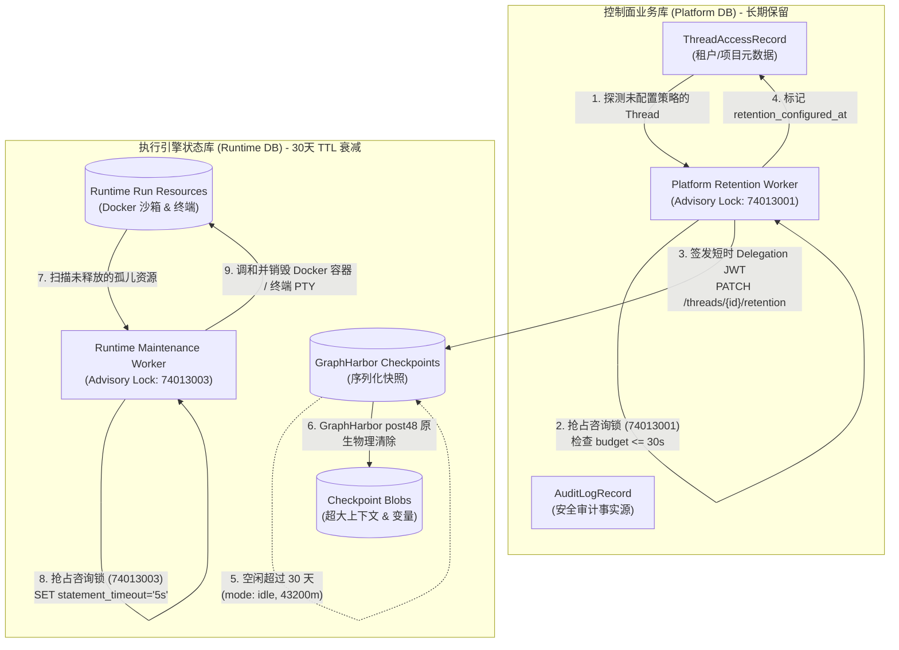
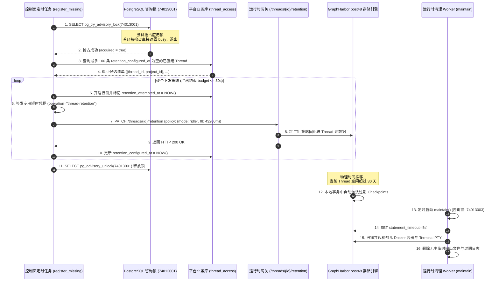

# 02-08 会话生命周期与运行时 Checkpoint 存储 TTL 自动衰减工程

> **模块定位与核心价值**：建立整套系统的**海量执行快照自动清理、存储容量防爆与多级生命周期治理体系**。
> 彻底解决智能体多步执行在底层累积数百万条 Checkpoint 快照引发的“B02 存储膨胀与 IOPS 枯竭瓶颈”；基于 **平台策略注册与 GraphHarbor 原生到期淘汰（Platform Policy Registration & Engine-Owned Expiry）**，确立业务元数据（Platform DB）与增量执行状态（Runtime DB）的**跨库弱引用（Weak Reference）与优雅降级机制**；全链路通过 **PostgreSQL 咨询锁（Advisory Lock）、有界时间预算（Bounded Budget）与沙箱临时资源调和**，实现零锁表、零停机、全自动的存储自愈闭环。
> 本篇作为横切规范的核心篇章，承接 [02-cross-cutting/07-continuous-evaluation-flywheel.md](file:///Users/lijiaxin/PyCharmMiscProject/ai-agent-platform/docs/architecture/02-cross-cutting/07-continuous-evaluation-flywheel.md) 的评测资产锁定原则，并为后文剖析执行引擎防撑爆韧性 [05-runtime-service/05-context-blowup-defense-and-resilience.md](file:///Users/lijiaxin/PyCharmMiscProject/ai-agent-platform/docs/architecture/05-runtime-service/05-context-blowup-defense-and-resilience.md) 奠定存储层治理基石。

---

## 零、 知识前置与上下文串联（Knowledge Bridges）

在深入阅读具体的清理代码前，必须掌握四大底层生命周期概念，以及状态数据在双库之间的流动与衰减拓扑。

### 1. 前置必备概念速查

- **概念 1：为什么 Checkpoint 必须有 TTL？（B02 存储膨胀瓶颈）**
  - **状态膨胀复盘**：LangGraph 的每次工具调用、节点转移都会保存一个序列化的快照（Checkpoint）。一个包含 20 步思考与工具调用的复杂 Agent Run，会在 `checkpoints`、`checkpoint_blobs` 和 `checkpoint_writes` 表中写入几十行二进制数据；
  - 平台运行数月后，历史快照表会迅速膨胀至数十 GB 甚至数百 GB，导致数据库的缓冲池命中率（Buffer Cache Hit Ratio）暴跌、Vacuum 慢如蜗牛，并引发严重的慢查询；
  - 真实的业务规律是：**用户对执行现场（精确到哪一步调用哪个工具的局部变量）的关注期通常只有 7~30 天；30 天前的一次内部执行现场已无现场重放价值，必须按 TTL 自动淘汰**。
- **概念 2：平台策略注册与引擎原生淘汰（GraphHarbor Owns Expiry）**
  - **核心设计规约**：*Register platform policy through the engine API; never scan its database.*（通过引擎 API 注册平台保留策略，绝对不允许控制面跨库直接扫描并 `DELETE` 运行时的物理表！）；
  - 控制面（Platform API）只负责感知 Thread 的创建，并通过专有短时凭据向 Runtime 发起 `PATCH /threads/{id}/retention` 注入策略：`POLICY = {"mode": "idle", "ttl_minutes": 30 * 24 * 60}`（即空闲 30 天后自动淘汰）；
  - 真正的数据物理删除由 **GraphHarbor post48** 存储引擎在其本地事务内自主按时间戳淘汰，保证执行引擎的物理自治。
- **概念 3：PostgreSQL 咨询锁（Advisory Lock: `74013001` 与 `74013003`）**
  - 在多微服务实例并发部署环境下，后台维护任务（Cron / Lifespan）极易并发重复执行，引发数据库死锁；
  - 系统使用 PG 级别的应用咨询锁：控制面使用 `pg_try_advisory_lock(74013001)`，运行时使用 `pg_try_advisory_lock(74013003)`；
  - `pg_try_advisory_lock` 是**非阻塞尝试**：若已被其他节点抢占，当前协程立即返回 `skipped: maintenance_busy` 并安全退出，零等待、零死锁、零业务干扰。
- **概念 4：有界维护预算（Bounded Limits & Budget Seconds）**
  - 后台维护任务绝不允许无限制地长时间执行大事务，必须遵守硬性边界：
    - `limit=100`（单批次最多扫描处理 100 条）；
    - `budget_seconds=30`（单次维护任务总耗时严格硬顶 30 秒）；
  - 一旦 `time.monotonic() >= deadline`，任务立即终止并返回 `budget_exhausted: True`，未处理完的候选留在下一周期继续，绝不抢占业务连接池。
- **概念 5：跨库弱引用（Weak Reference）与优雅降级**
  - Platform DB 与 Runtime DB 物理隔离，两者之间没有数据库外键，仅通过 `thread_id` 字符串进行跨服务逻辑关联；
  - **快照过期不等于会话删除**：即使底层 Checkpoint 被 30 天 TTL 物理淘汰，前台用户依然能在会话列表看到该会话标题和最终问答摘要；仅当用户试图回溯已经淘汰的执行现场时，前端平滑提示“运行现场已归档”，而不是崩溃报 500。

### 2. 双库生命周期与 TTL 自动衰减拓扑



---

## 一、 对立视角：简易永久存储 vs 生产级分层 TTL 衰减

| 评估维度 | 简易永久堆积方案 (Naive) | 生产级分层 TTL 衰减工程 (Production Architecture) | 架构收益与突破 |
| :--- | :--- | :--- | :--- |
| **存储容量控制** | 所有 Run 的 Checkpoint 快照永久保存，几个月后单表数千万行 | 采用 **30 天空闲 TTL 自动物理淘汰**，状态库容量恒定收敛在健康水位 | 彻底根除 B02 存储膨胀瓶颈，IOPS 稳定在低位 |
| **微服务跨库边界**| 控制面写复杂的后台脚本，直接跨库连接 Runtime 数据库执行 `DELETE` | **严禁跨库扫表**，控制面通过受控 API 注入策略，由引擎自治淘汰 | 守护服务物理隔离底线，消灭跨库隐式依赖 |
| **并发任务防护** | 多实例部署时后台定时任务并发打架，引发严重的数据库行锁等待与死锁 | 基于 **PostgreSQL 咨询锁（Advisory Lock）**，单集群非阻塞排他执行 | 抢占失败直接秒级跳过，杜绝维护任务引发集群震荡 |
| **大事务与资源保护**| 一次性扫描全表删除数十万行，导致数据库 CPU 飙升 100%、主库只读锁死 | 严格约束 **`limit=100` 与 `budget_seconds=30`**，单批次到时强制熔断 | 绝不挤占主业务数据库连接池，后台维护静默无感 |
| **历史数据访问** | 误删或级联删除导致旧会话在用户前台瞬间消失，引发客户投诉 | **跨库弱引用解耦**：业务元数据长久保留，底层快照物理淘汰后优雅降级 | 用户前台历史列表零丢失，现场状态归档清晰透明 |

---

## 二、 源码精准坐标映射（Code Pointer Map）

以下是当前生产分支中会话生命周期与 TTL 自动衰减的核心实现文件绝对路径：

| 模块职责 | 核心代码绝对路径 | 关键类 / 函数 / 契约 |
|---|---|---|
| **控制面策略注册维护器** | [retention.py (API)](file:///Users/lijiaxin/PyCharmMiscProject/ai-agent-platform/apps/platform-api/src/platform_api/modules/runtime_gateway/application/retention.py) | `register_missing()`, `maintenance_lock(74013001)`, `POLICY`, 有界预算控制 |
| **会话访问控制与状态元数据表**| [models.py (API)](file:///Users/lijiaxin/PyCharmMiscProject/ai-agent-platform/apps/platform-api/src/platform_api/modules/runtime_gateway/infra/sqlalchemy/models.py) | `ThreadAccessRecord`, `retention_configured_at`, `retention_attempted_at` |
| **上游网关策略下发客户端** | [runtime_gateway_upstream.py](file:///Users/lijiaxin/PyCharmMiscProject/ai-agent-platform/apps/platform-api/src/platform_api/adapters/langgraph/runtime_gateway_upstream.py) | `set_thread_retention()`, `PATCH /threads/{id}/retention` |
| **运行时端沙箱与日志维护脚本** | [maintenance.py (Runtime)](file:///Users/lijiaxin/PyCharmMiscProject/ai-agent-platform/apps/runtime-service/src/runtime_service/maintenance.py) | `maintain()`, `pg_try_advisory_lock(74013003)`, `reconcile_remote_resources` |
| **运行时策略鉴权切面** | [platform.py (Auth)](file:///Users/lijiaxin/PyCharmMiscProject/ai-agent-platform/apps/runtime-service/src/runtime_service/auth/platform.py) | 校验 `operation == "thread-retention"` 与 `platform-retention-maintenance` 角色 |
| **评测资料保留与豁免扫描器** | [retention.py (Eval)](file:///Users/lijiaxin/PyCharmMiscProject/ai-agent-platform/apps/platform-api/src/platform_api/modules/evaluation/retention.py) | `maintain()`, `sweep()`, 评测锁定资产免受清理，合规日志保留审计 |
| **运行时环境生命周期守护** | [evaluation_environment.py](file:///Users/lijiaxin/PyCharmMiscProject/ai-agent-platform/apps/runtime-service/src/runtime_service/observability/evaluation_environment.py) | `environment_retention_lifespan()`, 运行时常驻协程维护 |

---

## 三、 真实数据结构与报文（Real Payloads & DB Schemas）

### 1. 控制面会话保留追踪字段（Platform DB: `thread_access`）

```sql
ALTER TABLE thread_access
ADD COLUMN retention_configured_at TIMESTAMPTZ NULL,
ADD COLUMN retention_attempted_at TIMESTAMPTZ NULL;

-- 快速定位未配置策略且已就绪的 Thread 索引
CREATE INDEX ix_thread_retention_pending
ON thread_access (retention_configured_at, retention_attempted_at)
WHERE provisioning_status = 'ready' AND retention_configured_at IS NULL;
```
- **字段语义剖析**：
  - `retention_configured_at`：记录策略成功注入运行时的精确时间戳；只要该字段非空，表示该 Thread 已受 GraphHarbor TTL 纳管，后台扫描永久跳过；
  - `retention_attempted_at`：记录最近一次尝试配置的时间；若遇网络抖动失败，按该字段升序（`nulls_first`）依次退避重试，防止某个异常 Thread 霸占批次队列。

### 2. 控制面向运行时下发策略的真实 HTTP 报文

```http
PATCH /threads/01932345-6789-7abc-def0-123456789abc/retention HTTP/1.1
Host: 127.0.0.1:8123
Authorization: Bearer <Delegation-JWT>
Content-Type: application/json

{
  "policy": {
    "mode": "idle",
    "ttl_minutes": 43200
  }
}
```
- **参数规格**：
  - `mode: "idle"`：空闲计时模式，即从该 Thread 最后一次 Run 结束开始计时；若期间用户重新发话，计时器自动重置清零；
  - `ttl_minutes: 43200`：严格等于 $30 \times 24 \times 60$ 分钟（整 30 天）；
  - **凭证权限约束**：所携带的短时 Delegation JWT 其 Scope 必须严格等于 `{"operation": "thread-retention", "thread_id": "..."}`，主体必须为 `platform-retention-maintenance`，否则被运行时 `@auth.authenticate` 拦截直接抛出 403。

### 3. 控制面维护任务对账响应（JSON Report）

```json
{
  "candidates": 42,
  "configured": 40,
  "missing": 2,
  "failed": 0
}
```
- `candidates`：本次扫描出的候选 Thread 数量（受 `limit` 约束）；
- `configured`：成功下发并落盘记录的数量；
- `missing`：底层已返回 404 的数量（说明物理快照已不在，无需重复配置）；
- `failed`：网络超时或项目未找到的失败数量。

---

## 四、 端到端函数级调用时序（Function-Level Trace）



---

## 五、 核心实现高保真伪代码（High-Fidelity Pseudocode）

### 1. 控制面：带咨询锁与预算上限的策略注册器（提取自 `retention.py`）

```python
# 对应真实源码：apps/platform-api/src/platform_api/modules/runtime_gateway/application/retention.py
import time
from contextlib import contextmanager
from datetime import UTC, datetime
from sqlalchemy import select, text

POLICY = {"mode": "idle", "ttl_minutes": 30 * 24 * 60}


@contextmanager
def maintenance_lock(factory, key: int = 74013001):
    """基于 PostgreSQL 咨询锁实现高可用集群下的单实例排他执行"""
    with factory() as session:
        engine = session.get_bind()
    with engine.connect() as connection:
        acquired = connection.scalar(
            text("SELECT pg_try_advisory_lock(:key)"), {"key": key}
        )
        connection.commit()
        try:
            yield acquired
        finally:
            if acquired:
                connection.execute(
                    text("SELECT pg_advisory_unlock(:key)"), {"key": key}
                )
                connection.commit()


def register_missing(
    factory, settings, *, apply=False, limit=100, budget_seconds=30
):
    with maintenance_lock(factory, 74013001) as acquired:
        if not acquired:
            return {"skipped": "maintenance_busy"}

        deadline = time.monotonic() + budget_seconds
        # 1. 扫描候选 Thread
        with factory() as session:
            rows = session.scalars(
                select(ThreadAccessRecord)
                .where(
                    ThreadAccessRecord.retention_configured_at.is_(None),
                    ThreadAccessRecord.provisioning_status == "ready",
                )
                .order_by(
                    ThreadAccessRecord.retention_attempted_at.asc().nulls_first()
                )
                .limit(limit)
            ).all()
            candidates = [(row.thread_id, row.project_id) for row in rows]

        # 2. 逐个下发并在超时前优雅退出
        for thread, project in candidates:
            if time.monotonic() >= deadline:
                break  # 达到 30 秒预算硬顶，主动让出 CPU 与连接池

            # 签发短时凭据并通过 HTTP 接口注册策略（略）...
            # 成功后在本地事务中更新 retention_configured_at
```

### 2. 运行时：带语句超时与沙箱资源调和的自愈脚本（提取自 `maintenance.py`）

```python
# 对应真实源码：apps/runtime-service/src/runtime_service/maintenance.py
import time
from runtime_service.db import connect
from runtime_service.run_control.resources import (
    reconcile_remote_resources,
    reconcile_terminal_resources,
)


def maintain(*, apply=False, limit=100, budget_seconds=30):
    deadline = time.monotonic() + budget_seconds

    with connect() as lock:
        # 抢占运行时专用咨询锁
        acquired = lock.execute(
            "SELECT pg_try_advisory_lock(74013003)"
        ).fetchone()["pg_try_advisory_lock"]
        lock.commit()
        if not acquired:
            return {"skipped": "maintenance_busy"}

        try:
            # 调和终端 PTY 与 Docker 远程执行沙箱
            for kind, reconciler in (
                ("terminal", reconcile_terminal_resources),
                ("docker_execute", reconcile_remote_resources),
            ):
                if time.monotonic() >= deadline:
                    return {"budget_exhausted": True}

                with connect() as db:
                    # 关键防御：设置 5 秒语句级超时，防止大表扫描拖死状态库
                    db.execute("SET LOCAL statement_timeout='5s'")
                    rows = db.execute(
                        """SELECT resource_id FROM runtime_run_resources
                        WHERE kind=%s AND status<>'cleanup_confirmed'
                        ORDER BY updated_at LIMIT %s""",
                        (kind, limit),
                    ).fetchall()

                if apply:
                    for _ in rows:
                        if time.monotonic() >= deadline:
                            break
                        reconciler(limit=1)
        finally:
            lock.execute("SELECT pg_advisory_unlock(74013003)")
            lock.commit()
```

---

## 六、 假想断电与极限场景推演（Thought Experiments）

### 场景 1：生产环境部署了 4 个 `platform-api` 容器，Cron 定时器在整点同时触发
- **简易系统表现**：4 个节点同时发起全表扫描，同时争抢修改同一批 `thread_access` 行，导致严重的行锁冲突与死锁异常，引发数据库连接数暴增。
- **本系统表现**：
  1. 4 个节点同时执行 `SELECT pg_try_advisory_lock(74013001)`；
  2. 节点 1 成功抢得锁（返回 `true`），开始处理数据；
  3. 节点 2、3、4 瞬间返回 `false`，立即输出 `{"skipped": "maintenance_busy"}` 并直接退出；
  4. 整个集群只有 1 个实例在温和处理，零死锁、零并发冲突。

### 场景 2：数据库因其他慢查询压力陡增，维护任务在处理到第 50 个 Thread 时耗时达到 30 秒
- **简易系统表现**：普通维护脚本死心眼一直往下跑，在大事务里拖着几十个连接不释放，直到系统整体雪崩。
- **本系统表现**：
  1. 每次循环前校验 `if time.monotonic() >= deadline: break`；
  2. 当耗时到达 30 秒时，循环立刻跳出，已完成的 50 条成功提交落盘，未完成的 50 条保持原样；
  3. 释放咨询锁并退出，等待下一个维护周期（如 1 小时后）再继续，**主业务性能受到最严密的隔离守护**。

### 场景 3：用户在前台控制台点击翻看两个月前的历史会话
- **简易系统表现**：系统试图从底层查询 Checkpoint 快照，发现记录已经被清理，直接抛出 `KeyError: checkpoint not found`，前台页面白屏并弹出巨幅 500 错误。
- **本系统表现**：
  1. 前端向 Platform API 拉取会话元数据（标题、更新时间、最终问答历史均在 Platform DB 中完整保留）；
  2. 会话正常加载并完整显示历史聊天内容；
  3. 仅当用户试图展开底层工具调用的详细中间状态时，界面温和提示：“该会话已超过 30 天，运行态现场已归档释放”；
  4. 既保证了存储瘦身，又保证了用户前台体验的完美平滑。

---

## 七、 架构不变量清单（Architectural Invariants）

任何后续的存储优化、会话管理与数据库重构，**绝不允许打破以下五条核心红线**：

1. **控制面严禁跨库直接扫描并物理删除运行时的 Checkpoint 表**：
   - 必须通过受控的 API（`PATCH /threads/{id}/retention`）下发保留策略，由 GraphHarbor 存储引擎在其本地事务中执行到期清理。
2. **所有后台维护任务必须受 PostgreSQL 咨询锁（Advisory Lock）保护**：
   - 控制面维护任务绑定 Key `74013001`，运行时维护任务绑定 Key `74013003`；必须采用非阻塞尝试（`pg_try_advisory_lock`），禁止集群多实例并发踩踏。
3. **单次批处理必须受严格的时间与数量有界预算硬顶**：
   - 必须设定 `limit <= 100` 与 `budget_seconds <= 30`；到达时间截点必须强制熔断退出，严禁执行无边界大事务。
4. **底层物理快照淘汰绝对不允许级联删除控制面会话元数据**：
   - 跨库逻辑保持弱引用；底层返回 404 仅表示现场快照过期，控制面必须保留会话骨架记录，防止用户前台会话列表被破坏。
5. **沙箱资源与临时文件必须实现显式闭环销毁**：
   - Docker 执行容器、终端 PTY 与临时日志文件必须有专有的 Reconciler 扫尾，严禁只删数据库记录而残留孤儿系统进程。
