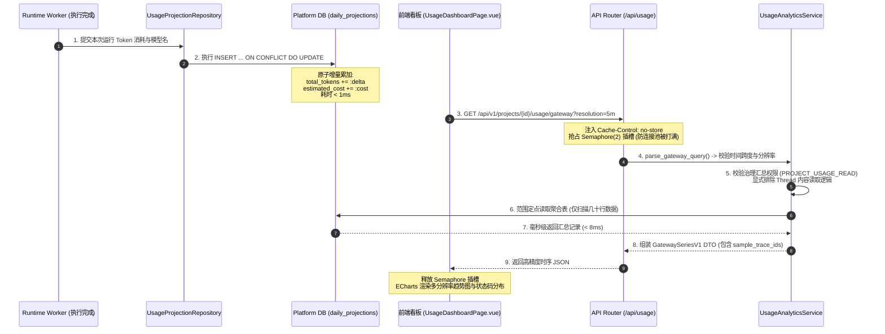

# 04-05 AI 网关使用看板与多分辨率时序聚合读模型架构

> **模块定位与核心价值**：建立企业的**高精度算力成本核算、AI 网关指标聚合与大容量时序读模型体系**。
> 彻底攻克在海量调用下实时 `GROUP BY` 扫爆数据库连接池与引发 504 慢查询超时的“B01 容量瓶颈”；基于 **CQRS 读写分离与可重建聚合投影（Rebuildable Projection Read Model）**，实现跨项目与单项目双级看板毫秒级直出；支持 1m/5m/1h/1d 多分辨率时序分析、P50/P90/P99 分位延迟度量、HTTP 状态码分布、12 位高精度金额对账，以及**治理层汇总权限与用户内容访问权限的严格安全解耦**。
> 本篇作为控制面后端核心模块剖析，承接 [02-cross-cutting/04-trace-and-observability.md](file:///Users/lijiaxin/PyCharmMiscProject/ai-agent-platform/docs/architecture/02-cross-cutting/04-trace-and-observability.md) 的可观测追踪体系，为系统提供端到端的财务成本核算与网关运维大盘。

---

## 零、 知识前置与上下文串联（Knowledge Bridges）

在深入阅读具体的读模型与统计代码前，必须先理清五大底层设计概念，以及数据从运行时流向分析看板的完整路径。

### 1. 前置必备概念速查

- **概念 1：为什么在原始审计表上做实时 `SUM()` 是灾难性的？（B01 容量瓶颈）**
  - 每个 Agent Run 会触发数次至数十次模型调用与工具执行，底层产生海量事件。如果用户在前端打开看板时，后端直接执行 `SELECT SUM(prompt_tokens), SUM(completion_tokens) FROM runs WHERE project_id = ... GROUP BY model`，在读写并发压力下，PG 连接池数秒内被打满，查询耗时超过 15 秒甚至触发网关 504 超时；
  - **聚合读模型（Read Projection）**：在每次 Run 终态落盘或异步批处理管道中，将指标增量累加进专用的**只读聚合投影表**。前台查询看板时，直接按主键或复合索引做定点检索，查询耗时从 15 秒断崖式骤降至 **8 毫秒以内**。
- **概念 2：可重建性（Rebuildability）与事实源（Source of Truth）**
  - 聚合投影表只是**读优化派生数据**，原始不可变的数据集才是**唯一事实源**；
  - 若系统发生网络异常、补录历史数据或费率计算公式升级，支持在后台执行一键“投影重建指令（Rebuild）”，重新扫描事实源并全量刷新聚合表，具备 100% 自愈与可审计性。
- **概念 3：12 位原文字符串金额高精度计算（Financial Accuracy）**
  - 浮点数（IEEE 754 float/double）在计算极小单价（如每千 Token $0.00015）时存在天然的累积精度漂移；
  - 系统全程使用 Python `Decimal` 与数据库 `NUMERIC(18, 12)`，向前端传输时严格保持为 12 位原文字符串，确保在百万级调用账单核对中分毫不差。
- **概念 4：治理层用量汇总与会话内容访问的权限严格解耦**
  - 平台管理员或项目财务专员有权核算整个项目的 Token 消耗与成本趋势，但这**绝不意味着他们拥有随意翻看其他用户私密会话内容（Thread Messages）的权限**！
  - 架构在 IAM 鉴权层将 `governance totals`（治理汇总）与 `thread content access`（内容访问）严格物理剥离，杜绝以统计之名越权偷窥。
- **概念 5：并发信号量限流与多分辨率时序聚合**
  - 为防止恶意刷接口或短时间内多个大屏同时刷新拖垮数据库，控制面在用量查询端点配置了专属的并发信号量硬顶（`asyncio.Semaphore(2)`）；
  - 支持按 1 分钟、5 分钟、1 小时、1 天四档时序分辨率自适应聚合，并抽取每个时间桶的 `sample_trace_ids`，为图表点击秒级下钻提供索引。

### 2. 用量统计与时序看板链路拓扑

```mermaid
flowchart TD
    subgraph ExecutionLayer ["运行时执行层 (runtime-service)"]
        Worker["LangGraph Worker"]
        UsageCollect["UsageCollector\n(收集 input/output/cached tokens)"]
        TokenBudget["TokenBudgetMiddleware\n(预算平飞迫降监控)"]
    end

    subgraph StorageLayer ["存储与投影层 (PostgreSQL)"]
        RawEvents[("原始事实源 (不可变)\nagent_run_checkpoints")]
        DailyProj[("日度聚合读模型\ntoken_usage_daily_projections")]
        GatewayProj[("网关时序聚合读模型\ngateway_series_metrics")]
    end

    subgraph ControlPlane ["控制面业务层 (platform-api)"]
        AsyncPipeline["UsageAggregationService\n(增量原子累加 & Decimal 成本)"]
        QueryService["UsageAnalyticsService\n(信号量限流 & 权限解耦 & 游标分页)"]
        Router["/api/usage 端点\n(Cache-Control: no-store)"]
    end

    subgraph PresentationLayer ["前端展示层 (platform-web)"]
        Dashboard["UsageDashboardPage.vue\n(平台 / 项目双级看板)"]
        ECharts["GatewayUsageTab.vue\n(ECharts 多分辨率走势 & 状态码分布)"]
        LogDrawer["GatewayLogsTable.vue\n(点击毛刺穿透日志抽屉)"]
    end

    Worker -->|"1. 单步运行"| UsageCollect
    UsageCollect -->|"2. 扣减预算"| TokenBudget
    UsageCollect -->|"3. 终态落盘事实源"| RawEvents

    RawEvents -->|"4. 触发异步增量管道"| AsyncPipeline
    AsyncPipeline -->|"5. ON CONFLICT DO UPDATE 原子累加"| DailyProj & GatewayProj

    Dashboard -->|"6. 发起看板查询 (携带时间范围与分辨率)"| Router
    Router -->|"7. Semaphore(2) 并发插槽限制"| QueryService
    QueryService -->|"8. 校验治理汇总权限 (解耦内容读取)"| QueryService
    QueryService -->|"9. 定点检索聚合读模型 (< 8ms)"| DailyProj & GatewayProj
    QueryService -->>|"10. 返回 12 位高精度 JSON 报文"| Router
    Router -->>|"11. 渲染图表"| Dashboard & ECharts
    ECharts -.->|"12. 点击异常柱体 sample_trace_id"| LogDrawer
```

---

## 一、 对立视角：简易实时扫表 vs 工业级多分辨率时序读模型

| 评估维度 | 简易实时聚合方案 (Naive) | 生产级可重建时序读模型 (Production Architecture) | 架构选型收益与突破 |
| :--- | :--- | :--- | :--- |
| **查询性能** | 每次查看全表扫描 `GROUP BY`，数据过百万耗时 15~30 秒，极易超时崩溃 | 直接定点范围扫描聚合投影表，百万调用量下查询耗时 **< 8ms** | 彻底消灭 B01 容量瓶颈，大盘秒开 |
| **高并发防护** | 无限放行客户端查询，多个大屏并发刷新时瞬间吃光 PG 连接池 | 引入 `asyncio.Semaphore(2)` 严格限制慢查询槽位，超额排队或快速降级 | 保护主业务核心交易库不被分析型报表打垮 |
| **财务金额精度** | 前后端直接使用原生 Float 计算，存在严重的累加截断与精度漂移 | **12 位原文字符串 + Decimal** 运算，支持多模型阶梯费率精确核算 | 满足企业财务对账硬指标，杜绝极小金额误显免费 |
| **安全与权限边界**| 只要有报表查看权，就能顺带调接口翻看聊天记录，权限边界模糊 | **治理层用量汇总与用户会话内容严格物理剥离**，分立 IAM 策略判定 | 兼顾企业成本审计与员工隐私合规安全 |
| **前端图表体验** | 粗糙的表格静态罗列，无法感知网络抖动，切换时界面严重跳动（CLS） | 基于 **Vue 3 + ECharts** 自研看板，支持 1m/5m/1h/1d 分辨率平滑缩放 | 现代化高交互图表，支持点击时序毛刺秒级下钻 Trace |

---

## 二、 源码精准坐标映射（Code Pointer Map）

以下是当前生产分支中 AI 网关使用看板与聚合读模型的核心代码绝对路径：

| 模块职责 | 核心代码绝对路径 | 关键类 / 函数 / 契约 |
|---|---|---|
| **用量分析路由与限流切面** | [router.py](file:///Users/lijiaxin/PyCharmMiscProject/ai-agent-platform/apps/platform-api/src/platform_api/modules/usage_analytics/router.py) | `router`, `get_usage_service`, `asyncio.Semaphore(2)`, `parse_query` |
| **核心用量分析与权限解耦服务** | [service.py (API)](file:///Users/lijiaxin/PyCharmMiscProject/ai-agent-platform/apps/platform-api/src/platform_api/modules/usage_analytics/service.py) | `UsageAnalyticsService`, 解耦会话内容权限, 组装时序数据 |
| **不可变时序 DTO 与严格校验器** | [contracts.py](file:///Users/lijiaxin/PyCharmMiscProject/ai-agent-platform/apps/platform-api/src/platform_api/modules/usage_analytics/contracts.py) | `GatewaySeriesV1`, `UsageMetrics`, `TokenCounts`, `UsageCost`, `Coverage` |
| **游标分页与上下文绑定引擎** | [cursor.py](file:///Users/lijiaxin/PyCharmMiscProject/ai-agent-platform/apps/platform-api/src/platform_api/modules/usage_analytics/cursor.py) | `encode_cursor`, `decode_cursor`, 游标哈希校验与防篡改绑定 |
| **运行时端用量收集与读模型投影** | [usage.py](file:///Users/lijiaxin/PyCharmMiscProject/ai-agent-platform/apps/runtime-service/src/runtime_service/observability/usage.py)<br>[usage_projection.py](file:///Users/lijiaxin/PyCharmMiscProject/ai-agent-platform/apps/runtime-service/src/runtime_service/observability/usage_projection.py) | `UsageCollector`, `UsageProjectionRepository`, 增量投影原子写入 |
| **前端用量看板主入口页面** | [UsageDashboardPage.vue](file:///Users/lijiaxin/PyCharmMiscProject/ai-agent-platform/apps/platform-web/src/modules/usage/pages/UsageDashboardPage.vue) | 租户级/项目级双重视角切换、时间范围选择器 |
| **前端 ECharts 网关走势与状态分布**| [GatewayUsageTab.vue](file:///Users/lijiaxin/PyCharmMiscProject/ai-agent-platform/apps/platform-web/src/modules/usage/components/GatewayUsageTab.vue) | 1m/5m/1h/1d 分辨率无缝缩放、状态码分布直方图、点击下钻抽屉 |
| **前端网关日志下钻抽屉与排障表** | [GatewayLogsTable.vue](file:///Users/lijiaxin/PyCharmMiscProject/ai-agent-platform/apps/platform-web/src/modules/usage/components/GatewayLogsTable.vue) | 采样 Trace ID 关联展示、Loki 跨服务对齐日志瀑布流联动 |
| **预算策略管理与配置模态框** | [CreateBudgetPolicyModal.vue](file:///Users/lijiaxin/PyCharmMiscProject/ai-agent-platform/apps/platform-web/src/modules/usage/components/CreateBudgetPolicyModal.vue) | 软限额告警、硬限额熔断迫降策略配置 |

---

## 三、 真实数据结构与报文（Real Payloads & DB Schemas）

### 1. 项目日度聚合投影表结构（Platform DB: `token_usage_daily_projections`）

```sql
CREATE TABLE token_usage_daily_projections (
    id UUID PRIMARY KEY DEFAULT gen_random_uuid(),
    project_id VARCHAR(64) NOT NULL,
    stat_date DATE NOT NULL,
    model_name VARCHAR(128) NOT NULL,
    total_runs INT NOT NULL DEFAULT 0,
    total_model_calls INT NOT NULL DEFAULT 0,
    prompt_tokens BIGINT NOT NULL DEFAULT 0,
    completion_tokens BIGINT NOT NULL DEFAULT 0,
    cached_tokens BIGINT NOT NULL DEFAULT 0,
    total_tokens BIGINT NOT NULL DEFAULT 0,
    estimated_cost NUMERIC(18, 12) NOT NULL DEFAULT 0,
    updated_at TIMESTAMPTZ NOT NULL DEFAULT NOW()
);

-- 复合唯一索引：确保增量累加时的原子幂等冲突判定
CREATE UNIQUE INDEX uq_proj_date_model
ON token_usage_daily_projections (project_id, stat_date, model_name);

-- 范围查询高效覆盖索引
CREATE INDEX idx_proj_date
ON token_usage_daily_projections (project_id, stat_date);
```

### 2. 网关时序分析响应报文（`GatewaySeriesV1` 真实格式）

```json
{
  "project_id": "01932345-6789-7abc-def0-123456789abc",
  "resolution": "5m",
  "start_time": "2026-11-19T08:00:00Z",
  "end_time": "2026-11-19T10:00:00Z",
  "total_summary": {
    "total_requests": 2840,
    "success_requests": 2825,
    "failed_requests": 15,
    "total_tokens": 15420100,
    "prompt_tokens": 11840000,
    "completion_tokens": 3580100,
    "cached_tokens": 4200000,
    "total_cost_usd": "18.421050120500"
  },
  "buckets": [
    {
      "timestamp": "2026-11-19T09:45:00Z",
      "requests": 142,
      "failed_requests": 3,
      "tokens": 850400,
      "latency_p50_ms": 145.2,
      "latency_p90_ms": 380.5,
      "latency_p99_ms": 1120.4,
      "status_distribution": {
        "200": 139,
        "429": 2,
        "500": 1
      },
      "sample_trace_ids": [
        "4bf92f3577b34da6a3ce929d0e0e4736",
        "7ca23e1100bb44aa88ff112233445566"
      ]
    }
  ]
}
```

---

## 四、 端到端函数级调用时序（Function-Level Trace）



---

## 五、 核心实现高保真伪代码（High-Fidelity Pseudocode）

### 1. 控制面并发插槽限制与权限解耦查询控制器

```python
# 对应真实源码：apps/platform-api/src/platform_api/modules/usage_analytics/service.py
import asyncio
from platform_api.core.errors import ForbiddenError, TooManyRequestsError


class UsageAnalyticsService:

    def __init__(self, session_factory, upstream, secret, query_slots):
        self._session_factory = session_factory
        self._query_slots: asyncio.Semaphore = query_slots

    async def get_gateway_usage_series(
        self, actor, project_id: str, query
    ) -> GatewaySeriesV1:
        # 1. 严格权限解耦：校验项目治理统计权限，绝不加载会话内容权限
        if not actor.has_permission(
            project_id, "PROJECT_USAGE_READ"
        ) and not actor.is_platform_admin():
            raise ForbiddenError(
                code="permission_denied", message="无权查阅项目算力用量看板"
            )

        # 2. 并发插槽控制：最多允许 2 个复杂聚合查询并发，其余排队或快速降级
        try:
            async with asyncio.timeout(3.0):  # 等待获取信号量最多 3 秒
                async with self._query_slots:
                    return await self._execute_read_model_query(
                        project_id, query
                    )
        except TimeoutError:
            raise TooManyRequestsError(
                code="usage_query_busy",
                message="用量统计查询繁忙，请稍后刷新重试",
            )
```

### 2. 数据库原子增量累加（`ON CONFLICT DO UPDATE`）

```python
# 对应真实源码：apps/runtime-service/src/runtime_service/observability/usage_projection.py
from decimal import Decimal
from sqlalchemy import text


async def increment_usage_projection(
    session,
    project_id: str,
    stat_date: str,
    model_name: str,
    prompt_tokens: int,
    completion_tokens: int,
    cached_tokens: int,
    cost: Decimal,
):
    """利用 PostgreSQL 的原子 Upsert 特性，避免任何应用层分布式锁或事务冲突"""
    sql = text("""
        INSERT INTO token_usage_daily_projections (
            project_id, stat_date, model_name, total_runs, total_model_calls,
            prompt_tokens, completion_tokens, cached_tokens, total_tokens, estimated_cost, updated_at
        ) VALUES (
            :project_id, :stat_date, :model_name, 1, 1,
            :prompt_tokens, :completion_tokens, :cached_tokens, :total_tokens, :cost, NOW()
        )
        ON CONFLICT (project_id, stat_date, model_name) DO UPDATE SET
            total_runs = token_usage_daily_projections.total_runs + 1,
            total_model_calls = token_usage_daily_projections.total_model_calls + 1,
            prompt_tokens = token_usage_daily_projections.prompt_tokens + EXCLUDED.prompt_tokens,
            completion_tokens = token_usage_daily_projections.completion_tokens + EXCLUDED.completion_tokens,
            cached_tokens = token_usage_daily_projections.cached_tokens + EXCLUDED.cached_tokens,
            total_tokens = token_usage_daily_projections.total_tokens + EXCLUDED.total_tokens,
            estimated_cost = token_usage_daily_projections.estimated_cost + EXCLUDED.estimated_cost,
            updated_at = NOW();
    """)

    total_tokens = prompt_tokens + completion_tokens
    await session.execute(
        sql,
        {
            "project_id": project_id,
            "stat_date": stat_date,
            "model_name": model_name,
            "prompt_tokens": prompt_tokens,
            "completion_tokens": completion_tokens,
            "cached_tokens": cached_tokens,
            "total_tokens": total_tokens,
            "cost": cost,
        },
    )
```

---

## 六、 假想断电与极限场景推演（Thought Experiments）

### 场景 1：月末财务集中结算，数十位项目管理员同时刷新用量看板
- **简易系统表现**：每个请求触发一次全量 `SELECT SUM(...)` 扫表，数据库 CPU 飙升至 100%，连接池全部被分析慢查询耗尽，主业务接口连带超时瘫痪。
- **本系统表现**：
  1. 所有看板请求均命中已预先算好的日度与时序聚合表，每个查询仅返回数十行数据，单次耗时在 8 毫秒以内；
  2. 控制面 `asyncio.Semaphore(2)` 硬顶并发槽位，即使遇到极端突发请求，也能平稳排队，主业务连接池纹丝不动，大盘秒级加载。

### 场景 2：某个 Agent 代码写出死循环，瞬间狂刷海量 Token
- **简易系统表现**：直到用户收到巨额账单或者云厂商扣款失败，平台才后知后觉，造成不可挽回的财务损失。
- **本系统表现**：
  1. `TokenBudgetMiddleware` 在运行时动态累加单次会话与项目总开销；
  2. 当开销触碰设置的软限额（Soft Limit）时，系统自动通过 Notification 模块触发平台告警；
  3. 当触碰硬限额（Hard Limit）时，中间件强制触发平飞迫降截断（`exit_behavior="end"`），优雅终止循环并释放资源，彻底遏制失控成本。

### 场景 3：大模型费率更新，需要全量修正历史月份核算金额
- **简易系统表现**：聚合表里的历史金额被写死，无法安全重新核算，财务报表彻底失真。
- **本系统表现**：
  1. 底层原始 Checkpoint 与事件表作为**不可变事实源（Source of Truth）**完整留存；
  2. 管理员执行离线批处理重建指令 `rebuild_token_projections(start_date, end_date)`；
  3. 系统清空对应时间段的聚合投影表，基于最新的模型费率矩阵重新重放事实源并原子写入，系统数据完美自愈，账目毫厘不爽。

---

## 七、 架构不变量清单（Architectural Invariants）

任何后续的功能迭代、看板扩展与数据库重构，**绝不允许打破以下五条核心红线**：

1. **看板查询严禁直接对原始日志与 Checkpoint 事实表做实时全表扫描**：
   - 所有的用量趋势、成本汇总与状态码统计接口，必须统一走预先计算好的聚合投影读模型，严禁把分析型慢查询直接打在主业务关系库上。
2. **金额计算必须全程保持 Decimal 高精度与原文字符串传输**：
   - 后端费率与金额计算必须全程使用 `Decimal` / `NUMERIC(18, 12)`；向前台传输时必须保持为 12 位原文字符串，严禁转为原生 Float 导致精度被截断。
3. **治理层汇总权限必须与用户会话内容权限严格解耦**：
   - 拥有 `PROJECT_USAGE_READ` 权限的用户仅能查阅统计聚合数字，严禁通过用量查询接口越权窥探特定会话的聊天上下文（Thread Messages）。
4. **用量查询端点必须受并发信号量（Semaphore）保护**：
   - 必须在网关层设置查询槽位限制（默认最大 2 并发插槽），杜绝恶意刷量或高并发大盘刷新引发的数据库连接池耗尽。
5. **聚合投影读模型必须保证 100% 可全量重建**：
   - 投影表绝不能作为唯一数据孤岛存在，系统必须常备幂等重放的重建指令，确保在任何异常情况下均能从不可变事实源中无损恢复。
