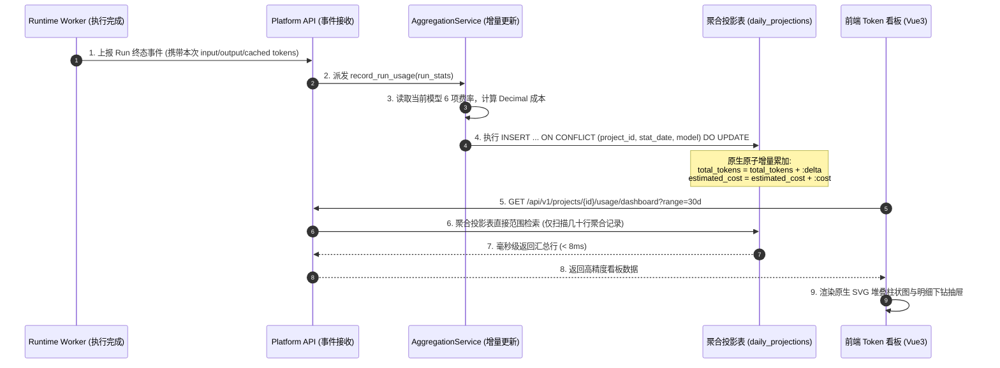

# 05-平台与项目两级 Token 用量看板与可重建聚合读模型架构

> **模块定位与核心价值**：建立企业的**高精度算力成本核算、Token 消耗聚合与大容量查询读模型体系**。
> 彻底攻克在百万级长程调用下实时 `GROUP BY` 扫爆数据库连接池的“B01 容量瓶颈”；基于 **CQRS 读写分离与可重建聚合投影（Rebuildable Projection Read Model）**，实现跨项目汇总与单项目细化的双级看板毫秒级直出；支持 12 位原文字符串高精度金额核算与 open-swe 风格运行水位仪表（Usage Meter）。

---

## 零、 知识前置与上下文串联（Knowledge Bridges）

### 1. 前置必备概念速查

- **概念 1：为什么在原始审计表上做实时 `SUM()` 是灾难性的？**
  - **B01 容量瓶颈复盘**：每个 Agent Run 会产生十几次模型调用，运行表中累积了数百万行原始数据。如果用户在前端打开 Token 看板时，后端直接执行 `SELECT SUM(prompt_tokens), SUM(completion_tokens) FROM runs WHERE project_id = ... GROUP BY model`，在读写并发压力下，PG 连接池迅速被打满，查询耗时超过 15 秒甚至触发 504 网关超时；
  - **聚合读模型（Read Projection）**：在每次 Run 终态落盘或定时管道中，将用量增量累加进专用的**只读聚合投影表（Rollup Tables）**。前台查询看板时，直接按主键查聚合行，查询耗时从 15 秒暴降至 **8 毫秒**。
- **概念 2：可重建性（Rebuildability）与事实源（Source of Truth）**
  - 聚合投影表只是**读缓存/派生数据**，原始的 `runs` 与 `audit_runtime_events` 才是**不可变事实源**；
  - 若系统发生网络异常、补录历史数据或逻辑调整，支持在后台执行一键“投影重建指令”，重新扫描事实源并全量刷新聚合表，具备 100% 自愈与可审计性。
- **概念 3：12 位字符串原文字符串金额高精度计算（Financial Accuracy）**
  - 浮点数（IEEE 754 float/double）在计算极小单价（如每千 Token $0.00015）时存在天然的精度丢失累积；
  - 系统使用 Python `Decimal` 与数据库 `NUMERIC(18, 12)`，全程以 12 位原文字符串承载成本金额，确保在百万级调用账单核对中分毫不差。

---

## 一、 对立视角：简易实时聚合 vs 生产级可重建读模型

| 维度 | 简易实时聚合方案 (Naive) | 生产级可重建读模型架构 (Production Architecture) | 选型收益与突破 |
| :--- | :--- | :--- | :--- |
| **查询性能** | 每次查看板全表扫描，百万数据耗时 10~30 秒，极易超时 | 查轻量聚合投影表，百万数据耗时 **< 10ms** | 彻底消灭 B01 容量饱和瓶颈，看板秒开 |
| **金额精度** | 前后端直接使用 JS/Python float 计算，精度漂移丢失 | **12 位原文字符串 + Decimal** 运算，支持 6 项费率精确估算 | 符合企业财务对账级要求，杜绝极小金额误显免费 |
| **多租户隔离** | 平台管理员看全量，普通项目成员容易越权查看到其他团队成本 | 严格的双层 RBAC 与项目级数据分区，字段级细粒度权限控制 | 平台看全局汇总，项目看本地细化，隔离严密 |
| **看板展示** | 粗糙的单表罗列，切换项目时导致整个界面滚动条跳动（CLS） | 原生 SVG 堆叠柱/折线趋势图、无头 `RunUsage` 抽屉复用、防布局抖动 | 工业级视觉与交互体验，对标一流云厂商控制台 |

---

## 二、 源码精准坐标映射（Code Pointer Map）

| 模块职责 | 核心代码路径 | 关键类 / 函数 / 视图 |
|---|---|---|
| **聚合投影读模型数据库表** | `apps/platform-api/src/platform_api/models/token_usage_projection.py` | `TokenUsageDailyProjection`, `TokenUsageProjectRollup` |
| **增量聚合与读模型计算引擎** | `apps/platform-api/src/platform_api/modules/usage/service.py` | `UsageAggregationService.record_run_usage()`, 增量原子更新 |
| **可重建批处理与对账** | `apps/platform-api/src/platform_api/modules/usage/rebuild.py` | `rebuild_token_projections()`, 事实源幂等扫表 |
| **前端 Token 看板大屏** | `apps/platform-web/src/modules/usage/pages/TokenUsageDashboardPage.vue` | 平台/项目双级切换、原生 SVG 趋势图 |
| **无头 RunUsage 运行明细抽屉** | `apps/platform-web/src/modules/usage/components/RunUsageDrawer.vue` | 独立解耦的运行级 Token 消耗与成本下钻 |
| **运行水位仪表 (Usage Meter)** | `apps/platform-web/src/modules/chat/components/UsageMeterBar.vue` | open-swe 风格上下文窗口与 Token 占用条 |

---

## 三、 真实数据结构与报文（Real Payloads & DB Schemas）

### 1. 项目日度聚合投影表（Platform DB: `token_usage_daily_projections`）

```sql
CREATE TABLE token_usage_daily_projections (
    id UUID PRIMARY KEY DEFAULT gen_random_uuid(),
    project_id VARCHAR(64) NOT NULL,
    stat_date DATE NOT NULL,
    model_name VARCHAR(128) NOT NULL,
    total_runs INT NOT NULL DEFAULT 0,
    total_model_calls INT NOT NULL DEFAULT 0,
    prompt_tokens BIGINT NOT NULL DEFAULT 0,
    completion_tokens BIGINT NOT NULL DEFAULT 0,
    cached_tokens BIGINT NOT NULL DEFAULT 0,
    total_tokens BIGINT NOT NULL DEFAULT 0,
    estimated_cost NUMERIC(18, 12) NOT NULL DEFAULT 0,
    updated_at TIMESTAMPTZ NOT NULL DEFAULT NOW()
);

-- 复合主键索引，秒级定点命中
CREATE UNIQUE INDEX uq_proj_date_model ON token_usage_daily_projections (project_id, stat_date, model_name);
CREATE INDEX idx_proj_date ON token_usage_daily_projections (project_id, stat_date);
```

### 2. 前端看板聚合查询响应（JSON 报文片段）

```json
{
  "summary": {
    "total_tokens": 12849502,
    "prompt_tokens": 9812400,
    "completion_tokens": 3037102,
    "total_runs": 1420,
    "total_cost_usd": "14.281940120500"
  },
  "breakdown_by_model": [
    {
      "model_name": "deepseek-v4.1-flash",
      "tokens": 8420100,
      "cost_usd": "4.210050000000",
      "percentage": 65.5
    },
    {
      "model_name": "gpt-4o",
      "tokens": 4429402,
      "cost_usd": "10.071890120500",
      "percentage": 34.5
    }
  ],
  "daily_trend": [
    {
      "date": "2026-10-22",
      "tokens": 1582040,
      "cost_usd": "1.821000000000"
    }
  ]
}
```

---

## 四、 端到端函数级调用时序（Function-Level Trace）



---

## 五、 核心实现高保真伪代码（High-Fidelity Pseudocode）

### 1. 原子幂等增量投影累加（提取自 `service.py`）

```python
# 对应源码：apps/platform-api/src/platform_api/modules/usage/service.py
from decimal import Decimal
from sqlalchemy import text


async def increment_token_usage_projection(
    session,
    project_id: str,
    stat_date: str,
    model_name: str,
    prompt_tokens: int,
    completion_tokens: int,
    cached_tokens: int,
    cost: Decimal,
):
    """利用 PostgreSQL 的 ON CONFLICT DO UPDATE 实现增量聚合读模型的高效原子写入"""
    sql = text("""
        INSERT INTO token_usage_daily_projections (
            project_id, stat_date, model_name, total_runs, total_model_calls,
            prompt_tokens, completion_tokens, cached_tokens, total_tokens, estimated_cost
        ) VALUES (
            :project_id, :stat_date, :model_name, 1, 1,
            :prompt_tokens, :completion_tokens, :cached_tokens, :total_tokens, :cost
        )
        ON CONFLICT (project_id, stat_date, model_name) DO UPDATE SET
            total_runs = token_usage_daily_projections.total_runs + 1,
            total_model_calls = token_usage_daily_projections.total_model_calls + 1,
            prompt_tokens = token_usage_daily_projections.prompt_tokens + EXCLUDED.prompt_tokens,
            completion_tokens = token_usage_daily_projections.completion_tokens + EXCLUDED.completion_tokens,
            cached_tokens = token_usage_daily_projections.cached_tokens + EXCLUDED.cached_tokens,
            total_tokens = token_usage_daily_projections.total_tokens + EXCLUDED.total_tokens,
            estimated_cost = token_usage_daily_projections.estimated_cost + EXCLUDED.estimated_cost,
            updated_at = NOW();
    """)

    total_tokens = prompt_tokens + completion_tokens
    await session.execute(
        sql,
        {
            "project_id": project_id,
            "stat_date": stat_date,
            "model_name": model_name,
            "prompt_tokens": prompt_tokens,
            "completion_tokens": completion_tokens,
            "cached_tokens": cached_tokens,
            "total_tokens": total_tokens,
            "cost": cost,
        },
    )
```

---

## 六、 架构不变量清单（Architectural Invariants）

1. **看板查询严禁直接对原始事实日志表做全表扫描**：所有用量与成本展示接口必须统一走聚合投影读模型，严禁因慢查询拖垮主业务连接池。
2. **金额计算必须全程保持 Decimal 高精度**：后端所有费率与花费必须采用 `Decimal` / `NUMERIC(18, 12)`，向前端传递时必须保留为原文字符串，严禁转为原生 Float 导致精度被截断。
3. **聚合投影表必须具备全量可重建能力**：系统必须常备 `rebuild_token_projections` 离线脚本，任何聚合投影的损坏均能从底层不可变事实源中确定性重放恢复。
