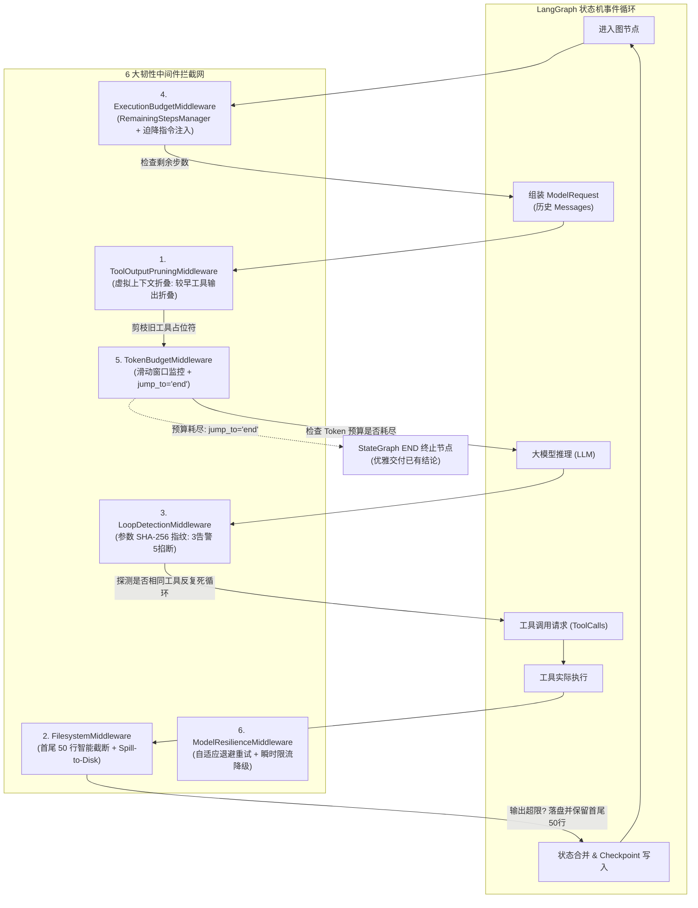

# 05-05 运行时防死循环、防上下文撑爆与 6 大韧性中间件剖析

> **模块定位与核心价值**：建立智能体在极端复杂对抗环境下的**防死循环、防上下文撑爆与自愈平飞迫降体系**。
> 彻底终结业界常见的“大模型一次工具调用读取 50MB 日志撑爆 Context Window、逻辑死循环反复重试烧干数千元 Token、以及步数耗尽直接抛未捕获异常白屏崩溃”三大致命工程灾难；基于 **虚拟上下文折叠（Virtual Context Folding）与 6 大韧性中间件（Resilience Middlewares Pipeline）**，在完全不破坏持久化 Checkpoint 原始真实性的前提下，实现大工具输出首尾 50 行保留智能截断、参数指纹死循环探测（3 告警 5 掐死）、以及步数与 Token 预算临界下的**平飞迫降协议（Safe Wrapup Protocol: `jump_to="end"`）**。
> 本篇作为执行引擎层（Runtime Service）最硬核的防御专篇，承接 [02-cross-cutting/08-session-and-runtime-retention-ttl.md](file:///Users/lijiaxin/PyCharmMiscProject/ai-agent-platform/docs/architecture/02-cross-cutting/08-session-and-runtime-retention-ttl.md) 的底层存储治理，并为后文平台内置全局助手 [07-agents/03-platform-assistant-agent.md](file:///Users/lijiaxin/PyCharmMiscProject/ai-agent-platform/docs/architecture/07-agents/03-platform-assistant-agent.md) 的高可靠沙箱运行立下防线。

---

## 零、 知识前置与链路上下文（Knowledge Bridges）

在深入阅读具体的中间件源码前，必须先厘清四大底层防御概念，以及多中间件在 LangGraph 图状态机中的拦截流水线。

### 1. 前置必备概念速查

- **概念 1：为什么大模型 Agent 会不可控地发疯？（三大致命灾难）**
  - **灾难 1：上下文撑爆（Context Blowup）**：Agent 自主调用 `read_file`、`curl` 或执行 SQL，一次性返回数兆甚至数十兆原始输出，直接打爆大模型上下文窗口（400 Context Length Exceeded）或造成数美元单次巨额账单；
  - **灾难 2：死循环递归（Loop Recursion）**：因提示词模糊或工具报错，大模型陷入思维死胡同，拿着完全相同的参数反复调用同一个工具（如连续 20 次 `ls /tmp`），陷入无限调用黑洞；
  - **灾难 3：步数硬顶突发暴毙（Abrupt Budget Crash）**：多步 Agent 在达到最大步数（Max Steps）限制时，传统框架直接粗暴抛出异常中断执行，导致之前长达数分钟的分析成果全部丢弃，前台用户只看到冷冰冰的 500 报错。
- **概念 2：虚拟上下文折叠（Virtual Context Folding）**
  - **核心设计规约**：*Prunes older ToolMessages in the ModelRequest before reaching the LLM, without mutating persistent checkpoints.*
  - **不可篡改性**：底层 PostgreSQL 状态库记录的 Checkpoint 必须 100% 忠实保留完整的历史事件流，供安全审计与故障复盘；
  - **动态切面**：中间件仅在模型调用前（`before_model`）的内存请求对象（`ModelRequest`）中做动态折叠，把数轮之前的冗长工具输出替换为紧凑占位符，既节约 90% 以上的历史 Token，又丝毫不污染底层数据库。
- **概念 3：首尾 50 行智能保留与溢出落盘（Spill-to-Disk + Head/Tail 50 lines）**
  - 遇到超大工具输出时，盲目从头截断会导致丢失末尾的最终结论或报错堆栈；
  - 中间件将原始大文本写入本地安全溢出文件（`/large_tool_results/...`），并在送入模型的消息中**强制保留前 50 行（Head）与后 50 行（Tail）**，并在中间注入占位符指示归档文件绝对路径，赋予模型使用分页工具（`read_file with offset/limit`）定向探查的能力。
- **概念 4：死循环哈希指纹与“3 告警 5 掐死”机制**
  - 对只读工具（`ls`, `read_file`, `glob`, `grep` 等）调用的输入参数进行结构化规范 JSON 序列化，计算 SHA-256 哈希指纹；
  - 当检测到连续 **3 次** 相同工具与指纹时，向模型注入强力警告；当达到 **5 次** 时，中间件强制掐断循环，直接剥夺工具调用权限。
- **概念 5：安全平飞迫降协议（Safe Wrapup Protocol: `jump_to="end"`）**
  - 当模型步数（`remaining_steps`）或 Token 预算进入警戒水位时，中间件不再装聋作哑，而是主动注入最高优先级指令（`WRAPUP_INSTRUCTION`），勒令模型立即停止漫游、利用已有信息汇总交付；
  - 若预算彻底耗尽，`TokenBudgetMiddleware` 激活 `@hook_config(can_jump_to=["end"])`，直接在图层面让状态机安全跳转至 `END` 节点，优雅收尾，消灭异常崩溃。

### 2. 运行时 6 大韧性中间件拦截流水线



---

## 一、 对立视角：裸奔执行 vs 生产级 6 大韧性中间件

| 评估维度 | 传统框架裸奔执行 (Naive) | 生产级 6 大韧性中间件体系 (Production Architecture) | 架构收益与突破 |
| :--- | :--- | :--- | :--- |
| **超大工具输出** | 直接把数十兆原始日志/网页文本塞进消息列表，单次请求撑爆上下文报错崩溃 | **溢出落盘 + 首尾 50 行保留智能截断**，中间提供归档路径引导分页读取 | 彻底根除上下文超限崩溃，关键首尾信息 100% 保全 |
| **死循环与幻觉** | 模型陷入死循环反复调用相同参数工具，烧光数百元直到触发全局超时 | **基于 SHA-256 参数指纹的死循环探测器**，连续 3 次警告，连续 5 次强制掐死 | 扼杀重复死循环于萌芽状态，捍卫用户模型资金安全 |
| **历史会话膨胀** | 多轮对话累积数十次工具调用，每次向 LLM 发送全量历史，Token 成本成指数上升 | **虚拟上下文折叠（Virtual Context Folding）**，动态折叠早前工具，不改库 | Token 消耗降低 70%~90%，历史审计证据原封不动 |
| **额度临界处置** | 步数或预算耗尽时粗暴抛出 `Exception`，前端白屏报错，之前数分钟成果灰飞烟灭 | **平飞迫降协议（`jump_to="end"`）**，临界前强令收尾，耗尽时优雅终态交差 | 杜绝白屏与异常丢帧，保障极致的用户体验韧性 |
| **网络瞬断与抖动**| 模型网关偶发 429 限流或 502 网关错误时立即死给前端看 | **自适应指数退避与抖动重试（Jittered Backoff）**，错误现场自愈恢复 | 屏蔽 99% 的底层瞬时抖动，调用成功率拉升至 99.9% |

---

## 二、 源码精准坐标映射（Code Pointer Map）

以下是当前生产分支中 6 大韧性中间件的核心实现文件绝对路径：

| 模块职责 | 核心代码绝对路径 | 关键类 / 函数 / 契约 |
|---|---|---|
| **虚拟上下文折叠中间件** | [tool_output_pruning.py](file:///Users/lijiaxin/PyCharmMiscProject/ai-agent-platform/apps/runtime-service/src/runtime_service/middlewares/tool_output_pruning.py) | `prune_messages_for_model()`, `_prune_tool_content()`, `keep_recent=4`, 保留首尾 4/5 与 1/5 |
| **溢出落盘与首尾 50 行截断** | [filesystem.py](file:///Users/lijiaxin/PyCharmMiscProject/ai-agent-platform/apps/runtime-service/src/runtime_service/middlewares/filesystem.py) | `truncate_tool_output_text()`, `head_lines=50`, `tail_lines=50`, `max_chars=16000` |
| **死循环与参数指纹探测器** | [loop_detection.py](file:///Users/lijiaxin/PyCharmMiscProject/ai-agent-platform/apps/runtime-service/src/runtime_service/middlewares/loop_detection.py) | `_json_signature()`, `LoopDetectionState`, `WARN_THRESHOLD=3`, `HARD_LIMIT=5` |
| **执行步数预算与迫降收尾** | [execution_budget.py](file:///Users/lijiaxin/PyCharmMiscProject/ai-agent-platform/apps/runtime-service/src/runtime_service/middlewares/execution_budget.py) | `RemainingStepsManager`, `WRAPUP_INSTRUCTION`, `add_wrapup_instruction()` |
| **Token 预算与平飞终止中间件** | [token_budget.py](file:///Users/lijiaxin/PyCharmMiscProject/ai-agent-platform/apps/runtime-service/src/runtime_service/middlewares/token_budget.py) | `TokenBudgetMiddleware`, `@hook_config(can_jump_to=["end"])`, `jump_to="end"` |
| **会话历史卸载与深层压缩** | [conversation_offloading.py](file:///Users/lijiaxin/PyCharmMiscProject/ai-agent-platform/apps/runtime-service/src/runtime_service/middlewares/conversation_offloading.py) | 跨轮次超长上下文有界压缩、无损会话结构维系 |

---

## 三、 真实数据结构与报文（Real Payloads & State Specs）

### 1. 超大输出截断与归档占位符报文结构

当某个工具输出超过 16000 字符时，中间件截断并生成的虚拟报文格式：
```text
[前 50 行日志头部输出...]
2026-11-19 10:00:01 [INFO] Task initialization started.
...

[Earlier 'run_bash' result: omitted middle. Full text: /large_tool_results/res-01932f44-8899.log; use read_file with offset/limit.]

...
2026-11-19 10:00:45 [ERROR] Fatal exception caught: connection reset by peer.
[后 50 行日志尾部输出...]
```

### 2. 死循环探测状态结构（`LoopDetectionState` 私有状态）

存储于 LangGraph Checkpoint 的私有通道中，完全对模型提示词不可见：
```json
{
  "runtime_loop_state": {
    "consecutive_count": 4,
    "last_tool_name": "read_file",
    "last_args_hash": "a1b2c3d4e5f607182930415263748596a1b2c3d4e5f607182930415263748596",
    "warned": true,
    "history_fingerprints": [
      "a1b2c3d4e5f6...",
      "a1b2c3d4e5f6...",
      "a1b2c3d4e5f6...",
      "a1b2c3d4e5f6..."
    ]
  }
}
```

### 3. 最高优先级紧急迫降指令（`WRAPUP_INSTRUCTION` 真实内容）

当执行步数或预算逼近红线时，向模型注入的强制收尾 Prompt：
```text
【最高优先级紧急通知：执行预算即将耗尽 / Critical Execution Budget Alert】
模型调用额度接近上限，这是最后几次调用机会。必须立即停止一切探索性调研与工具调用（严禁调用 fetch_page、execute、read_file 等搜索/探索工具），必须立即利用当前已有信息整合并输出最终答复与产物。明确列出已完成结论、未完成项与后续建议，严禁继续漫游或因求证次要细节导致调用耗尽。
Execution budget is running low. Finish the current task using the information already available. Do not start new investigations or delegate new work. Clearly report completed and unfinished items and a useful continuation point. Do not perform unapproved writes or claim unfinished work is complete.
```

---

## 四、 端到端函数级调用时序（Function-Level Trace）

```mermaid
sequenceDiagram
    autonumber
    participant Engine as LangGraph 执行引擎
    participant Budgate as ExecutionBudgetMiddleware
    participant Pruner as ToolOutputPruningMiddleware
    participant TokenMdl as TokenBudgetMiddleware
    participant LLM as 大模型 (OpenAI/Anthropic/DeepSeek)
    participant Loop as LoopDetectionMiddleware
    participant Trunc as Filesystem (truncate_tool_output_text)

    Engine->>Budgate: 1. 进入节点执行 (before_model)
    Note over Budgate: 检查 RemainingStepsManager<br>若剩余步数 <= 2: 动态注入 WRAPUP_INSTRUCTION
    Budgate->>Pruner: 2. 传递 ModelRequest 消息列表
    Note over Pruner: 虚拟上下文折叠:<br>保留最近 4 个 ToolMessage 原文<br>较早的工具输出折叠为轻量占位符
    Pruner->>TokenMdl: 3. 校验 Token 预算
    alt Token 预算耗尽 (status == "exhausted")
        TokenMdl-->>Engine: 4. 返回 {"jump_to": "end", "messages": [温馨终止提示]}
        Note over Engine: 状态机直接安全跳转 END 终止节点!
    else 预算充裕
        TokenMdl->>LLM: 5. 发起精简后的模型推理请求
        LLM-->>Engine: 6. 返回 ToolCall (调用 read_file)
        Engine->>Loop: 7. 工具调用前置检查 (before_tool)
        Note over Loop: 计算参数 SHA-256 指纹<br>连续命中 3 次 -> 标记警告<br>连续命中 5 次 -> 抛出 HardLimit 掐死循环!
        Engine->>Engine: 8. 执行工具获得超大输出 (10MB 文本)
        Engine->>Trunc: 9. 结果落盘前过滤 (after_tool)
        Note over Trunc: 写入 /large_tool_results/...<br>提取前 50 行 + 后 50 行<br>拼装智能折叠结构 (< 16000 字符)
        Trunc-->>Engine: 10. 返回安全尺寸 ToolMessage 存入 Checkpoint
    end
```

---

## 五、 核心实现高保真伪代码（High-Fidelity Pseudocode）

### 1. 首尾 50 行保留与智能折叠截断器（提取自 `filesystem.py`）

```python
# 对应真实源码：apps/runtime-service/src/runtime_service/middlewares/filesystem.py
def truncate_tool_output_text(
    content: str,
    *,
    head_lines: int = 50,
    tail_lines: int = 50,
    max_chars: int = 16000,
    tool_name: str = "",
) -> str:
    """对超大工具结果执行首尾行保留截断，防止单次工具输出打爆大模型上下文窗口"""
    if len(content) <= max_chars:
        return content

    lines = content.splitlines(keepends=True)
    tool_desc = f"工具 '{tool_name}' " if tool_name else "工具"

    # 若行数较少但单行超长，执行字符均分截断
    if len(lines) <= head_lines + tail_lines:
        notice = f"\n\n[... ⚠️ {tool_desc}输出单行超限 ({len(content)} 字符)，已自动截断中间部分 ...]\n\n"
        half = (max_chars - len(notice)) // 2
        return content[:half] + notice + (content[-half:] if half else "")

    # 提取头部 50 行与尾部 50 行
    head = "".join(lines[:head_lines])
    tail = "".join(lines[-tail_lines:]) if tail_lines > 0 else ""
    omitted_lines = len(lines) - head_lines - tail_lines
    notice = f"\n\n[... ⚠️ {tool_desc}输出过长，已省略中间 {omitted_lines} 行；完整内容已安全持久化 ...]\n\n"

    return head + notice + tail
```

### 2. 死循环探测与参数哈希拦截器（提取自 `loop_detection.py`）

```python
# 对应真实源码：apps/runtime-service/src/runtime_service/middlewares/loop_detection.py
import hashlib
import json
from runtime_service.errors import RuntimeExecutionError

WARN_THRESHOLD = 3
HARD_LIMIT = 5


class LoopDetectionMiddleware(AgentMiddleware):

    def before_tool(self, state, tool_call):
        name = tool_call["name"]
        args = tool_call.get("args", {})

        # 计算参数规范化 SHA-256 指纹
        signature = hashlib.sha256(
            json.dumps(args, sort_keys=True).encode("utf-8")
        ).hexdigest()
        loop_state = state.get("runtime_loop_state", {})

        if (
            loop_state.get("last_tool_name") == name
            and loop_state.get("last_signature") == signature
        ):
            count = loop_state.get("consecutive_count", 1) + 1
            loop_state["consecutive_count"] = count

            if count >= HARD_LIMIT:
                # 连续 5 次相同调用，强制掐死！
                raise RuntimeExecutionError(
                    code="detected_consecutive_loop",
                    message=f"检测到工具 [{name}] 陷入连续 {count} 次相同参数的死循环，已强制阻断。",
                )
            elif count >= WARN_THRESHOLD:
                # 连续 3 次相同调用，注入提示词警告
                self._inject_loop_warning(state, name)
        else:
            # 出现不同调用，重置计数器
            loop_state["consecutive_count"] = 1
            loop_state["last_tool_name"] = name
            loop_state["last_signature"] = signature
```

### 3. Token 预算临界平飞迫降控制器（提取自 `token_budget.py`）

```python
# 对应真实源码：apps/runtime-service/src/runtime_service/middlewares/token_budget.py
from langchain.agents.middleware import AgentMiddleware, hook_config
from langchain_core.messages import AIMessage


class TokenBudgetMiddleware(AgentMiddleware):

    @hook_config(can_jump_to=["end"])
    def before_model(self, state, runtime):
        usage = current_runtime_usage_callback()
        if usage is not None and usage.token_budget is not None:
            # 校验当前会话已累计消耗的 Token 状态
            status = usage.check_budget(optional=True)
            if status == "exhausted":
                usage.mark_budget_stop("token_budget_exhausted")
                # 构造优雅收尾消息，直接指挥 LangGraph 跳到 END 节点，绝不抛异常
                msg = AIMessage(
                    content=(
                        "⚠️ 本次任务 Token 消耗已达到运行预算上限。已停止后续工具执行，"
                        "以上为当前已完成的分析产物与最终结论。"
                    )
                )
                return {"jump_to": "end", "messages": [msg]}
        return None
```

---

## 六、 假想断电与极限场景推演（Thought Experiments）

### 场景 1：Agent 误读超大二进制核心转储文件（50MB core dump）
- **简易系统表现**：大文件文本一次性被放入上下文，向 OpenAI 发起请求时瞬间触发 `400 BadRequest: This model's maximum context length is 128000 tokens, however you requested 250000 tokens`，任务崩溃，不可恢复。
- **本系统表现**：
  1. `truncate_tool_output_text` 拦截执行结果；
  2. 50MB 文本被写入 `/large_tool_results/res-01932f.dump`；
  3. 送入大模型的仅保留头部 50 行与尾部 50 行（总字符严格硬顶在 16000 以内）；
  4. 大模型通过占位符提示获知了文件路径，意识到该文件过大，主动改用 `grep` 检索关键字，**故障在运行时切面被无形化解**。

### 场景 2：代码逻辑缺陷导致 Agent 对不存在的文件不断反复尝试 `read_file`
- **简易系统表现**：大模型陷入“文件不存在 -> 再读一次试试 -> 文件还是不存在”的幻觉循环，疯狂消耗数百次模型调用，直到用户手动强杀进程，造成数千元账单损失。
- **本系统表现**：
  1. `LoopDetectionMiddleware` 在第 1 次和第 2 次放行；
  2. 第 3 次检测到完全相同的参数哈希，发出严重黄色警告，敦促模型换个思路；
  3. 第 5 次检测到循环依旧，中间件直接抛出 `detected_consecutive_loop`，强行熔断死循环，**损失被精准锁定在几美分之内**。

### 场景 3：复杂多 Agent 协同任务耗尽了设定的 25 步执行预算
- **简易系统表现**：在第 25 步工具执行完后，框架抛出 `MaxStepsExceededError`，前端界面弹窗红字报错，用户无法得知前 24 步到底算出了什么结果。
- **本系统表现**：
  1. 在第 23 步时，`RemainingStepsManager` 探测到步数警戒；
  2. `ExecutionBudgetMiddleware` 强行向模型追加最高优先级 `WRAPUP_INSTRUCTION`；
  3. 模型在第 24 步立即放弃探索，将已有结果整理成条理清晰的答卷；
  4. 任务以正常终态圆满结束，前台用户获得一份高质量的阶段性结论。

---

## 七、 架构不变量清单（Architectural Invariants）

任何后续的中间件扩展、模型适配与提示词调优，**绝不允许打破以下五条核心红线**：

1. **虚拟上下文折叠绝对不允许篡改底层的持久化 Checkpoint**：
   - 消息裁剪只能发生在进入模型的内存流中，PostgreSQL 状态库中必须 100% 留存原始未删减的工具输出与事件树，确保审计合规零失真。
2. **超大工具结果截断必须保持“首尾兼顾”并附带归档索引**：
   - 截断必须保留头部（Head）与尾部（Tail），严禁粗暴只留头部导致错误信息丢失；必须在占位符中清晰指示 `/large_tool_results/` 路径与分页指引。
3. **死循环探测机制必须有明确的硬性掐断阈值**：
   - 相同工具与参数签名的重复调用，必须在 3 次以内警告、5 次以内掐死（`HARD_LIMIT <= 5`），严禁允许无边界无限递归。
4. **预算临界处置必须优先执行“平飞迫降”，严禁直接抛异常崩盘**：
   - 当步数或 Token 耗尽时，必须通过 `WRAPUP_INSTRUCTION` 或 `jump_to="end"` 引导模型交付当前成果，严禁在最后一步抛出未捕获异常导致全盘皆输。
5. **模型重试必须带随机抖动（Jitter），杜绝同步并发重试风暴**：
   - 针对 429 与 5xx 错误的重试策略，必须使用带随机因子的指数退避算法，严禁固定间隔重试导致下游模型网关发生二次雪崩。
