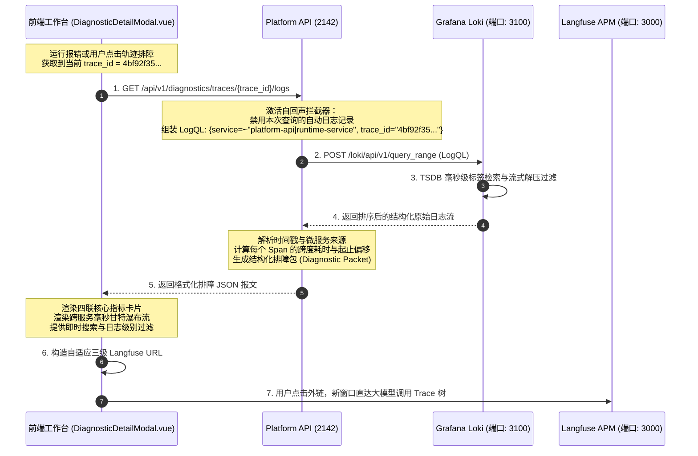

# 06-05 Trace-to-Logs 毫秒级分布式排障日志穿透时序深度解密

> **场景定位与核心价值**：解析对标大厂（阿里 ARMS、字节排障）体验的**分布式微服务排障全链路贯穿时序**。
> 解决微服务排障中“前端报错、后端日志如大海捞针”的痛点；凭借单一 `trace_id`，在前端一屏内同时展现微服务调用拓扑瀑布图与各服务毫秒级对齐的详细上下文日志，并无缝直达 Langfuse 链路树。

---

## 零、 场景拓扑与核心时序

---

## 一、 关键阶段与源码坐标映射

| 阶段步骤 | 关键代码路径 | 职责与防御细节 |
|---|---|---|
| **1. 诊断接口与自回声阻断** | `apps/platform-api/src/platform_api/modules/diagnostics/router.py` | `query_trace_logs()`，向 Loki 发起 LogQL，排除自污染路径 |
| **2. Loki TSDB 标签聚合** | `deploy/docker-compose.observability.yml` | 依托 TSDB 索引对 `trace_id` 毫秒直查，无全文倒排索引开销 |
| **3. 前端甘特瀑布流呈现** | `apps/platform-web/src/modules/diagnostics/components/DiagnosticDetailModal.vue` | 耗时瀑布流渲染、微服务调用分层、深浅主题自适应 |
| **4. Langfuse 三级自适应跳转** | `apps/platform-web/src/modules/diagnostics/utils/langfuseUrl.ts` | `resolveLangfuseTraceUrl()`，基于环境变量与项目元数据防 404 |
