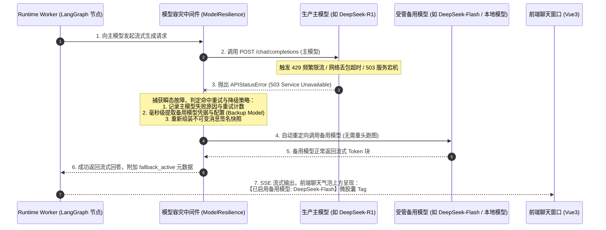

# 06-07 大模型瞬态故障毫秒级主备容灾降级时序深度解密

> **场景定位与核心价值**：解析智能体在执行长程复杂任务时，遭遇外部 LLM 供应商**网络抖动、429 限流或服务宕机时的毫秒级容灾降级（Model Fallback）时序**。
> 消除大模型服务商作为外部不可控单点的脆弱性；通过受管备用模型自动切换中间件与签名快照，保障关键任务的确定性执行，并在前端呈现备用模型微胶囊 Tag 保持透明。

---

## 零、 场景拓扑与核心时序

---

## 一、 关键阶段与源码坐标映射

| 阶段步骤 | 关键代码路径 | 职责与防御细节 |
|---|---|---|
| **1. 备用模型配置与网关签名** | `apps/platform-api/src/platform_api/modules/models/` | 模型 Catalog 配置受管备用模型与恢复重试策略 |
| **2. 运行时容灾拦截中间件** | `apps/runtime-service/src/runtime_service/middleware/model_resilience.py` | 捕获 429/5xx 异常，执行最大等待时间与备用模型平滑替换 |
| **3. 前端透明感知微胶囊** | `apps/platform-web/src/modules/chat/components/MessageHeader.vue` | 识别 `fallback_model` 标记，高亮琥珀色备用模型标签 |
