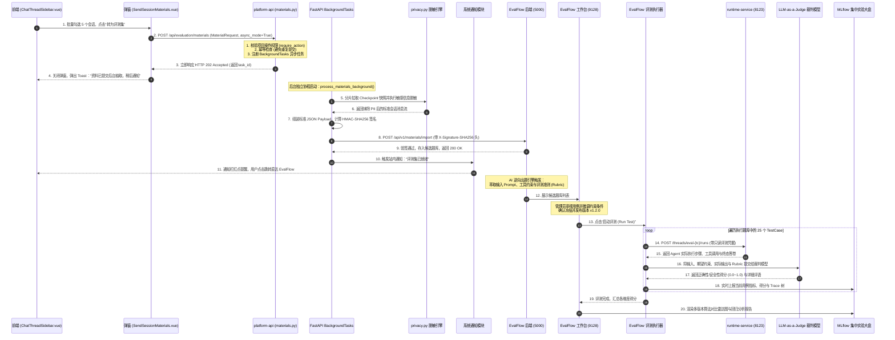

# 08-生产会话转持续评测飞轮端到端全链路 (End-to-End Session to Eval Flywheel Flow)

> **场景定位与核心价值**：建立整套系统的**线上真实会话数据回流、合规脱敏、AI 逆向出题、自动化裁判与集中实验归档的完整闭环**。
> 彻底攻克业界“缺乏真实评测语料、人工造题成本极高、线上长尾故障无法复现、算法改动缺乏基线对比”四大痛点；贯穿 **`platform-web`（前端）**、**`platform-api`（控制面）**、**`runtime-service`（执行引擎）**、**`EvalFlow`（独立评测系统）** 与 **`MLflow`（集中实验追踪）** 五大独立组件；全链路展现从用户在会话列表批量勾选会话、合规授权、HTTP 202 异步脱敏物化，到 EvalFlow AI 自动化逆向提炼用例、发布题库、驱动 Agent 运行基准、LLM 裁判打分与实验大盘对比的工业级全生命周期。
> 本篇作为场景时序大闭环的第一篇，承接 [02-cross-cutting/07-continuous-evaluation-flywheel.md](../02-cross-cutting/07-continuous-evaluation-flywheel.md) 的底层评测飞轮机制，为平台智能化质检与算法迭代提供端到端工程标准。

---

## 零、 知识前置与上下文串联（Knowledge Bridges）

在深入阅读具体的跨服务调用时序前，必须理清三大认知输入，以及本场景在整个知识拓扑中的承上启下关系。

### 1. 认知输入（前置模块依赖）
- 依赖 [02-cross-cutting/01-communication-matrix.md](../02-cross-cutting/01-communication-matrix.md)：掌握干线 7（持续评测飞轮流水线通信）的 HMAC 签名校验、202 异步状态与只读目标调用契约。
- 依赖 [02-cross-cutting/07-continuous-evaluation-flywheel.md](../02-cross-cutting/07-continuous-evaluation-flywheel.md)：掌握两权物理分离原则（*Supply authorized Session evidence. Test case authoring belongs to EvalFlow.*）与数据分级（synthetic/business）。
- 依赖 [02-cross-cutting/04-trace-and-observability.md](../02-cross-cutting/04-trace-and-observability.md)：掌握 MLflow 集中式实验追踪的 Runs、Metrics 与 Trace 上报机制。

### 2. 本章核心流转
- **前端意图收集**：单会话菜单或侧边栏多选（最多 20 个会话），收集用例集标题与合规授权声明。
- **控制面网关准入与 202 异步解耦**：API 校验项目操作权限，执行幂等检查，立即返回 `202 Accepted` 并释放前端 HTTP 连接。
- **后台脱敏物化与 HMAC 签名投递**：`BackgroundTasks` 分片读取会话 Checkpoint 快照，执行正则脱敏（抹除手机号、密码、凭据），组装报文并基于共享密钥计算 HMAC-SHA256 签名，跨机投递给 EvalFlow。
- **EvalFlow AI 逆向建题与题库发布**：EvalFlow 接收资料并触发 AI 逆向出题引擎，从真实交互中提炼出输入 Prompt、工具约束与裁判准则（Rubric）；管理员微调后冻结发布为版本化题库资产。
- **驱动基准运行与 LLM-as-a-Judge 裁判归档**：EvalFlow Batch Runner 调用 Agent 只读接口执行测试，专用裁判模型多维度打分，指标与执行树自动归档至 MLflow 集中大盘，生成算法演进雷达图。

### 3. 认知输出（支撑后续模块）
- 为 [09-platform-assistant-diagnostics-flow.md](09-platform-assistant-diagnostics-flow.md) 提供评测资产如何被平台全局助手作为辅助参考资料进行故障溯源的依据。

---

## 一、 对立视角：简易原型 vs 生产架构（Naive vs. Production）

| 维度 | 常见简易方案 (Naive) | 本平台生产级全链路闭环 (Production Architecture) | 架构选型收益与突破 |
| :--- | :--- | :--- | :--- |
| **评测语料来源** | 研发人员手工编写十几个死板的测试用例，脱离真实生产环境 | **生产会话一键回流**，涵盖真实线上长尾场景、工具报错现场与用户纠错交互 | 评测集随线上真实调用持续动态演进，消灭“测试全绿、线上一跑就崩” |
| **前台交互与超时** | 在前端发起同步请求，后端边读历史边调大模型，转圈数分钟后 504 超时崩溃 | **两阶段 HTTP 202 Accepted 异步解耦**，30ms 极速响应，后台任务分片处理 | 用户前端零阻塞、零卡顿；支持 1~20 个超长会话批量无压力抽取 |
| **数据隐私合规** | 生产数据直接原样透传给评测模型，用户手机号、身份证、密钥等 PII 全面泄露 | **强制分级隐私脱敏（`privacy.py`）**，内置正则与实体清洗，抹除敏感字段 | 严格遵守数据安全合规要求，敏感凭据绝对不出域 |
| **测试断言机制** | 简单的字符串包含断言（`assert "成功" in text`），模型稍微换个同义词就误报失败 | **LLM-as-a-Judge 裁判模型**，根据提炼出的 Rubric 进行语义、安全性与工具合规多维评分 | 工业级弹性打分，准确识别幻觉、工具漏调与语气不当 |
| **系统架构耦合度**| 评测直接连生产数据库扫表，甚至把评测逻辑塞在业务进程中跑，把主库打垮 | **独立服务（5000/9128）跨机部署**，独立存储与 MLflow 追踪，零源码依赖，API 受控互通 | 保护主站核心业务性能坚如磐石；评测系统可独立作为 CI/CD 卡点运行 |

---

## 二、 源码精准坐标映射（Code Pointer Map）

### 1. 前端交互与入口
- [apps/platform-web/src/modules/chat/components/ThreadActionsMenu.vue](../../../apps/platform-web/src/modules/chat/components/ThreadActionsMenu.vue)：单会话上下文菜单中的“转为评测集”入口。
- [apps/platform-web/src/modules/chat/components/ChatThreadSidebar.vue](../../../apps/platform-web/src/modules/chat/components/ChatThreadSidebar.vue)：侧边栏多会话批量选择器（最多限制 20 个）。
- [apps/platform-web/src/modules/evaluation/components/SendSessionMaterials.vue](../../../apps/platform-web/src/modules/evaluation/components/SendSessionMaterials.vue)：收集转换标题、数据类型确认与提交弹窗。
- [apps/platform-web/src/modules/evaluation/EvaluationMovedPage.vue](../../../apps/platform-web/src/modules/evaluation/EvaluationMovedPage.vue)：指引用户前往 EvalFlow 工作台的受控迁移页。

### 2. 控制面网关与脱敏投递
- [apps/platform-api/src/platform_api/modules/evaluation/materials.py](../../../apps/platform-api/src/platform_api/modules/evaluation/materials.py)：`submit_materials()`，202 异步调度，`process_materials_background()` 异步任务。
- [apps/platform-api/src/platform_api/modules/evaluation/privacy.py](../../../apps/platform-api/src/platform_api/modules/evaluation/privacy.py)：`sanitize_message_content()`，手机号与凭据脱敏流水线。
- [apps/platform-api/src/platform_api/modules/evaluation/router.py](../../../apps/platform-api/src/platform_api/modules/evaluation/router.py)：`/api/evaluation/materials` 路由与 `require_action(actor, "create")` 鉴权。

### 3. 底座运行时与只读目标
- [apps/runtime-service/src/runtime_service/observability/evaluation_target.py](../../../apps/runtime-service/src/runtime_service/observability/evaluation_target.py)：向 EvalFlow 暴露的只读评测 Agent 目标配置。
- [apps/runtime-service/src/runtime_service/observability/mlflow_tracer.py](../../../apps/runtime-service/src/runtime_service/observability/mlflow_tracer.py)：集中式 MLflow 实验数据追踪器。

---

## 三、 真实数据结构与报文（Real Payloads & DB Schemas）

### 1. 前端提交转评测请求报文（`POST /api/evaluation/materials`）

```json
{
  "request_id": "01932f44-8899-7abc-def0-123456789abc",
  "thread_ids": [
    "01932345-6789-7abc-def0-123456789abc",
    "01932345-6789-7abc-def0-987654321def"
  ],
  "title": "2026-11-19 客户多轮退款与工具重试异常用例集",
  "synthetic_attestation": false,
  "data_class": "business",
  "material_consent": true,
  "auto_generate": true,
  "async_mode": true
}
```

### 2. 控制面响应 HTTP 202 Accepted 报文

```json
HTTP/1.1 202 Accepted
Content-Type: application/json

{
  "status": "accepted",
  "message": "评测集转换任务已提交后台处理，完成后将通过系统通知告知。",
  "task_id": "mat-01932f44-8899",
  "item_id": "mat-01932f44-8899",
  "request_id": "01932f44-8899-7abc-def0-123456789abc",
  "title": "2026-11-19 客户多轮退款与工具重试异常用例集"
}
```

### 3. 控制面向 EvalFlow 投递的 HMAC-SHA256 签名报文（带脱敏快照）

```http
POST /api/v1/materials/import HTTP/1.1
Host: 127.0.0.1:5000
Content-Type: application/json
X-Signature-SHA256: 7f83b1657ff1fc53b92dc18148a1d65dfc2d4b1fa3d677284addd200126d9069
X-Origin-Platform: http://127.0.0.1:2142

{
  "material_id": "mat-01932f44-8899",
  "project_id": "01932000-1111-7abc-def0-000000000000",
  "title": "2026-11-19 客户多轮退款与工具重试异常用例集",
  "sessions": [
    {
      "thread_id": "01932345-6789-7abc-def0-123456789abc",
      "messages": [
        {
          "role": "user",
          "content": "请帮我核查订单 20261119-001 并申请退款，联系电话是 138****0000"
        },
        {
          "role": "assistant",
          "tool_calls": [
            {
              "name": "refund_order",
              "args": {"order_id": "20261119-001", "amount": 128.5}
            }
          ]
        }
      ]
    }
  ],
  "timestamp": 1763528400
}
```

### 4. MLflow 实验 Run 归档结构示例

```json
{
  "run_name": "eval_run_v1.2.0_20261119_1030",
  "experiment_id": "exp-agent-refund-benchmark",
  "params": {
    "agent_model": "deepseek-v4.1-flash",
    "dataset_version": "v1.2.0",
    "test_cases_count": 25,
    "judge_model": "gpt-4o"
  },
  "metrics": {
    "overall_accuracy_score": 0.945,
    "tool_compliance_score": 0.980,
    "avg_latency_ms": 1240.5,
    "total_tokens_consumed": 185420
  }
}
```

---

## 四、 端到端函数级调用时序（Function-Level Trace）



---

## 五、 核心实现高保真伪代码（High-Fidelity Pseudocode）

### 1. 控制面：202 异步非阻塞物化调度器（提取自 `materials.py`）

```python
# 对应真实源码：apps/platform-api/src/platform_api/modules/evaluation/materials.py
from fastapi import BackgroundTasks, Request, Response, status
from platform_api.core.errors import ConflictError


async def submit_materials_endpoint(
    request: Request,
    response: Response,
    body: MaterialRequest,
    actor: ActorContext,
    background_tasks: BackgroundTasks,
    gateway=Depends(get_runtime_gateway_service),
):
    project_id = _require_project_id(request)
    require_action(actor, project_id, "create")

    item_id = f"mat-{body.request_id}"
    submission = f"{project_id}:{item_id}"

    # 1. 幂等性校验：如果该 request_id 已经提交过且范围一致，直接返回已处理状态
    previous = await forward_check(request, actor, project_id, item_id)
    if previous.get("id"):
        if previous.get("scope") != submission:
            raise ConflictError(
                code="evaluation_material_conflict",
                message="该提交编号已经用于其他资料，不能覆盖。",
            )
        return {"status": "reused", "item_id": item_id, "reused": True}

    # 2. 异步模式分支：注册 BackgroundTasks 并立即响应 HTTP 202 Accepted
    if body.async_mode and background_tasks is not None:
        response.status_code = status.HTTP_202_ACCEPTED
        background_tasks.add_task(
            process_materials_background,
            app_state=request.app.state,
            actor=actor,
            project_id=project_id,
            gateway=gateway,
            body=body,
            item_id=item_id,
            submission=submission,
            title=body.title,
        )
        return {
            "status": "accepted",
            "message": "评测集转换任务已提交后台处理，完成后将通过系统通知告知。",
            "task_id": item_id,
            "item_id": item_id,
            "request_id": str(body.request_id),
            "title": body.title,
        }
```

### 2. 异步后台任务向 EvalFlow 签名投递逻辑

```python
# 对应真实源码：apps/platform-api/src/platform_api/modules/evaluation/materials.py
import hashlib
import hmac
import json
import time
import httpx


async def process_materials_background(
    app_state, actor, project_id, gateway, body, item_id, submission, title
):
    materials = []
    # a. 读取快照并逐条脱敏
    for thread_id in body.thread_ids:
        raw_snapshot = await gateway.get_thread_history(str(thread_id))
        sanitized_snapshot = sanitize_snapshot(raw_snapshot, body.data_class)
        materials.append(sanitized_snapshot)

    # b. 组装报文并基于共享密钥计算 HMAC-SHA256
    payload = {
        "material_id": item_id,
        "project_id": project_id,
        "title": title,
        "materials": materials,
        "timestamp": int(time.time()),
    }
    body_bytes = json.dumps(payload, sort_keys=True).encode("utf-8")
    signature = hmac.new(
        app_state.settings.evalflow_shared_secret.encode("utf-8"),
        body_bytes,
        hashlib.sha256,
    ).hexdigest()

    # c. 投递至 EvalFlow (端口 5000)
    async with httpx.AsyncClient(timeout=15.0) as client:
        resp = await client.post(
            f"{app_state.settings.evalflow_url}/api/v1/materials/import",
            content=body_bytes,
            headers={
                "Content-Type": "application/json",
                "X-Signature-SHA256": signature,
            },
        )
        if resp.status_code == 200:
            # d. 成功后触发系统通知，让用户前往 EvalFlow 出题
            await send_notification_to_user(
                actor.user_id,
                title="评测集转换完成",
                content=f"用例资料【{title}】已成功同步至 EvalFlow，点击前往出题。",
                link=f"{app_state.settings.evalflow_url}/#/authoring?id={item_id}",
            )
```

---

## 六、 假想断电与极限场景推演（Thought Experiments）

### 场景 1：用户批量勾选 20 个超长多轮长程会话（文本总量超 10MB）转为评测集
- **简易系统表现**：单次同步 HTTP 请求在查询数据库、正则脱敏与组织 JSON 时耗时超过 45 秒，中间代理 Nginx 触发 504 Gateway Timeout，前端红字报错，用户再次刷新重复提交，导致后台发生大事务行锁冲突。
- **本系统表现**：
  1. 控制面在 30 毫秒内完成权限审查与参数校验，为该批次打上 `task_id`，立即返回 `202 Accepted`；
  2. 前端弹窗瞬间关闭，用户无感知继续进行其他业务操作；
  3. 后台 `BackgroundTasks` 分片读取会话历史、执行正则脱敏并平稳投递至 EvalFlow；
  4. 资料物化完毕后，前端右上角通知栏亮起红点，点击一键跳转至 EvalFlow，体验丝滑流畅。

### 场景 2：EvalFlow 运行百道题评测时，线上某个三方模型 API 突发限流 429
- **简易系统表现**：若整个测试脚本同步阻塞执行，一个用例失败导致整批 100 道题评测全部报错中断，之前的打分数据全部丢失。
- **本系统表现**：
  1. EvalFlow Batch Runner 逐题独立运行，每个 TestCase 拥有独立的运行上下文；
  2. 遇到 429 报错时，触发底层 `ModelResilienceMiddleware` 的指数退避重试（最多 3 次）；
  3. 若重试依然失败，仅将当前 TestCase 标记为 `ERROR` 并记录错误快照，其余 99 道题继续正常执行；
  4. 最终 MLflow 大盘如实反映该模型在并发压力下的稳定率（Availability Rate），错误被转化为极具价值的算法评估资产。

### 场景 3：外部恶意用户试图绕过平台直接调用 EvalFlow 的 `materials/import` 接口注入脏数据
- **简易系统表现**：如果评测导入接口没有严格认证，黑客可以随意导入海量虚假用例，污染评测题库，甚至让裁判模型被提示词注入攻击。
- **本系统表现**：
  1. EvalFlow 校验 `X-Signature-SHA256` 头部；
  2. 必须使用掌握平台 `evalflow_shared_secret` 的私钥对请求载荷进行规范化哈希签名；
  3. 未经签名或签名不匹配的伪造请求直接被拦截抛出 401 鉴权异常，外部非法入侵被物理阻断。

---

## 七、 架构不变量清单（Architectural Invariants）

任何后续的场景重构与功能演进，**绝不允许打破以下五条核心红线**：

1. **两权物理彻底分离，绝对不允许服务间反向侵入**：
   - 会话证据的权限校验、合规脱敏属于 Agent 平台；出题、版本管理、裁判打分与实验对比属于 EvalFlow；
   - EvalFlow 绝对不直接读取 Agent 源码文件，绝对不共享 Python 虚拟环境，绝对不直连 Agent 业务数据库。
2. **转评测接口必须优先采用异步 202 机制**：
   - 任何涉及多会话物化抽取的接口，必须采用 `BackgroundTasks` 异步非阻塞处理并返回 `HTTP 202 Accepted`，严禁在主请求中同步阻塞组装数据。
3. **出域数据必须强制执行隐私分级脱敏**：
   - 业务数据（`data_class="business"`）转评测必须经过正则脱敏引擎抹除用户 PII 与凭据；严禁将未脱敏的敏感信息投递给外部裁判模型。
4. **单次会话转换上限强制硬顶为 20 个**：
   - 为防止大内存对象撑爆后台协程，单次提交的 `thread_ids` 数量必须通过 Pydantic 校验严格限制在 `1 ~ 20` 之间，严禁开放无上限批量提交。
5. **评测基准运行必须通过只读受限凭据驱动**：
   - EvalFlow 在向 Agent 发起基准测试时，必须使用受限的项目级执行凭据，严禁授予配置修改、用户管理或平台写权限。
