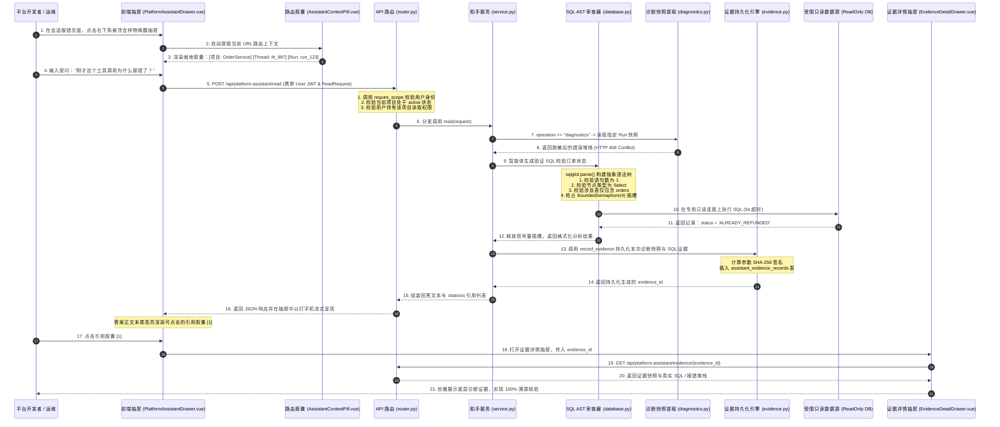

# 09-平台全局助手就地故障诊断与证据链回溯时序大闭环 (Platform Assistant Diagnostics & Evidence Flow)

> **场景定位与核心价值**：建立整套系统的**就地故障诊断、智能自愈建议、只读数据检索与不可变证据链回溯全链路**。
> 彻底攻克业界“控制台报错需要跳出页面人工复制粘贴、模型排障建议凭空捏造不可考据、以及传统运维机器人权限失控引发删库隐患”三大致命工程痛点；贯穿 **`platform-web`（全局悬浮抽屉与证据抽屉）**、**`platform-api`（助手路由与静态 AST 安全网关）**、**`PostgreSQL`（只读副本与不可变证据事实源）** 与 **`Loki TSDB`（微服务日志中心）**；全链路展现用户在任意报错页面唤醒助手、自动注入当前路由上下文胶囊、控制面 `require_scope` 实时身份重验、`sqlglot` 静态 AST 深度只读审查、不可变证据链持久化、以及前台打字机流式输出并支持点击引用胶囊（Citations）秒级深钻底层证据的端到端闭环。
> 本篇作为场景时序大闭环的第二篇，承接 [07-agents/03-platform-assistant-agent.md](../07-agents/03-platform-assistant-agent.md) 的底层智能体架构，为平台运营与开发者提供极致的可信排障体验。

---

## 零、 知识前置与上下文串联（Knowledge Bridges）

在深入阅读具体的跨服务调用时序前，必须理清三大认知输入，以及本场景在整个知识拓扑中的承上启下关系。

### 1. 认知输入（前置模块依赖）
- 依赖 [07-agents/03-platform-assistant-agent.md](../07-agents/03-platform-assistant-agent.md)：掌握平台全局助手的只读沙箱架构、`sqlglot` 语法树静态审查规约与不可变证据模型 `AssistantEvidenceRecord`。
- 依赖 [02-cross-cutting/01-communication-matrix.md](../02-cross-cutting/01-communication-matrix.md)：掌握干线 8（平台内置助手诊断通道）的通信契约与只读凭据约束。
- 依赖 [02-cross-cutting/04-trace-and-observability.md](../02-cross-cutting/04-trace-and-observability.md)：掌握通过 LogQL 穿透 Loki TSDB 的防自回声检索语法。

### 2. 本章核心流转
- **就地唤醒与隐式路由胶囊注入**：用户在会话出错页面点击右下角悬浮吉祥物，前端自动提取当前 URL 路由中的 `project_id`, `thread_id`, `run_id`，作为上下文胶囊（`AssistantContextPill.vue`）注入助手。
- **控制面严格准入与操作分发**：API 接口执行 `require_scope` 校验项目激活状态与用户角色；将自然语言意图拆解为 `diagnostics`, `logs`, `sql_query` 等纯只读操作。
- **安全沙箱执行与 AST 审查**：若触发 SQL 分析，通过 `sqlglot` 静态解析 AST 语法树，强制断言为只读 Select 且仅引用白名单表与白名单函数，抢占 `BoundedSemaphore(4)` 插槽并在专用只读 DSN 执行；若触发日志拉取，通过带有 `!~ "loki/api/v1/query"` 的 LogQL 检索微服务对齐日志。
- **不可变证据链持久化**：每次只读工具执行均持久化一条 `AssistantEvidenceRecord`，生成唯一 `evidence_id` 并计算 SHA-256 签名防篡改。
- **流式解答与引用胶囊秒级下钻**：前端打字机流式渲染 Markdown 解答，文本末尾挂载引用胶囊 `[1]`；用户点击胶囊直接滑出 `EvidenceDetailDrawer.vue` 证据抽屉，核验底层真实 SQL、执行结果与错误堆栈。

### 3. 认知输出（支撑后续模块）
- 为 [10-gateway-usage-to-trace-flow.md](10-gateway-usage-to-trace-flow.md) 提供用量分析看板如何与助手证据链进行联动诊断的技术支撑。

---

## 一、 对立视角：简易原型 vs 生产架构（Naive vs. Production）

| 维度 | 常见简易排障方案 (Naive) | 本平台生产级全链路闭环 (Production Architecture) | 架构选型收益与突破 |
| :--- | :--- | :--- | :--- |
| **交互现场感** | 遇到报错，用户必须切走页面打开一个完全割裂的工单系统或聊天窗口，手动复制粘贴一大堆错误日志 | **全局悬浮交互（Drawer）+ 路由上下文自动感知**，原地唤醒助手，当前上下文自动就绪 | 零跳转成本，排障操作无缝嵌入当前业务工作流 |
| **数据库安全边界** | 助手直接连接后端主业务数据库并具备写权限，Prompt 注入攻击可导致整库被 Drop | **专用只读 DSN + 静态 SQL AST 审查**，仅允许 `Select`，白名单表与内置函数严格硬顶 | 彻底消灭数据篡改与删库风险，防御能力达到金融级合规标准 |
| **排障结论可信度** | 助手凭大模型幻觉编造排障建议，经常胡说八道且无从考据真实性 | **不可变证据链（`AssistantEvidenceRecord`）**，每个关键结论均挂载证据编号与脱敏快照 | 结论 100% 有据可查，用户可点击引用胶囊一键穿透核验真实证据 |
| **系统防打垮保护** | 复杂分析 SQL 无限并发，用户多问几句长报表直接把生产数据库连接池吃满 | 引入 **`threading.BoundedSemaphore(4)` 严格控制插槽**，单语句 5 秒硬超时 | 严格限制分析型慢查询开销，绝不影响主业务交易吞吐 |
| **权限隔离粒度** | 助手只要有权限就能查所有租户数据，普通用户可借机横向越权偷看其他团队数据 | **每次请求实时调用 `require_scope`**，限定只能查当前所属项目授权数据集 | 杜绝横向越权（IDOR）与跨租户隐私泄露 |

---

## 二、 源码精准坐标映射（Code Pointer Map）

### 1. 前端交互与证据抽屉
- [apps/platform-web/src/modules/platform-assistant/components/PlatformAssistantDrawer.vue](../../../apps/platform-web/src/modules/platform-assistant/components/PlatformAssistantDrawer.vue)：全局常驻悬浮抽屉主组件，负责会话状态与流式渲染。
- [apps/platform-web/src/modules/platform-assistant/components/AssistantContextPill.vue](../../../apps/platform-web/src/modules/platform-assistant/components/AssistantContextPill.vue)：路由上下文胶囊，自动解析当前 URL 绑定的 `project_id`, `thread_id`, `run_id`。
- [apps/platform-web/src/modules/platform-assistant/components/EvidenceDetailDrawer.vue](../../../apps/platform-web/src/modules/platform-assistant/components/EvidenceDetailDrawer.vue)：不可变证据详情抽屉，展示底层的真实 SQL 语句、查询结果与日志快照。

### 2. 控制面后端与只读安全网关
- [apps/platform-api/src/platform_api/modules/platform_assistant/router.py](../../../apps/platform-api/src/platform_api/modules/platform_assistant/router.py)：`/api/platform-assistant` 路由，处理 `read` 请求与租户上下文隔离。
- [apps/platform-api/src/platform_api/modules/platform_assistant/service.py](../../../apps/platform-api/src/platform_api/modules/platform_assistant/service.py)：`read()`, `require_scope()`，实时核验用户身份与项目状态。
- [apps/platform-api/src/platform_api/modules/platform_assistant/database.py](../../../apps/platform-api/src/platform_api/modules/platform_assistant/database.py)：`validated_sql()`，基于 `sqlglot` 的静态 AST 审查器与 `BoundedSemaphore(4)` 信号量限流。
- [apps/platform-api/src/platform_api/modules/platform_assistant/evidence.py](../../../apps/platform-api/src/platform_api/modules/platform_assistant/evidence.py)：`record_evidence()`，持久化证据记录并生成 SHA-256 操作指纹。
- [apps/platform-api/src/platform_api/modules/platform_assistant/models.py](../../../apps/platform-api/src/platform_api/modules/platform_assistant/models.py)：`AssistantEvidenceRecord` 实体模型定义。

### 3. 底座日志与运行诊断服务
- [apps/platform-api/src/platform_api/modules/observability/service.py](../../../apps/platform-api/src/platform_api/modules/observability/service.py)：`ObservabilityService.query_trace_logs()`，执行防自回声的 LogQL 查询。
- [apps/platform-api/src/platform_api/modules/platform_assistant/diagnostics.py](../../../apps/platform-api/src/platform_api/modules/platform_assistant/diagnostics.py)：`read_checkpoint()`，从底层提取过滤脱敏后的运行态现场快照。

---

## 三、 真实数据结构与报文（Real Payloads & DB Schemas）

### 1. 助手只读请求报文（`POST /api/platform-assistant/read`）

```json
{
  "operation": "diagnostics",
  "target_thread_id": "01932345-6789-7abc-def0-123456789abc",
  "target_run_id": "01932345-6789-7abc-def0-987654321def",
  "query": "为什么最后一次工具调用失败了？",
  "evidence_ids": []
}
```

### 2. 不可变证据链表结构（Platform DB: `assistant_evidence_records`）

```sql
CREATE TABLE assistant_evidence_records (
    id UUID PRIMARY KEY DEFAULT gen_random_uuid(),
    project_id UUID NOT NULL,
    actor_id UUID NOT NULL,
    thread_id UUID NULL,
    run_id UUID NULL,
    operation VARCHAR(64) NOT NULL,
    operation_hash VARCHAR(64) NOT NULL,
    input_params JSONB NOT NULL DEFAULT '{}',
    evidence_payload JSONB NOT NULL DEFAULT '{}',
    created_at TIMESTAMPTZ NOT NULL DEFAULT NOW()
);

-- 索引：支持按项目与证据 ID 毫秒级回溯
CREATE INDEX idx_evidence_proj_actor ON assistant_evidence_records (project_id, actor_id);
CREATE INDEX idx_evidence_created ON assistant_evidence_records (created_at DESC);
```

### 3. 证据链条目数据快照（JSON 格式）

```json
{
  "id": "01932f44-8899-7abc-def0-123456789abc",
  "project_id": "01932000-1111-7abc-def0-000000000000",
  "actor_id": "01932111-2222-7abc-def0-333333333333",
  "thread_id": "01932345-6789-7abc-def0-123456789abc",
  "run_id": "01932345-6789-7abc-def0-987654321def",
  "operation": "diagnostics",
  "operation_hash": "a1b2c3d4e5f607182930415263748596a1b2c3d4e5f607182930415263748596",
  "input_params": {
    "tool_name": "refund_order",
    "target_run_id": "01932345-6789-7abc-def0-987654321def"
  },
  "evidence_payload": {
    "status": "error",
    "error_type": "HTTP 409 Conflict",
    "error_message": "Order 20261119-001 is already refunded.",
    "stack_trace": "Traceback (most recent call last):\n  File 'services/order.py', line 85..."
  },
  "created_at": "2026-11-19T10:40:00Z"
}
```

### 4. 助手流式回答与引用渲染报文（Assistant Response）

```json
{
  "answer": "经核查，本次运行失败的原因是调用 `refund_order` 工具时参数传递错误。订单编号 `20261119-001` 在底层业务库中当前状态已为 `ALREADY_REFUNDED`，工具抛出了 HTTP 409 业务冲突异常 [1]。",
  "citations": [
    {
      "index": 1,
      "evidence_id": "01932f44-8899-7abc-def0-123456789abc",
      "operation": "diagnostics",
      "summary": "Runtime Error Snapshot: 409 Conflict - Order already refunded."
    }
  ]
}
```

---

## 四、 端到端函数级调用时序（Function-Level Trace）



---

## 五、 核心实现高保真伪代码（High-Fidelity Pseudocode）

### 1. 基于 `sqlglot` 的只读 SQL 静态语法树深度审查器（提取自 `database.py`）

```python
# 对应真实源码：apps/platform-api/src/platform_api/modules/platform_assistant/database.py
import threading
import sqlglot
from sqlglot import exp
from platform_api.core.errors import BadRequestError, ForbiddenError

_SLOTS = threading.BoundedSemaphore(4)  # 最多允许 4 个并发只读查询
_ALLOWED_FUNCTIONS = frozenset(
    {"COUNT", "SUM", "AVG", "MIN", "MAX", "ROUND", "COALESCE", "DATE_TRUNC"}
)


def validated_sql(query: str, source: AssistantDatabase) -> str:
    """使用 sqlglot 在语法树层面彻底阻断任何写操作与非法内置函数"""
    try:
        statements = sqlglot.parse(query, read="postgres")
        # 1. 严格断言：只能包含单条 SQL 语句
        if len(statements) != 1:
            raise BadRequestError(
                code="multiple_statements_forbidden", message="严禁包含多条 SQL 语句"
            )

        tree = statements[0]
        # 2. 严格断言：根节点必须为只读查询（Select / Union / Intersect / Except）
        if not isinstance(
            tree, (exp.Select, exp.Union, exp.Intersect, exp.Except)
        ):
            raise ForbiddenError(
                code="non_read_statement_forbidden",
                message="平台助手仅允许执行只读查询操作",
            )

        # 3. 严格断言：语法树复杂度硬顶（节点数 <= 1000），防语法树炸弹
        if len(list(tree.walk())) > 1000:
            raise BadRequestError(
                code="sql_complexity_exceeded", message="SQL 语法树复杂度超限"
            )

        # 4. 深度遍历语法树：校验涉及的表名与函数白名单
        for node in tree.walk():
            # 校验表名必须在当前数据源白名单内
            if isinstance(node, exp.Table):
                table_name = node.name.lower()
                if table_name not in source.tables:
                    raise ForbiddenError(
                        code="table_not_allowed",
                        message=f"无权查询表 [{table_name}]",
                    )
            # 校验调用的函数必须在安全白名单内
            elif isinstance(node, exp.Anonymous):
                func_name = node.name.upper()
                if func_name not in _ALLOWED_FUNCTIONS:
                    raise ForbiddenError(
                        code="function_not_allowed",
                        message=f"禁止调用未授权函数 [{func_name}]",
                    )

        return tree.sql(dialect="postgres")
    except Exception as exc:
        raise BadRequestError(
            code="invalid_sql_syntax", message="SQL 静态审查未通过"
        ) from exc
```

### 2. 证据链持久化与防篡改签名引擎（提取自 `evidence.py`）

```python
# 对应真实源码：apps/platform-api/src/platform_api/modules/platform_assistant/evidence.py
import hashlib
import json
from uuid import uuid4
from platform_api.modules.platform_assistant.models import (
    AssistantEvidenceRecord,
)


def record_evidence(
    session,
    project_id: str,
    actor_id: str,
    operation: str,
    params: dict,
    payload: dict,
    thread_id: str = None,
    run_id: str = None,
) -> str:
    """持久化一条不可变助手操作证据，返回用于前台引用的 evidence_id"""
    evidence_id = str(uuid4())

    # 计算入参与操作的规范化 SHA-256 签名，确保不可篡改
    canonical_bytes = json.dumps(
        {"op": operation, "params": params}, sort_keys=True
    ).encode("utf-8")
    operation_hash = hashlib.sha256(canonical_bytes).hexdigest()

    record = AssistantEvidenceRecord(
        id=evidence_id,
        project_id=project_id,
        actor_id=actor_id,
        thread_id=thread_id,
        run_id=run_id,
        operation=operation,
        operation_hash=operation_hash,
        input_params=params,
        evidence_payload=payload,  # 脱敏后的只读结果快照
    )
    session.add(record)
    session.flush()

    return evidence_id
```

---

## 六、 假想断电与极限场景推演（Thought Experiments）

### 场景 1：黑客试图通过 Prompt 注入诱导助手执行 `DROP TABLE users;` 或 `UPDATE projects SET ...`
- **简易系统表现**：如果直接将生成的 SQL 发给数据库执行，用户表被瞬间清空，业务彻底报废。
- **本系统表现**：
  1. `validated_sql()` 在收到 SQL 字符串后立即构建 `sqlglot` 抽象语法树；
  2. 根节点识别为 `exp.Drop` 或 `exp.Update`，根本不属于 `exp.Select` 派生类；
  3. 系统直接抛出 `ForbiddenError("平台助手仅允许执行只读查询操作")`；
  4. 数据库连接池甚至根本没有被建立，**攻击在第一道静态 AST 语法树防线前就被瞬间瓦解**。

### 场景 2：普通项目成员试图利用助手偷窥平台系统管理库或其他租户项目数据
- **简易系统表现**：若助手共用全局管理员数据库连接，普通成员可以通过自然语言问出系统所有用户的密码哈希或财务信息。
- **本系统表现**：
  1. 接口强制调用 `require_scope(factory, actor, project_id)`；
  2. 系统严密核验当前登录用户的项目角色，发现普通成员试图传入非授权的 `project_id` 时，立即抛出 403 越权异常；
  3. 即使在当前项目内，数据源 `sources()` 严格过滤只返回管理员配置给该项目的只读 DSN，绝不包含任何系统库，跨租户窥探被严密封死。

### 场景 3：突发多个用户同时唤醒助手并发执行大规模复杂统计查询
- **简易系统表现**：大量报表查询并发争抢 CPU，直接拖死只读从库，引发数据库连接池耗尽与主从复制延迟报警。
- **本系统表现**：
  1. `_SLOTS = threading.BoundedSemaphore(4)` 在入口处把守；
  2. 前 4 个查询获得信号量插槽正常执行；
  3. 第 5 个请求在等待获取信号量，超过超时阈值后自动优雅降级，返回“当前诊断分析通道繁忙，请稍后重试”；
  4. 系统 CPU 始终保持在安全水位，生产稳定性安如磐石。

---

## 七、 架构不变量清单（Architectural Invariants）

任何后续的平台助手功能扩展、工具增补与提示词迭代，**绝不允许打破以下五条核心红线**：

1. **平台助手工具链必须 100% 保持只读，严禁授予任何写操作**：
   - 助手严禁拥有修改配置、删除资源、创建项目或更新用户状态的工具；一切排障建议只能以“只读分析 + 人工操作确认指引”的形式呈现。
2. **所有生成的 SQL 必须经过 `sqlglot` 静态 AST 严格审查**：
   - 严禁绕过 AST 语法树直接用正则匹配判断 SQL 安全性；必须强制限定单语句、只读 Select、白名单表与白名单内置函数。
3. **助手的每一次读取必须生成不可变的 `AssistantEvidenceRecord`**：
   - 助手提供的关键结论必须挂载对应的 `evidence_id`，前台必须支持点击证据胶囊滑出底层快照深钻，杜绝不可考据的幻觉胡诌。
4. **每次请求必须重新校验当前用户的项目与租户身份范围**：
   - 严禁通过助手 Session 绕过 IAM 权限控制；`require_scope` 必须在每次请求时定点重验用户是否仍然处于活跃且具备该项目权限的状态。
5. **只读查询必须受并发信号量（Semaphore）与语句超时保护**：
   - 必须配置全局并发插槽硬顶（默认 4）与 5 秒以内的语句执行超时（`statement_timeout='5s'`），坚决不让复杂的辅助分析查询拖垮底层数据库。
