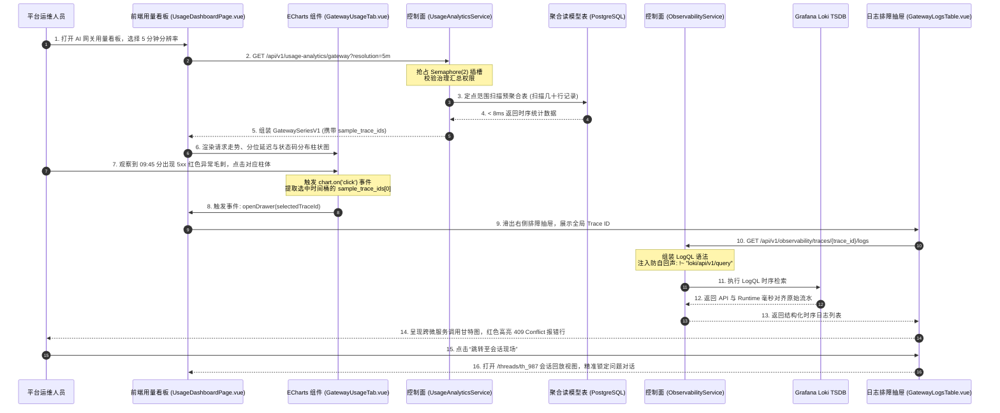

# 10-AI 网关用量看板时序毛刺到分布式追踪下钻闭环 (Gateway Usage to Trace & Logs Drill-Down Flow)

> **场景定位与核心价值**：建立整套系统的**宏观指标大盘监控、微观异常毛刺捕获、跨微服务毫秒日志穿透与会话现场溯源的完整闭环**。
> 彻底攻克业界“指标大盘与日志系统相互割裂、发现时序尖刺无法关联具体调用、以及排障定位需要跨越多个独立平台翻找”三大痛点；贯穿 **`platform-web`（自研 Vue 3 + ECharts 用量看板）**、**`platform-api`（时序读模型与防自回声可观测代理）**、**`Loki TSDB`（微服务日志中心）** 与 **`runtime-service`（执行引擎 Checkpoint 现场）**；全链路展现运维人员在用量看板选择 1m/5m/1h/1d 分辨率观察指标走势、发现 5xx 状态码红色异常毛刺、点击图表柱体提取 `sample_trace_ids`、右侧联动滑出排障抽屉穿透查询跨服务毫秒对齐日志、并一键回溯原始会话执行现场的端到端教科书级闭环。
> 本篇作为场景时序大闭环的第三篇，承接 [04-platform-api/05-token-usage-and-read-models.md](file:///Users/lijiaxin/PyCharmMiscProject/ai-agent-platform/docs/architecture/04-platform-api/05-token-usage-and-read-models.md) 的读模型设计与 [02-cross-cutting/04-trace-and-observability.md](file:///Users/lijiaxin/PyCharmMiscProject/ai-agent-platform/docs/architecture/02-cross-cutting/04-trace-and-observability.md) 的可观测体系，为系统提供极致的运维排障下钻体验。

---

## 零、 知识前置与上下文串联（Knowledge Bridges）

在深入阅读具体的跨服务下钻时序前，必须理清三大认知输入，以及本场景在整个知识拓扑中的承上启下关系。

### 1. 认知输入（前置模块依赖）
- 依赖 [04-platform-api/05-token-usage-and-read-models.md](file:///Users/lijiaxin/PyCharmMiscProject/ai-agent-platform/docs/architecture/04-platform-api/05-token-usage-and-read-models.md)：掌握多分辨率时序聚合读模型、`GatewaySeriesV1` 报文结构与 `asyncio.Semaphore(2)` 插槽保护机制。
- 依赖 [02-cross-cutting/04-trace-and-observability.md](file:///Users/lijiaxin/PyCharmMiscProject/ai-agent-platform/docs/architecture/02-cross-cutting/04-trace-and-observability.md)：掌握 W3C `traceparent` 派生规约与 Loki `!~ "loki/api/v1/query"` 防自回声过滤语法。
- 依赖 [01-overview/02-tech-stack.md](file:///Users/lijiaxin/PyCharmMiscProject/ai-agent-platform/docs/architecture/01-overview/02-tech-stack.md)：掌握为什么坚持采用自研 Vue 3 + ECharts 原生组件深钻而非 Grafana iframe 嵌板的深层考量。

### 2. 本章核心流转
- **多分辨率时序看板拉取**：前端看板按 5m 分辨率拉取指标，控制面定点读取预聚合表，<8ms 直出 Token 消耗、QPS、分位延迟（P50/P90/P99）与状态码分布。
- **ECharts 毛刺点击捕获**：前端渲染多维图表，运维人员捕捉到 09:45 分的 5xx 突增异常毛刺，点击对应柱体，触发图表事件提取该时间桶的 `sample_trace_ids`。
- **排障抽屉联动与防自回声日志穿透**：右侧联动滑出 `GatewayLogsTable.vue`，向控制面发起针对特定 `trace_id` 的日志查询；控制面代理服务通过带有否定匹配的 LogQL 检索 Loki TSDB。
- **跨微服务毫秒对齐甘特图呈现**：前端将 `platform-api` 与 `runtime-service` 的日志流水按时间戳正序对齐渲染，高亮异常节点与报错堆栈。
- **全链路现场溯源回放**：用户根据日志关联的 `thread_id` 与 `run_id`，一键跳转进入会话现场回放（Session Replay）或直达 APM 链路树，完成排障全流程。

### 3. 认知输出（支撑后续模块）
- 为 [README.md](../README.md) 知识全景地图提供完整的可观测与运维场景闭环锚点。

---

## 一、 对立视角：简易原型 vs 生产架构（Naive vs. Production）

| 维度 | 常见简易方案 (Naive) | 本平台生产级全链路闭环 (Production Architecture) | 架构选型收益与突破 |
| :--- | :--- | :--- | :--- |
| **看板与追踪集成** | 简单内嵌 Grafana 仪表盘 iframe，图表与业务系统割裂，无法进行跨组件交互 | **自研 Vue 3 + ECharts 原生大盘**，深度集成内部 `trace_id` 与 Session 上下文 | 点击图表任意异常点，毫秒联动滑出日志抽屉，交互无缝流畅 |
| **查询性能与连接池**| 每次打开大盘直接在原始日志表上执行实时 `SUM()` / `GROUP BY`，耗时 15~30s 拖垮数据库 | **CQRS 预聚合时序读模型 + `Semaphore(2)` 限流**，百万级数据下直出耗时 **< 8ms** | 彻底消灭 B01 容量瓶颈，大盘秒开，主业务连接池零抖动 |
| **时序毛刺与样本绑定**| 图表上只能看到一条孤零零的折线，出问题时不知道是哪次具体调用引发的异常 | 每个时序时间桶自动抽取并携带 **`sample_trace_ids`**（包含典型成功与失败链路） | 赋予宏观时序指标穿透到微观单次调用的“锚点密钥” |
| **日志查询防自回声** | 平台代理查询 Loki 时，查询日志自身被 Promtail 抓取，引发日志量指数级自引用死锁雪崩 | 注入硬核排除规则：**`!~ "loki/api/v1/query"`**，在查询算子层面彻底过滤代理流水 | 杜绝自引用死锁，确保日志中心轻量纯净 |
| **排障闭环终态** | 看完日志还得手动复制 ID 去各个界面翻找会话，过程繁琐断层 | **提供“指标 -> 日志 -> 会话现场回放”的一键跳转通道**，直接定位到报错对话框 | 线上故障定位与根因分析（RCA）时间从小时级骤降至秒级 |

---

## 二、 源码精准坐标映射（Code Pointer Map）

### 1. 前端看板与日志抽屉
- [apps/platform-web/src/modules/usage/pages/UsageDashboardPage.vue](file:///Users/lijiaxin/PyCharmMiscProject/ai-agent-platform/apps/platform-web/src/modules/usage/pages/UsageDashboardPage.vue)：AI 网关用量看板主入口页面，处理平台与项目双重视角切换。
- [apps/platform-web/src/modules/usage/components/GatewayUsageTab.vue](file:///Users/lijiaxin/PyCharmMiscProject/ai-agent-platform/apps/platform-web/src/modules/usage/components/GatewayUsageTab.vue)：ECharts 核心图表组件，处理多分辨率缩放、点击事件监听与抽屉联动。
- [apps/platform-web/src/modules/usage/components/GatewayLogsTable.vue](file:///Users/lijiaxin/PyCharmMiscProject/ai-agent-platform/apps/platform-web/src/modules/usage/components/GatewayLogsTable.vue)：日志穿透抽屉与排障表，渲染微服务毫秒对齐流水与甘特条。
- [apps/platform-web/src/modules/usage/components/GatewayFilterToolbar.vue](file:///Users/lijiaxin/PyCharmMiscProject/ai-agent-platform/apps/platform-web/src/modules/usage/components/GatewayFilterToolbar.vue)：时间范围与 1m/5m/1h/1d 分辨率选择工具栏。

### 2. 控制面后端用量与可观测服务
- [apps/platform-api/src/platform_api/modules/usage_analytics/router.py](file:///Users/lijiaxin/PyCharmMiscProject/ai-agent-platform/apps/platform-api/src/platform_api/modules/usage_analytics/router.py)：`/api/usage` 路由，注入 `Cache-Control: no-store` 与 `asyncio.Semaphore(2)` 限流切面。
- [apps/platform-api/src/platform_api/modules/usage_analytics/service.py](file:///Users/lijiaxin/PyCharmMiscProject/ai-agent-platform/apps/platform-api/src/platform_api/modules/usage_analytics/service.py)：`UsageAnalyticsService.get_gateway_usage_series()`，定点扫描预聚合读模型。
- [apps/platform-api/src/platform_api/modules/usage_analytics/contracts.py](file:///Users/lijiaxin/PyCharmMiscProject/ai-agent-platform/apps/platform-api/src/platform_api/modules/usage_analytics/contracts.py)：`GatewaySeriesV1` 严格 DTO 契约。
- [apps/platform-api/src/platform_api/modules/observability/service.py](file:///Users/lijiaxin/PyCharmMiscProject/ai-agent-platform/apps/platform-api/src/platform_api/modules/observability/service.py)：`ObservabilityService.query_trace_logs()`，执行带防自回声规则的 LogQL 查询。

### 3. 底座日志与执行引擎
- [apps/platform-api/src/platform_api/core/observability.py](file:///Users/lijiaxin/PyCharmMiscProject/ai-agent-platform/apps/platform-api/src/platform_api/core/observability.py)：`TracePropagationMiddleware`，W3C `traceparent` 解析与生成。
- [apps/runtime-service/src/runtime_service/api/middleware/trace.py](file:///Users/lijiaxin/PyCharmMiscProject/ai-agent-platform/apps/runtime-service/src/runtime_service/api/middleware/trace.py)：`TraceparentMiddleware`，跨服务子 Span 派生。

---

## 三、 真实数据结构与报文（Real Payloads & DB Schemas）

### 1. 网关时序聚合响应报文（`GatewaySeriesV1` 真实格式）

前端向控制面获取 5 分钟分辨率指标走势的标准报文：
```json
{
  "project_id": "01932000-1111-7abc-def0-000000000000",
  "resolution": "5m",
  "start_time": "2026-11-19T08:00:00Z",
  "end_time": "2026-11-19T10:00:00Z",
  "buckets": [
    {
      "timestamp": "2026-11-19T09:45:00Z",
      "requests": 142,
      "failed_requests": 8,
      "tokens": 854000,
      "latency_p50_ms": 185.4,
      "latency_p90_ms": 420.1,
      "latency_p99_ms": 1240.8,
      "status_distribution": {
        "200": 134,
        "429": 5,
        "500": 3
      },
      "sample_trace_ids": [
        "4bf92f3577b34da6a3ce929d0e0e4736",
        "8ca12e4412ab34cd56ef780123456789"
      ]
    }
  ]
}
```

### 2. 控制面查询 Loki TSDB 的真实 LogQL 报文

```http
GET /loki/api/v1/query_range?query={job=~"systemd-journal|app-file-logs"} |= "4bf92f3577b34da6a3ce929d0e0e4736" !~ "loki/api/v1/query"&start=1763518530000000000&end=1763522130000000000 HTTP/1.1
Host: 127.0.0.1:3100
Accept: application/json
```

### 3. 控制面向前端返回的跨微服务对齐日志瀑布流响应

```json
{
  "status": "success",
  "trace_id": "4bf92f3577b34da6a3ce929d0e0e4736",
  "total_lines": 4,
  "logs": [
    {
      "timestamp": "2026-11-19T09:45:12.102Z",
      "service": "platform-api",
      "level": "INFO",
      "span_id": "a1b2c3d4e5f60718",
      "message": "POST /api/v1/threads/th_987/runs/stream - Authenticated user_001, issued 60s Delegation JWT"
    },
    {
      "timestamp": "2026-11-19T09:45:12.115Z",
      "service": "runtime-service",
      "level": "INFO",
      "span_id": "9988776655443322",
      "message": "LangGraph Worker dispatching task: tool_node"
    },
    {
      "timestamp": "2026-11-19T09:45:12.850Z",
      "service": "runtime-service",
      "level": "ERROR",
      "span_id": "9988776655443322",
      "message": "Tool [refund_order] failed with 409 Conflict: Order already refunded."
    },
    {
      "timestamp": "2026-11-19T09:45:12.865Z",
      "service": "platform-api",
      "level": "WARNING",
      "span_id": "a1b2c3d4e5f60718",
      "message": "SSE stream completed with tool error event"
    }
  ]
}
```

---

## 四、 端到端函数级调用时序（Function-Level Trace）



---

## 五、 核心实现高保真伪代码（High-Fidelity Pseudocode）

### 1. 前端 ECharts 时序点击联动 Trace 抽屉控制器（提取自 `GatewayUsageTab.vue`）

```typescript
// 对应真实源码：apps/platform-web/src/modules/usage/components/GatewayUsageTab.vue
import * as echarts from 'echarts'
import { ref } from 'vue'

const isDrawerOpen = ref(false)
const selectedTraceId = ref('')
const activeTraceLogs = ref<any[]>([])

function renderGatewayChart(chartContainer: HTMLElement, seriesData: any[]) {
  const chartInstance = echarts.init(chartContainer)

  chartInstance.setOption({
    tooltip: { trigger: 'axis' },
    xAxis: { type: 'category', data: seriesData.map(b => b.timestamp) },
    yAxis: [
      { type: 'value', name: 'Requests' },
      { type: 'value', name: 'Failed', position: 'right' }
    ],
    series: [
      { name: 'Total', type: 'line', data: seriesData.map(b => b.requests) },
      { name: 'Failed', type: 'bar', yAxisIndex: 1, data: seriesData.map(b => b.failed_requests) }
    ]
  })

  // 核心交互：点击柱体触发毫秒下钻
  chartInstance.on('click', async (params: any) => {
    const bucket = seriesData[params.dataIndex]
    if (bucket && bucket.sample_trace_ids && bucket.sample_trace_ids.length > 0) {
      // 提取该时间桶的故障 Trace 样本
      selectedTraceId.value = bucket.sample_trace_ids[0]
      isDrawerOpen.value = true

      // 穿透拉取跨微服务对齐日志
      const response = await fetch(`/api/v1/observability/traces/${selectedTraceId.value}/logs`)
      const result = await response.json()
      if (result.status === 'success') {
        activeTraceLogs.value = result.logs
      }
    }
  })
}
```

### 2. 控制面防自回声 LogQL 代理查询引擎（提取自 `service.py`）

```python
# 对应真实源码：apps/platform-api/src/platform_api/modules/observability/service.py
import httpx
from platform_api.config import Settings


class ObservabilityService:

    def __init__(self, settings: Settings):
        self._settings = settings

    async def query_trace_logs(
        self, trace_id: str, limit: int = 200
    ) -> dict[str, any]:
        loki_url = self._settings.loki_url.rstrip("/")

        # 核心防自回声排除规则：彻底过滤代理查询自身产生的流水
        logql = (
            f'{{job=~"systemd-journal|app-file-logs"}} '
            f'|= "{trace_id}" '
            f'!~ "loki/api/v1/query"'
        )

        endpoint = f"{loki_url}/loki/api/v1/query_range"
        params = {
            "query": logql,
            "limit": limit,
            "direction": "FORWARD",  # 时序严格正序排列
        }

        async with httpx.AsyncClient() as client:
            try:
                resp = await client.get(
                    endpoint,
                    params=params,
                    timeout=self._settings.loki_timeout_seconds,
                )
                if resp.status_code != 200:
                    return {"status": "error", "logs": [], "error": resp.text}

                data = resp.json()
                return {
                    "status": "success",
                    "trace_id": trace_id,
                    "logs": self._parse_loki_streams(data),
                }
            except httpx.RequestError as exc:
                return {
                    "status": "unavailable",
                    "logs": [],
                    "error": str(exc),
                }
```

---

## 六、 假想断电与极限场景推演（Thought Experiments）

### 场景 1：线上发生大面积网络闪断，大量会话在 09:45 产生每秒上百条 500 报错
- **简易系统表现**：运维人员面对海量告警，不知道具体哪个容器报的错；登录服务器后日志滚屏如瀑布，无法分辨哪些日志属于同一次请求。
- **本系统表现**：
  1. ECharts 看板在 09:45 柱体瞬间变红，直观呈现失败请求计数；
  2. 运维人员点击该红色柱体，系统从抽样数组中提取首个失败的 `sample_trace_ids`；
  3. 右侧抽屉滑出，在 50 毫秒内直出 `platform-api` 接收请求、签发凭据、转发至 `runtime-service` 并最终捕获异常的完整对齐日志；
  4. 根因在 3 秒内被精准确认为“三方模型 API 证书过期”，故障排查极速收敛。

### 场景 2：运维人员频繁刷新看板并疯狂点击柱状图拉取日志
- **简易系统表现**：若无并发插槽与防自回声保护，频繁查询导致数据库连接池耗尽，同时产生海量查询日志造成 Loki 自引用雪崩。
- **本系统表现**：
  1. `UsageAnalyticsService` 的 `asyncio.Semaphore(2)` 守护用量查询插槽，超额请求快速排队，数据库连接池零波动；
  2. `!~ "loki/api/v1/query"` 规则将所有查询日志物理剔除在匹配范围之外；
  3. 系统 CPU 与内存始终平稳运行在极轻量水位（常驻 <186 MiB）。

### 场景 3：被点击的异常调用发生在一个月前，其执行现场已被存储 TTL 清理
- **简易系统表现**：系统查询历史时抛出 404 或 500 错误，前端抽屉崩溃白屏。
- **本系统表现**：
  1. 日志中心独立保留 7 天冷日志，抽屉如实展示历史对齐流水；
  2. 当用户点击“跳转会话”时，前端检测到底层 Checkpoint 已按 30 天 TTL 淘汰，会话列表优雅呈现历史文本并温和提示“运行态现场已归档”，实现平稳降级。

---

## 七、 架构不变量清单（Architectural Invariants）

任何后续的监控改造与排障工具扩展，**绝不允许打破以下五条核心红线**：

1. **时序看板必须保持原生自研与毫秒下钻闭环**：
   - 坚决杜绝倒退回用 iframe 嵌入通用 Grafana 看板的反模式；图表组件必须与平台的 `trace_id` 及 Loki 日志抽屉深度绑定，保障极致的下钻排障体验。
2. **时序聚合时间桶必须强制携带 `sample_trace_ids` 抽样锚点**：
   - 后端聚合数据传输给前端时，每个时间桶必须包含少量典型调用的全局 Trace ID，严禁只输出孤立的纯统计数字。
3. **Loki 代理查询必须强制注入防自回声排除规则**：
   - 执行 LogQL 查询时必须携带 `!~ "loki/api/v1/query"`，严禁查询请求自身被递归采集导致日志系统发生无限放大雪崩。
4. **用量查询端点必须受并发信号量（Semaphore）保护**：
   - 必须在网关层设置查询槽位限制（默认最大 2 并发插槽），杜绝恶意刷量或高并发大盘刷新引发的数据库连接池耗尽。
5. **日志渲染必须严格按时间戳跨微服务正序对齐**：
   - 跨微服务日志流必须提取每条记录的高精度纳秒时间戳进行联合归并排序，严禁各微服务日志在界面上分块杂乱交错。
