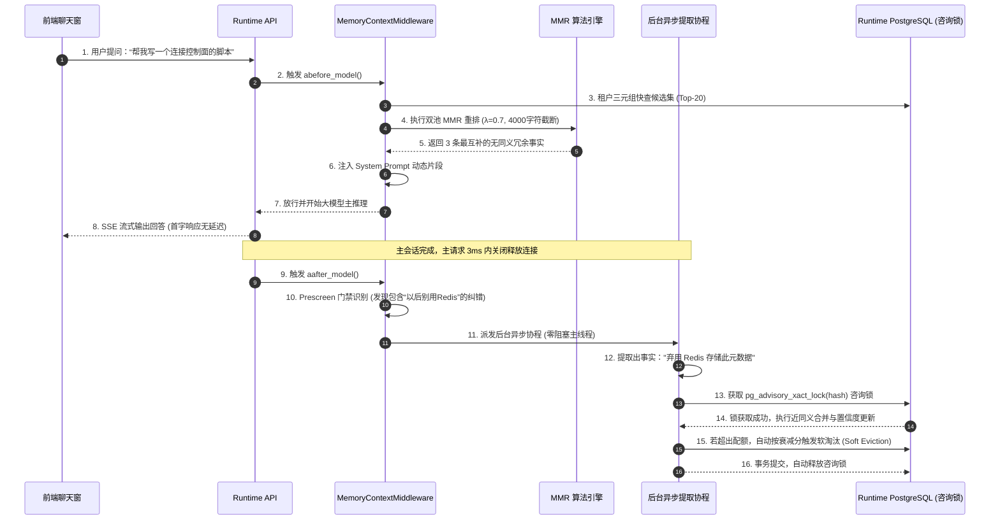

# 02-企业级长期记忆闭环系统 (异步解耦、MMR 重排与平滑淘汰)

> **模块定位与核心价值**：构建高可用、低时延且抗信息冗余的**智能体长期记忆闭环引擎**。
> 吸收 DeerFlow 记忆架构工业级优势并去业务化：彻底颠覆旧版“同步阻塞抽取导致主请求卡顿 2~5s、100条死板拒服”的反模式；实现**异步后台提取（主延迟 < 5ms）**、**Prescreen 成本门禁**、**中文分词+IDF 与双池 MMR 多样性重排召回**、**同义近重复合并**与**基于新鲜度/置信度的平滑软淘汰**；保留企业级 PostgreSQL Advisory Lock 事务 CAS 乐观锁与多租户严格隔离。

---

## 零、 知识前置与上下文串联（Knowledge Bridges）

### 1. 前置必备概念速查

- **概念 1：为什么同步提取记忆是严重的反模式？**
  - **旧方案缺陷**：大模型生成完答案后，如果中间件同步拉起另一个“记忆提取 LLM”分析上下文，会导致用户的 HTTP/SSE 连接迟迟不能关闭，用户被迫多等 2~5 秒；
  - **异步解耦架构**：主请求完成后，仅需 `< 5ms` 派发异步后台任务（Background Task）。记忆提取与向量化完全在独立协程中静默运转，对前台用户零感知。
- **概念 2：MMR（Maximal Marginal Relevance，最大边际相关度）重排算法**
  - 传统的 Top-K 向量相似度检索极易陷入“信息同质化”：例如检索到 5 条记忆，全是“用户喜欢使用 Python 编写后端”的换皮同义句，白白浪费 4000 字符的 Context 预算；
  - MMR 算法在计算与 Query 相似度的同时，**惩罚候选记忆与已选记忆之间的相似度**。公式：
    $$\text{MMR} = \arg\max_{D_i \in R \setminus S} \left[ \lambda \cdot \text{Sim}_1(D_i, Q) - (1 - \lambda) \cdot \max_{D_j \in S} \text{Sim}_2(D_i, D_j) \right]$$
    实现高相关性与高多样性的完美平衡。
- **概念 3：软淘汰机制（Soft Eviction）替代 100 条 409 拒服死锁**
  - 旧系统容量达到 100 条时抛出 HTTP 409 Conflict，直接拒绝写入新记忆；
  - 生产系统通过综合评分算法（综合**访问频次、置信度、时间衰减半衰期**），当存储达到软上限时，自动沉降或淘汰打分最低的边缘事实，保障记忆池活水流动。

### 2. 链路上下文坐标

- **记忆沉淀（异步写链）**：
  主模型回答结束 -> 触发完成事件 -> `MemoryContextMiddleware` 进行 Prescreen 成本预筛 -> 存在记忆价值时，后台派发提取任务 -> 小模型提取事实 -> 近重复合并 -> PostgreSQL Advisory Lock CAS 写入。
- **工作记忆动态注入（同步读链）**：
  用户发起提问 -> 中间件在 `abefore_model` 毫秒级提取 Query -> 中文混合分词 + 向量粗排 -> 双池 MMR 多样性精排重排 -> 4000 字符有界截断 -> 动态拼装入 System Prompt。

---

## 一、 对立视角：旧版同步架构 vs 生产级异步 MMR 架构

| 维度 | 旧版同步原型 (Legacy / Naive) | 升级后生产架构 (Production Architecture) | 架构收益与突破 |
| :--- | :--- | :--- | :--- |
| **主请求耗时** | 每次问答结束同步调用提取 LLM，阻塞 2000~5000ms | 异步后台任务解耦派发，主请求耗时 **< 5ms** | 前台交互丝滑，彻底消除主会话拖尾感 |
| **提取成本消耗** | 每轮对话盲目全量提取，大量闲聊消耗无谓 Token | **Prescreen 成本门禁**：仅识别到显式偏好或纠错信号时提取 | 节约 70% 以上无意义提取与 Embedding 成本 |
| **召回检索质量** | 单纯 Top-K 向量检索，容易召回一堆同义重复句 | **中文分词 + IDF + 双池 MMR 多样性重排** | 4000 字符内信息密度最大化，杜绝复读机 |
| **容量生命周期** | 硬限 100 条，超限直接爆 409 错误拒服 | **近重复合并 + 置信度/新鲜度平滑软淘汰** | 消除业务死锁，长期运行记忆库自我进化自愈 |
| **并发数据安全** | 裸行锁或无并发保护，高并发追问时容易脏写覆盖 | **PostgreSQL Advisory Lock（咨询锁）事务 CAS** | 无表级锁死风险，租约自愈，毫秒级原子更新 |

---

## 二、 源码精准坐标映射（Code Pointer Map）

| 模块职责 | 核心代码路径 | 关键类 / 函数 / 算法 |
|---|---|---|
| **异步记忆调度中间件** | `apps/runtime-service/src/runtime_service/services/dearflow_agent/middleware/memory.py` | `MemoryContextMiddleware`, `abefore_model()`, `aafter_model()` |
| **Prescreen 成本门禁** | `apps/runtime-service/src/runtime_service/services/dearflow_agent/memory_prescreen.py` | `should_extract_memory()`, 纠错/规则正则与轻量判定 |
| **双池 MMR 重排算法** | `apps/runtime-service/src/runtime_service/services/dearflow_agent/memory_mmr.py` | `maximal_marginal_relevance_rerank()`, 相似度惩罚衰减 |
| **分词与 IDF 权重计算** | `apps/runtime-service/src/runtime_service/services/dearflow_agent/text_tokenize.py` | `hybrid_chinese_tokenize()`, 词频倒排表 |
| **PostgreSQL 咨询锁 CAS 存储**| `apps/runtime-service/src/runtime_service/services/dearflow_agent/memory.py` | `MemoryStorage.cas_update_with_advisory_lock()` |
| **平滑淘汰与生命周期** | `apps/runtime-service/src/runtime_service/services/dearflow_agent/memory_eviction.py` | `calculate_memory_decay_score()`, 软上限沉降 |

---

## 三、 真实数据结构与报文（Real Payloads & DB Schemas）

### 1. 记忆存储模型（Runtime PostgreSQL 表：`runtime_agent_memories`）

```sql
CREATE TABLE IF NOT EXISTS runtime_agent_memories (
    id UUID PRIMARY KEY DEFAULT gen_random_uuid(),
    project_id VARCHAR(64) NOT NULL,
    user_id VARCHAR(64) NOT NULL,
    scope VARCHAR(32) NOT NULL,            -- 'profile' (个人) | 'project' (项目公共)
    category VARCHAR(64) NOT NULL,         -- 'preference' | 'convention' | 'milestone'
    fact_text TEXT NOT NULL,
    fact_hash VARCHAR(64) NOT NULL,        -- 近同义去重指纹
    confidence DOUBLE PRECISION DEFAULT 1.0,-- 置信度 [0.0 ~ 1.0]
    access_count INT DEFAULT 1,            -- 命中频次
    last_accessed_at TIMESTAMPTZ NOT NULL DEFAULT NOW(),
    embedding VECTOR(1536),                -- text-embedding-3-small 向量
    is_verified BOOLEAN DEFAULT TRUE,      -- 是否已人工复核通过
    created_at TIMESTAMPTZ NOT NULL DEFAULT NOW(),
    updated_at TIMESTAMPTZ NOT NULL DEFAULT NOW()
);

-- 租户三元组唯一索引与多维加速索引
CREATE UNIQUE INDEX uq_memory_scope_hash ON runtime_agent_memories (project_id, user_id, fact_hash);
CREATE INDEX idx_memory_retrieval ON runtime_agent_memories (project_id, user_id, scope, confidence);
```

### 2. System Prompt 动态注入报文（4000 字符严格有界）

```markdown
<agent_memory_context>
[System Note]: The following facts were dynamically retrieved and deduplicated via MMR (Maximal Marginal Relevance):
- [Preference | Conf: 0.98]: 用户倾向于采用严谨的代码防御范式，要求使用双引号包裹路径、禁止裸传长效凭据。
- [Convention | Conf: 0.95]: 本项目默认数据库采用 PostgreSQL 14+，严禁在业务高频主库中执行无索引大扫描。
- [Architecture | Conf: 0.91]: 前后端流式通信已切为 LangGraph v3 协议，网关注入 15 秒心跳保活帧。
Please naturally adapt to these rules without saying "According to memory".
</agent_memory_context>
```

---

## 四、 端到端函数级调用时序（Function-Level Trace）



---

## 五、 核心实现高保真伪代码（High-Fidelity Pseudocode）

### 1. 双池 MMR 多样性重排核心算法（提取自 `memory_mmr.py`）

```python
# 对应源码：apps/runtime-service/src/runtime_service/services/dearflow_agent/memory_mmr.py
import numpy as np
from typing import List, Dict


def maximal_marginal_relevance(
    query_embedding: np.ndarray,
    candidate_embeddings: List[np.ndarray],
    candidates: List[Dict],
    lambda_param: float = 0.7,
    max_tokens_budget: int = 4000,
) -> List[Dict]:
    """双池 MMR 贪心多样性选择算法

    :param lambda_param: 0.7 表示 70% 倾向与 Query 相关度，30% 惩罚同义冗余
    """
    selected_indices: List[int] = []
    remaining_indices = list(range(len(candidates)))
    selected_memories: List[Dict] = []
    accumulated_chars = 0

    while remaining_indices:
        best_score = -float("inf")
        best_idx = -1

        for idx in remaining_indices:
            cand_emb = candidate_embeddings[idx]
            # 计算与当前 Query 的相关度
            query_sim = float(np.dot(query_embedding, cand_emb))

            # 计算与已选集合中的最大冗余度
            if not selected_indices:
                redundancy = 0.0
            else:
                redundancy = max(
                    float(np.dot(cand_emb, candidate_embeddings[s_idx]))
                    for s_idx in selected_indices
                )

            # MMR 核心权衡打分
            mmr_score = (
                lambda_param * query_sim - (1.0 - lambda_param) * redundancy
            )

            if mmr_score > best_score:
                best_score = mmr_score
                best_idx = idx

        # 检查字符预算
        chosen_text = candidates[best_idx]["fact_text"]
        if accumulated_chars + len(chosen_text) > max_tokens_budget:
            break

        selected_indices.append(best_idx)
        remaining_indices.remove(best_idx)
        selected_memories.append(candidates[best_idx])
        accumulated_chars += len(chosen_text)

    return selected_memories
```

### 2. PostgreSQL 咨询锁 CAS 事务更新（提取自 `memory.py`）

```python
# 对应源码：apps/runtime-service/src/runtime_service/services/dearflow_agent/memory.py
import zlib
from sqlalchemy import text


async def save_memory_with_advisory_lock(
    session, project_id: str, user_id: str, fact: str, embedding: list[float]
):
    """利用 PostgreSQL 咨询锁实现行外无阻塞并发控制"""
    # 将项目和用户空间映射为一个 64 位有符号大整数
    lock_key = zlib.crc32(f"{project_id}:{user_id}".encode("utf-8"))

    async with session.begin():
        # 1. 获取会话级事务咨询锁，防并发竞态
        await session.execute(
            text("SELECT pg_advisory_xact_lock(:lock_key)"),
            {"lock_key": lock_key},
        )

        # 2. 检查近重复指纹
        fact_hash = zlib.crc32(fact.encode("utf-8"))
        existing = await session.execute(
            text(
                "SELECT id, confidence, access_count FROM runtime_agent_memories "
                "WHERE project_id = :p AND user_id = :u AND fact_hash = :h"
            ),
            {"p": project_id, "u": user_id, "h": str(fact_hash)},
        )
        row = existing.fetchone()

        if row:
            # 强化置信度与访问频次，更新新鲜度
            await session.execute(
                text(
                    "UPDATE runtime_agent_memories SET "
                    "confidence = LEAST(confidence + 0.1, 1.0), "
                    "access_count = access_count + 1, "
                    "last_accessed_at = NOW() "
                    "WHERE id = :id"
                ),
                {"id": row.id},
            )
        else:
            # 插入新记忆
            await session.execute(
                text(
                    "INSERT INTO runtime_agent_memories (project_id, user_id, scope, fact_text, fact_hash, embedding) "
                    "VALUES (:p, :u, 'profile', :f, :h, :emb)"
                ),
                {
                    "p": project_id,
                    "u": user_id,
                    "f": fact,
                    "h": str(fact_hash),
                    "emb": str(embedding),
                },
            )
```

---

## 六、 架构不变量清单（Architectural Invariants）

1. **严禁在主请求链路执行同步记忆抽取**：记忆抽取必须通过异步后台任务执行，主请求处理时间增量必须 `< 5ms`，严禁阻塞前端 SSE 关闭。
2. **召回必须经过双池 MMR 重排与 4000 字符硬预算截断**：严禁无界注入记忆历史，严禁单纯 Top-K 无冗余过滤导致复读。
3. **严禁抛出 409 拒服异常破坏会话体验**：达到容量配额时必须执行软淘汰降解，确保活跃核心偏好常青。
4. **并发更新必须受 Advisory Lock 咨询锁保护**：多轮连续并发请求提取记忆时，必须通过项目级咨询锁排队，杜绝死锁与脏写。
