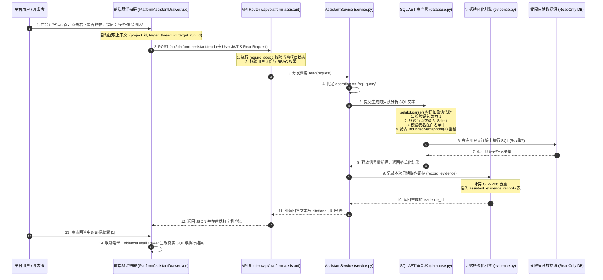

# 07-03 平台内置全局助手智能体：只读诊断工具链、证据链与沙箱执行

> **模块定位与核心价值**：建立整套系统的**嵌入式运维辅助、会话故障诊断、只读数据分析与证据链合规审计智能体**。
> 彻底攻克业界常见的“普通运维机器人权限失控导致删库、缺乏可信证据无法溯源、以及脱离业务现场跳转排障成本极高”三大核心痛点；基于 **SQL 静态抽象语法树（AST）深度审查、纯只读数据源绑定与不可变证据链（Evidence Audit Chain: `AssistantEvidenceRecord`）**，实现用户在任意控制台页面通过悬浮交互随时调起助手；助手自适应感知当前路由上下文（Route Context），在严格受限的沙箱内安全调用只读诊断、Loki 日志聚合与白名单 SQL 检索，输出附带证据出处（Citations）的精准排障建议。
> 本篇作为智能体实现层（Agents Layer）的平台级元智能体专篇，承接 [05-runtime-service/05-context-blowup-defense-and-resilience.md](file:///Users/lijiaxin/PyCharmMiscProject/ai-agent-platform/docs/architecture/05-runtime-service/05-context-blowup-defense-and-resilience.md) 的韧性中间件规范与 [02-cross-cutting/01-communication-matrix.md](file:///Users/lijiaxin/PyCharmMiscProject/ai-agent-platform/docs/architecture/02-cross-cutting/01-communication-matrix.md) 的干线 8 契约，为全平台运营提供可信 AI 领航员。

---

## 零、 知识前置与链路上下文（Knowledge Bridges）

在深入阅读具体的助手代码前，必须掌握四大底层设计概念，以及平台助手在全系统拓扑中的沙箱运转机制。

### 1. 前置必备概念速查

- **概念 1：平台助手（Platform Assistant）与普通业务 Agent 的本质区别**
  - **业务 Agent**：面向特定领域的外部终端用户（如客服、代码生成、文档编写），执行业务工作流，持有可扩展的业务读写工具；
  - **平台全局助手（Platform Assistant）**：面向平台操作者（开发者、运维、项目管理员），常驻于控制台右下角，专职用于**解答平台架构使用、排查指定 Run 的报错原因、核算当前项目 Token 消耗走势、以及安全查询业务报表**；它是平台的“系统元级自省智能体”。
- **概念 2：纯只读沙箱与 SQL AST 语法树深度拦截（sqlglot AST Inspection）**
  - 给大模型配备 SQL 执行工具是极高危的操作。稍有不慎，模型产生幻觉或受到 Prompt 注入攻击，就会执行 `UPDATE` 或 `DROP TABLE` 导致灾难性删库；
  - 架构实施了**三层物理级只读围栏**：
    1. **专用只读 DSN**：底层数据库连接账号仅具备 `has_table_privilege(..., 'SELECT')` 权限，连接绝不复用业务写入连接池；
    2. **sqlglot 静态语法树审查**：在执行前将 SQL 解析为 AST 树，强制断言语句数量必须为 1，类型必须为 `Select / Union / Intersect / Except`，禁止任何 DDL/DML 写操作；
    3. **函数与表白名单**：函数必须在只读白名单（`_FUNCTIONS`）内，涉及的表必须属于当前项目显式授权的数据集，其余一律原地掐死。
- **概念 3：不可变证据链（Evidence Audit Chain）**
  - 助手绝不“信口开河”：每次助手调用底层只读工具（查询数据库、抓取 Checkpoint、过滤 Loki 日志）时，系统都会在 Platform DB 中持久化一条带有唯一 UUID 的 `AssistantEvidenceRecord`；
  - 记录详细记录了当时的查询入参、时间戳、上下文与脱敏结果快照；前台渲染时将证据标记为可点击的**引用胶囊（Evidence Citations）**，用户点击直接滑出证据抽屉，核验助手回答的真实来源。
- **概念 4：路由上下文感知（Route Context Binding）**
  - 用户在聊天界面、用量看板或成员管理页面打开助手时，前端自动提取当前 URL 路由参数（如 `project_id`, `thread_id`, `run_id`）并作为隐式上下文注入助手；
  - 用户无需重复输入“帮我看看那个报错怎么回事”，直接输入“刚才为什么失败了？”，助手即可通过上下文自动锁定最近的错误 Run 进行日志与诊断分析。
- **概念 5：并发信号量限流（`BoundedSemaphore(4)`）**
  - 只读分析查询通常伴随较重的报表扫描。系统在只读执行引擎上配置了 `threading.BoundedSemaphore(4)`，确保全局并发查询数不超过 4，杜绝高频并发把只读只读副本打挂。

### 2. 全局助手交互与只读执行拓扑

```mermaid
flowchart TD
    subgraph FrontendConsole ["前端控制台 (platform-web)"]
        Mascot["全局悬浮吉祥物\n(assistant-mascot.gif)"]
        Drawer["PlatformAssistantDrawer.vue\n(悬浮抽屉会话视图)"]
        ContextPill["AssistantContextPill.vue\n(当前路由上下文胶囊: project/thread)"]
        EvidenceDrawer["EvidenceDetailDrawer.vue\n(点击引用查看不可变证据快照)"]
    end

    subgraph ControlPlaneAPI ["控制面后端 (platform-api)"]
        AssistantRouter["/api/platform-assistant 路由"]
        ScopeCheck["require_scope()\n(身份重验 & 项目激活判定)"]
        AssistantService["AssistantService.read()\n(只读操作分发器)"]
        EvidenceEngine["evidence.py\n(生成并持久化 AssistantEvidenceRecord)"]
    end

    subgraph ReadOnlySandbox ["受限只读沙箱执行环境"]
        SQLValidator["database.py (sqlglot)\n(静态 AST 解析 & 白名单校验)"]
        DiagProxy["diagnostics.py\n(读取 Run 快照与 Checkpoint)"]
        LokiClient["logs.py\n(按 trace_id / project 检索 Loki)"]
    end

    subgraph DataSources ["受限底层数据源 (只读)"]
        ReadOnlyPG[(只读 PostgreSQL\n专用 DSN & has_table_privilege)]
        RuntimeCheckpoints[(Runtime DB Checkpoints\n受限 Delegation-JWT 只读)]
        LokiTSDB[(Grafana Loki TSDB)]
        PlatformDB[(平台业务库\n存储 AssistantEvidenceRecord)]
    end

    %% 前端交互流
    Mascot -->|"1. 点击唤醒"| Drawer
    Drawer -->|"2. 自动捕获当前 URL"| ContextPill
    Drawer -->|"3. 提交诊断提问 (POST /api/platform-assistant/read)"| AssistantRouter

    %% 控制面鉴权与审计
    AssistantRouter -->|"4. 强制范围审查"| ScopeCheck
    ScopeCheck -->|"5. 准入通过"| AssistantService
    AssistantService -->|"6. 记录不可变证据"| EvidenceEngine
    EvidenceEngine -->|"7. 写入证据事实源"| PlatformDB

    %% 只读沙箱执行
    AssistantService -->|"8. 请求执行 SQL 分析"| SQLValidator
    SQLValidator -->|"9. 静态 AST 校验通过 (Semaphore 4)"| ReadOnlyPG

    AssistantService -->|"10. 请求提取运行诊断"| DiagProxy
    DiagProxy -->|"11. 短时凭据只读获取"| RuntimeCheckpoints

    AssistantService -->|"12. 请求检索相关日志"| LokiClient
    LokiClient -->|"13. LogQL 查询"| LokiTSDB

    %% 回包渲染与深钻
    AssistantService -->>|"14. 返回回答文本与 evidence_ids"| Drawer
    Drawer -->|"15. 渲染 Markdown 与引用胶囊 [1]"| Drawer
    Drawer -.->|"16. 点击引用 [1]"| EvidenceDrawer
    EvidenceDrawer -->|"17. 调出证据详情"| PlatformDB
```

---

## 一、 对立视角：普通运维聊天机器人 vs 生产级只读受限助手

| 评估维度 | 常见运维聊天机器人 (Naive) | 生产级只读受限平台助手 (Production Architecture) | 架构收益与突破 |
| :--- | :--- | :--- | :--- |
| **数据库执行权限** | 直接使用后端主业务连接，具备对全库的读写改删权限 | **专用只读 DSN + 静态 SQL AST 审查**，只允许 `Select`，白名单函数与表 | 彻底根除 Prompt 注入删库或篡改业务数据的风险 |
| **回答可信度** | 助手回答纯靠大模型编造，经常胡说八道且无从考证 | **不可变证据链（`AssistantEvidenceRecord`）**，每个结论必须挂载证据 ID | 符合企业级可信 AI 要求，排障结论可 100% 溯源核验 |
| **多租户权限隔离** | 只要管理员配置了助手，任何普通用户提问都能越权查看全平台数据 | **严格的 `require_scope` 实时身份重验**，限定只能查当前所属项目授权数据 | 杜绝横向越权（IDOR）与跨租户数据泄露 |
| **控制台交互体验** | 独立的运维页面，用户遇到报错必须切走当前工作流去另一个窗口复制粘贴 | **全局悬浮交互（Drawer）+ 路由上下文自动感知**，就地提问就地诊断 | 排障无缝融入业务流程，操作效率提升 5 倍以上 |
| **系统资源消耗** | 复杂查询无限并发，用户多问几个 SQL 直接把生产数据库连接池吃满 | **`threading.BoundedSemaphore(4)` 严格控制插槽**，单语句 5 秒硬超时 | 严格限制分析型开销，保护主业务核心交易库稳定 |

---

## 二、 源码精准坐标映射（Code Pointer Map）

以下是当前生产分支中平台内置全局助手的核心实现代码绝对路径：

| 模块职责 | 核心代码绝对路径 | 关键类 / 函数 / 契约 |
|---|---|---|
| **助手路由与范围鉴权切面** | [router.py (Assistant)](file:///Users/lijiaxin/PyCharmMiscProject/ai-agent-platform/apps/platform-api/src/platform_api/modules/platform_assistant/router.py) | `APIRouter(prefix="/api/platform-assistant")`, `_target_gateway()`, 租户范围校验 |
| **助手核心业务与能力分发器** | [service.py (Assistant)](file:///Users/lijiaxin/PyCharmMiscProject/ai-agent-platform/apps/platform-api/src/platform_api/modules/platform_assistant/service.py) | `read()`, `require_scope()`, `sources()`, `readable_capabilities()` |
| **SQL 静态 AST 审查与只读执行**| [database.py (Assistant)](file:///Users/lijiaxin/PyCharmMiscProject/ai-agent-platform/apps/platform-api/src/platform_api/modules/platform_assistant/database.py) | `validated_sql()`, `sqlglot.parse()`, `_FUNCTIONS` 白名单, `_SLOTS = BoundedSemaphore(4)` |
| **不可变证据链数据模型与写入** | [models.py (Assistant)](file:///Users/lijiaxin/PyCharmMiscProject/ai-agent-platform/apps/platform-api/src/platform_api/modules/platform_assistant/models.py)<br>[evidence.py (Assistant)](file:///Users/lijiaxin/PyCharmMiscProject/ai-agent-platform/apps/platform-api/src/platform_api/modules/platform_assistant/evidence.py) | `AssistantEvidenceRecord`, `record_evidence()`, SHA-256 结果去重与审计 |
| **助手输入 DTO 与操作定义** | [contracts.py (Assistant)](file:///Users/lijiaxin/PyCharmMiscProject/ai-agent-platform/apps/platform-api/src/platform_api/modules/platform_assistant/contracts.py) | `ReadRequest`, `InternalReadRequest`, `AssistantDatabase`, 10 大只读操作枚举 |
| **运行态诊断与快照提取器** | [diagnostics.py (Assistant)](file:///Users/lijiaxin/PyCharmMiscProject/ai-agent-platform/apps/platform-api/src/platform_api/modules/platform_assistant/diagnostics.py) | `read_checkpoint()`, 过滤敏感凭据并返回结构化诊断快照 |
| **前端助手全局悬浮抽屉主组件** | [PlatformAssistantDrawer.vue](file:///Users/lijiaxin/PyCharmMiscProject/ai-agent-platform/apps/platform-web/src/modules/platform-assistant/components/PlatformAssistantDrawer.vue) | 全局常驻抽屉，深浅色主题适配，双向打字机流式交互 |
| **前端当前路由上下文胶囊** | [AssistantContextPill.vue](file:///Users/lijiaxin/PyCharmMiscProject/ai-agent-platform/apps/platform-web/src/modules/platform-assistant/components/AssistantContextPill.vue) | 自动捕获当前页面状态、显示项目名称与当前选中 Thread |
| **前端证据快照深钻抽屉** | [EvidenceDetailDrawer.vue](file:///Users/lijiaxin/PyCharmMiscProject/ai-agent-platform/apps/platform-web/src/modules/platform-assistant/components/EvidenceDetailDrawer.vue) | 点击文本中的 `[1]`, `[2]` 弹出底层证据明细（SQL、日志流水或错误快照） |

---

## 三、 真实数据结构与报文（Real Payloads & DB Schemas）

### 1. 不可变证据链表结构（Platform DB: `assistant_evidence_records`）

```sql
CREATE TABLE assistant_evidence_records (
    id UUID PRIMARY KEY DEFAULT gen_random_uuid(),
    project_id UUID NOT NULL,
    actor_id UUID NOT NULL,
    thread_id UUID NULL,
    run_id UUID NULL,
    operation VARCHAR(64) NOT NULL,
    operation_hash VARCHAR(64) NOT NULL,
    input_params JSONB NOT NULL DEFAULT '{}',
    evidence_payload JSONB NOT NULL DEFAULT '{}',
    created_at TIMESTAMPTZ NOT NULL DEFAULT NOW()
);

-- 索引：加速按项目与证据 ID 回溯
CREATE INDEX idx_evidence_proj_actor ON assistant_evidence_records (project_id, actor_id);
CREATE INDEX idx_evidence_created ON assistant_evidence_records (created_at DESC);
```

### 2. 助手只读请求报文（`ReadRequest` 真实格式）

```json
{
  "operation": "diagnostics",
  "target_thread_id": "01932345-6789-7abc-def0-123456789abc",
  "target_run_id": "01932345-6789-7abc-def0-987654321def",
  "query": "为什么最后一次工具调用失败了？",
  "evidence_ids": [
    "01932000-aaaa-7abc-def0-111111111111"
  ]
}
```
- **核心操作类型枚举**：
  - `diagnostics`：提取指定 Run 的错误堆栈与输入输出快照；
  - `logs`：按服务与时间跨度拉取相关的 Loki 结构化日志；
  - `sql_schema` / `sql_query`：获取授权数据集的表结构与执行只读分析 SQL；
  - `record_citations`：将模型回答中的引用锚点与后端证据编号进行固化绑定。

### 3. 证据链返回与引用报文片段（Assistant Response）

```json
{
  "answer": "经核查，本次运行失败的原因是调用 `refund_order` 工具时参数传递错误。订单编号 `20261119-001` 在底层数据库状态为 `ALREADY_REFUNDED`，工具抛出了 HTTP 409 业务冲突异常 [1]。",
  "citations": [
    {
      "index": 1,
      "evidence_id": "01932f44-8899-7abc-def0-123456789abc",
      "operation": "diagnostics",
      "summary": "Runtime Error Snapshot: 409 Conflict - Order already refunded."
    }
  ]
}
```

---

## 四、 端到端函数级调用时序（Function-Level Trace）



---

## 五、 核心实现高保真伪代码（High-Fidelity Pseudocode）

### 1. 基于 `sqlglot` 的只读 SQL 静态语法树审查器（提取自 `database.py`）

```python
# 对应真实源码：apps/platform-api/src/platform_api/modules/platform_assistant/database.py
import threading
import sqlglot
from sqlglot import exp
from sqlglot.optimizer.scope import Scope, traverse_scope
from platform_api.core.errors import BadRequestError, ForbiddenError

_SLOTS = threading.BoundedSemaphore(4)  # 最多允许 4 个并发只读查询
_ALLOWED_FUNCTIONS = frozenset(
    {"COUNT", "SUM", "AVG", "MIN", "MAX", "ROUND", "COALESCE", "DATE_TRUNC"}
)


def validated_sql(query: str, source: AssistantDatabase) -> str:
    """使用 sqlglot 在语法树层面彻底阻断任何写操作与非法内置函数"""
    try:
        statements = sqlglot.parse(query, read="postgres")
        # 1. 严格断言：只能包含单条 SQL 语句
        if len(statements) != 1:
            raise BadRequestError(
                code="multiple_statements_forbidden", message="严禁包含多条 SQL 语句"
            )

        tree = statements[0]
        # 2. 严格断言：根节点必须为只读查询（Select / Union / Intersect / Except）
        if not isinstance(
            tree, (exp.Select, exp.Union, exp.Intersect, exp.Except)
        ):
            raise ForbiddenError(
                code="non_read_statement_forbidden",
                message="平台助手仅允许执行只读查询操作",
            )

        # 3. 严格断言：语法树复杂度硬顶（节点数 <= 1000），防语法树炸弹
        if len(list(tree.walk())) > 1000:
            raise BadRequestError(
                code="sql_complexity_exceeded", message="SQL 语法树复杂度超限"
            )

        # 4. 深度遍历语法树：校验涉及的表名与函数白名单
        for node in tree.walk():
            # 校验表名必须在当前数据源白名单内
            if isinstance(node, exp.Table):
                table_name = node.name.lower()
                if table_name not in source.tables:
                    raise ForbiddenError(
                        code="table_not_allowed",
                        message=f"无权查询表 [{table_name}]",
                    )
            # 校验调用的函数必须在安全白名单内
            elif isinstance(node, exp.Anonymous):
                func_name = node.name.upper()
                if func_name not in _ALLOWED_FUNCTIONS:
                    raise ForbiddenError(
                        code="function_not_allowed",
                        message=f"禁止调用未授权函数 [{func_name}]",
                    )

        return tree.sql(dialect="postgres")
    except Exception as exc:
        raise BadRequestError(
            code="invalid_sql_syntax", message="SQL 静态审查未通过"
        ) from exc
```

### 2. 证据链记录与不可变审计引擎（提取自 `evidence.py`）

```python
# 对应真实源码：apps/platform-api/src/platform_api/modules/platform_assistant/evidence.py
import hashlib
import json
from uuid import uuid4
from platform_api.modules.platform_assistant.models import (
    AssistantEvidenceRecord,
)


def record_evidence(
    session,
    project_id: str,
    actor_id: str,
    operation: str,
    params: dict,
    payload: dict,
    thread_id: str = None,
    run_id: str = None,
) -> str:
    """持久化一条不可变助手操作证据，返回用于前台引用的 evidence_id"""
    evidence_id = str(uuid4())

    # 计算入参与操作的 SHA-256 签名，防止篡改
    canonical_bytes = json.dumps(
        {"op": operation, "params": params}, sort_keys=True
    ).encode("utf-8")
    operation_hash = hashlib.sha256(canonical_bytes).hexdigest()

    record = AssistantEvidenceRecord(
        id=evidence_id,
        project_id=project_id,
        actor_id=actor_id,
        thread_id=thread_id,
        run_id=run_id,
        operation=operation,
        operation_hash=operation_hash,
        input_params=params,
        evidence_payload=payload,  # 脱敏后的只读结果快照
    )
    session.add(record)
    session.flush()

    return evidence_id
```

---

## 六、 假想断电与极限场景推演（Thought Experiments）

### 场景 1：黑客试图通过 Prompt 注入诱导助手执行 `DROP TABLE users;` 或 `UPDATE projects SET ...`
- **简易系统表现**：如果直接将生成的 SQL 发给数据库执行，用户表被瞬间清空，业务彻底报废。
- **本系统表现**：
  1. `validated_sql()` 在收到 SQL 字符串后立即构建 `sqlglot` 抽象语法树；
  2. 根节点识别为 `exp.Drop` 或 `exp.Update`，根本不属于 `exp.Select` 派生类；
  3. 系统直接抛出 `ForbiddenError("平台助手仅允许执行只读查询操作")`；
  4. 数据库连接池甚至根本没有被建立，**攻击在第一道静态 AST 语法树防线前就被瞬间瓦解**。

### 场景 2：普通项目成员试图利用助手偷窥平台系统管理库或其他租户项目数据
- **简易系统表现**：若助手共用全局管理员数据库连接，普通成员可以通过自然语言问出系统所有用户的密码哈希或财务信息。
- **本系统表现**：
  1. 接口强制调用 `require_scope(factory, actor, project_id)`；
  2. 系统严密核验当前登录用户的项目角色，发现普通成员试图传入非授权的 `project_id` 时，立即抛出 403 越权异常；
  3. 即使在当前项目内，数据源 `sources()` 严格过滤只返回管理员配置给该项目的只读 DSN，绝不包含任何系统库，跨租户窥探被严密封死。

### 场景 3：突发多个用户同时唤醒助手并发执行大规模复杂统计查询
- **简易系统表现**：大量报表查询并发争抢 CPU，直接拖死只读从库，引发复制延迟报警。
- **本系统表现**：
  1. `_SLOTS = threading.BoundedSemaphore(4)` 在入口处把守；
  2. 前 4 个查询获得信号量插槽正常执行；
  3. 第 5 个请求在等待获取信号量，超过超时阈值后自动优雅降级，返回“当前诊断分析通道繁忙，请稍后重试”；
  4. 系统 CPU 始终保持在安全水位，生产稳定性安如磐石。

---

## 七、 架构不变量清单（Architectural Invariants）

任何后续的平台助手功能扩展、工具增补与提示词迭代，**绝不允许打破以下五条核心红线**：

1. **平台助手工具链必须 100% 保持只读，严禁授予任何写操作**：
   - 助手严禁拥有修改配置、删除资源、创建项目或更新用户状态的工具；一切排障建议只能以“只读分析 + 人工操作确认指引”的形式呈现。
2. **所有生成的 SQL 必须经过 `sqlglot` 静态 AST 严格审查**：
   - 严禁绕过 AST 语法树直接用正则匹配判断 SQL 安全性；必须强制限定单语句、只读 Select、白名单表与白名单内置函数。
3. **助手的每一次读取必须生成不可变的 `AssistantEvidenceRecord`**：
   - 助手提供的关键结论必须挂载对应的 `evidence_id`，前台必须支持点击证据胶囊滑出底层快照深钻，杜绝不可考据的幻觉胡诌。
4. **每次请求必须重新校验当前用户的项目与租户身份范围**：
   - 严禁通过助手 Session 绕过 IAM 权限控制；`require_scope` 必须在每次请求时定点重验用户是否仍然处于活跃且具备该项目权限的状态。
5. **只读查询必须受并发信号量（Semaphore）与语句超时保护**：
   - 必须配置全局并发插槽硬顶（默认 4）与 5 秒以内的语句执行超时（`statement_timeout='5s'`），坚决不让复杂的辅助分析查询拖垮底层数据库。
