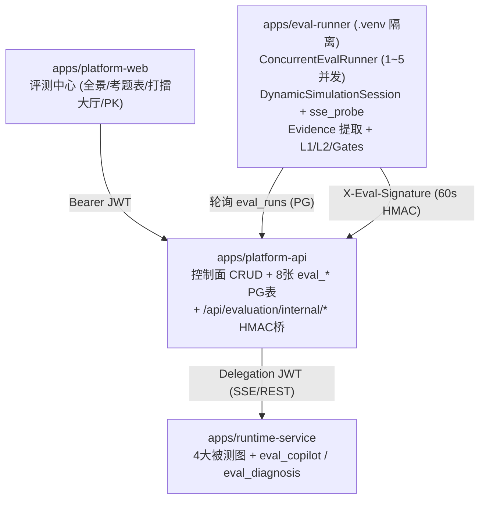

# 08 原生独立评测中台（Independent Evaluation Platform）

> **专题总览与学习导航**
> 本专题按照 [架构分析与源码解读方法论](../METHODOLOGY.md) 的六维硬核标准编写，系统剖析本仓**原生独立评测中台**的架构设计、四端协同协议、动态多轮仿真与白盒取证引擎、7 维指标裁决标准以及一线使用指南。

---

## 一、 承前启后：为什么要有这一层独立架构？

- **承前（演进来源）**：平台早期曾采用寄生在 `EvalFlow` / MLflow 实验视图之外的外挂方案（历史参考见 [02-07 持续评测飞轮](../02-cross-cutting/07-continuous-evaluation-flywheel.md)），长期遭受单文件膨胀、文件锁读盘卡死、Cookie 滑动补丁与“四者死绑”的 `Connection` 抽象拖累。
- **居中（当前原生架构）**：我们将评测资产、冻结版本、调度运行、白盒取证、中文动态仿真与 DeepEval 裁判全面重构进本仓原生底座，严格遵循**四端解耦**：
  1. `platform-web`（「评测中心」原生 Vue 3 工作台）
  2. `platform-api`（同步控制面 CRUD + PostgreSQL 8 张表 + HMAC 内部代理桥）
  3. `eval-runner`（独立并发执行引擎 + 隔离 `.venv` DeepEval `3.9.9`）
  4. `runtime-service`（多图执行 + `eval_copilot` / `eval_diagnosis` 专家 Graph）
- **启后（核心产出）**：让每一次 Agent 或模型变更都可以在指定隔离靶场中经历“L1 确定性硬断言 → L2 平台网关模型裁判 → L3 人工标定”的流水线检验，并生成可对比 PK、可穿透 MLflow Trace、可三层 Gap 归因的上线门禁结论。

---

## 二、 两大传送门概念（Threshold Concepts）

掌握以下两个核心枢纽机制，就能推导出整个评测中台 80% 的代码设计：

1. **控制面与执行引擎的“零凭证 HMAC 内部代理桥”**：
   `eval-runner` 作为独立进程跑并发与 DeepEval，**绝不直接读取用户的登录 JWT 或越权查询其他项目数据**；所有模型凭据解析、测试文件上传、线程执行与工作区证据读取，必须经 `platform-api` 的 `/api/evaluation/internal/*` 校验 `X-Eval-Signature`（60 秒窗口防重放）后由控制面代为向 `runtime-service` 签发受控 Delegation JWT。
2. **“先物理取证、再分层裁决”的白盒取证管线**：
   传统黑盒问答只看最后一句输出，Agent 一旦“虚假成单”或跳过工具就会漏报。本系统强制在执行后从真实线程状态提取 `tool_events`（`requested`/`executed`/`blocked`）、从沙箱提取 `artifacts` 与 `initial_artifacts`、从诊断流提取 `loop_signals`，**先固化不可篡改的 `Evidence`，再按 L1 硬规则 → L2 语义裁判逐层打分，缺失关键证据一律报错熔断而不放行**。

---

## 三、 全景拓扑与专题文档地图

| 序号 | 文档 | 核心覆盖范围 | 适用读者 |
|---|---|---|---|
| **01** | [01-control-plane-and-isolation.md](01-control-plane-and-isolation.md) | 8 张 PostgreSQL 表完整 Schema、版本冻结哈希、Readiness 守卫、HMAC 内部桥真实报文、`eval_copilot` / `eval_diagnosis` 专家图 | 后端研发、架构师 |
| **02** | [02-execution-simulation-and-evidence.md](02-execution-simulation-and-evidence.md) | `ConcurrentEvalRunner`、SSE 流式 TTFT 探针、中文动态多轮仿真、`__interrupt__` 三路协商、`tool_evidence`/`artifacts` 白盒取证、真跑排障复盘 | 引擎研发、Runtime 研发 |
| **03** | [03-metrics-gates-and-usage-guide.md](03-metrics-gates-and-usage-guide.md) | 3 大形态 × 7 维指标公式、L1/L2/L3 裁决、4 维异常分层、CI 门禁、前端完整操作、4 套推荐选指标避坑矩阵、多轮改代码验证写法与 CLI | QA、算法工程师、业务出题人 |

---

## 四、 切斯特顿栅栏：为什么不做看起来“更简单”的方案？

| 看似“更简单”的替代方案 | 被否决的真实原因（源码级防线） |
|---|---|
| **把 `eval-runner` 直接放进 `platform-api` 进程里用 `BackgroundTasks` 跑？** | `deepeval==3.9.9` 依赖 `sentry-sdk>=2.x` 与多套解析库，直接装进主控制面不仅会引发 `runtime-service`/`platform-api` 依赖冲突，长耗时并发推理与裁判思考还会拖垮 API 主事件循环内存与 Worker 池。独立 `apps/eval-runner/.venv` 实现了依赖与内存彻底隔离。 |
| **把历史用例和运行结果继续存在本地 JSON + 文件锁里？** | 旧 `EvalFlow` 的 `work_items.py` 曾因递归扫描 `.local-stack/*.json` 触发 $O(N \times M)$ 读盘卡死与锁竞争。迁入 PostgreSQL `eval_*` 表后，利用主键与唯一索引天然解决并发写与断点续跑状态一致性。 |
| **让 `eval-runner` 直接拿超级管理员 Token 调 `runtime-service`？** | 破坏控制面与执行面隔离边界：一旦运行器内部参数拼装有误，可能越权读写线上正式业务项目的对话记忆。通过 `/api/evaluation/internal/*` + `target_project_id` 强制把靶场行为关在授权隔离项目内。 |
| **遇到 `__interrupt__` 时直接走 `/execute-turn` 重发一条普通消息续跑？** | 实测会直接触发网关 HTTP 400 `resume_configuration_override` 拒绝执行。控制面在检测到 `command` 时必须分流走 `gateway.send_thread_command(method="input.respond", ...)` + `gateway.join_thread_run_stream(...)`。 |

---

## 五、 评测中台架构不变量清单（红线规则）

1. **控制面绝不运行长阻塞评测或加载 DeepEval**：`platform-api` 仅负责异步任务入队与同步状态查询，评测执行只归属 `apps/eval-runner`。
2. **缺失证据严禁放行或默认满分**：当用例声明了工具、工件或检索上下文检查但采集失败/未记录时，`rules.py` 与 `deepeval_adapter.py` 必须返回失败或 `error`（`missing_trace_evidence` / `missing_artifact_evidence` / 熔断拒评），绝不降级成 PASS。
3. **安全类规则拥有门禁一票否决权**：`SAFETY_METRICS`（`no_write`、`approval`、`cross_project_denied`、`protected_unchanged`、`tool_constraints`）任一失败，即使总均分达标，`evaluate_gate` 也必须判 FAIL（退出码 `1`）。
4. **跨项目对比仅限同冻结版本**：`Head-to-Head PK` 严格比对 `version_id` 与 `content_hash`，防止不同题库版本“关公战秦琼”。
