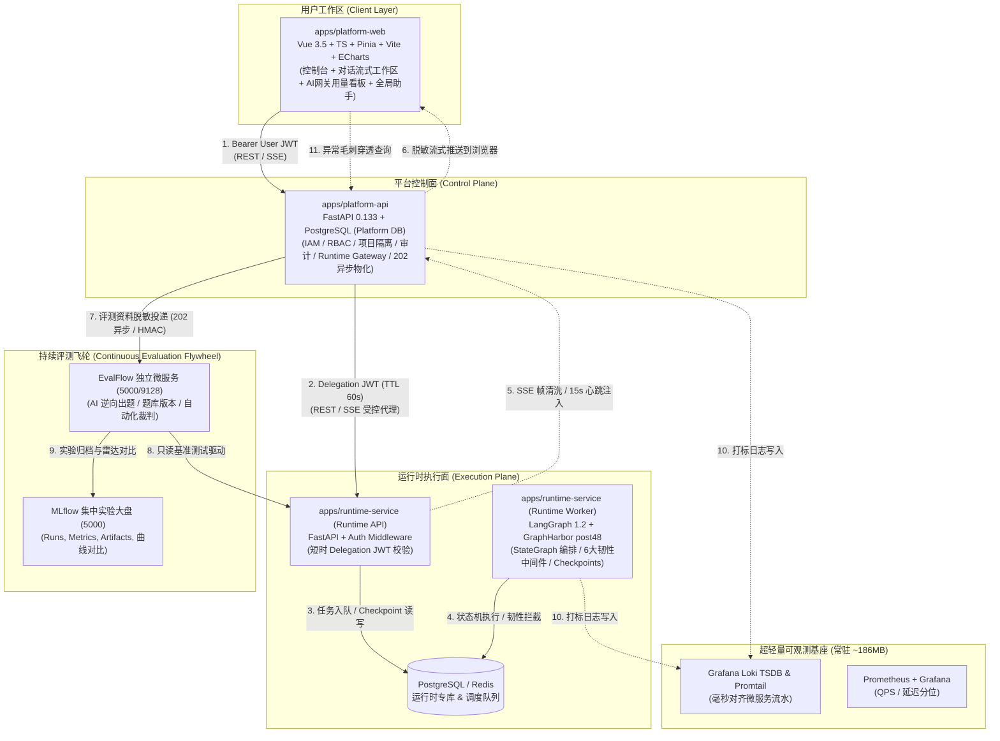
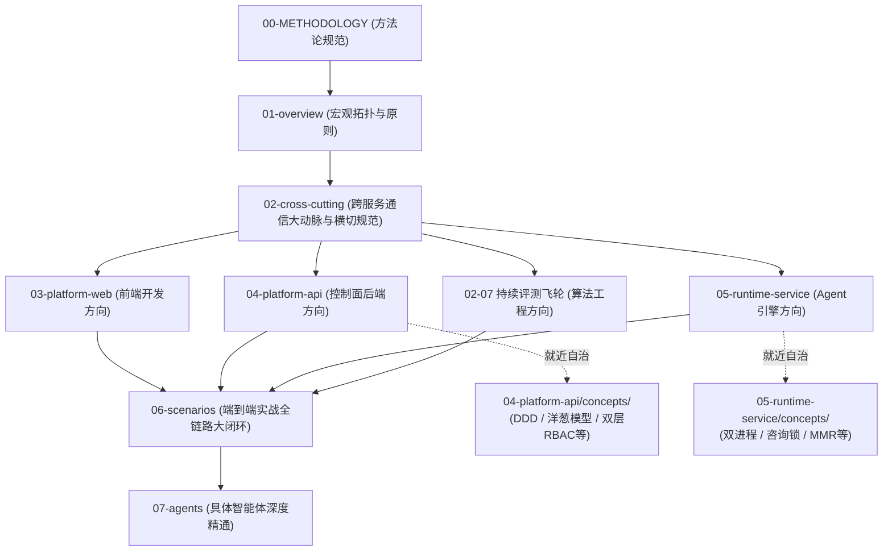

# 企业级 AI Agent 平台架构与源码深度解读

> **架构全景导航与深度学习指南**
> 本目录不是浮于表面的概览，而是面向二次开发、生产架构落地与深度源码学习的系统化技术全景。涵盖：**六大核心支柱拓扑、跨服务 8 大通信协议、子系统深度设计、10 大端到端核心业务场景、典型智能体深度剖析、持续评测飞轮与核心防御机制**。

---

## 零、 文档编写方法论与学习导读（必读）

为了防止文档沦为“大而化之的 PPT 概述”或“没有上下文的代码搬运工”，本项目制定了专门的**架构分析与源码解读方法论规范**：

📖 **详见规范**：[METHODOLOGY.md - 架构分析与源码解读方法论：工业级技术深潜文档编写指南](METHODOLOGY.md)

本目录所有文档均严格遵循 **“六维硬核标准”**：
1. **精确源码坐标映射**：具体到目录、文件、核心类和函数方法（可点击的绝对路径超链接）；
2. **真实数据结构与 Schema**：列出真实的 PostgreSQL 表结构、HTTP Headers 与 JSON 交互报文；
3. **函数级端到端调用时序**：使用精准的 Mermaid 泳道图从前端组件一路跟踪到模型/数据库执行点；
4. **高保真核心伪代码**：1:1 提炼真实生产代码中的核心算法、防御拦截与边界分支；
5. **真实故障防御与踩坑经验**：复盘项目中真实的容错设计（如 post48 运行时 TTL、410 游标失效恢复、8MB 帧审查、防自回声排除、首尾 50 行折叠）；
6. **知识串联模型（三承三启）**：开头必有概念速查与前置输入来源，结尾必有下游消费去向与架构红线。

---

## 一、 系统架构核心原则（核心认知）



1. **控制面与运行面物理隔离（Separation of Concerns）**：
   - `platform-api` 专注治理：租户、项目边界、BYOK 目录、双层 RBAC 权限、用量时序聚合、审计、202 异步物化与网关中继。绝不加载任何大模型 SDK 或运行 LangGraph 图节点。
   - `runtime-service` 专注执行：负责 LangGraph 图状态机、6 大运行韧性中间件、工具装配（Tools/MCP/Skills）、模型推理与人机协同审批（HITL）。绝不直接持有用户的长期登录凭证。
   - **双库独立**：平台业务库（Platform PostgreSQL）与运行时状态库（Runtime PostgreSQL + Redis）严格隔离，保证高并发执行不拖垮控制面。
2. **零信任短时委托鉴权（Delegation JWT Architecture）**：
   - 跨服务绝不透传用户原始 Token，而是由网关对权限和白名单校验后，动态签发 **60 秒超短 TTL 的 Delegation JWT**（携带严格的 `operation` 枚举、`project_id`、`thread_id` 与模型白名单）。
3. **流式管道状态机清洗与自愈（Streaming State Machine）**：
   - SSE 事件流在网关层经历 **8MB 单帧审查、敏感数据脱敏、`: heartbeat` 保活注入**；前端消费端具备 **`useSessionInterrupts` 审批状态机自愈** 与 **`410 cursor_expired` 断流降级恢复** 能力。
4. **持续评测飞轮两权解耦（Continuous Evaluation Flywheel）**：
   - 确立核心规约：*Supply authorized Session evidence. Test case authoring belongs to EvalFlow.*
   - Agent 平台负责合规授权、脱敏物化与只读执行；EvalFlow（`5000/9128`）负责 AI 逆向建题、版本发布、LLM-as-a-Judge 裁判与 MLflow 实验大盘。
5. **运行时全方位韧性拦截（Resilience Middlewares Pipeline）**：
   - 部署虚拟上下文折叠（不改库）、超大输出溢出落盘与首尾 50 行截断、参数指纹死循环探测（3 告警 5 掐死）、以及步数与 Token 耗尽时的平飞迫降协议（`jump_to="end"`）。

---

## 二、 严格编号的系统知识地图（全景索引）

所有文档已全面实施**层级两级数字编号**，严格按照知识依赖顺序排列：

```text
docs/architecture/
├── README.md                                # [当前导航] 架构全景大地图、学习指南与进度看板
├── METHODOLOGY.md                           # [编写规范] 架构分析与源码解读方法论 (六维硬核标准)
│
├── 01-overview/                             # 【第一层：宏观拓扑与技术全景】
│   ├── 01-system-topology.md                # 01-01 系统架构拓扑图与六大核心支柱 (内嵌 Archify 交互大图)
│   ├── 02-tech-stack.md                     # 01-02 统一技术栈清单与 7 大深度选型考量 (Python 3.13 / EvalFlow / ECharts)
│   └── 03-design-principles.md              # 01-03 核心架构设计原则与权衡
│
├── 02-cross-cutting/                        # 【第二层：跨服务通信与横切规范】(重中之重)
│   ├── 01-communication-matrix.md           # 02-01 服务间通信全景矩阵 (8 大骨干通信干线对照大表)
│   ├── 02-delegation-auth.md                # 02-02 委托鉴权机制与短时令牌 (23项操作白名单/高保真伪代码)
│   ├── 03-sse-streaming-pipeline.md         # 02-03 SSE 流式推送全链路与自愈机制 (8MB截断/v3帧防洪/410自愈)
│   ├── 04-trace-and-observability.md        # 02-04 分布式全链路追踪与工业级可观测大盘 (W3C/Loki防自回声/MLflow双轨)
│   ├── 05-data-isolation.md                 # 02-05 存储架构与数据隔离模型 (双库物理边界与红线)
│   ├── 06-knowledge-studio-and-zero-tunnel.md # 02-06 原生知识中台与单向免隧道自治架构 (Scoped HMAC/只读MCP/Graph Studio)
│   ├── 07-continuous-evaluation-flywheel.md # 02-07 持续评测飞轮工程实现全揭秘 (两权分离/202异步物化/AI出题/LLM裁判)
│   └── 08-session-and-runtime-retention-ttl.md # 02-08 会话生命周期与运行时 Checkpoint 存储 TTL 自动衰减工程 (30天TTL/咨询锁)
│
├── 03-platform-web/                         # 【第三层：前端平台宿主架构 (Vue 3.5)】
│   ├── 01-architecture.md                   # 03-01 前端分层与工程骨架 (5层 Clean Architecture / ErrorBoundary)
│   ├── 02-chat-session-engine.md            # 03-02 对话会话池与多 Tab 保活状态机 (四大顽疾治愈 / Iron Gate)
│   └── 03-component-design.md               # 03-03 控制台规范与动态工件渲染 (Observability / Token看板 / PlanReview)
│
├── 04-platform-api/                         # 【第四层：平台控制面与网关架构 (FastAPI 0.133)】
│   ├── 01-architecture.md                   # 04-01 后端分层架构与领域划分
│   ├── 02-runtime-gateway.md                # 04-02 网关反向代理与协议转换细节 (W3C 头注入 / 自回声阻断)
│   ├── 03-iam-and-governance.md             # 04-03 IAM 权限、租户隔离与 PII 脱敏网关治理
│   ├── 04-catalog-management.md             # 04-04 智能体资产目录生命周期管理 (模型多Provider/费率配置)
│   ├── 05-token-usage-and-read-models.md    # 04-05 AI 网关使用看板与多分辨率时序聚合读模型架构 (1m/5m/1h/1d/权限解耦)
│   └── concepts/                            # 【控制面概念透析专篇库 (就近自治)】
│       ├── 01-mvc-ddd-hexagonal.md          # 01 从 MVC 到 DDD 与六边形架构深度透析
│       ├── 02-onion-middleware-model.md     # 02 深入理解中间件洋葱圈模型 (穿透/短路/防泄漏)
│       ├── 03-chestertons-fence-in-software-defense.md # 03 切斯特顿栅栏在软件架构防御中的深度透析
│       ├── 04-control-vs-execution-plane-permissions.md # 04 控制面与执行面权限解耦与透传报文深度透析
│       ├── 05-iam-and-rbac-architecture.md # 05 IAM 身份认证、双层 RBAC 与多租户安全治理
│       ├── 06-dual-layer-rbac-deep-dive.md # 06 双层 RBAC 权限引擎设计与端到端实战推演
│       ├── 07-opaque-token-and-credential-governance.md # 07 大模型凭据零信任治理与不透明临时引用票据
│       └── 08-lightweight-observability-philosophy.md # 08 186MB 超轻量微服务可观测体系设计哲学深度剖析
│
├── 05-runtime-service/                      # 【第五层：Agent 运行时执行引擎 (LangGraph 1.2 + GraphHarbor post48)】
│   ├── 01-architecture.md                   # 05-01 运行时 API 与 Worker 双进程架构
│   ├── 02-langgraph-execution.md            # 05-02 LangGraph 图执行与预算软收尾 (只读工具防死循环/模型容灾降级)
│   ├── 03-hitl-and-interrupts.md            # 05-03 人机协同中断与审批恢复机制 (Plan Mode / Iron Gate 避让)
│   ├── 04-tools-and-skills.md               # 05-04 MCP 协议适配与弹性装配容错 (防自杀软降级 / Skills 快照)
│   ├── 05-context-blowup-defense-and-resilience.md # 05-05 运行时防死循环、防上下文撑爆与 6 大韧性中间件剖析 (虚拟折叠/首尾50行/迫降)
│   └── concepts/                            # 【运行时概念透析专篇库 (就近自治)】
│       ├── 01-runtime-autonomy-and-decoupled-testing.md # 01 执行层微服务自治与无依赖测试架构
│       ├── 02-runtime-execution-and-developer-experience-critique.md # 02 运行时执行边界与架构批判式审视
│       ├── 03-dual-process-runtime-deep-dive.md # 03 运行时双进程架构与运行模型深度透析
│       ├── 04-langgraph-ecosystem-thin-wrapper-and-agent-development-guide.md # 04 LangGraph 生态扫盲与 Agent 开发 SOP
│       ├── 05-message-inbox-advisory-lock-and-reconciliation-deep-dive.md # 05 MessageInbox 咨询锁与消息对账全链路
│       ├── 06-request-authentication-and-runtime-resolution-pipeline.md # 06 请求验签与配置净化全链路透析
│       ├── 07-runtime-core-module-anatomy-and-code-responsibilities.md # 07 Runtime 核心内核源码与职责透析
│       ├── 08-database-architecture-dual-chains-and-application-schema.md # 08 数据库双轨制架构与应用表全景透析
│       ├── 09-workspace-sandbox-pty-and-asset-pipeline.md # 09 运行时沙箱、Smart Zip 流式直出与 PTY 终端透析
│       ├── 10-runtime-webapp-api-server-and-inbox-pipeline.md # 10 运行时 Web 控制面、消息收件箱与对账引擎透析
│       ├── 11-upstream-langgraph-monkey-patches-and-hitl-bug-anatomy.md # 11 LangGraph 官方源码级猴子补丁与人机中断避坑
│       ├── 12-runtime-observability-langfuse-and-otel-pipeline.md # 12 运行时可观测性架构与 Langfuse/OTel 追踪管线
│       ├── 13-asynchronous-memory-and-mmr-algorithm.md # 13 异步记忆提取与双池 MMR 重排算法深度透析
│       └── 14-resilient-mcp-fault-isolation.md       # 14 弹性 MCP 容错与装配期短路保护机制深度透析
│
├── 06-scenarios/                            # 【第六层：端到端经典全链路时序大闭环】
│   ├── 01-agent-chat-flow.md                # 06-01 普通流式对话端到端全链路 (Web→API→Runtime→Web)
│   ├── 02-hitl-approval-flow.md             # 06-02 工具调用触发审批与恢复全链路
│   ├── 03-subagent-dispatch.md              # 06-03 主智能体派发子智能体与历史回放
│   ├── 04-plan-mode-flow.md                 # 06-04 先规划后执行（Plan Mode）端到端全链路时序
│   ├── 05-trace-to-logs-flow.md             # 06-05 Trace-to-Logs 毫秒级分布式排障日志穿透时序
│   ├── 06-knowledge-studio-flow.md          # 06-06 知识资产上传、异步入库与只读检索时序
│   ├── 07-model-resilience-fallback-flow.md # 06-07 大模型瞬态故障毫秒级主备容灾降级时序
│   ├── 08-session-to-eval-flywheel-flow.md  # 06-08 生产会话转持续评测飞轮端到端全链路 (勾选/脱敏/202/AI建题/裁判/MLflow)
│   ├── 09-platform-assistant-diagnostics-flow.md # 06-09 平台全局助手就地故障诊断与证据链回溯时序大闭环 (悬浮/AST/证据链)
│   └── 10-gateway-usage-to-trace-flow.md    # 06-10 AI 网关用量看板时序毛刺到分布式追踪下钻闭环 (ECharts/采样Trace/Loki深钻)
│
└── 07-agents/                               # 【第七层：具体智能体深度剖析与伪代码】
    ├── 01-dearflow-agent/                   # 07-01 核心旗舰智能体：DearFlow Agent 专属专题目录
    │   ├── README.md                        # 专题导读与架构总览
    │   ├── 01-architecture-and-modes.md     # 07-01-01 总控编排与四档执行模式 (Pregel拓扑/10+中间件/算力预算)
    │   ├── 02-memory-engine.md              # 07-01-02 企业级长期记忆闭环系统 (异步解耦/MMR重排/平滑软淘汰)
    │   ├── 03-tools-ecosystem.md            # 07-01-03 38类工具装配矩阵 (检索/ArXiv/GitHub/部署/多模态/图表)
    │   ├── 04-workspace-sandbox.md          # 07-01-04 工作空间沙箱与资产管线 (Smart Zip流式传输/PTY/防逃逸)
    │   ├── 05-skills-runtime.md             # 07-01-05 技能治理与动态热加载 (20+内置技能/ZIP乐观锁/快照隔离)
    │   ├── 06-high-fidelity-implementation.md # 07-01-06 端到端高保真实现伪代码 (单文件级全景装配闭环)
    │   └── 07-real-world-lifecycle-case-study.md # 07-01-07 真实案例端到端全链路实录 (从用户一句话到沙箱结果落盘)
    ├── 02-showcase-demo-agent.md            # 07-02 演示智能体：Showcase Agent 最小骨架
    └── 03-platform-assistant-agent.md       # 07-03 平台内置全局助手智能体：只读诊断工具链、证据链与沙箱执行 (sqlglot/只读DSN)
```

---

## 三、 架构演进与推进成果看板

| 阶段 | 重点领域 | 包含文档 / 核心产出物 | 状态 |
|---|---|---|---|
| **Phase 0** | **架构总纲与方法论规范** | [README.md](README.md)<br>[METHODOLOGY.md](METHODOLOGY.md) (六维硬核标准) | ✅ 100% 已完成 (done) |
| **Phase 1** | **宏观全景与基础设施校准** | [01-overview/01-system-topology.md](01-overview/01-system-topology.md) (六大支柱交互拓扑)<br>[01-overview/02-tech-stack.md](01-overview/02-tech-stack.md) (Python 3.13 / EvalFlow / 7大选型考量)<br>[02-cross-cutting/01-communication-matrix.md](02-cross-cutting/01-communication-matrix.md) (8 大骨干通信网络大表)<br>[02-cross-cutting/04-trace-and-observability.md](02-cross-cutting/04-trace-and-observability.md) (W3C/Loki防自回声/MLflow双轨)<br>[04-platform-api/05-token-usage-and-read-models.md](04-platform-api/05-token-usage-and-read-models.md) (AI网关看板与时序聚合读模型) | ✅ 100% 已完成 (done) |
| **Phase 2** | **四大重磅架构专篇攻坚** | [02-cross-cutting/07-continuous-evaluation-flywheel.md](02-cross-cutting/07-continuous-evaluation-flywheel.md) (持续评测飞轮工程实现全揭秘)<br>[02-cross-cutting/08-session-and-runtime-retention-ttl.md](02-cross-cutting/08-session-and-runtime-retention-ttl.md) (会话生命周期与运行时 Checkpoint TTL 衰减)<br>[05-runtime-service/05-context-blowup-defense-and-resilience.md](05-runtime-service/05-context-blowup-defense-and-resilience.md) (防死循环、防上下文撑爆与 6 大韧性中间件)<br>[07-agents/03-platform-assistant-agent.md](07-agents/03-platform-assistant-agent.md) (平台内置全局助手智能体：只读诊断与证据链) | ✅ 100% 已完成 (done) |
| **Phase 3** | **三大场景时序大闭环** | [06-scenarios/08-session-to-eval-flywheel-flow.md](06-scenarios/08-session-to-eval-flywheel-flow.md) (生产会话转持续评测飞轮端到端全链路)<br>[06-scenarios/09-platform-assistant-diagnostics-flow.md](06-scenarios/09-platform-assistant-diagnostics-flow.md) (平台全局助手就地故障诊断与证据链回溯)<br>[06-scenarios/10-gateway-usage-to-trace-flow.md](06-scenarios/10-gateway-usage-to-trace-flow.md) (AI网关用量看板时序毛刺到分布式追踪下钻闭环) | ✅ 100% 已完成 (done) |
| **Subsystems**| **前端与执行层基础专篇** | `03-platform-web/` (3篇) / `04-platform-api/` (前4篇) / `05-runtime-service/` (前4篇) | ✅ 100% 已完成 (done) |
| **Agents** | **旗舰智能体深度精通** | `07-agents/01-dearflow-agent/` (专题 8 篇含真实案例全链路实录) / `07-agents/02-showcase-demo-agent.md` | ✅ 100% 已完成 (done) |
| **Concepts**| **子系统专属概念透析专篇库 (22 篇)** | `04-platform-api/concepts/` (8篇) + `05-runtime-service/concepts/` (14篇) | ✅ 100% 已完成 (done) |

---

## 四、 快速阅读推荐路径与依赖树

每个角色对知识的需求层次不同，推荐按照如下**前后依赖链条**推进阅读：



- **新同学第一步**：先看 [01-overview/01-system-topology.md](01-overview/01-system-topology.md) 在内嵌大图中看懂系统全景；接着看 [01-overview/02-tech-stack.md](01-overview/02-tech-stack.md) 了解技术依赖与 7 大选型权衡。
- **联调与接口二开**：必读 [02-cross-cutting/01-communication-matrix.md](02-cross-cutting/01-communication-matrix.md)（8 大干线对照表）、[02-cross-cutting/02-delegation-auth.md](02-cross-cutting/02-delegation-auth.md) 与 [02-cross-cutting/03-sse-streaming-pipeline.md](02-cross-cutting/03-sse-streaming-pipeline.md)。
- **算法评测与质量工程**：必读 [02-cross-cutting/07-continuous-evaluation-flywheel.md](02-cross-cutting/07-continuous-evaluation-flywheel.md) 与 [06-scenarios/08-session-to-eval-flywheel-flow.md](06-scenarios/08-session-to-eval-flywheel-flow.md)。
- **线上运维与全链路排障**：必读 [02-cross-cutting/04-trace-and-observability.md](02-cross-cutting/04-trace-and-observability.md)、[04-platform-api/05-token-usage-and-read-models.md](04-platform-api/05-token-usage-and-read-models.md)、[06-scenarios/09-platform-assistant-diagnostics-flow.md](06-scenarios/09-platform-assistant-diagnostics-flow.md) 与 [06-scenarios/10-gateway-usage-to-trace-flow.md](06-scenarios/10-gateway-usage-to-trace-flow.md)。
- **开发新智能体 / 接入新工具 / 防上下文撑爆**：必读 [05-runtime-service/05-context-blowup-defense-and-resilience.md](05-runtime-service/05-context-blowup-defense-and-resilience.md) 与 [07-agents/01-dearflow-agent/README.md](07-agents/01-dearflow-agent/README.md)。
