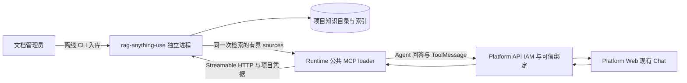

# 项目知识检索 MCP - 已批准方案与实现契约

**状态：blocked。** 用户于 2026-10-11 明确批准，并授权源码本地开发、启动和联调。非前端文本/MCP链已实现；PDF/Office解析与业务资料质量验收受兼容环境/语料阻塞，前端由同事接续。完成度以 [tasks.md](tasks.md) 为准。

## 目标与首版范围

用户需要给平台补一项通用知识能力，通过 MCP 使用指定的 `rag-anything-use`。首版完成一条真实链路：管理员预先导入项目资料 → 当前项目的新 Thread 调用只读知识工具 → 主 Agent 用检索片段回答 → 现有页面展示并回放来源。

使用场景假设：团队共同维护的小规模文本资料，项目内所有有权运行 Agent 的成员可检索这些资料；不要求在线导入、文档级授权或零停机索引更新。这些边界随本方案获得用户批准；如果实际材料有个人权限或法律删除要求，不能按此范围发布。

原定首版必验文本型 PDF；当前 Intel macOS/Python3.13 无锁定 Torch2.11 wheel，这一门禁明确 blocked，不能被 Markdown 验证代替。其他格式只有用实际 Docling 输入跑通后才声明支持；线程附件支持 DOCX/PPTX 不代表知识服务已经具备同等支持。多模态增强默认关闭。

## 架构与分工



| 层 | 必须做 | 复用与边界 |
| --- | --- | --- |
| 前端 | 联验工具结果、无命中/错误、来源快照与刷新回放；必要时微调现有来源卡 | 复用 Chat/Dear 的同一组件，不增加知识菜单、上传、选库、模型/Key 配置，不直连 MCP |
| 平台后端 | 创建可信项目绑定、禁止客户端注入、保护公开投影；执行与读取仍走当前权限 | 不存文档/向量，不增加知识 CRUD、新业务表、新 Run 状态或 JWT operation |
| Runtime | 官方工具装配、连接归属、只读/策略门禁、结果校验；两主图共用 | 不解析知识文件、不跑索引、不自建 Agent 循环，不把 KB URL/Key 放 Context/Prompt |
| 知识服务 | 文档解析/索引/检索；凭据决定范围；返回安全来源；独立生命周期 | 原有 CLI 是管理员入口；不把入库/删除工具交给模型 |

`dearflow_agent` 与 `showcase_demo` 是本期两个真实调用点。其他 Graph 可按既有组合根范式将来显式接入，不自动给 reference/workflow 或 researcher 子图扩权。Plan Mode 继续禁止 MCP；上下文整理/schema-only 不连接 MCP。

## 1. 可信项目绑定，先解决隔离

### 配置方式

首版用部署方维护的三份小配置，不做配置管理产品或数据库迁移：

| 所在进程 | 配置 | 内容/用途 |
| --- | --- | --- |
| Platform API | `PLATFORM_KNOWLEDGE_MCP_BINDINGS_JSON`（已新增） | `tenant UUID或__default:project UUID -> resource_id`；只有引用，没有 URL/Key |
| Runtime API/Worker | 现有 `RUNTIME_MCP_CONNECTIONS_JSON` | 每个 resource 的明确 tenant/project scope、HTTP URL、项目 Bearer、allowed_tools |
| 知识 MCP | `KNOWLEDGE_MCP_TOKEN_SCOPES_JSON`（已新增） | 一个 Bearer 对应一个 tenant/project/知识 namespace；此文件仅服务端可读 |

Runtime 配置示意（全部是占位值；`scope` 已由服务端校验，传给官方客户端前剥离）：

```json
{
  "knowledge-project-a": {
    "scope": {"tenant_id": "<tenant UUID>", "project_id": "<project UUID>"},
    "transport": "streamable_http",
    "url": "http://127.0.0.1:<本环境知识端口>/mcp",
    "headers": {"Authorization": "Bearer <project-a-only-token>"},
    "allowed_tools": ["mcp_query_project_knowledge"]
  }
}
```

无配置默认无知识能力，不回退公共库、默认项目、主工作区或另一个项目的连接。同一个查询名字可出现在不同项目连接里，因为每次只解析当前绑定的一条连接；目录按名字取集合，同一连接重复/实际工具重复或撞保留名仍拒绝。

生产 loader 提取后，已有受管 MCP 连接也必须声明自己的 scope；部署方若已配置其他 MCP，随本次配置迁移补齐并验收，缺 scope 安全失败，不保留宽松回退。教学 mcp_demo 的独立假服务不作为生产接线。

### 授权链

1. API 按现有 IAM 和项目成员/服务账号 grant 校验创建 Thread。身份来自 ActorContext，project 来自已授权请求范围。
2. Thread ID 由平台确定后，按精确 tenant/project 映射生成现有 `runtime-resource-bindings/v1` 的 `mcp` 条目；保留其他受管资源条目。binding 只含 provider/resource_id/tenant_id/project_id/thread_id。
3. 任何公开请求中的 `runtime_resource_bindings`、`__graphharbor_thread_metadata` 及新私有配置都拒绝；不能接受用户先填正确 tenant/project 再自选 resource。
4. Runtime 先解析当前签名 principal、Context 和 tool policy，再按 binding 解析连接。binding 的三项 scope 与实际 connection 的 tenant/project 必须一致，禁止凭 `resource_id` 访问其他项目。
5. 知识服务在 HTTP 层使用 FastMCP Bearer 认证，工具从已认证上下文取 namespace。禁止公开 query 参数指定项目；其他网络工具同样受 scope 约束，返回名单/状态不能泄漏 source_uri 或原始异常。
6. 新 Run/resume/队列消费/定时启动沿现有当前工具授权路径；用户撤权后不允许新执行或读取历史。模型伪造旧 tool call 不能绕过 deny/Plan gate。

不为这个内部服务新增 OAuth、SSO 或另一套用户 RBAC；复用 FastMCP 的 TokenVerifier 接口，静态项目凭据可撤销/轮换。认证上下文已用锁定 FastMCP3.2.0 的 TokenVerifier/get_access_token 实测，使用 FastMCP 原生 ToolResult/ToolError。

项目凭据授权的是项目资料，而不是某个用户身份。权限决策由平台做，知识端的范围约束再阻止跨项目访问；V1 不提供供应商层面的逐用户审计/实时撤权。已有运行的成员撤权按当前 Stop 机制处理，不能宣称仅更新静态配置就已取消在途检索。

### 旧会话与停用

- 首版只给新建 Thread 绑定；不批量补旧 Thread metadata。旧会话继续普通对话，没有知识工具。
- fork 调用现有 create_thread，对新 Thread ID 重新签发绑定，不复制旧 Thread 的 binding。
- 禁用能力的权威入口是当前项目 tool restriction。先 deny 查询并阻止新调用，再撤销知识凭据/连接映射；只删除 API 的创建映射不能撤销已签发 binding。
- 历史 ToolMessage 是检索时证据快照，仍由现有 Thread ACL 管理。不在刷新时重新检索，不在停用时清空历史。
- 换知识范围后，首版新开受管 Thread；旧绑定不静默改指向另一份资料。

## 2. 知识服务补齐，不重写引擎

所有 K 路径相对用户指定的 `rag-anything-use` 根；本轮已在用户指定源码目录实施，完整改动见 [implementation/01-knowledge-mcp.md](implementation/01-knowledge-mcp.md)。

| 文件/符号 | 类型 | 精确改动 |
| --- | --- | --- |
| `src/mcp_server.py`：`create_server()` / lifespan 内的 `mcp_query_project_knowledge()` / `build_server_run_settings()` | 修改 | 对平台提供 `mcp_query_project_knowledge(query, top_k)`，async；HTTP `/mcp`、明确只读注解；服务 lifespan 复用 engine，超时/取消继续传播 |
| `src/knowledge/auth.py`：`resolve_knowledge_scope()`（已新增） | 新增小模块 | 接 FastMCP 的认证上下文与静态 token scope；所有网络查询/目录/状态入口共用；未认证/不匹配不读目录或调用 Embedding |
| `src/knowledge/project_paths.py`：`build_knowledge_project_paths()` | 修改 | 仅允许有限长度的单段 ID；resolve 后必须在 root 下，拒绝绝对路径、分隔符、`..` 和逃逸符号链接 |
| `src/knowledge/rag_engine.py`：`ProjectRAGEngine.get_rag()`；`retrieve()`（已新增） | 修改 | 明确每范围 LightRAG workspace；有界初始化/关闭；一次 `aquery_data()`，不再在 MCP 路径 `aquery()` 生成答案 |
| `src/knowledge/schemas.py` | 修改 | 增加仅检索的请求/响应验证；query trim 后 1–2000 字符、top_k 1–8，固定 hybrid；未实现 document_ids 不得默默忽略 |
| `src/knowledge/citations.py`：`build_query_result_artifacts()` | 修改 | 新范围用不透明 doc ID 精确映射；只接受 ready 文档，单次片段与来源一起输出；不暴露路径/raw metadata、不猜页码 |
| `src/knowledge/ingest_service.py:ingest_document()` / `rag_engine.py:ingest_content_list()` | 修改 | 新平台 corpus 用 document_id 作索引 locator；异常/部分索引不发布；沿用管理员离线入库，无自动去重/在线任务队列 |
| `src/knowledge/document_registry.py:_save()` | 修改 | manifest 临时文件原子替换；仍是单写者，不把原子写误说成并发事务 |
| `src/demo_support.py:load_settings()` / `build_lightrag()` | 修改 | 显式 workspace；服务路径不依赖无关测试文件/关闭的视觉模型配置，示例使用时在示例入口校验；沿用 Ollama Embedding，不增加 provider |
| `src/knowledge/admin_service.py` / MCP 两个管理读函数 | 修改 | 所有 HTTP 调用限当前 scope，safe DTO 只留文档 ID/名称/状态；Key、绝对路径、原始 last_error 不公开 |
| `tests/test_knowledge_smoke.py` / `tests/test_mcp_stdio.py` / `tests/test_mcp_http.py`（新增） | 修改/新增 | 同步旧 MCP query 名称/参数的变更，补边界与真实 HTTP 测试；stdio 不作为正式授权验收，也不允许缺 scope 的查询兜底 |
| `README.md` / `env.example` / `docs/mcp_receiver_integration_guide.md` | 修改 | 正式平台接入说明改为 Streamable HTTP；写 scope/凭据/冻结索引/部署必需项和安全范例 |

既有 CLI `query` 可继续返回生成式 answer；平台只绑定新的检索 MCP 契约。外部工程实施前未部署，本次已本地部署；不维护旧 query 名的兼容别名。已盘点并更新该工程已发现的 stdio/HTTP 测试和平台消费方，未提供其他外部消费者清单。

### 数据/索引维护

首版运行一份知识 MCP 进程。每个项目有不同 namespace、workdir、manifest 和明确的 LightRAG workspace；不按文件目录不同就推定进程内全局状态已隔离。

索引发布过程：管理员在未发布的新 namespace 单文件顺序 ingest → 核对所有文档 ready 和质量 → 停止写入 → 重启/加载查询服务 → 按受控配置给项目发布凭据与 resource。查询服务不执行 ingest。失败或部分写入的 namespace 不发布，不能混入可搜索来源。

更新/移除资料用新 namespace 从批准的完整资料集合重建，然后通过新 resource/凭据发布；保留旧目录用于回退，不自动删除用户资料。短期有界维护窗口可接受，不承诺多实例扩容/在线一致性。服务连续运行时不由旁路 CLI 直接修改正在使用的 manifest/索引。

### 模型与费用

Agent 与知识端文本模型优先使用 miaomiaoai `deepseek-v4.1-flash`，知识引擎的实体/关键词结构化抽取仍须真实验证，不能由平台聊天通过推导出来。真实新版本入库曾出现空正文；本轮增加 LLM_EXTRA_BODY_JSON，并按该供应商关闭 thinking 后复测成功。Embedding 沿用 K 的 Ollama `/api/embed`、`nomic-embed-text` 组合，本地部署地址/768维已核实并冻结；不能中途换模型后继续复用旧向量。

取消知识端“生成答案”可以减少一次生成及重复检索；LightRAG hybrid 检索仍可能调用关键词 LLM 和 Embedding。现有平台 Usage 不自动包含这些外部调用，本期单独记录知识服务耗时/模型调用数，不新增第二套计费账本。

## 3. 平台 API 小范围补齐

| P 文件/符号 | 类型 | 改动 |
| --- | --- | --- |
| `apps/platform-api/src/platform_api/config.py:Settings` | 修改 | 新增默认空的项目→资源映射配置，启动时校验结构/UUID/唯一 scope；无凭据字段 |
| `apps/platform-api/src/platform_api/modules/runtime_gateway/application/knowledge_bindings.py:build_knowledge_binding()`（已新增） | 新增小模块 | 按可信 actor/project/thread 与配置生成现有 binding；不做 KB repository 或 CRUD |
| `apps/platform-api/src/platform_api/modules/runtime_gateway/presentation/http.py:get_runtime_gateway_service()` | 修改 | 通过已有依赖注入把已校验的映射交给用例；不新开 HTTP 路由 |
| `apps/platform-api/src/platform_api/modules/runtime_gateway/application/service.py:RuntimeGatewayService.__init__()` / `create_thread()` | 修改 | 仅内部写 binding，Thread ID 确定后生成；合并受管资源而不是整体覆盖；fork 使用当前 create 路径 |
| `apps/platform-api/src/platform_api/core/runtime_contract.py:PRIVATE_RUNTIME_STATE_KEYS` / `reject_private_runtime_state()` | 修改 | 将 binding、引擎 thread metadata 及新增私有标记纳入禁止注入；递归覆盖创建/Run/Protocol/input/state/config/metadata |
| `apps/platform-api/src/platform_api/modules/runtime_gateway/application/thread_access.py:initial_metadata()` | 修改 | 只保留用例签发的资源字段，不能把浏览器字段透传当作平台持有；保持现有 ACL 事实源 |
| `apps/platform-api/src/platform_api/adapters/langgraph/sdk_client.py:redact_runtime_private_fields()` | 修改 | binding/连接配置不进入公开 Thread/history/SSE/错误；供应商 JSON 文本仍由 Runtime 入栈前做白名单投影 |
| `apps/platform-api/tests/test_knowledge_mcp_bindings.py`（新增）及已有 Thread/fork/runtime contract 测试 | 修改/新增 | 证明范围签发、伪造拒绝、旧 Thread、fork、服务账号、停用和历史过滤 |

复用现有 `RuntimePolicyOverlayService`、`launch_runtime_run()` 和 `send_thread_command()` 的当前权限校验，不复制执行授权。目录刷新仍用已有 catalog 接口，将 query 工具挂到两主图的策略目录；不新增知识目录 API。

## 4. Runtime 公共接入

| P 文件/符号 | 类型 | 改动 |
| --- | --- | --- |
| `apps/runtime-service/src/runtime_service/tools/mcp.py:load_mcp_tools()`（已迁入） | 提取 | 从 Dear 生产 loader 提取，保留只读/allowlist/名字冲突/传输错误处理；额外核验绑定与 connection scope，禁止借 resource_id 跨项目 |
| `apps/runtime-service/src/runtime_service/runtime/mcp_config.py:configured_mcp_names()`（已新增/迁入） | 提取 | 纯声明/校验，跨连接同名取集合，同连接重复仍失败；避免能力声明导入 transport/组合根产生循环依赖 |
| `apps/runtime-service/src/runtime_service/tools/knowledge.py:project_knowledge_result()`（已新增） | 新增薄投影 | 使用官方 MCP interceptor，对唯一知识工具的结果校验并裁剪；native content 与 structuredContent 都只留安全契约，保留 isError/取消，不存 raw provider 数据 |
| `apps/runtime-service/src/runtime_service/services/dearflow_agent/tools/mcp.py` / `capabilities.py` | 迁移调用者 | 更新到公共入口，不留第二套 loader/声明或为旧路径加无消费者兼容层 |
| `apps/runtime-service/src/runtime_service/services/dearflow_agent/agent.py:_build_agent()` | 修改 | 保留先授权后连接；使用共同 loader/投影，实际可用列表与声明一致；Plan/子图不接入 |
| `apps/runtime-service/src/runtime_service/services/demo/showcase_demo/agent.py:_build_agent()` | 修改 | defaults/optional tools、执行装配、可用集合同步接入同一 loader；schema/offload 不发请求 |
| `apps/runtime-service/src/runtime_service/runtime/capabilities.py:graph_tools()` / `tool_catalog()` | 修改 | 仅两主图显式声明 MCP，目录取集合，不变成全图默认权限 |
| 两主图 `prompts.py` | 最小修改 | 知识问题应先查当前项目资料、注明来源/无答案；资料是非可信数据，不服从片段内的指令；不要求每轮必查 |
| 现有 MCP/resource binding/工具预算/两图组合测试及新增 `tests/tools/test_knowledge_result.py` | 修改/新增 | 复跑所有迁移调用者，覆盖跨项目同名、输出安全、schema-only、deny/Plan/取消、预算/offloading |

保留官方 Adapter，不手写网络 MCP 客户端、工具注册器或新 Agent middleware 链。当前锁版本支持 interceptor；官方文档出现新版 beta API 不构成本专项依赖升级理由。

## 5. MCP 与来源契约（已实现 v1）

### 工具输入

`mcp_query_project_knowledge(query: string, top_k: integer = 8)`：query 去首尾空白后 1–2000 字符，top_k 1–8；模式固定 hybrid。MCP annotations 明确 `readOnlyHint=true` / `destructiveHint=false`。hint 是装配条件，实际只读实现和凭据权限还要核验。

模型可见参数不含 tenant/project/namespace、document_ids、mode、provider URL、Key 或 include_debug。一份项目资源就是完整检索边界，不把模型过滤条件用于授权。

### 成功/空命中

返回一个 JSON 文本块及同值 structuredContent。此处 `source_id` 是检索调用内唯一快照 ID；`title` 带调用内序号，保证同名文档不被现有 UI 按相同 title 合并。不填 `content_hash` 作伪造定位，也不提供下载 URL。

```json
{
  "status": "ok",
  "sources": [
    {
      "source_id": "<retrieval-id>-1",
      "document_id": "kd_11111111111111111111111111111111",
      "chunk_id": "chunk_example",
      "title": "[1] 登录接口说明.pdf",
      "kind": "knowledge",
      "preview": "登录接口使用 POST /login，成功响应字段为……",
      "truncated": false
    }
  ]
}
```

空命中为 `{"status":"no_hit","sources":[]}`。检索未命中与服务失败严格区分；没有 ready 索引、损坏 manifest、认证失败或上游超时不得伪装成 no_hit。

sources 最多 8 条，单条 preview 最多 800 字符，最终 JSON 文本 UTF-8 最多 12 KiB（按序列化后的大小计，包含所有字段）；超出时缩短 preview 并标 truncated 或删除完整条目，保持合法 JSON。native artifact 与模型文本保存同一份已输出片段，不保存全文/raw_data/宿主路径。若现有 F04 预算更小，进一步按当前模型预算缩减完整来源条目；不得对半截 JSON 继续宣称来源可用。

V1 不承诺页码。可读标题是真实 filename 加序号，preview 是检索时原片段的有界快照，不能用另一轮生成的摘要冒充。模型回答使用文档名/序号提示来源，不发不存在的 `#knowledge-*` 点击链接。

片段内提示注入仍是模型使用资料的风险。保持现有工具权限/审批、明确资料仅作数据并验证恶意样本；通过若干样本不能证明模型对所有提示注入免疫。

### 错误/停用

MCP 执行失败使用 `isError=true` 和固定安全错误内容，沿 Adapter/现有工具容错显示 error ToolMessage；网络失败沿现有 MCP transport 分类处理。错误不带 exception repr、路径、URL、Key 或原始供应商响应。CancelledError/Run Stop 保留控制流，不包装为“无命中”。本期不新增公开 HTTP 错误 envelope 或 SSE 事件类型。

知识工具未绑定/被禁用时不进入模型工具列表，不连知识服务；普通对话仍可用。绑定已存在却损坏、跨 scope 或认证异常时安全失败，不能自动查默认库。

## 6. 前端交接与职责

同事按 [frontend-handoff.md](frontend-handoff.md) 实施。首版无需新页面、菜单、service 或知识状态机。后端先提供真实 Adapter 的 content/artifact、历史和错误 fixture，同事用现有 `ToolResult.vue`/`transcript.ts` 联验。

后端把字段归一化成现有 `sources`，不用前端理解原始 `citations`、`MCPToolArtifact` 或供应商路径。只有真实 fixture 不能正确显示时，才在共享组件增加必要投影/文案并补测试；不能以“知识工具”名义顺手重构聊天组件。

## 7. 部署、验证与回退

本轮已按源码部署本地文本/查询模式。遵循 Worktree 规范，平台统一使用 `scripts/local-stack.sh` 登记的本环境 PG/Redis/端口和独立依赖；`RUNTIME_BACKEND=local`。知识工程单独的 Python ≥3.13 环境、独立知识目录与端口，纳入 local-stack 的 knowledge-register/start/stop/restart，默认 loopback，不复用主库或别的 Worktree corpus。平台 `.venv` 不安装 Docling/LightRAG；不引入 Docker。

跨机正式服务才通过内部网络/HTTPS 和凭据接入；端口、root、模型/Embedding 地址、scope 和维护负责人都要留配置回执。知识服务不因本平台已有 PG 就自动依赖 PG。

验证分层及命令见 [verification.md](verification.md)：先源工程兼容 Spike，再两项目 HTTP/权限、两主图真实 Worker、浏览器/历史回放、检索质量、故障/取消和禁用回退。Phase 验证和 Final 分开记录。

回退顺序：在现有项目策略 deny query → 阻止新调用并处理在途 Run → 撤销/轮换项目知识凭据 → 停新知识进程/恢复原平台代码和配置 → 验证普通 Chat/附件/记忆/Plan 和历史来源仍可读。保留 Thread/checkpoint 和知识目录，不做数据删除或数据库 downgrade。

## 8. 审批与实施后的限制

用户已批准首版范围、本地源码启动、非前端全部开发与测试。不是再次待评审状态。前端代码和浏览器验收由同事完成，交接包含4份真实Worker ToolMessage及6份经官方Adapter的受控协议fixture。

为使现有隔离空库能启动，API/Runtime各增加一份无DDL的双head合并迁移；不增加知识业务表。真实PG upgrade已执行。服务账号真实链发现旧credential_id白名单/字段返回遗漏，已保留原验证规则并修复。

本机只宣称UTF-8 Markdown/TXT入库和项目只读检索已验。PDF/Office/多模态与10–20份实际业务资料的质量门禁，需要兼容ARM Mac/Linux环境和代表性资料。全仓旧失败另列于verification；不以相关测试通过冒充全仓全绿。

本地地址、索引更新与回退操作见[deployment-runbook.md](deployment-runbook.md)，同事可直接转发的说明见[frontend-message.md](frontend-message.md)。
