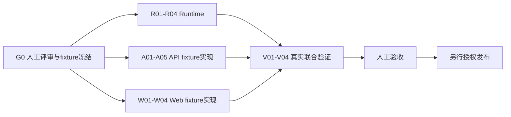

# 实施路线、验证与发布

## 目标

把已采集Agent用量看板交付为可核账、可授权、可回退的完整三服务能力。2026-10-11用户批准原方案及必要的B01优化；2026-10-12非前端范围完成、B01解除。Web接续与全栈Final单独追踪，整项目仍为`partial`，未部署生产。

## 方案设计

### G0 人工评审项

以下原方案均于2026-10-11获用户批准并进入实施。容量实测失败后提出的必要派生读模型与完整复测也由用户明确批准，实施和解除证据见B01。

| 决策 | 方案 | 批准后的影响 | 评审状态 |
|---|---|---|---|
| 职责与查询路线 | Runtime保留采集/额度并提供受控有界查询；平台负责产品/权限，经接口读用量 | V1沿用服务/数据边界，平台不直连Runtime库；理由与备选见02 | **用户已确认，2026-10-11** |
| 首期消费范围 | 已采集native Run；辅助模型调用单列后续 | 标题/推荐问题不混入“全产品”总量 | 已批准 2026-10-11 |
| 平台/项目权限 | 平台super_admin/operator、项目admin/editor；其他角色初始不新增聚合授权 | 新增两具体IAM权限及可见菜单 | 已批准 2026-10-11 |
| 数字治理与内容ACL | 获批角色可看项目数字；Run明细沿当前Thread read/manager接管审计 | 汇总范围可大于当前可查看明细，不能偷偷开放会话内容 | 已批准 2026-10-11 |
| 删除/保留 | 存在项目汇总保留已删会话历史消费；删项目退出默认scope；不新增物理清理 | 新聚合数据集和已有Thread授权查询有明确差别 | 已批准 2026-10-11 |
| 时间与比较 | 调用started_at；两时区；≤90天；相邻等长窗口 | 跨日/迟到修正能核对，旧Thread窗口口径不变 | 已批准 2026-10-11 |
| 服务间认证 | 新用途限定HMAC、两个精确POST，不放松旧usage-read | 新内部契约须双端验证、内网部署边界检查 | 已批准 2026-10-11 |
| 查询与容量细节 | 原始SQL先验，必要时Runtime内可重建投影；查询超时与整链路读并发有界 | 按实测确认资源预算及原门槛；同库CPU/I/O仍共享 | 已批准2026-10-11；2026-10-12公开链两轮通过 |
| 价格/预算 | 历史快照USD估算；不扣费；不改Run额度，不新增月度预算 | 产品文案不能冒充账单或严格封顶 | 已批准 2026-10-11 |
| 排期与人员 | V1 15–20人天；本轮 Codex 后端、同事前端、用户人工验收 | 时间是估计，未代表前端或生产发布授权 | 已批准 2026-10-11 |

**人工决策记录（2026-10-11）：** 首轮用户确认“职责与查询路线”，见 [02决策记录](02-runtime-aggregation.md)；随后明确“同意,方案评审通过，可以开始实施了”，批准全部 G0。两次确认范围有别，原方案批准不代表容量或前端已经验收。

### 交付阶段与依赖

**方案评审批准与本轮授权（2026-10-11）：** 用户明确：“同意,方案评审通过，可以开始实施了。把除了前端的开发项都开发完成，除非有 Block 项”。批准本方案全部G0建议，授权G02、D03/D04非前端口径核验、R01–R04、A01–A05、V01及V02/V03/V04非前端部分。Web W01–W04、浏览器布局/三尺寸/人工前端验收由前端同事接续，本轮交付冻结接口/样例/交接话术；生产发布P01不执行。当前Worktree为b2b1，不新增分支或提交。



**P0（约0.5–1人天）：** 盘点实际部署的采集开关、接线图、台账起点/规模、价格完整度和Runtime/Platform版本；冻结query/schema/signature样本。不能把既有项目done当成生产已开启。发现未接线图时明确范围/追加接线任务，不宣称所有图自动支持。

**P1（约5–6人天）：** Runtime有界查询、必要索引及内部入口。先用确定性PG数据核对数字，独立单元/durable和既有Usage/TokenBudget回归通过。

**P2（约4–5人天）：** API权限、HMAC、三公开GET、当前名字、候选ACL、审计及文档。可以用固定Runtime fixture先完成，再与P1联调；真实授权/撤权和scope差异必须验。

**P3（约4–4.5人天）：** Web service/DTO/权限路由、卡片/趋势/排行/数据质量、分页和已有RunUsage抽屉。可以在DTO冻结后用fixture开发，但不能据此跳过真实三服务验收。

**Final（约1.5–2.5人天）：** 单元及静态门禁、完整E2E、负载/安全/回退、真实模型最短链、人工三尺寸验收。合计为区间估算，环境/协作等待不计入纯开发工作量。

### 可执行任务清单

专题详细任务与最小验收见02/03/04；本表追踪全范围，不用implementation文件数量判断进度。

| Task | 交付/代码位置 | 完成条件 | 当前状态 |
|---|---|---|---|
| G01 方案评审 | 本篇G0、01口径、03治理边界 | 用户/负责人明确批准及日期/范围记录 | [x] 2026-10-11全部方案评审通过，非前端获准实施 |
| G02 环境盘点与fixture冻结 | 现有usage/价格/签名样本；项目下 `fixtures/` | 本地开关/规模有读证据，DTO和签名向量冻结，负责人分配 | [x] done；生产盘点未执行，不属于本轮本地实施 |
| R01 查询契约与投影 | 02 的 analytics/query/tests | 指标与全部数据状态正确 | [x] done |
| R02 SQL及时间索引/投影 | 02 的 repository/迁移 | 正确性、迁移与容量门槛通过 | [x] done；百万完整30天公开链两轮通过，B01解除 |
| R03 内部入口与认证 | 02 的 HTTP/ingress | 双端签名、实际部署及互拒通过 | [x] done |
| R04 耐久/故障与回归 | 02 的 durable/控制链 | 恢复、旧额度及读压采集影响通过 | [x] done；最终0005下重建/崩溃/重启/旧应用及写影响通过 |
| A01–A05 API | 03 的 analytics/IAM/adapter/ACL/audit/tests | 当前权限及两端契约通过，无Thread扩权 | [x] done；公开容量联合验收通过，整链路有界admission |
| W01–W04 Web | 04 的 usage/service/router/types/e2e | 全状态与三尺寸、身份/项目切换隔离通过 | [x] 沿用04同事已记录的完成/测试结果，本轮未复验；最终后端/503联合复验及人工验收见V04 |
| V01 单元/契约/真实PG | 原tests及新analytics tests | 迁移/重启/故障、旧接口回归有证据 | [x] done；既有全仓失败另列下方 |
| V02 非前端真实链路 | Worktree API/Runtime/Worker/原生PG/Redis | 真实模型核账、E01–E06相关HTTP/耐久/控制链；浏览器部分移交W04 | [x] done（非前端范围）；Web→API及E07待同事 |
| V03 性能/安全/回退 | 真实规模数据、EXPLAIN/canary、保留库 | 性能、安全互拒、旧读/历史不丢通过 | [x] done（非前端范围）；公开容量两轮、安全及最终迁移回退通过 |
| V04 Final和人工验收 | 本篇Final区、专题状态、仓库索引 | 前端联合及用户人工验收 | [ ] 前端同事接续及用户验收；B01已解除，未执行全栈Final |
| P01 生产发布 | 运维发布单与采集配置 | 另行授权、版本对齐、索引/权限/回退与观察窗口 | [ ] 本轮范围外，未执行 |

### 测试矩阵

| 层级 | 必测场景 | 证据 |
|---|---|---|
| Runtime纯函数/SQL | Token子集、Decimal/缺价、同快照聚合、相邻窗、跨日、TopN其他、distinct Run、null/0/overflow | 新analytics单元及真实PG测试输出 |
| Runtime耐久/迁移 | 空/既有库、重复upgrade、并发upsert、迟到补齐、PG重启、锁/查询超时、采集disabled旧数据 | durable日志/数量对账/EXPLAIN |
| 服务间契约 | 双端最终body bytes、用途/时间/method/path、project篡改、body上限、JWT和其他operation互拒 | 固定vector和正反HTTP响应 |
| Platform API | 角色/服务账号/范围/撤权、names安全、参数/DTO/scope、候选ACL/pagecursor、审计与Session生命周期 | API定向及真实授权测试 |
| Web | Zod、格式/缺失、URL/filter、race/abort、cursor/抽屉卸载、权限状态、三尺寸主题/键盘 | Vitest、静态门禁、Playwright截图 |
| 回归 | 两旧usage GET、模型价格CRUD/历史冻结、Run Token预算、Chat普通执行/Stop/HITL/RunDiagnostics | 原相关测试和最短真实链路 |

### E2E完整链路

| 编号 | 操作 | 核对结果 |
|---|---|---|
| E01 基本报表 | 使用确定性provider在两个项目、多个Thread/Run/模型产生真实Worker调用，打开7日看板 | Web→API→Runtime→PG的summary、bucket、group及已授权Run抽屉逐数字相等；不是直接往页面注入假数字 |
| E02 真实模型 | 本地默认miaomiaoai `deepseek-v4.1-flash`，小任务两轮；保存provider已报告usage和ledger记录 | 至少1个真实模型调用，native Run归属正确、台账→单Run→看板一致；价格缺失必须unknown，不抓供应商账单冒充费用核验 |
| E03 缺失/价/重试 | 确定性provider返回缓存/无usage/错误usage，换模型价格再新Run、备用模型发生新调用 | cache/reasoning不重复；旧成本不改；new call计入、重复callback不计入；partial/unknown与缺失数准确 |
| E04 时间/生命周期 | 跨窗口调用、取消/HITL恢复、新native Run、后台完成接续、fork及晚到补齐 | 按call start归桶，原消费不消失/复制；不把HTTP重连当消耗；native归属与fixture一致 |
| E05 权限与删除 | 平台operator无项目普通内容权、项目editor/executor、私有/共享Thread、成员撤权、删Run/Thread | 聚合遵G0范围，Run行先ACL过滤，现有manager读保留审计；无权不能通过改URL直读，删内容不返回；数字保留口径核对 |
| E06 降级与关闭 | DB连接/锁超时、Runtime网络失败、关闭采集，旧范围与新范围查询 | Agent执行不被统计故障阻断；部分/不可用/HTTP失败区分；旧历史可读、新历史不伪造；临时故障不登出 |
| E07 浏览器竞态/回归 | 快速切项目/账号/范围，慢旧响应，打开/关闭Run抽屉；原Chat/审批/Stop | 没有跨身份/项目残影、抽屉无遗留请求；错误局部处理、原链路不受看板影响 |

真实外部模型用于最短能力证明，边界数值和故障用确定性fixture保证可重复。缓存TTL、供应商隐藏重试/未报告消费不通过一次真实调用宣称全覆盖。

### 性能与资源目标（2026-10-11 已批准）

既有专项的小样本Run/Thread查询p95约997ms，不能推出百万级看板性能。本项目建立新基线，记录机器、PG版本、数据分布、冷/热缓存、采集并发、请求量和p50/p95/p99。

| 场景 | 建议目标 | 超标处理 |
|---|---|---|
| 100万calls、50项目、30日、10个并发读、同时2条模型采集 | 报表API p95≤1.5s、p99≤3s，硬deadline≤5s | 先定位SQL/index/返回体；不无条件扩大timeout |
| 时间窗/分组输出 | ≤200桶、≤50排行、响应≤300KiB，Run公开页≤200候选预算 | 明确拒绝超范围、选项截断标示，不截断总量 |
| Run页（含当前ACL） | 50公开行预算场景p95≤1.5s；候选过滤后可短页 | 验证候选扫描预算和批量ACL，无无限扫页 |
| 采集影响 | 加索引/读压前后start/end写入p95增幅≤20%，无新增持久化失败 | 优化索引/查询、限制读并发；未满足不能称正式可用 |
| Web | 200点不使主线程出现单次>100ms长任务，三尺寸无阻塞交互 | 简化图形/DOM，不因性能先建泛用图表框架 |

100万calls只是V1容量验收目标，不能据此承诺任意规模。另补200项目上限/90日边界的读测量，并保留无索引与有索引对照。负载在工作树独占测试库生成，模型调用不用于生成百万数据；命名/清理遵Worktree规范，不触碰主库历史。

若有效索引仍无法满足目标，暂停V1发布并据实追加预聚合任务：Run/日派生表、迟到更新水位、幂等重建、质量修正和权限隔离。不能在原查询超时后返回未经说明的旧/半份数据，或把未完成的优化默默标deferred。

### B01 容量阻塞与追加评审方案

> 2026-10-12已解除；本节保留原始失败、复诊、授权和最终通过证据，当前状态以「B01解除证据」及任务表为准。

**初始阻塞对象：** R02/R04/V03/V04和正式发布。原始SQL、索引、UUID二进制distinct key、4条SQL并发及16个在途预算已实施；HTTP超时不能解决同库CPU/I/O与聚合成本。该初始状态已由下方B01解除证据取代。

| 真实测量 | 10万行优化后 | 百万行最终复测 | 批准门槛 |
|---|---|---|---|
| 10并发 × 3轮可用性 | 0/30 available | 0/30 available | 查询全部完成 |
| 并发读 p95 / p99 | 4532.40 / 4593.62ms | 4524.20 / 4532.37ms | ≤1500 / ≤3000ms |
| 2写并发 p95，空闲→读压 | 72.81→58.20ms，噪声较大 | 28.62→42.04ms，+46.89% | 增幅≤20%，无写失败 |
| 200项目/90天边界 | available，1830.98ms | unavailable，1535.62ms | 可用且不截总量 |
| Runtime Run候选页 p95 | 74.77ms | 522.53ms | ≤1500ms，公开ACL页另有小规模HTTP证据 |

机器为 macOS 26.5.2 / Intel（系统 `i386`），原生 PostgreSQL 17.11。10万行均匀分布30日；复用的旧百万行数据实际集中约12日，当前窗口命中971200条、116544000 Token，实际首尾时间保留在报告中，**不能冒充完整30日目标分布验收**。机器资源共享、重复写入和缓存波动意味着上表不能推出生产容量上限；足以证明当前环境没有满足门槛。更早10万行读压测量的写p95 35.48→97.49ms（+174.77%）也失败，不选择某轮负增幅掩盖查询失败。

#### B01 复诊：具体热点与证据边界（2026-10-11）

2026-10-11原因复诊阶段核对原始报告，并在原Worktree所属两个容量库执行有界只读诊断；该阶段未生成数据、迁移、修改超时或重跑并发验收。随后获批优化另列下方；以下分段结果不能替代正式容量验收：

| 查询阶段 | 10万行本次单请求 | 百万行本次单请求 |
|---|---|---|
| Run manifest 总数/采集起止 | 16.67ms | 14.76ms |
| 零调用 Run（`NOT EXISTS`） | 190.44ms | 1152.72ms，SQLSTATE 57014，先于总览失败 |
| 总览/前窗/时间桶 | 782.20ms | 因上一阶段失败，整请求未进入；独立 EXPLAIN ANALYZE 在3秒上限仍超时 |
| Top N | 710.67ms | 整请求未进入；独立 EXPLAIN ANALYZE 在3秒上限仍超时 |
| other / model facets / Agent facets | 55.52 / 100.93 / 83.54ms | 整请求未进入 |
| 整请求 | 1963.95ms，正确返回12000000 Token | 1184.64ms，QueryCanceled |

源码与执行计划支持的原因：

1. `db/repositories/usage_analytics.py::_collection()` 的零调用统计对 Run 做 `NOT EXISTS` 调用存在性判断。百万库估算计划为 Nested Loop Anti Join + `runtime_usage_calls_pkey` Index Only Scan；实际诊断在1秒应用限制以及3秒独立诊断限制均超时。它是本次最先失败的语句；估算计划没有 Actual Loops/Heap Fetches，不能声称已经量出实际探测次数或全部耗时来自回表。
2. `aggregate_usage()` 一个请求最多顺序执行7条数据查询，此外还有快照时间和statement timeout设置。总览把当前窗口与等长前窗一起聚合，随后 Top N、other、model/Agent facets 又读取调用台账；Top N 的 LIMIT 在分组之后，不能把输入行数限制为10条。总览/排行包含 calls/runs join、distinct Run/价格版本、多个SUM/COUNT FILTER以及时区分桶，范围索引不免除命中行的这些计算。百万库的总览和排行估算计划均包含 calls顺序扫描、Hash Join、排序和聚合；两条独立诊断都超过3秒，故只优化零调用查询不足以解除B01。
3. 早期10万行真实分析计划已有 `Sort Method=external merge`、`Sort Space Type=Disk`，以及约2379个临时写块；UUID二进制pair版本的总览单SQL约874.52ms，仍很接近1秒限制。不同诊断轮次的缓存命中不同，不能把该数字与其他版本作严格A/B改善比例。百万报告中的单项目简单SUM也读了20000个共享块、用时2117.65ms；该SUM不是完整看板SQL，但支持缓存/I/O开销已经明显的判断。
4. `observability/usage_analytics.py::_read()` 在进入4线程池**之前**开始4.5秒预算；10个请求中其余请求排队，执行器最多16个在途任务，repository最多4个SQL连接。每条SQL另有1000ms上限，remaining预算不足或排队过久也失败。QueryCanceled/OperationalError被明确投影为`unavailable`。所以4524.20ms是包含排队与超时的失败返回p95，不能解释为百万报表已经在4.52秒完成。原30次并发报告未记录逐请求SQLSTATE/阶段，无法精确拆分SQL超时和排队超时各占多少。

**写入影响的准确解释：** `scripts/verify_usage_capacity.py` 用两个线程向同一个新Run写入100条合成调用，对照同样两线程的100条空闲写入。计时涵盖每次新建连接、manifest检查、call upsert和事务提交；这不是两条真实模型流的完整start/end时延。两组都有当前索引，28.62→42.04ms的`(42.04 / 28.62 - 1)`约为46.89%，不能全归因于新增索引。聚合读取与写入共用同一PG实例的CPU、缓存、内存和磁盘；历史分析计划已经证明读页与临时文件开销，但没有同轮CPU/I/O/wait-event采样，不能给这47%分配精确资源占比，也没有证据宣称是聚合持有排他行锁所致。本次未复测写入，该比例仍是原报告的观测值。

**修复顺序与取舍：** 百万行不是必须新增架构的充分条件。先在受控测试库给各阶段/排队加计时，核查存在性查询计划、统计信息与Index Only Scan可见性；减少重复join/扫描，复用维度聚合计算Top N与other，并把非可加Run计数/价格集合与可加数字分别计算。必须保留distinct、缺失/零、历史价格与同快照语义，不能把当前窗口各桶的Run数相加。SQL优化若达到全部原门槛，可继续原方案；现有多处慢查询说明不能只补一个索引或提高timeout就承诺解决。原始聚合仍超标时，按下面B01.1–B01.5评审可重建投影；短缓存/合并相同请求只能缓解热查询，还要验证不同筛选及冷查询，不能靠相同请求缓存通过容量门禁。

同库派生表的目标是减少查询工作量，**不提供物理负载隔离**；连同投影任务一起压测，若采集写入仍超20%门槛，再评估独立只读PG实例/查询资源。换成Platform API直接查同一库、另开schema或同实例数据库都不会自动隔离CPU/I/O。当前职责分工与HMAC/权限/ACL路线仍适用，执行额度恢复继续只信原始ledger，报表投影不能成为预算事实源。

新增证据为 `.local-stack/usage-capacity-stage-diagnostic.json`、`usage-capacity-stage-explain.json`；历史热点证据为 `usage-pair-diagnostic.json`、`usage-read-diagnostic.json`、`usage-optimization-diagnostic.json`、`usage-query-explain.json`。3秒仅用于独立只读诊断；超时后保留的是非ANALYZE估算计划，不能冒充完整执行计划。原因复诊结束时B01仍`blocked`；后续授权、优化和通过证据见下方。

#### B01 优化授权与任务（2026-10-11）

用户明确批准：“同意,现在开始优化解决B01 问题”。批准SQL优化优先、必要时Runtime可重建派生读模型及完整复测方案。本轮继续在b2b1隔离本地资源实施，不开发前端、不提交/推送、不部署生产，不放宽原SLO、鉴权或额度语义。2026-10-12 B01.0–B01.5已完成，B01解除；新增治理实施已有人工授权。

| Task | 实施及验收 | 状态 |
|---|---|---|
| B01.0 SQL热点优化 | SQL Spike确认原始分桶/Run集合仍超门槛；零调用存在标记、可加数字与精确Run集合分开，按批准方案转投影 | [x] done；未用超时掩盖SQL失败 |
| B01.1 投影粒度实测 | 小时/UTC日/上海日/8小时桶和项目内Run位集合；百万43,550行、29.41MiB、构建189.51s；稀疏/高基数及边界核账 | [x] done |
| B01.2 幂等投影与补齐 | 同事务append-only脏版本、有界后台完整替换、快照水位清脏；并发和晚提交低版本均不漏 | [x] done；真实PG并发/晚提交测试通过 |
| B01.3 查询/质量/权限 | 同RR快照与有界补查、distinct位集合/金额/known count，三成功DTO与ACL保留；平台两admission槽、Runtime单读槽 | [x] done；原始对照/公开容量/安全通过 |
| B01.4 重启/重建/回退 | 崩溃回滚、generation续扫/切换、失败重试、旧应用保留0005链、真实PG/应用重启 | [x] done；独立PG13项及实际重启通过 |
| B01.5 完整验收 | 百万/50项目/完整30日，公开API三轮×10并发+两采集、200项目/90天、Run ACL；首次/热查询、两轮容量及模型/安全 | [x] done；全部原门槛通过，B01解除；未清空PG/OS磁盘缓存 |

#### 可重建读模型方案（已批准并实施）

**已实施的必要改动：** SQL无法满足原门槛后，在Runtime内建立可重建派生读模型，原始ledger和Run额度仍为唯一事实源；Platform API职责、权限、三公开DTO保留。新增治理范围已由用户批准并完成下方设计与验收。

| 追加Task | 设计与验收 |
|---|---|
| B01.1 投影粒度Spike | 对比“UTC小时 × project/graph/model/purpose/scope 数字汇总”和“Run/日数字及Run索引”；同时测均匀/集中、稀疏/高基数数据。不能假设Run/小时必然压缩百万行。任意from/to的边界小时仍读有界原始调用；UTC及上海分桶和前窗核账必须相同。 |
| B01.2 变更发现与幂等 | 当前台账没有可靠更新水位，按started_at单向扫会遗漏迟到补齐。建议成功 upsert/manifest变更时在同事务标记受影响Run和小时，独立有界投影任务重算并原子替换；重复任务不累计加数，失败不删除事实，先验证新增写影响≤20%。不新增外部消息系统。 |
| B01.3 查询与完整度 | Token sum/字段known count、费用Decimal/价格版本、missing/incomplete及比例分子分母分别存；distinct Run从Run集合/索引计算，不能相加各桶/各模型Run数。开放/退化状态仍按manifest读取；明细仍由Platform当前ACL过滤。 |
| B01.4 新鲜度/重建/回退 | 新投影必须有真实处理水位和同快照dirty检查，积压不能返回假完整报表；无法满足当前DTO时明确unavailable。重建从ledger读取、使用新generation校验后原子切换，保留旧generation直到回退验过，不改历史价格/额度。额外schema与维护任务先评审。 |
| B01.5 完整容量再验 | 新建正确的百万调用/50项目/30日数据，再执行公开API10读并发+2条采集、200项目/90天、迟到补齐/重启/撤权/重建/回退；记录投影行数、磁盘、追赶时间及p95/p99。全部达到原门槛才解除B01。 |

备选为专属查询资源/只读副本，需另行明确资源预算、复制延迟、快照和权限边界。本轮同库投影及整链路并发预算已满足原门槛，未引入外部查询资源；不将同库优化称为物理负载隔离。

#### B01 解除证据（2026-10-12）

**结论：B01 `done`，R02/R04/V03非前端范围完成。** 新容量数据为1,000,000调用、50项目、10,000 Run，时间为 `2026-09-01T00:00:00Z` 至 `2026-09-30T23:59:57Z`，目标窗口120,000,000 Token，确实覆盖完整30天；机器为macOS26.5.2 Intel，原生PostgreSQL17.11。API与Runtime使用独立进程，两条repository采集流在同租户/同项目/不同Run持续写入start/end事实，投影维护同时运行，查询历史30天窗口。

| 原验收条件 | 公开链第一轮 | 同代码公开复测 | 结果 |
|---|---|---|---|
| 三轮×10并发，共30次全部可用 | 30/30 | 30/30 | 通过 |
| 读p95≤1500ms / p99≤3000ms | 1220.89 / 1309.52ms | 1171.99 / 1172.77ms | 通过 |
| 两采集写p95增幅≤20%，无持久化失败 | 41.15→47.74ms，+16.01%，无失败 | 41.47→46.29ms，+11.62%，无失败 | 通过 |
| 200项目/90天可用 | 181.03ms | 170.63ms | 通过 |
| Run页含当前ACL p95≤1500ms | 525.54ms，4页200唯一Run | 506.85ms，4页200唯一Run | 通过 |

该验收包含真实JWT/当前授权、HMAC、目录名与DTO校验、审计、Run ACL及加密cursor；Runtime原生报告另有30/30、读p95 430.30ms、写增幅2.10%，不能替代公开链。首次投影43,550行、30,834,688字节、189.51秒；只读查询不返回旧代或积压假完整，最多8个脏项目日/5000条事实补查，超限明确不可用。

**边界：** 两轮均新启动查询进程，首个模型分组请求316.36/300.24ms，后续热请求约130–145ms；没有清空共享PG/OS缓存，不能声称磁盘冷缓存验收。两采集为真实采集repository的有界合成事实写入，不等于外部模型端到端时延。高基数/稀疏分布、模型/用途/时区/非整小时边界、同Run跨桶/模型去重、晚提交/迟到补齐由独立真实PG原始聚合对照覆盖，不能承诺任意百万维度分布均有相同压缩率。同实例CPU/I/O仍共享，生产容量需按真实负载再验。

**恢复与回退：** 独立原生PG的13项durable测试通过，包含SIGKILL投影进程、晚提交低版本、失败重试、分代重建与原子切换、只读连接复用/回滚、保留0005迁移链的旧Runtime lifespan启动和额度读取；旧外部模型/性能矩阵2项未选，分别由本专项真实链路和容量报告覆盖。含历史价格与额度的0004库前向/重复upgrade后全事实字段哈希一致，70 Token/USD0.004000000000和额度/停止原因保留。真实PG停止/重启后调用、投影、价格、额度和head仍一致。临时PG已停止，宿主共享PG未重启。

**证据：** `.local-stack/usage-capacity-b01-final-native.json`、`usage-capacity-phase-platform-budget-two.json`、`usage-capacity-b01-final-http-repeat.json`、`usage-b01-durable-and-restart.json`；恢复后的模型与安全链见下方Phase记录。历次失败报告保留，单平台admission槽曾出现读p95 1753.35ms/写增幅41.77%；最终采用平台两个整链路槽、Runtime一个查询线程/SQL连接，原deadline/SLO未放宽。连接池仅用于看板，采集原路径保留。实施细节见[02-B01](implementation/02-b01-optimization.md)。

### 安全验证

- HMAC错签/过期/重放到另一URI/method/tenant/project/body全拒绝；旧JWT不能兑换新聚合读，新内部签名也不能访问native Run/模型/Workspace。
- 输入SQL枚举、分页/window/project/body大小限制、数字溢出、加密cursor变筛选/变用户/项目或过期拒绝；公开cursor不能解码出隐藏RunID。
- 项目grant撤销/服务账号凭据失效、返回前撤权复核、private/共享/manager接管读、删除数据范围。
- canary扫描数据库新增字段/响应/日志/审计：没有Prompt/Completion、私有会话标题、apikey、baseURL、JWT或signature正文。
- no-store；前端只访问Platform API，身份/项目变化旧snapshot和drawer立即清理；临时5xx不扩大授权也不登出。

### 发布与回退建议

1. G0批准后使用工作树隔离本地资源完成实施。原生PG/Redis优先，依赖在各app独立安装，默认 `RUNTIME_BACKEND=local`；模型优先miaomiaoai DeepSeek。没有Docker需求，不启动Docker。
2. 先前向创建索引并验数据量/版本/锁时间；旧台账/价格保留，不创建破坏性downgrade。
3. 成对准备Runtime内部查询和Platform API，固定HMAC向量/路由/secret配置核对。新Web入口在后端验收后开放；旧后端返回404时给明确不可用态，不退回逐Thread扫描或普通JWT扩权。
4. 验证实际采集开关和图覆盖，先在少量已知项目核账，再开放指定角色；报告采集现状与起点，不能假称自动回填关闭期间。
5. 灰度观察scope拒绝、DB查询超时、missing/unpriced、读/写延时和网络错误。不新增一套开关管理平台；发布灰度依现有流程。
6. 获生产授权后才部署；生产发布不由本轮规划请求自动授权。发布过程中Run执行、原Usage、预算/聊天/审批不因看板变化受损。

回退优先恢复已验证前一版API/Web路由及Runtime查询实现，原 `RUNTIME_USAGE_ENABLED` 不随看板回退关闭（关闭会影响既有Token预算前提）。**回退应用代码时保留当前迁移目录**，准备含新迁移链的回退构建；直接启动未经处理的旧包会不认识新head，不能声称它已验证。保留新索引、投影及原台账，不删已发生消费/价格、不运行旧迁移树或stamp/downgrade改写head。最终已验证基线116cc26f旧Runtime lifespan在保留库启动并读原额度/停止原因，head保持0005；普通/HITL/Stop与Worker恢复另有30场景证据，未执行生产回退。旧应用没有后台投影维护，回退时停用新看板入口，事实采集和额度仍可读；再次升级后脏队列继续追赶。索引或投影如需删除是额外结构操作，单独批准与验证。

汇总公式问题先回退查询投影，重新基于未改的事实查询；没有本期历史重算/更新台账步骤。HMAC问题下线新内部URI并回退新API，不能扩普通read替代。

## 任务拆分

任务执行入口为上方完整清单及02/03/04任务表；G01之后才能实施。最终逐项检查所有未完成项，能在当前授权与环境继续完成的必须继续推进；partial仅是过程状态。

### Task G02：本地环境盘点与冻结输入

- **改动内容：** 核对b2b1自有栈、开关、历史规模及价格覆盖，冻结两响应/两query schema、11个响应、4个错误及HMAC向量。
- **代码位置：** 本项目 `fixtures/`；`apps/platform-api/scripts/verify_usage_chain.py`。
- **预期结果：** 前端能依据公开DTO开发；本地环境与生产现状明确区分。
- **验证项：** 本地RUNTIME_USAGE_ENABLED=true；盘点40个manifest/47条call（采样时刻），11响应Pydantic及4schema相等断言通过；实际三服务地址已核对。
- **状态：** `[x] done` 2026-10-11；生产开关/规模未读取，留P01发布盘点。
- **合规检查：** [x] 实现；[x] 验证；[x] 状态；[x] CONTEXT；[x] FEATURES；[x] CHANGELOG。

### Task V01：非前端单元、契约与真实耐久

- **改动内容：** 聚合、HMAC、DTO/ACL/cursor、迁移/保留库与既有Usage/预算回归。
- **代码位置：** 两服务analytics tests；Runtime `tests/durable/test_usage_analytics.py` 与原ledger tests；Platform `tests/test_iam_migration.py`。
- **预期结果：** 有界读取与安全失败，升级/重启不丢已发生调用和历史费用。
- **验证项：** 最终定向Runtime171 passed；API96 passed/1 skipped/18 subtests；独立原生PG13 passed/2 deselected，含保留0005链的旧应用启动/额度读取、投影崩溃/重建/晚提交。PG真正停止/重启与0004含事实升级通过；skip/deselect不算pass，原API PG opt-in分支有独立迁移证据。
- **状态：** `[x] done`（本轮功能/安全/耐久范围）；全仓既有失败及容量见下方。
- **合规检查：** [x] 实现；[x] 验证；[x] 状态；[x] CONTEXT；[x] FEATURES；[x] CHANGELOG。

### Task V02：真实模型与非前端运行链

- **改动内容：** 注册栈真实Worker/DeepSeek→ledger→单Run→项目/平台→趋势/分组；真实身份、分享/撤权/删除/数据库锁；四图控制链。
- **代码位置：** `apps/platform-api/scripts/verify_usage_chain.py`、`verify_usage_security.py`；Runtime `tests/durable/test_token_budget.py`。
- **预期结果：** 同一次消费逐层核账，查询不触发模型；聚合权限不赋予聊天内容权。
- **验证项：** 原真实DeepSeek470/488/471 Token证据保留；投影实施后490 Token/USD0.000488400000，以及Runtime API/Worker/Platform API重启后471 Token/USD0.000720000000再次核账通过，真实Thread fork不复制调用。安全6场景重验、既有四图/HITL/恢复/取消30场景通过；浏览器E07及页面口径移交W04。
- **状态：** `[x] done`（非前端范围）；不是完整三服务浏览器E2E或供应商账单验收。
- **合规检查：** [x] 实现；[x] 验证；[x] 状态；[x] CONTEXT；[x] FEATURES；[x] CHANGELOG。

### Task V03：非前端性能、安全与回退

- **改动内容：** Runtime可重建投影和整链路并发预算、完整百万公开容量、安全互拒及保留事实回退。
- **代码位置：** Runtime `db/migrations/versions/0005_usage_projection.py`、`db/repositories/usage_projection.py`、`usage_analytics.py`；API `modules/usage_analytics/service.py` 与三个验证脚本。
- **预期结果：** 达到原SLO和写入影响门槛，权限/历史价格/额度保留；不将失败或积压数据伪装完整。
- **验证项：** B01公开两轮30/30可用、读p95 1220.89/1171.99ms、写增幅16.01/11.62%、200项目/90天和Run ACL通过；真实安全6场景、旧Runtime保持0005启动与真实PG重启通过。
- **状态：** `[x] done`（非前端范围）2026-10-12；B01解除，Web/全栈Final单独追踪。
- **合规检查：** [x] 实现；[x] 验证；[x] 状态；[x] CONTEXT；[x] FEATURES；[x] CHANGELOG。

### Task B01.0–B01.5：容量优化闭环

- **改动内容：** B01.0完成原始SQL Spike与零调用优化；B01.1完成桶/Run位集合规模测量；B01.2完成幂等/并发/晚提交投影；B01.3完成同快照/质量/权限读取；B01.4完成崩溃/重建/重启/回退；B01.5完成两轮公开容量与真实核账/安全。
- **代码位置：** 本篇B01任务表及[实施记录](implementation/02-b01-optimization.md)逐项对应Runtime/API代码、测试及复测脚本。
- **预期结果：** 原采集和额度事实语义保留，原门槛全部通过后解除B01。
- **验证项：** 本篇「B01解除证据」与Phase逐Task记录；所有容量gates为true、durable13项通过、API/Runtime定向回归和真实链路通过。未清空PG/OS缓存、未验任意高基数百万分布或生产容量。
- **状态：** B01.0 `[x] done`；B01.1 `[x] done`；B01.2 `[x] done`；B01.3 `[x] done`；B01.4 `[x] done`；B01.5 `[x] done`，2026-10-12。
- **合规检查：** [x] 实现；[x] 验证；[x] 本篇任务表；[x] CONTEXT；[x] FEATURES；[x] CHANGELOG；详细文件/原因见实施记录。

## 验证要求与记录

### 验证要求

- [ ] 全部V1范围、R/A/W任务及E01–E07完成，文档指标与真实数值一致。
- [ ] 真实本地PG/Redis/Worker和至少一条真实模型浏览器链，不能仅mock验收。
- [ ] 性能、安全、迁移/旧代码保留库回退有实际命令输出；门槛变更须注明原因与人工决定。
- [ ] Web lint/typecheck/Vitest/build、Python相关单元/integration/durable及跨服务契约；既有失败分开列明，不宣称全仓绿色。
- [ ] 人工验收后才能标整项目done；源码完成或fixture通过不等于联合完成。

### Phase 规划检查（2026-10-11）

- 已静态阅读CONTEXT、三服务规范及相关经验，核对当前Token/Cost专项与核心源码。
- 已产出本项目六篇规划文档；功能实施任务如实未勾选，01仅勾选本轮已完成的D01/D02规划任务。
- 文档检查通过：`git diff --check`；临时Python断言检查六篇结构、任务状态、排期一致性、换行/尾空格，9处项目相对链接、22处既有代码引用、7处明确标注的拟新增代码引用及14处Web路径均通过。
- 复用 `scripts/check_docs.py` 的 `self_check()`、`check_file()` 检查本项目六篇及README/CONTEXT/FEATURES三份索引，9份文档无本机绝对路径或退役host问题；三份索引的新项目链接均可解析。未执行全仓历史文档扫描。
- 未执行应用单测、PG查询/迁移、真实模型、Playwright、性能或生产验证。既有项目的测试数字不计入本项目结果。

### Phase 实施验证记录

以下保留2026-10-11原实施Phase证据；2026-10-12 B01完成证据另列后表，未执行的浏览器/人工验收不补成Final。基线116cc26f、b2b1 Worktree、环境wt_43d02afc6100；真实查询/模型均从本目录独立依赖导入，原生PG/Redis，未启动Docker。

| 已完成Task | 验证与结果 |
|---|---|
| D01 | 台账/归一化/预算/两旧GET/IAM与四图接线源码盘点完成，01列明真实入口。 |
| D02 | V1指标、辅助排除、删除、null/0与费用规则形成可逐项评审材料。 |
| G01 | 用户明确批准全部原G0和非前端实施；原对话授权已原文记入本篇。 |
| G02 | 自有栈地址、开关/数据覆盖盘点；4份schema、11个公开响应、4个错误及固定签名向量冻结。 |
| D03 | DTO/schema相等断言及双端向量通过；完整/partial/empty/disabled/not_recorded/backend_unavailable/unpriced分开。 |
| D04 | 真实DeepSeek ledger/单Run/两级报表/趋势/排行一致，470/488/471 Token三次证据保留；最新471 Token、USD 0.000720000000，真实Thread fork未复制调用或增加消费。 |
| R01 | 最新Runtime定向167项全部通过；含Token子集、Decimal、空桶、前窗、溢出及取消后迟到SQL异常回收。 |
| R03 | HMAC UTF-8原始bytes、30秒/64KiB/重复头与JSON键、精确URI；实际部署签名及旧JWT/native隔离通过。 |
| A01 | 真实operator/editor/executor/viewer、服务账号/撤权、私有/share及返回前重新授权通过。 |
| A02 | 固定向量、真实慢HTTP504/断网502、最终bytes签名及5秒总deadline通过。 |
| A03 | public DTO全状态、scope/窗口/time_basis/可加性坏值拒绝；真实10并发30请求小样本p95 787.5ms/p99 822.86ms。该成绩不算容量验收。 |
| A04 | 当前Thread ACL、manager接管审计、空页cursor、身份/筛选/过期绑定与删除Thread后历史消费保留通过。Run删除仅覆盖已登记审计链路，限制见03。 |
| A05 | 最新API定向95 passed/1 skipped/18 subtests；SQLite合法UUID保留/数值UUID拒绝、真实PG迁移通过；71条用量审计无canary/密钥/签名正文。 |
| V01 | 真实PG6 passed/2 skipped；两旧head前向合并/重复升级/全旧字段保留；独立PG停机重启、锁超时恢复；旧Runtime保留当前迁移启动1 passed。 |
| V02 | 三次真实模型核账、真实Thread fork、安全6场景与受控provider30个四图/HITL/Worker恢复/Stop/预算历史场景通过。浏览器未执行。 |

原实施时R02/R04/V03因容量失败未完成；2026-10-12优化与两轮公开链验收后均已完成，详见B01。原`6 passed/2 skipped`中两项旧opt-in真实模型/性能用例未启用；本项目另有真实模型链与容量测量，skip不算pass。API SQLite轮跳过的PG分支已在专属PG库独立执行1 passed。

### Phase B01优化验证记录（2026-10-12）

| 已完成Task | 验证与结果 |
|---|---|
| B01.0 | 百万SQL Spike：单SUM约0.66s、分桶2.30s、Run集合6.05s、零调用4.43s；纯SQL不足，采用已批准投影，原始失败证据保留。 |
| B01.1 | 真正完整30天百万数据；投影43,550行/29.41MiB/189.51s，8小时桶降低上海时区边界开销；真实PG稀疏/高基数对照及所有数字校验通过。 |
| B01.2 | 同事务脏版本、并发写入、晚提交低版本水位、补齐、删除、失败重试和SIGKILL事务回滚均通过。 |
| B01.3 | UTC/上海、前窗/非整小时、模型/用途/范围、Top+other、distinct/价格/known count与原始事实对照通过；只读池/rollback及平台admission恢复通过。最终零调用Run窗尾用例先复现2/期望1，分离dirty扩展窗口参数后通过，严格保留 `[from,to)`。 |
| B01.4 | 13项真实PGdurable、含事实0004→0005/重复升级、保留0005链的旧应用启动/额度/停止原因、PG真正停止/重启通过；注册Runtime API/Worker/Platform API实际重启后ready并真实模型核账通过。 |
| B01.5 | 公开两轮30/30可用，p95 1220.89/1171.99ms、p99 1309.52/1172.77ms；写+16.01/+11.62%、无失败；200项目/90天、4页200唯一Run ACL通过。 |
| R02 | 0004时间索引+0005派生投影及只读同快照核账通过，容量原SLO通过。 |
| R04 | 原Usage/预算回归、独立PG13项恢复与晚提交、保留事实回退、公开读压写入≤20%通过。 |
| V03 | 公开容量、安全6场景、旧应用保留迁移回退、真实PG/服务重启均通过；Web与生产未验。 |

最终定向Runtime171 passed（10.11s），API96 passed/1 skipped/18 subtests passed（10.30s）。真实模型miaomiaoai deepseek-v4.1-flash：投影后490 Token/USD0.000488400000，三个后端进程重启后471 Token/USD0.000720000000；Worker→事实→单Run→平台/项目→趋势/排行逐层一致，fork不复制，HMAC及native隔离通过。安全6场景重验为聚合权限不授私有内容、分享后撤权、服务凭据/ACL、投影状态锁故障/恢复、删除Thread历史保留、查询不产生模型调用。报告 `usage-chain-b01-restarted.json`、`usage-security-b01-restarted.json`。

本地旧同名0005原型已仅在所属Runtime库校正，66调用/49,617 Token/USD0.101036100000保持；正式部署用合法前向迁移，不能照抄本地修复SQL，见实施记录。

最终边界修正只分离dirty扫描与manifest窗口参数，没有改变索引、SQL聚合运算或并发预算。真实PG回归中查询结束时恰好创建的零调用Run被正确排除；复现失败报告 `usage-b01-window-regression-before.json` 与修正后完整13项报告 `usage-b01-durable-and-restart.json` 均保留。两轮容量数据没有窗尾零调用Run，原可用性/性能数据仍适用。

边界修正后再次重启Runtime API，公开项目看板复查返回200/available，耗时125.85ms；471 Token/USD0.000720000000及趋势与原真实模型记录一致，已删除Thread的历史消费继续保留。查询前后调用事实均为68条，未新增模型调用，安全摘要见 `.local-stack/usage-b01-final-public-smoke.json`。

**主要复现命令**（应用目录执行；数据库测试只能指向Worktree独占测试库，不在文档写DSN/密码）：

```bash
# apps/runtime-service
.venv/bin/python -m pytest tests/observability/test_usage.py tests/observability/test_usage_analytics.py tests/observability/test_usage_connections.py tests/observability/test_usage_projection.py tests/observability/test_usage_lifecycle.py tests/http/test_usage.py tests/http/test_usage_analytics.py tests/runtime/test_token_budget.py tests/runtime/test_platform_auth.py tests/runtime/test_auth.py tests/middlewares/test_token_budget.py -q
.venv/bin/python -m pytest tests/durable/test_usage_analytics.py tests/durable/test_usage_ledger.py tests/durable/test_token_budget_ledger.py -q
.venv/bin/python scripts/verify_usage_capacity.py --database "wt_本环境ID_usage_capacity_新唯一后缀" --output "../../.local-stack/usage-capacity-native.json"

# apps/platform-api
.venv/bin/python -m pytest tests/test_usage_analytics.py tests/test_run_usage.py tests/test_model_pricing.py tests/test_iam_policy_engine.py tests/test_iam_migration.py tests/test_audit_http_resolution.py tests/test_runtime_thread_authorization.py tests/integration/test_run_acceptance_migration.py -q
.venv/bin/python scripts/verify_usage_capacity_http.py --database "wt_43d02afc6100_usage_capacity_c5cfb168" --output "../../.local-stack/usage-capacity-b01-final-http-repeat.json"
.venv/bin/python scripts/verify_usage_chain.py --output "../../.local-stack/usage-chain-b01-restarted.json"
.venv/bin/python scripts/verify_usage_security.py --chain "../../.local-stack/usage-chain-b01-restarted.json" --output "../../.local-stack/usage-security-b01-restarted.json"
```

最终容量命令退出0，native和公开链所有gates为true；原失败退出1的报告继续保留。native脚本生成新容量库，数据库占位名须替换为当前环境ID及唯一后缀；公开复测使用同环境已有完整百万容量库。上述数据库名仅属于本轮环境，其他Worktree不可照抄。durable通过`USAGE_TEST_DSN`指向专属测试库；受控模型/Worker矩阵沿原fixture，报告在本轮 `.local-stack/usage-controls.json`。真实模型链会创建本环境项目及有界调用，只需查看证据时不重复执行。

**原始证据索引：** `.local-stack/usage-inventory.json`、`usage-migration.json`、`usage-platform-migration.json`、`usage-pg-restart.json`、`usage-runtime-durable-final.json`、`usage-runtime-rollback.json`、`usage-chain-final.json`、`usage-chain-fork.json`、`usage-security.json`、`usage-controls.json`、`usage-controls-test.json`、`usage-audit-scan.json`、`usage-public-http.json`、`usage-capacity-100k-final.json`、`usage-capacity-100k-optimized.json`、`usage-capacity-million-final.json`、`usage-index-comparison.json`、`usage-quality.json`。文件在本Worktree私有状态目录，未入Git；交付说明保留安全摘要，不复制私有env或全量运行日志。

**收尾静态门禁：** 原交付31个Python文件/18份Markdown结果保留；2026-10-12最终40个Runtime/API新增或修改Python文件Ruff check及format通过，21份相关Markdown经`check_docs.py::self_check/check_file`定向检查、27个项目相对链接可解析，尾空格/末尾换行与`git diff --check`通过。四schema与11个成功/状态响应仍匹配Pydantic，五个错误Envelope结构通过，新增容量503不改成功DTO；三个最终容量报告的gates全部true。报告为 `usage-b01-quality.json`、`usage-b01-doc-check.json`。本轮没有修改Web源码，工作区既有同事改动保留；未扫描全仓历史文档或检查生产配置。三服务/Worker/Redis仍在所属环境运行供联调，地址以 `local-stack status` 为准。

**既有失败：** Platform全量探索暴露以下4个用例失败，已在116cc26f基线源码复现（`.local-stack/usage-baseline-failures.txt`）。它们不是新用量测试的通过数，也不借本项目顺手修改：

- `test_resume_keeps_parent_policy_after_agent_configuration_changes`、`test_submission_reuses_frozen_policy_after_unknown_result`：旧stub缺少`get_thread_state`。
- `test_private_counters_and_clocks_not_public_and_defaults_have_custom`：旧断言仍要求删除已公开的`agent_plan/auto_title_pending`。
- `test_completion_records_check_event_digest_and_execution_identity`：旧stub缺少`thread_id`。

未宣称全仓全绿；本次新增/相关定向回归、真实链路与失败基线分别报告。

### Final 验证记录

**全栈端到端联合复验完成，项目研发态达到 `done`；代码尚未提交，等待用户人工最终验收。**
- **前端 W01–W04 实施与优化**：已在 `apps/platform-web` 完成平台/项目双入口、三接口对接、4组金融级指标卡、原生SVG趋势图、排行榜钻取、运行分页及无头 `RunUsage` 抽屉；彻底解决顶栏项目切换时的滚动条抖动与布局缩放（CLS）。
- **容量保护 503 适配**：前端已适配 503 `usage_query_capacity_exhausted`，保留已选筛选条件，呈现专属业务提示并支持就地手动重试；单测已覆盖 `error-query-capacity.json` 错误提取。
- **全栈联合自动化回归**：Playwright + Chromium 针对最终后端运行真实大模型（`deepseek-v4.1-flash`）全链路自动化测试通过（耗时 24.1s），全套实景截图已留痕落库。静态门禁（TypeScript 0 错误、Vitest 12 项通过、构建打包成功）全部全绿通过。
- **发布状态**：本地三服务持续运行供人工验收；未提交、未推送，生产 P01 待另行授权。

### 项目收尾

实施完成后同步 CONTEXT、FEATURES 和用户可见 CHANGELOG，按实际能力更新服务权限/审计/查询活规范。若建立经批准的跨服务草案且全部验收通过，再评估标准毕业；不借本项目让未完成的JWT/SSE原专项自动active。经验库只在发生值得沉淀的教训后向用户提出内容建议，确认后写入。

2026-10-11用户确认后，“聚合接口不等于数据库负载隔离”“回退应用需保留迁移链”已沉淀至[runtime-service经验库](../../lessons/runtime-service.md)，共12条。2026-10-12容量优化实测继续符合这两条；建议另沉淀“性能验收需覆盖平台整条链路”和“脏序号分配先后不等于事务提交先后，清理必须遵同快照”，待用户确认后写入经验库。

## 状态

`done`（研发态实施与全栈自动化联合复验完成，等待用户最终人工验收与发布授权）。本地三原生服务持续稳定运行中。
