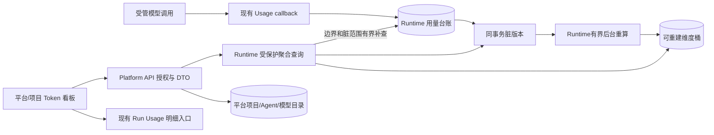

# 平台 Token 用量看板

## 项目概述

- **启动日期：** 2026-10-11；实施排期在方案评审后确认。
- **目标：** 在现有 Agent 用量台账上建立平台/项目两级分析入口，回答消耗多少、变化趋势、主要消耗来源、数据是否完整，并支持按当前权限追查运行明细。
- **负责人：** 产品及方案审批由用户负责；本轮 Codex 完成非前端实施，Platform Web 由用户的前端同事接续。
- **模板类型：** 多专题模板。
- **改动级别：** 治理改动；跨三服务，新增聚合访问权限、服务间只读查询契约和数据库索引迁移。
- **状态：** `done`（研发态全栈实施与自动化联合复验完成，等待用户人工最终验收）。2026-10-11用户批准原方案及B01优化；2026-10-12 Runtime/API接口、投影、权限、迁移、容量、安全、耐久和真实链路完成，B01容量门禁已解除；Web端完成W01–W04、布局防抖消除、503容量饱和适配，Playwright真实大模型全链路联合回归100%通过。本地三原生服务持续稳定运行中，生产发布待另行授权。状态与证据见05。
- **预计工作量：** V1 合计 15–20 人天，按一个熟悉现有系统的开发者约 3–4 周估计；有前后端分工时可交错推进，联调和评审等待另计。

## 阅读顺序

1. [产品范围、统计口径与现状](01-product-and-metrics.md)：V1 功能、已有能力、指标公式、辅助费用与用户归因边界。
2. [Runtime 数据查询与聚合](02-runtime-aggregation.md)：已确认的职责与数据访问决策、备选路线取舍、SQL/索引、时间分桶和部分数据。
3. [平台接口、权限与服务间契约](03-platform-api-and-security.md)：公开 API、用途受限的内部签名、运行明细 ACL 和审计。
4. [Web 看板与交互](04-web-dashboard.md)：信息布局、组件复用、筛选与钻取、状态和请求竞态。
5. [实施路线、验证与发布](05-delivery-and-verification.md)：完整依赖顺序、任务追踪、性能/安全/E2E/回退和评审清单。
6. [前端交接](frontend-handoff.md)：联调环境、三个接口、冻结样例、W01–W04 与可直接转发的话术。

README 为唯一导航入口。各专题自带任务、验证要求和状态；总体交付门禁以 05 为准。冻结契约见 [fixtures](fixtures/README.md)，改动理由及代码位置见 [非前端实施记录](implementation/01-backend-delivery.md)。

## 核心结论

仓库已经具备模型调用级 Token、缓存/推理明细、持久化去重、价格快照、估算成本，以及 Chat 中的 Run/Thread Usage 面板。新项目补充的是跨 Thread/项目的聚合分析和正式导航，不重建计量系统。

## V1 验收范围

| 范围 | 交付 |
|---|---|
| 平台视图 | 当前租户已授权治理范围内项目的总览、趋势、项目/模型/Agent/用途/主子图分解 |
| 项目视图 | 指定项目相同指标，独立项目用量权限，与平台治理视图区分 |
| 指标 | 已采集 Token 总量、输入/输出、缓存/推理明细、已知估算成本、调用/运行数量、用量与计价完整度 |
| 筛选 | 今日/昨日/7天/30天/自定义最多90天；项目、模型、Agent、用途、主/子/辅助范围 |
| 明细 | 有界运行分页；先按现有 Thread ACL 过滤，再进入现有 Run Usage 读取完整明细 |
| 数据状态 | 真零、未记录、采集关闭、已知小计、采集中、存储故障、无权限各自展示 |
| 交付门禁 | 单元/真实 PostgreSQL/服务间契约/Web三尺寸/E2E/负载与回退证据完整 |

## 关键决策与建议

1. **职责与查询路线已确认（2026-10-11）：** Runtime保留调用事实采集、去重、Run额度保护与恢复，提供受控聚合与可重建投影；Platform API负责权限、范围、产品指标、名称解析、明细ACL和审计，Web负责展示。平台经Runtime接口读用量，不直连Runtime数据库；取舍与确认见02。
2. **V1 明确限定数据范围：** 已接线且开启采集的 native Run 消耗；标题、推荐问题等辅助调用仍未计入，页面标示范围。需要整个产品的模型总消费时实施 01 的后续辅助调用专题。
3. **治理读权限已批准并实现：** `platform.usage.read`、`project.usage.read` 分别映射平台 super_admin/operator、项目 admin/editor；平台 viewer、项目 executor 不新增聚合权限。两权限不授予私有聊天/文件/模型凭据访问。
4. **内部聚合单独隔离：** 采用绑定用途、tenant、project 集合、时间和原始请求体的 HMAC 只读请求，不扩大现有 Thread-bound `usage-read`，不改变既有 Delegation JWT 的五字段 scope。
5. **B01已解除（2026-10-12）：** 原始SQL在百万数据下失败；按批准方案增加Runtime可重建投影、脏版本补齐、Run位集合和Platform整链路admission。公开两轮30/30可用，读p95 1220.89/1171.99ms，写入p95增幅16.01%/11.62%，200项目/90天和Run ACL通过。原deadline/门槛保留，同库投影不等于物理负载隔离。
6. **费用始终称估算成本：** 使用调用发生时保存的 USD 价格快照；缺价/缺用量不补零、不按当前费率重算历史。
7. **默认读取、按需刷新：** 首期手动刷新与时间范围筛选；不新增看板 SSE 或常驻轮询，不挤占聊天连接。

## 实施依赖与进度

| 阶段 | 依赖 | 出口 | 当前状态 |
|---|---|---|---|
| G0 口径与治理评审 | 本方案、负责人决定 | 全部 G0 获批，DTO/签名 fixture 冻结 | done |
| P1 Runtime 聚合 | G0 | 02 的 R01–R04 | done；投影、容量、恢复和回退通过 |
| P2 Platform API | G0；可先用 Runtime fixture | 03 的 A01–A05 | done；公开容量联合验收通过 |
| P3 Platform Web | G0；可先用 API fixture | 04 的 W01–W04 | 沿用04同事done记录；本轮排除前端，最终后端/503联合复验待接续 |
| Final 联合验收 | P1/P2/P3 | 05 的 V01–V04 | partial；B01解除，等待最终后端/前端联合复验及人工验收 |

## 与既有项目的关系

- [Agent Token/Cost 跟踪治理](../20261007-agent-usage-cost-governance/README.md)：已实现的事实采集、历史价格和单 Run/Thread 查询继续使用。该项目明确将独立看板后置，本项目承接这一范围。
- [F01 Run Token 额度保护](../20260913-dearflow-agent/15-token-budget-governance.md)：保护一条 Run，不能当作项目/月度预算。本期只展示历史停止原因，不改变执行拦截。
- [可观测性与追踪](../20261006-agent-observability-hardening/README.md)：运行问题继续在 RunDiagnostics 排查；Langfuse 关闭不影响已采集台账读取。
- [Worktree 规范](../../standards/worktree-development.md)：实施及真实联调使用 `scripts/local-stack.sh` 分配本地原生 PG/Redis、独立依赖、`RUNTIME_BACKEND=local`。

## 本轮交付边界

用户于2026-10-11追加授权实施：本轮完成Runtime、Platform API、非前端测试/性能/回退及接入交接；Web开发与浏览器验收由前端同事接续。工作区为当前b2b1关联Worktree，本地资源通过local-stack初始化隔离；不提交/推送、不部署现役、不更改主工作区数据。非前端完成状态与整项目状态分别记录。

本轮工作区基线 `116cc26f`，环境 `wt_43d02afc6100`；改动未提交，不能只从基线获取本能力。B01失败、优化及解除证据见05；交接不代表全栈Final或生产验收通过。
