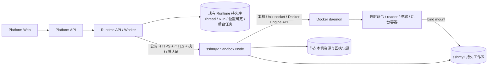
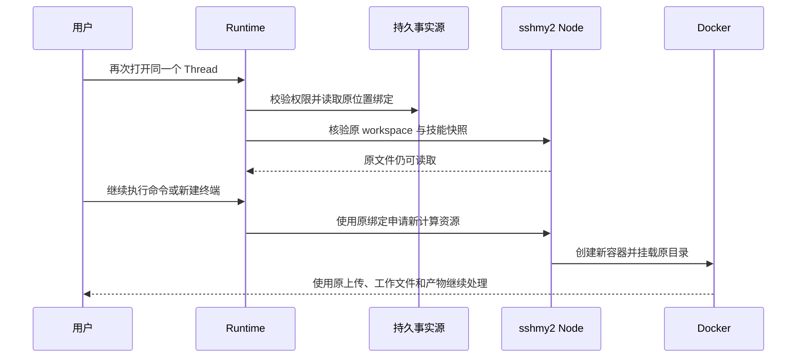

# Runtime 单节点远端 Docker 沙箱：整体方案

> 状态：已完成 / done（2026-10-13 用户验收）。三模式/两图公网平台/浏览器/安全/性能/进程恢复/回退已验，B01/B02 解除；wawapii 真实生图通过。用户明确剩余问题后续完成，正式 I10 整机部分/后续独立 Final、真实编辑、留存夹具与残留 interrupt 排查转 [deferred](follow-ups.md)。2026-10-12 批准设计继续作为实现依据，用户验收不等于上述未执行测试通过。

## 背景与现状证据

当前“API / Worker 与 Docker daemon 同机、工作区使用相同宿主绝对路径”的要求源自本地文件实现和 Docker bind mount。它不是 Docker 或 DeepAgents 对所有部署拓扑的必然限制：Docker daemon 必须能访问挂载源，但 Runtime 可以通过远端服务读写该工作区并控制执行。

| 事实源 | 现有行为 | 远端适配的含义 |
| --- | --- | --- |
| `apps/runtime-service/src/runtime_service/workspace/execution.py` → `runtime_backend()`、`docker_workspace_args()`、`execute_in_workspace()` | backend 为 local / docker；普通 Docker 命令 `run --rm`，预置镜像、固定隔离参数，挂载 Runtime 本机目录；使用本机 UID / GID | 远端必须由 Node 解析目录、选择节点本机 UID / GID，不能照搬 Runtime 的路径和身份 |
| `apps/runtime-service/src/runtime_service/services/dearflow_agent/workspace/backend.py` → `DearWorkspaceBackend`、`prepare_custom_skills()` | 文件操作、目录准备和技能快照直接访问本机；Docker 只执行命令 | 文件与 execute 必须同时切到同一远端位置 |
| `apps/runtime-service/src/runtime_service/services/demo/showcase_demo/backend.py` → `create_workspace()`、`build_backend()` | Showcase 同样把本机 FilesystemBackend 与命令后端组合 | Showcase / DearFlow 及其子 Agent 要共同回归 |
| `apps/runtime-service/src/runtime_service/http/workspace.py`、`http/documents.py`、`http/images.py` | 文件树、上传、内容、预览、下载、归档与 fork 依赖本机 workspace | 保留外部接口，内部按持久位置绑定转发 |
| `apps/runtime-service/src/runtime_service/tools/documents.py` → `build_document_tools()` | Office 固定使用 Docker reader；即使 shell backend 为 local，也没有宿主 Office parser 回退 | 保留例外，不把“保留 local”误写成“Office 无需 Docker”；远端模式使用节点 reader |
| `apps/runtime-service/src/runtime_service/workspace/terminal.py` → `TerminalSession`、`TerminalManager` | PTY 和回放缓冲由 API 进程持有；无输入 900 秒、最长 3600 秒；关闭会杀进程并清理容器 | 远端 PTY 移到 Node；本地实现保持；持久化文件，不承诺持久化 shell 内存 |
| `apps/runtime-service/src/runtime_service/background_tasks/service.py`、`repository.py` 与 `workspace/background.py` | 已有任务表、提交幂等、host 绑定、lease / fence、Docker 标签、签名回执、对账与 unknown / unconfirmed 状态 | 复用现有事实与状态机，只替换节点控制通道，不新建后台任务调度系统 |
| `apps/runtime-service/scripts/r6_workspace_cleanup.py` 与 `services/demo/workspace_demo/policy.py` | 默认 dry-run；显式 apply 才删除；扫描 R6 的 `<tenant>/<project>/<thread>` 目录，并依赖调用者提供保护列表 | 不能直接拿该扫描器清理 Showcase / DearFlow 的哈希目录或远端目录 |
| `scripts/local-stack.sh` 与 `docs/standards/worktree-development.md` | 本地默认 local；Worktree 使用独立 env、路径和登记执行域 ID | 远端节点也必须隔离不同 Worktree，不能将所有 host ID 改成 sshmy2 |

服务器事实见 [README.md](README.md#当前服务器与适配结论)。此前的只读探测证明部署基础，不证明镜像可运行、公网 HTTPS 已打通或项目链路已适配。

## 目标与兼容底线

| 用法 | 配置 | 执行和工作区位置 | 默认行为 |
| --- | --- | --- | --- |
| 本地宿主机 | `RUNTIME_BACKEND=local` | Runtime 宿主机；可信开发模式 | 本地栈继续默认使用，Node 配置不参与普通 shell 路由 |
| 本地 Docker | `RUNTIME_BACKEND=docker`、`RUNTIME_SANDBOX_TARGET=local` | 现有本地 Docker daemon 和本机目录 | target 缺省为 local，保持旧配置可用 |
| 远端 Docker | `RUNTIME_BACKEND=docker`、`RUNTIME_SANDBOX_TARGET=remote` | sshmy2 Node、Docker 和持久目录 | 必须显式配置节点连接与认证，缺少配置即拒绝启动 |

保留当前独立 Runtime 未设置 backend 时默认为 docker 的行为；不改变本地栈默认 local 的规则。后台新建能力仍由 `RUNTIME_BACKGROUND_TASKS_ENABLED` 控制，默认关闭；local 下继续保留旧任务查询、回执和取消语义。

`RUNTIME_BACKEND=local` 时 target 不触发远程执行；普通本地开发不需要连接 Node。远端模式不依赖 Runtime 本机安装 Docker CLI。local 的 Office reader 继续使用当前本地 Docker 例外，不在本期新增“local shell + 远端 reader”的第四种组合。

## 整体架构



Runtime 所在机器可以是开发机，或计划部署 Runtime 的 sshmy1；本方案不假定当前已在 sshmy1 部署服务。**需要同机的是 Node、Docker daemon 和 Docker 挂载源；API / Worker 可以远离沙箱节点。** API / Worker 必须指向同一事实源和执行域，不能一方读本地、一方写远端。

Sandbox Node 是 runtime-service 中的独立启动角色，复用文件校验、Docker 参数和现有 runner。它不启动 Agent 图、模型调用、GraphHarbor Worker 或平台服务，不要求在 sshmy2 部署 PostgreSQL / Redis。使用现有 FastAPI / HTTP 客户端依赖，不另建仓库或引入 Kubernetes。

资源计算移到 sshmy2 可以隔离 Runtime 的 CPU / 内存负载，但公网会增加工具与文件往返耗时；不据此承诺所有请求更快。列表、grep、归档等操作在节点批量完成，返回有界结果；不把目录逐文件同步到 Runtime。

## 公网通信与 sshmy2 准备

### 生产主通道：公网 HTTPS + mTLS

sshmy2 对 Runtime 开放一个受限 HTTPS Node 入口，建议端口 `19111`，最终以预检结果为准。Node 使用现有 ASGI 服务栈原生终止 TLS，专用进程由 systemd 管理；本期不增加反向代理、VPN 或隧道 sidecar。

- 使用专用 CA 与双向证书校验；Runtime 校验服务器证书的信任链、有效期和 URL 的 DNS / IP SAN，Node 要求受信客户端证书。无域名时可使用带正确 IP SAN 的证书，不必另建 DNS 系统。
- mTLS 保护服务身份，现有方案中的 caller token 再绑定 `execution_host_id`；两项必须同时通过。身份和节点 URL 均来自运维配置，不能由 Agent、Thread metadata 或公开请求指定。
- 云安全组与主机防火墙只允许实际 Runtime API / Worker 的公网出口 IP 访问 Node 端口；容器化 Runtime 校验实际 NAT 出口。本地 remote 调试使用自己的授权与允许的出口地址，本地 local 不依赖此入口。
- Runtime 原生 / 容器部署都访问同一个 HTTPS URL；容器只读挂载 CA、客户端证书 / 私钥和 token 文件。不同宿主的 API / Worker 各自配置客户端证书，使用同一执行域与位置事实源，不再依赖 SSH 别名。
- Node 的客户端连接池有明确 connect / read / pool 超时与上限，关闭客户端时释放连接；`trust_env=False`，不经过开发机代理；拒绝跨主机重定向和 `verify=False`。
- TCP 断开后的连接可以重建；执行、上传提交、PTY 输入、后台启动等副作用不得自动重放。受管只读 readiness / inspect 可在预算内重试，沿用单一重试负责人。
- Node 服务端私钥、Runtime 客户端私钥与授权 token 分开存放。交付运维说明包含证书到期检查、轮换与故障时停止准入；不在本期建设自动发证服务。

SSH 保留为部署、运维和应急入口，使用固定主机指纹与受控账号。必要时可以转发既有 HTTPS 端口做运维诊断，仍需 mTLS 与 caller 认证，不另实现免证书的 HTTP 业务通道。SSH 本身是官方支持的远程访问方法；本次调整是服务边界选择，不认定 SSH 不能用于生产。

### Docker API 的使用方式与备选

| 方式 | 技术上是否支持 | 本期决策与原因 |
| --- | --- | --- |
| Node → 本机 Unix socket → Docker Engine API | 支持；现有 Docker CLI 内部就调用 Engine API | 主方案。优先复用现有 Docker CLI 封装，固定本机 socket、受管镜像 / 挂载与资源策略，不为此增加 Docker SDK 依赖 |
| Runtime → TLS 2376 → Docker Engine API | Docker 官方支持双向 TLS | 受控备选，不在本期实现。TLS 验证客户端身份，但不自动限制其创建特权容器或挂载宿主根目录的权力；仍要适配远端文件、绑定和回收 |
| Runtime → `ssh://` → Docker Engine API | Docker 官方支持 | 运维 / 探测可用；单独改 `DOCKER_HOST` 无法替换当前本地文件操作和生命周期治理 |
| Runtime → 公网明文 2375 | 可能配置，但没有安全认证边界 | 禁止使用 |

Node 是权限收敛层：Runtime 可以申请本项目的沙箱操作，不能调用任意 Docker API。mTLS 加密、身份验证与这个操作权限边界是三项不同职责。将来若选直连 Docker 2376，必须先批准独立 Docker 主机、IP 白名单、证书保护与 Engine 授权策略，并单独验证文件与副作用语义。

依据：[Docker 官方远程访问保护](https://docs.docker.com/engine/security/protect-access/)同时说明 SSH / TLS 支持和客户端密钥的宿主 root 权限风险；[bind mount 文档](https://docs.docker.com/engine/storage/bind-mounts/)明确挂载源属于 daemon 所在主机，不能凭远程 daemon 直接挂载客户端本地文件。

### 节点部署准备清单

| 项目 | sshmy2 需要完成的工作 | 验证依据 |
| --- | --- | --- |
| 公网 HTTPS | 固定 Node DNS / 公网 IP 与 TLS 端口；云安全组和主机防火墙限制 Runtime 出口 IP | 从真正 Runtime API / Worker 的原生或容器部署验证 mTLS 请求，不只测开发机到节点 |
| SSH 运维 | 固定指纹、受控部署账号；保留现有运维通道 | 不作为 Runtime 业务面的运行依赖，不开放新的裸 HTTP 入口 |
| Docker 权限 | 创建专用 Node 服务账号并授权访问本机 socket；SSH 用户无需用于直接执行 Docker | Node 账号可执行受管容器；docker 组等同宿主高权限，需要人工批准 |
| Node 程序 | 安装受管 runtime-service 产物，以独立角色启动；配置 systemd 重启 | Node readiness、版本、node_id、执行域匹配；不启动 Agent / DB / Redis |
| 持久目录 | 建立 `/var/lib/runtime-sandbox/workspaces`、`state`、`skills`；服务账号拥有工作目录 | 不挂载 `/tmp` 或容器 writable layer 作为唯一持久数据源 |
| 镜像 | 获取 / 构建既有 Showcase 镜像和 `deploy/Dockerfile.agent-workspace` 镜像，冻结实际版本 / digest | 通过加速地址真实拉取或受控传入构建产物；reader、字体和后台 runner smoke |
| 认证 | 服务端证书 / 私钥、客户端 CA、Runtime 客户端证书，以及 caller token / execution host 映射 | 无证书 / 非受信证书 / 错误 token / 跨执行域请求均拒绝；记录证书轮换办法 |
| 暴露面 | 受限公网 Node HTTPS；Docker 只使用 Unix socket；沙箱不发布端口 | 检查监听、安全组与外部连通；无公网 2375 / 2376、裸 HTTP 或 per-container 执行入口 |
| 容量 | 初始全节点同时最多 2 个活跃沙箱容器，含终端、后台任务和 reader | 原子准入、满额前置拒绝；测量后再调整，不沿用本地 32 终端上限作为节点容量 |
| 磁盘 | 监测工作区 / 镜像 / 日志；可用磁盘低于 5 GiB 时拒绝新建计算资源并报警 | 不通过自动删除保留中的用户工作区换取空间 |

单容器先沿用当前 256 MiB、1 CPU、64 PID、有界输出和 tmpfs 策略。2 个容器是保守初始准入值，不是性能实测结论。Office reader 或正式任务超出限制时需以测试结果调整已批准策略。

## 配置归属与默认值

真实配置可以放在项目对应 env 文件中；仅提交 `.example`，真实文件与秘密由本机配置或部署秘密管理器加载。下列键已接入本期实现；实际配置与操作以运行手册为准。

| 场景 | 配置文件 | 使用规则 |
| --- | --- | --- |
| 主工作区原生开发 | `apps/runtime-service/.env` | shell 默认 local；改模式后重启 Runtime API / Worker |
| 关联 Worktree | `.local-stack/runtime.env` | 延续独立 PG / Redis / 路径 / execution host；不修改主工作区配置 |
| 当前独立容器部署 | `apps/runtime-service/deploy/.env.runtime-service` | API / Worker 共享配置；不能把宿主 `.env` 烘进镜像 |
| 宿主基础设施 Compose | `apps/runtime-service/deploy/.env.runtime-service.host-infra` | 延续既有加载方式，仅增加本期执行目标配置 |
| 远端节点 | `apps/runtime-service/deploy/.env.sandbox-node` | 只加载节点监听、目录、镜像、准入和服务认证；不复制模型 / 平台秘密 |
| 示例模板 | 上述 Runtime `.env.example` / deploy `.example` 与`.env.sandbox-node.example` | 标注新增键、必需组合和不兼容组合，不填真实 token |

Worktree 初始化继续写入 `RUNTIME_BACKEND=local` 默认值；用户在所属 `runtime.env` 显式设置 docker 后，启停工具应读取该选择，不能因 Worktree 身份强制覆盖回 local。优先级为显式 shell override → 所属 env → 本地默认值；保持路径 / 数据库 / execution host 隔离不变。`local-stack.sh` 已按此优先级调整，配置和兼容基线已验收。

Runtime 配置职责：

| 变量 | 默认 / 示例 | 说明 |
| --- | --- | --- |
| `RUNTIME_BACKEND` | 保留现有默认 | local 是宿主执行，docker 是容器执行 |
| `RUNTIME_SANDBOX_TARGET`（新增） | `local` | docker 的目标；仅显式 remote 使用远端 Node |
| `RUNTIME_SANDBOX_NODE_ID`（新增） | remote 必填，例 `sshmy2` | 稳定节点身份；不是公网 IP 或 SSH 别名解析结果 |
| `RUNTIME_SANDBOX_NODE_URL`（新增） | remote 必填 | 例 `https://sandbox-node.example.com:19111`；必须 HTTPS，服务器 SAN 与 URL 对应 |
| `RUNTIME_SANDBOX_NODE_AUTH_FILE`（新增） | remote 必填 | Runtime 读取服务 token 的绝对路径；当前实现拒绝相对路径与软链接 |
| `RUNTIME_SANDBOX_NODE_CA_FILE`（新增） | remote 必填 | 校验 Node 服务端证书的受信 CA 文件 |
| `RUNTIME_SANDBOX_NODE_CLIENT_CERT_FILE`（新增） | remote 必填 | Runtime 客户端证书文件 |
| `RUNTIME_SANDBOX_NODE_CLIENT_KEY_FILE`（新增） | remote 必填 | Runtime 客户端私钥文件，不发送给 Node 或沙箱 |
| `RUNTIME_EXECUTION_HOST_ID`（已有） | 延续现有执行域规则 | 识别某部署 / Worktree 的执行所有权；远端模式必须固定配置 |
| `RUNTIME_WORKSPACE_TTL_SECONDS`（已有） | 示例 `604800` | 删除候选的保留期，不能单独作为“用户完成”的证明；既有 local 值不改变 |
| `RUNTIME_BACKGROUND_TASKS_ENABLED`（已有） | `0` | 远端 docker 不自动启用后台新任务 |

三个 Runtime 配置片段互相替代：

```dotenv
# 本地宿主机开发；已有配置继续可用。
RUNTIME_BACKEND=local
RUNTIME_SANDBOX_TARGET=local
```

```dotenv
# 本地 Docker；未设置 target 时也使用这条路径。
RUNTIME_BACKEND=docker
RUNTIME_SANDBOX_TARGET=local
```

```dotenv
# Runtime 通过公网 HTTPS + mTLS 访问 sshmy2；URL 是待替换的示例。
RUNTIME_BACKEND=docker
RUNTIME_SANDBOX_TARGET=remote
RUNTIME_SANDBOX_NODE_ID=sshmy2
RUNTIME_SANDBOX_NODE_URL=https://sandbox-node.example.com:19111
RUNTIME_SANDBOX_NODE_AUTH_FILE=/etc/runtime-service/secrets/sandbox-token
RUNTIME_SANDBOX_NODE_CA_FILE=/etc/runtime-service/secrets/sandbox-ca.pem
RUNTIME_SANDBOX_NODE_CLIENT_CERT_FILE=/etc/runtime-service/secrets/sandbox-client.pem
RUNTIME_SANDBOX_NODE_CLIENT_KEY_FILE=/etc/runtime-service/secrets/sandbox-client-key.pem
# Worktree 使用工具登记的 wt_...，不能被此生产示例覆盖。
RUNTIME_EXECUTION_HOST_ID=runtime-prod
RUNTIME_WORKSPACE_IMAGE=runtime-agent-workspace:p5-v2
RUNTIME_SHOWCASE_IMAGE=runtime-agent-workspace:p5-v2
RUNTIME_BACKGROUND_TASKS_ENABLED=0
```

Node 配置：

```dotenv
SANDBOX_NODE_ID=sshmy2
SANDBOX_LISTEN_HOST=0.0.0.0
SANDBOX_LISTEN_PORT=19111
SANDBOX_TLS_CERT_FILE=/etc/runtime-sandbox/secrets/server.pem
SANDBOX_TLS_KEY_FILE=/etc/runtime-sandbox/secrets/server-key.pem
SANDBOX_TLS_CLIENT_CA_FILE=/etc/runtime-sandbox/secrets/ca.pem
SANDBOX_WORKSPACE_ROOT=/var/lib/runtime-sandbox/workspaces
SANDBOX_STATE_ROOT=/var/lib/runtime-sandbox/state
SANDBOX_AUTH_FILE=/etc/runtime-sandbox/secrets/callers.json
SANDBOX_ALLOWED_IMAGES=runtime-agent-workspace:p5-v2,python:3.13-slim
SANDBOX_MAX_ACTIVE_CONTAINERS=2
SANDBOX_MIN_FREE_DISK_BYTES=5368709120
```

`callers.json` 保存受管 token 的 SHA256、证书 CN 与允许的 execution host / 源 CIDR 对应关系，由运维配置，不属于 Agent 输入。一个执行域的 API / Worker 共用该域认证；不同 Worktree 使用独立执行域和授权，不能任意指定其他域的文件。镜像选择由 Runtime env 提供，Node 只接受已安装的 allowlist 镜像；技能快照存于各工作区，不使用独立 SANDBOX_SKILLS_ROOT。

Node 启动器根据 TLS 配置要求客户端证书，缺少 TLS 组合即拒绝对外启动；没有从 `0.0.0.0` 自动退化为裸 HTTP 的路径。`callers.json` 仍校验服务 token 与执行域，不能仅凭 CA 签名就访问所有 Worktree。

SSH / TLS 私钥、服务 token 不直接写在示例 env、Git、镜像、公开日志或 Agent Context 中；env 存秘密文件路径即可。`.env.sandbox-node` 已加入忽略规则；Worktree 私有目录与客户端凭据 600 权限已核验。配置校验只输出键名与 present / empty。

Node 端 Docker CLI 显式固定本机 Unix socket，拒绝继承远程 `DOCKER_HOST` / Docker context。Runtime 的 remote 路径访问 Node，不修改 `DOCKER_HOST`；local Docker 保持既有已支持的上下文行为。

## deer-flow 借鉴与本次补齐

能力和可复制代码详见 [复用评估](deerflow-reuse.md)。本期“补齐”指三模式下的执行、文件、终端、后台、回收、恢复和隔离达到一致的契约，不扩大为所有云沙箱供应商、网络审批或多节点调度。

- 使用现有 DeepAgents `SandboxBackendProtocol`、权限与错误投影；不替换为 deer-flow 的字符串返回 `Sandbox` 接口。
- 创建、inspect / discover、终止与删除在 Node 集中处理，Runtime 仅持有稳定绑定与资源 ID。恢复不采用用户提供的 checkpoint sandbox ID，不把 missing file 与 missing sandbox 混成一个错误。
- 同 workspace 的准备 / 文件变更 / fork / 删除、同 resource 的创建 / Stop / 清理分别按可信键串行化。优先复制独立的 `AcquireSerializer` 及契约测试；其进程锁不替代 Runtime 数据库绑定、后台 lease / fence 和 Node 的持久 operation 登记。
- Node 固定一个进程拥有 PTY 与 janitor；ASGI 请求可以并发，同一节点不运行多个独立 janitor。退出先关闭新准入、等待有界操作与取消收尾，释放客户端 / executor / PTY；后台任务保留 deadline 和未确认日志，不随进程 shutdown 盲删。
- readiness 同时检查协议、节点身份、持久记录可写、磁盘、Docker、固定镜像与策略；启动对账完成前不准入副作用。发现的容器只读核验标签、镜像、mount、网络 / 权限 / 限额，不能凭名字或“活着”就接管、销毁或扩权。
- 远端文件读写复用现有安全模块；missing、真实空结果、超限截断、部分遍历失败必须区分。限额在 Node 生成结果时生效，不能先无界读取再到 Runtime 截断；修改与替换在节点锁内完成并原子发布。
- 保留现有 local 最小环境与容器固定 env，不复制 deer-flow 的整份宿主环境过滤器。Node 认证 / TLS / 模型秘密不进 sandbox env；宿主路径在公开 DTO、错误和模型输出中映射到既有虚拟根。可直接复制独立 `path_patterns.py`，它仅用于输出映射，不能替代路径授权。
- HTTP 连接、Docker CLI 与文件任务的取消必须有界收尾，晚完成的创建登记为可对账资源；失效连接不能触发副作用重放。沿用本项目已有 `_shielded()` / cleanup 与 unknown 控制流，移植上游反例测试补边界。

容器预热池与保持 shell 状态会改变当前普通命令 `--rm` 的行为，并占用节点容量；本期保持命令临时容器，交互需求通过既有终端满足。AIO 的 Redis ownership、OpenSandbox SDK、Kubernetes Provisioner 与动态网络批准属于部署 / 产品边界变化，不整包移植；明确列在复用评估中。

## 工作区位置绑定与文件适配

### 稳定位置，单一文件事实源

在 Runtime 应用持久层新增一份窄的工作区位置记录，复用现有连接、迁移和服务端身份；不把位置选择写入用户可改的 Thread metadata。绑定主键包括 execution host、tenant、project、thread、graph，记录存储位置 target、node_id、workspace_id、状态与创建时间。计算 backend 与文件位置分开：本地 local ↔ 本地 Docker 仍可在停止在途资源后复用同一本地目录，不因位置绑定禁止原有模式切换。

- local / 本地 Docker 沿用当前实际目录和 backend 身份；兼容既有未绑定工作区，受控切换前先登记已有位置。
- 远端 `workspace_id` 使用 graph 标识与现有 `thread_scope_hash()`，外层再以 execution host 隔离。不改变旧本地目录布局或已有公开 `/workspace/...` 路径。
- Node 根据已认证执行域与 workspace 标识映射到 `/var/lib/runtime-sandbox/workspaces/<execution-host>/<graph>/<scope-hash>/workspace`，不接受 Runtime 或用户传入宿主绝对路径作为挂载源。
- Runtime 位置表决定“去哪里”；节点目录、容器标签与本机资源回执证明“那里存在什么”。Node 不独立调度或重新决定 Thread 所属位置。
- 一个工作区的文件树、上传、Agent 文件工具、执行、终端、图片、产物和 reader 全部使用同一绑定；不保存可写的本地镜像副本。
- `workspace_id` 不是授权凭证。Runtime 每次先通过原有 ACL / delegation / tool policy；Node 再校验服务认证、执行域和路径边界。

绑定首次建立使用原子插入 / 比较，API / Worker 并发只能得到同一位置。已有绑定与当前目标配置冲突时，返回明确不可用 / 配置冲突；禁止自动覆盖绑定或创建同名空目录。配置切换只影响经批准的新 Thread；旧 Thread 保留原文件与原位置，切换操作必须先做清单和 drain，本期不提供自动迁移。

local 分支不能因为新增远端能力要求 Node 认证或网络依赖；纯路径 / 文件逻辑继续本地运行。既有离线 backend 和不连接数据库的本地测试继续使用原路径，不为了远端绑定增加全局数据库前置条件。持久部署的登记在已有 Runtime 存储接线，绑定单测通过仓储 fixture 验证；remote 与跨目标切换必须有持久绑定，真实重启恢复不能用进程字典替代。

### 保持功能完整的适配面

| 入口 | 远端行为 | 兼容要求 |
| --- | --- | --- |
| DeepAgents 文件 backend | Node 提供 list / read / write / edit / grep / glob 与文件上传下载；复用现有路径、哈希、只读边界 | 不仅实现 `execute()`；主 / 子 Agent、只读工具、外置大工具结果与 CompositeBackend 路由一致 |
| 工作区准备 | Node 创建 uploads / work / outputs，校验根和权限；执行中缺目录按现有规则失败 | 不在失败后自动换 workspace；prepare 幂等与 Run latch 保留 |
| 文档 / 图片上传 | 字节写到 Node，校验 MIME / 大小 / hash，原子发布 | 保持 FileRef / ImageRef 结构和授权下载，半写入不能被读到 |
| 文件树 / 预览 / 下载 / ZIP | Node 使用既有安全文件模块批量处理，Runtime 受控转发字节与安全头 | 当前 path、分页、内容类型、HTML CSP、sha256 引用不变；临时包有界并清理 |
| Agent 图片与图表 | 模型 / 图片供应商凭据继续由 Runtime 持有；读取引用或落盘产物走 Node | 供应商调用不移入不可信容器；图片编辑、分析与产物文件仍可见 |
| 研究来源 / 技能包 / 部署包 | 搜索 / GitHub / 论文工具将证据写到节点；技能工具和部署工具从节点读取已授权包 | 保留 `/workspace/sources/`、证据 hash / 元数据、技能治理与发布审批；外部服务鉴权仍归 Runtime |
| Office reader | 节点上的预置 reader 镜像解析节点原字节 | 保留 20 section / slide、12,000 字符、有界续读、结构 / hash 校验、取消和 unknown 控制流 |
| Skills / memory / 系统文件 | Runtime 准备受信内容与执行快照，按摘要发布到 Node，挂载只读；用户工作目录仍可写 | 保留现有技能审批、版本 / 哈希检查和历史恢复；禁止把 Runtime 本机包路径传给远端挂载 |
| fork | 同节点内按当前复制白名单生成新工作区与新绑定；新的 Thread 不复用原可写目录 | 不复制运行进程、不穿透执行域、不额外复制敏感系统文件 |

远端 backend 实现现有 `SandboxBackendProtocol`，沿官方接口装配；不伪造一个本地 FilesystemBackend 根来掩盖网络调用。Node 的安全文件实现复用当前模块，具体 transport 在共享 workspace 层集中处理，避免各 Agent 各造一次远端客户端。

## Node 协议、幂等和信任边界

协议为版本化内部 HTTP，以下为最小操作集合，最终 DTO 在 T03 固化；不新增浏览器接口或平台 JWT operation。

| 操作组 | 必需行为 |
| --- | --- |
| readiness | 协议版本、node_id、镜像 / Docker 可用、磁盘 / 持久记录与启动对账状态、授权执行域核验；无秘密和宿主路径 |
| workspace | prepare / inspect、文件 / 目录读写、grep / glob、预览 / archive、reader、技能快照发布、受控 fork |
| execute | 一次提交、按 resource_id 查询、有界取消和清理；结果有 output / exit_code / truncated |
| terminal | create / read(offset) / write(sequence) / resize / close / list；保留输入幂等和字节回放 |
| background | 受管 create / inspect / start / stop / output / receipt / remove；沿用 task_id、标签、回执签名与 fence |
| maintenance | 本域资源 discover / inspect / list、回收对账、工作区 dry-run；查询只读，删除仅使用复核过的明确候选 |

请求仅携带经 Runtime 验证的 scope、绑定、受管 resource_id / task_id、摘要和操作参数。禁止通用 Docker CLI / Docker API 透传；镜像限于 Node 配置的受管集合；挂载、UID / GID、权限和资源限额由 Node 构造。

Node 本机用标准库 SQLite 保存最小操作 / 资源记录，放在 `SANDBOX_STATE_ROOT`，不挂进容器。记录请求摘要、资源所有权、deadline、接收与结果状态、回收状态及有界结果，用于 Node 重启后的只读回查和清理；它不是第二个 Thread / Run / 后台任务调度库。已结束且清理确认的前台回执默认保留 7 天，活跃或 unconfirmed 记录不按时间删除；终态结果可过期，旧 ID 的执行登记墓碑保留到其工作区经批准删除，避免回执过期后重新执行同一资源。

单个 Node 进程是本机资源创建、PTY 和 janitor 的唯一管理者；所有调用者共享同一持久登记与全节点容量计数。进程内互斥负责创建 / Stop / 删除及文件变更竞态，SQLite 短事务负责登记与准入原子性，Runtime 数据库负责跨 API / Worker 的位置与后台 lease / fence。不得开启多进程 ASGI worker 再各自维护容量 / PTY / janitor，也不得长时间持有 SQLite 事务等待 Docker 或网络。

1. 有副作用操作执行前持久登记 operation / resource ID 与请求摘要；同 ID 不同摘要拒绝。
2. 容器名由执行域和资源 ID 确定，标签绑定 node、host、workspace、kind、deadline；后台标签保留现有 task / binding 摘要。
3. 重复提交已登记请求只读取已有资源 / 回执；如果记录存在但历史启动结果不确定，不再执行命令。
4. HTTP 等待失败不证明 Node 未收到请求。Runtime 标记 unknown，先按原 ID 回查；不能换新 ID 自动重跑。
5. 文件写入使用同样的 operation ID、内容摘要和原子发布；编辑冲突或提交未决不能当作未写入重放。
6. 取消 / remove 幂等且核对所有权；清理失败记录 unconfirmed。Node 重启优先对账，不能把“容器不存在”解释为命令成功。
7. Node 持久记录不可写或无法取得容量时，在 Docker / 文件副作用前拒绝。回执记录保留期间不重用 ID；过期后未知旧 ID 不能成为自动重发依据。

普通 execute 保留现有单次提交策略与 1–60 秒限额，默认 30 秒。Node 负责实际 deadline 与清理，HTTP 断开不取消该边界；Runtime Stop 另用原资源 ID 发送取消。容器内部硬超时确保 Node 进程退出后也不会无限运行。

复用现有安全错误码与公开 DTO；Node 原始 stderr、socket 路径、服务器地址、token 和系统栈只进入受控运维诊断。没有可靠执行证据时继续走 `runtime.workspace.execution_outcome_unknown` / 当前 unknown 语义；不因远端网络加一层工具重试。

隔离继续保留 `network=none`、只读根、`cap-drop=ALL`、非特权用户、`no-new-privileges`、PID / CPU / 内存 / 输出上限和最小可写挂载。Node 按服务账号的本机 UID / GID 创建文件与容器；不使用开发机 UID / GID。Docker socket、Node 密钥、其他 Thread / Worktree 目录绝不挂入沙箱。

## 容器回收、工作区保留与会话恢复

### 如何判断“使用完成”

使用明确生命周期事实，而不是猜用户是否离开：前台命令退出 / 超时 / 取消，终端显式关闭 / 无输入超时 / 总寿命到期，后台任务由 runner 回执与持久任务对账确认。关闭页面、切换会话或网络断开都不能直接认定后台任务完成。

| 对象 | 完成依据 | 回收动作 | 保留内容 |
| --- | --- | --- | --- |
| 普通 execute / reader 容器 | 进程退出，或 deadline / Stop 后清理确认 | 当前本地 `--rm` 与异常 `rm -f` 继续使用；远端由 Node 执行同等回收并登记结果 | 工作区文件；有界执行回执 / 诊断 |
| 交互终端容器 | 显式 close；无输入 15 分钟；寿命 1 小时 | 关闭 PTY、终止进程、删除容器；终态缓冲继续按现有保留窗口处理 | 工作区文件；不恢复旧 shell 的内存、进程和临时 env |
| 后台任务容器 | 既有 runner / 签名回执、任务 deadline / 取消与对账 | 不用 `--rm`；先将日志与最终回执保存并经 Runtime 持久层确认，再删除 | 任务 / 日志 / 回执按现有保留策略；工作区独立保留 |
| 工作区目录 | Thread 删除事实或经核实的孤儿，保留期到期，且没有未结资源 | 默认 dry-run；显式 apply 前复核，再按绑定删除精确目录 | 保留中的 Thread 不因闲置自动删除；已删除目录仅在有备份时可恢复 |

普通命令的输出有界保存到 Node 回执后再响应；如果 `--rm` 已完成而 Node 在持久化结果前崩溃，只能报告 unknown，不能凭容器消失补造成功。后台日志 / 回执未被 Runtime 确认时，Node 不擅自删除后台容器。

### 断线、崩溃与遗留资源

Node 启动以及运行中的有界周期扫描，只检查带本系统所有权标签的资源，与持久记录对账。普通 execute 和终端超过可信 deadline 才可强制回收；扫描器不碰未标记容器，不使用全局 `docker system prune`。

后台任务即使 Runtime 失联也受容器内部最长 1 小时 deadline 限制。Node 可按已确认 deadline 停止运行资源，但保留已退出容器、日志与签名回执；Runtime reconciler 恢复后完成事实落库和 remove 确认。容器丢失、Docker 不可达或日志尚未确认均保留 unknown / unconfirmed，不因“用户没在线”而删除证据或再跑一次。

Node 本机记录负责检测已知遗留资源；Runtime 原有 resource / Stop 报告继续保留“清理请求”与“清理确认”的区别。已停止但待日志确认的容器不占活跃计算槽，仍占磁盘，需要可见运维诊断。

### 工作区数据清理

第一阶段不启用自动工作区删除。保留列表必须覆盖所有仍保留的 Thread，含 idle、等待审批、排队和后续会再打开的 Thread；不能只拿 active Run 列表作为“活跃工作区”。

删除候选必须同时满足：

1. 持久事实源确认 Thread 已删除，或运维已核实该绑定确属孤儿；单纯最后访问时间、目录 mtime 或页面关闭不成立。
2. 没有 queued / running / interrupted Run、终端、后台任务、未确认副作用、cleanup / delivery 未决资源或仍依赖该 Thread 的受管任务。
3. 删除事实后的保留期超过 `RUNTIME_WORKSPACE_TTL_SECONDS`；7 天是示例宽限期，不是所有会话文件的寿命。
4. dry-run 结果明确列出执行域、node、workspace、原因与大小；apply 只接受这批明确候选。
5. apply 取得工作区互斥并再次核对 Thread 与资源；位置绑定写入 deleting / purged 标记，阻止并发新资源。事实源或 Node 不可用时跳过删除。

本期清理器按位置表精确定位目录；复用现有 dry-run / apply 和安全文件原则，但不能把现有 R6 三层扫描器直接接到远端哈希目录。Skills 快照只有无保留 Thread / Run 引用时才可列为候选。图片、上传、产物与系统文件作为同工作区数据统一保留，不只保留 `work/`。

磁盘压力先限流、拒绝新建和提示运维，不能绕过上述条件。真正删除用户文件前要有用户授权；重要历史如需超出单机持久盘的恢复承诺，必须另行建立并验证备份。

### 同会话恢复流程



“重启会话”定义为同一 tenant / project / Thread / graph / 执行域，不是新建 Thread。聊天与 checkpoint 由现有 GraphHarbor / Runtime 持久库恢复；文件由 Node 持久盘恢复；计算容器重新创建。新 Thread 使用新隔离工作区，只有显式 fork 才复制允许的数据。

重启 Runtime API / Worker 后位置不变；重启 Node / sshmy2 后持久目录与资源记录保留。Node 重启不承诺旧 PTY 延续，旧会话按既有 instance 变化语义关闭，并对账回收旧实例遗留终端容器；不重启未知后台命令。容器 writable layer、`/tmp`、未落盘进程状态与临时安装依赖不属于恢复范围。

若原目录不存在、已 purged 或节点磁盘损坏，返回明确不可恢复 / 不可用；禁止自动创建空目录并宣称“数据恢复”。单节点持久盘可承受进程 / 主机重启，不提供主机丢失、磁盘损坏或人为删除后的容灾保证。

## 代码与文档影响位置

以下是实施定位，不是本次已修改文件。新增文件只描述必要职责，最终拆分按现有结构确定，不为单节点增加通用调度框架。

| 范围 | 实现位置 | 必需改动 |
| --- | --- | --- |
| 配置与路由 | `workspace/execution.py` → `runtime_backend()`；拟在共享 `workspace/` 层增加目标配置与节点客户端 | target 默认兼容、严格 remote 配置、一次请求与错误投影 |
| 独立上游模块与来源 | `workspace/acquire_serialization.py`、`workspace/path_patterns.py`、`workspace/third_party/deerflow/LICENSE` / `PROVENANCE.md` 与 Runtime 契约测试 | 只复制实际接入的独立标准库模块；固定提交 / 哈希、保留 MIT、测试 import 与调用方适配 |
| 位置持久化 | `workspace/scoped.py` → `resolve_thread_workspace()` / `thread_scope_hash()`；`src/runtime_service/db/migrations/versions/` | 保留旧纯本地路径函数，增加服务端绑定仓储和受控登记迁移 |
| Node 启动角色 | `apps/runtime-service/src/runtime_service/sandbox_node/` | 专用 HTTP app、配置、认证、最小资源记录、readiness、Docker / 文件操作与对账 |
| Agent backend | DearFlow `workspace/backend.py`；Showcase `services/demo/showcase_demo/backend.py` | `prepare`、完整文件协议、execute、只读 Skills、主 / 子 Agent 组合 |
| 工具组合根 | `services/dearflow_agent/agent.py`；`services/demo/showcase_demo/agent.py` 与其工具装配 | 不再为远端绑定构造 Runtime 本机 `ImageWorkspace` / `BackgroundBinding` 路径 |
| DearFlow 磁盘直读调用方 | `services/dearflow_agent/tools/search.py` → `_evidence()`；`tools/skills.py` → `build_skill_tools()`；`tools/deployment.py` → `build_deployment_tool()`；`middleware/skills.py` → `ExecutionSkillsMiddleware` | 研究证据落盘、技能 / 部署包读取、执行快照锁与恢复按绑定适配；不能遗漏直接 `.root.parent` / `os.open()` 的调用 |
| 文件与 reader | `workspace/browser.py`、`documents.py`、`artifact_refs.py`、`archives.py`、`document_reader.py`；`tools/documents.py`、`tools/images.py`、`tools/chart.py`、`tools/artifacts.py` | 共用绑定存储；结构 / 哈希 / 只读边界复用；Office 留在 Docker |
| HTTP 网关 | `http/workspace.py`、`http/documents.py`、`http/images.py`、`http/terminal.py` | 保留权限与公开 DTO，按绑定调用 Node；预览安全头保真 |
| 终端 | `workspace/terminal.py` → `TerminalSession` / `TerminalManager` | remote 代理与 Node PTY；本地保持原进程归属、输入幂等 / 回放 / 限额 |
| 后台任务 | `workspace/background.py` → `BackgroundBinding` 和容器函数；`background_tasks/service.py` → `start_task()` / `reconcile_due()`；`repository.py` | 执行域不漂移；远端绑定摘要使用稳定标识；复用现有任务、lease / fence / 回执 / Stop |
| 数据清理 | `scripts/r6_workspace_cleanup.py` 与共享 policy；拟新增按位置绑定清理入口 | 保留原 R6 使用方式；新增精确候选、保护集合、互斥和删除标记 |
| 配置模板 / 部署 | `.env.example`、`deploy/.env.runtime-service*.example`、`.env.sandbox-node.example`、`.gitignore` | 不改真实 env；HTTPS URL、CA / 证书 / 私钥归属、镜像、单进程 systemd 启动与证书轮换说明 |
| 本地栈 | `scripts/local-stack.sh`、`scripts/local_stack_worktree.py`、`scripts/local_stack_processes.py` | API / Worker 相同目标配置；保留登记 execution host 与原生资源默认 |
| 标准与手册 | Runtime `docs/standards/runtime-service-development-standard.md`、`background-task-integration.md`、`deploy/README.md`；`docs/standards/worktree-development.md` | 实现并验证后限定“同机”规则到 local Docker 路径与 Node 内部；规划阶段不提前改现行标准 |

表中 `workspace/`、`http/`、`tools/`、`services/` 的相对路径均以 `apps/runtime-service/src/runtime_service/` 为根。

### Platform API / Platform Web 改动结论

本期设计不要求这两项服务改业务代码、增加页面、接口、JWT operation、节点选项或 Docker 凭据。Runtime 内部将文件、执行与生命周期切到 Node；既有 `/workspace/...`、FileRef / ImageRef、终端 / 后台 DTO、审批 / Stop 和安全错误结构继续使用。

改动位置集中在 Runtime、部署与本地栈工具、必要的 Runtime DB 迁移和第三方来源记录。Platform API / Web 只作为现有链路的回归和端到端验证入口：鉴权、撤权、上传 / 下载、预览、fork、终端、后台任务与错误展示必须实测。终端 UI 原已后置，不因新增 remote 将其扩大为前端任务。

Node 特有的认证、连接、容量、执行 unknown / cleanup unconfirmed 投影到现有安全错误；不把原始 Node DTO / 地址 / socket / TLS 信息发给浏览器。若实施发现现有契约确实表达不了必要状态，先写出最小差异供人工评审再改平台；当前没有这类代码任务。

## 实施顺序与验收门槛

1. **评审与兼容基线**：批准详细方案；冻结本地目录、配置默认、后台 host、reader 与权限基线。
2. **复用基线、配置、绑定与 Node**：独立模块 / 测试 / 来源与许可，remote opt-in、mTLS / caller 认证、内部 DTO、持久位置、节点目录和资源记录。
3. **完整能力接线**：文件 / 技能 / 图片 / reader / fork、execute、终端与后台任务一起完成，避免只有命令远程而文件仍本地。
4. **回收与恢复**：Node 断线 / 崩溃、孤儿容器、任务回执和显式工作区清理。
5. **sshmy2 部署与联合验证**：获具体服务器变更授权后部署，执行公网真机 E2E、安全 / 性能 / 重启 / 回退验证。

任务进度与依赖见 [tasks.md](tasks.md)，验收项与证据归属见 [verification.md](verification.md)。全部关键能力验证前不能启用现役远端执行或标为 done。

## 回退与数据保护

- 先关闭新远端资源准入，保持原 execution host 和 Node 连接用于取消、对账与保存后台回执。
- 等待 / 取消已知执行、终端和后台任务；有 unknown / unconfirmed 资源时不可认为 drain 完成。
- 使用保留当前迁移链的旧应用构建回退，保持 DB head、工作区绑定、Node 资源记录、工作区目录和原 env 备份；不默认 downgrade / stamp。
- 在确认本地仍有原始数据的独立环境验证 local / 本地 Docker 旧链路；不能只切 env 就让远端 Thread 在本地创建空目录。
- 回退期的远端旧 Thread 暂停写入；需要读取可保留新版本维护入口。将远端文件转回本地属于显式备份 / 迁移，不在本期自动实现。
- 不执行全局 prune、工作区批量删除、共享 Docker daemon 清理或现有 PG / Redis 的重建。

## 风险与后置范围

| 风险 / 限制 | 处理 |
| --- | --- |
| 公网连接不稳定、证书过期或出口 IP 改变 | 原 ID 回查；unknown 不重跑；证书 / IP 预检与运维轮换；节点 deadline 和清理不依赖 Runtime 在线 |
| 远端文件适配遗漏 | 按能力表与验收矩阵覆盖所有入口，不能以命令成功代表完整适配 |
| 4 核 / 约 3.6 GiB 节点容量有限 | 初始 2 活跃容器、资源限额与磁盘准入；实测后决定是否扩容 |
| Node 有 Docker socket 高权限 | 专用服务账号、固定镜像与挂载、服务认证；socket 不进容器；权限变更人工批准 |
| 日志未确认 / 数据长期保留导致磁盘增长 | 有界日志和可见对账；保留 Thread 不自动删；低磁盘停止准入，人工处理候选 |
| 单节点故障 / 数据盘损坏 | 报告不可用，不漂移、不伪造恢复；备份 / 跨节点容灾后置 |
| 模式切换误读旧文件 | 持久绑定、切换前登记与 drain、已有绑定冲突拒绝；不自动跨目标迁移 |
| 上游代码同名但语义不同 | 按复用表迁入独立模块与反例测试；保留本项目强隔离 / 硬准入 / unknown / 虚拟路径；不把复制视为已集成 |

未来多个 Docker 节点需要新增节点目录、健康 / 容量、分配策略、数据迁移和故障边界。本期仅将 `node_id` 写入位置与资源事实，避免以后无法识别旧文件在哪；不实现调度器、负载均衡、自动 failover 或跨节点共享存储。

## 人工评审项

| 编号 | 具体决策 | 当前建议 | 评审状态 |
| --- | --- | --- | --- |
| G01 | 修订后的单节点连接和角色 | sshmy2 单进程 Node + 公网 HTTPS / mTLS / caller 执行域认证，限制 Runtime 出口 IP；Docker 仅 Unix socket，SSH 为运维 | 2026-10-12 用户评审批准，含 T00–T15 与专项服务器部署；2026-10-13 公网业务与安全已通过，完整平台链见验证记录 |
| G02 | 执行和工作区位置规则 | 三种模式；target 默认 local；持久绑定；配置冲突拒绝，禁止静默回退 | 用户明确“其他的我同意”，已确认，保留不重复请求 |
| G03 | 数据保留与清理 | 容器按生命周期回收；保留 Thread 文件不自动删；删除候选宽限 7 天、dry-run 与显式 apply | 已确认设计；实际删除仍须明确候选授权 |
| G04 | 节点操作权限与容量 | 专用 Node 账号访问 Docker socket；初始全节点 2 活跃容器；低磁盘阻止新建 | 已确认设计；安装 / 账号 / 防火墙变更范围随部署任务列清 |
| G05 | 实施范围与故障语义 | C01–C18 范围补齐；复用 unknown / lease / fence；单节点持久盘恢复边界；合适的独立代码 / 测试直接复制 | 既有规则已确认，用户追加完整沙箱补齐与直接复用要求 |

G00 / G01 与 T00–T15 已于 2026-10-12 获用户明确批准，G02–G05 沿用已有确认，不再等待方案批准。sshmy2 专项账号、持久目录、mTLS / caller 配置、镜像和 systemd 服务已部署；公网连接和完整平台链路以 verification.md 的实际门禁为准。
