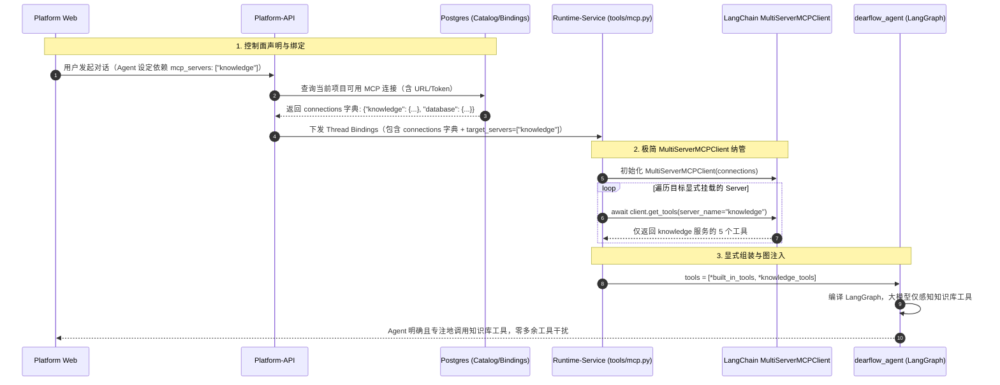

# Agent 显式挂载多 MCP 与 MultiServerMCPClient 极简治理方案 - 整体方案

## 背景

当前平台的 MCP（Model Context Protocol）接入存在两个严重的结构性痛点：

1. **盲目全量注入与缺乏“显式挂载”机制**：
   在之前的实现中，Agent 启动时将环境中获取到的所有 MCP 工具无差别地塞入 `all_agent_tools` 并传递给大模型。随着平台后续接入多个不同职责的 MCP 服务（例如：项目知识库 MCP `knowledge`、关系型数据库查询 MCP `database`、代码仓库 MCP `github`、运维发布 MCP `k8s`），所有工具一股脑全堆在模型上下文里，不仅造成严重的 Token 预算浪费，更会引发灾难性的模型幻觉——例如知识问答 Agent 错误调用了数据库写工具，或者数据库 Agent 被几十个无关的文档检索工具稀释了注意力。
2. **过度设计的倾向与轮子复造**：
   此前曾考虑过在 `runtime-service` 内部自行设计庞大的多层目录（`mcp/client.py`、`mcp/loader.py`、`mcp/interceptors.py`、`mcp/types.py`），这不仅严重违背了 **KISS（简单至上）** 原则，更忽略了 LangGraph / LangChain 官方生态的事实：`langchain_mcp_adapters` 官方包早就在 `MultiServerMCPClient` 中优雅地封装了多服务字典纳管、跨协议连接池、Schema 动态反射、以及最核心的 **`client.get_tools(server_name=...)` 按服务定向提取** 功能！

因此，必须回归极简原则，以 LangChain 官方机制为底座，建立 Agent 维度的“显式挂载（Explicit Mounting）”设计范式。

---

## 目标

1. **极简代码实现（KISS）**：
   彻底放弃多层冗余封装，保持 `apps/runtime-service/src/runtime_service/tools/mcp.py` 为小巧精悍的适配器，100% 依托官方 `MultiServerMCPClient` 处理多 MCP 服务的连接与生命周期。
2. **显式按需挂载（Explicit Mounting）**：
   在 Agent 层级（如 `dearflow_agent`）和会话资源绑定层级明确指定 `enabled_mcp_servers`（例如仅指定 `["knowledge"]`）。运行时仅拉取并注入指定 Server 的工具，实现 Agent 工具箱的角色专用与安全隔离。
3. **多 Server 命名空间治理**：
   支持 `tool_name_prefix` 与 Server 隔离，确保未来扩充数十个 MCP 服务时，服务间工具名称绝不冲突，平台与控制面能按 Server 维度进行精确启停和删除。
4. **清理静态硬编码残留**：
   移除 `mcp_config.py` 中的 `DYNAMIC_KNOWLEDGE_TOOLS` 静态列表，实现完全由 MCP Server 在线反射与平台数据库 Catalog 驱动的动态装配。

---

## 方案设计

### 1. 整体架构与显式挂载流转图



---

### 2. 关键代码改动设计

#### 改动点 1：`tools/mcp.py` 极简化与按 Server 提取
- **位置：** `apps/runtime-service/src/runtime_service/tools/mcp.py`
- **方案：**
  保留单文件结构，重构 `load_mcp_tools` 函数：
  ```python
  async def load_mcp_tools(
      config: dict,
      principal: RuntimePrincipal,
      target_servers: list[str] | tuple[str, ...],
      reserved_names: set[str],
  ) -> list[BaseTool]:
      """根据显式声明的 target_servers 从 MultiServerMCPClient 中精准提取工具。"""
      connections = resolve_mcp_connections(config, principal)
      if not connections or not target_servers:
          return []

      client = MultiServerMCPClient(
          connections=connections,
          tool_name_prefix=False,  # 或根据需要开启 server 前缀
          tool_interceptors=[knowledge_result_interceptor],
      )

      mounted_tools = []
      for server_name in target_servers:
          if server_name in connections:
              server_tools = await client.get_tools(server_name=server_name)
              mounted_tools.extend(server_tools)

      # 过滤保留字与冲突检测...
      return mounted_tools
  ```
- **理由：** 充分利用 `client.get_tools(server_name=...)`，代码量缩减 50% 以上，逻辑清晰直接。

#### 改动点 2：`dearflow_agent` 显式声明挂载目标
- **位置：** `apps/runtime-service/src/runtime_service/services/dearflow_agent/agent.py`
- **方案：**
  在 Agent 定义中显式声明所需要的 MCP 服务：
  ```python
  # 显式声明该 Agent 角色所需挂载的 MCP Server 列表
  REQUIRED_MCP_SERVERS = ("knowledge",)

  # 工厂装配时：
  mcp_tools = await load_mcp_tools(
      config=config,
      principal=facts.principal,
      target_servers=REQUIRED_MCP_SERVERS,
      reserved_names=set(DEAR_TOOLS),
  )
  ```
- **理由：** 使得 Agent 挂载的工具完全确定、可追踪、可审计，绝不产生跨界混淆。

#### 改动点 3：清理 `mcp_config.py` 中的静态列表
- **位置：** `apps/runtime-service/src/runtime_service/runtime/mcp_config.py`
- **方案：**
  删除 `DYNAMIC_KNOWLEDGE_TOOLS` 静态元组。工具的有效性判断转由 MCP 服务的实际反射结果和数据库 Catalog 决定。

#### 改动点 4：`platform-api` 资源绑定模型支持按 Server 授权
- **位置：** `apps/platform-api/src/platform_api/services/chat/token_service.py`
- **方案：**
  在签发给 Runtime 的 Resource Binding 中，支持传递项目绑定的 MCP Server 映射表，支持按 Server 名称打标。

---

### 3. 技术选型与权衡 (Tradeoffs)

| 选型对比 | 方案 A: 自建 mcp/ 目录多层封装 | 方案 B: LangChain MultiServerMCPClient 原生（采纳） |
|---|---|---|
| **代码量** | 4-5 个新文件，约 300+ 行重复样板代码 | 1 个文件，直接复用官方类，约 80 行代码 |
| **可维护性** | 容易与官方 LangChain/FastMCP 升级脱节 | 官方维护传输层、协议握手与 Bug 修复，终身受益 |
| **KISS 原则** | 严重违背（Over-engineering） | 完美契合（Do the simplest thing that could possibly work） |
| **多 Server 隔离** | 需手写连接池与过滤路由 | 原生内置 `connections` 字典与 `server_name` 参数 |

---

## 风险和依赖

- **依赖项：** `langchain-mcp-adapters` 已作为现有核心依赖安装在 `apps/runtime-service/.venv` 中，无需引入任何新第三方包。
- **风险 1：** 现有单元测试可能对 `load_mcp_tools` 的入参形式有 Mock 依赖。
  - **应对：** 逐一核对并重构 `tests/test_mcp_tools.py`，确保所有单测覆盖按 `server_name` 过滤的断言。
- **风险 2：** 如果未来开启 `tool_name_prefix=True`，工具名会变成 `knowledge__mcp_query_project_knowledge`，可能影响 Prompt 的感知。
  - **应对：** 第一期默认保持 `tool_name_prefix=False`，依靠平台 Catalog 和 Server 级别的独占挂载避免重名；第二期支持在 Server 配置中按需开启前缀映射。

---

## 实施计划

1. **Phase 1: Runtime-Service 极简适配与按 Server 过滤改造**
   - 重构 `tools/mcp.py`，引入基于 `MultiServerMCPClient(server_name=...)` 的精准加载。
   - 清理 `mcp_config.py` 静态硬编码。
2. **Phase 2: DearFlow Agent 显式挂载改造与系统提示词对齐**
   - 在 `dearflow_agent/agent.py` 显式声明 `REQUIRED_MCP_SERVERS = ("knowledge",)`。
   - 优化 Prompt，明确指导大模型在处理专业知识检索时调用该服务工具。
3. **Phase 3: 单元测试、集成验证与全量回归**
   - 编写多 Server 隔离单元测试（如同时配置 `knowledge` 与 `mock_db`，验证 Agent 仅挂载 `knowledge`）。
   - 本地全栈集成测试与回归测试。
