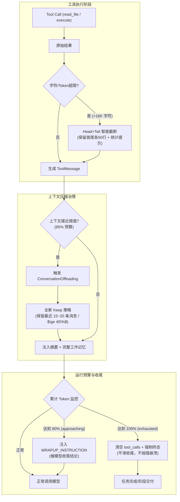

# 智能体上下文窗口治理与 Token 预算韧性优化 - 整体方案

## 背景
在 Agent 执行复杂多步骤开发任务时，出现了以下链式异常：
1. **频繁触发整理上下文**：运行 2~3 步即触发“正在整理上下文”；
2. **震荡失忆死循环**：当前中间件采用 `trigger = 85% input_budget`，但 `keep` 却极其激进地设为 `10% input_budget`（仅约 5,400 tokens）。Agent 前脚刚通过 `read_file` 获得的工作记忆被瞬间抹杀，后脚只能被迫重新调工具读取文件，短时间内再次打爆上下文；
3. **全局 Token 预算耗尽猝死**：在死循环下，每次模型调用都携带 ~40K tokens，走 20 步直接耗尽 100 万 token 预算，触发硬中断报错红条（`本次执行因Token额度停止`）。

## 目标
1. **打破压缩震荡**：重构上下文修剪策略，压缩时保留充足的短期记忆（如最近 15~20 条消息或 $\ge 40\%$ 上下文），使 Agent 不至于失忆重读；
2. **前置工具输出防爆**：为 `read_file`、`execute` 等工具的输出设置行数/字符硬防护（首尾截断保留 + 诊断提示），防止单步把上下文填满；
3. **Token 超限平滑收尾**：借鉴 DeerFlow 机制，当 Run Token 预算耗尽时，清空 `tool_calls` 并由模型基于现有信息做最终结论，保留已执行产物，正常交付而不是抛错崩溃；
4. **澄清平台配置面**：确认平台侧模型目录已有 `context_window_tokens` 编辑入口，梳理新建时默认值的设定，并在 runtime 提供稳妥的保底推断。

## 方案设计

### 整体架构



### 关键改动点

#### 1. 上下文保留策略重构（摒弃 keep = 10%）
- **文件：** `apps/runtime-service/src/runtime_service/middlewares/conversation_offloading.py`
- **改动：**
  - 将 `keep` 参数从死板的 `("tokens", math.floor(0.10 * self.input_budget))` 升级为支持按消息条数或安全比例保留：
    优先保留最近 N 条完整消息（推荐默认 `("messages", 16)` 或 `("tokens", math.floor(0.40 * self.input_budget))`）。
  - 避免将当前轮次的 ToolCall 和 ToolMessage 对拆散，确保 Agent 的当前行动因果链完整。
- **理由：** 10% 仅约 5,400 tokens，甚至装不下一两次工具调用的历史，导致 Agent 必然重读重做。

#### 2. 工具输出前置防爆机制（Head + Tail Truncation）
- **文件：**
  - `apps/runtime-service/src/runtime_service/middlewares/filesystem.py`
  - 新增/完善 `apps/runtime-service/src/runtime_service/middlewares/tool_output_budget.py`
- **改动：**
  - 在工具返回生成 `ToolMessage` 前拦截大文本（如超过 16,000 字符或约 4,000 tokens）；
  - 保留前 50 行（便于看结构）和后 50 行（便于看最新日志/输出），中间插入：
    `\n\n[... 已截断中间 {truncated_lines} 行 ({truncated_chars} 字符)。若需查看指定片段请使用行范围参数 read_file ...]\n\n`；
  - 阻断一次 `read_file` 直接吞噬 20,000+ tokens 的隐患。
- **理由：** 借鉴 DeerFlow 和 Open-SWE，Agent 不需要一次性在上下文里吃进几万字，行截断是防止上下文雪崩的第一道防线。

#### 3. Token 超限优雅停机（Graceful Hard-Stop）
- **文件：**
  - `apps/runtime-service/src/runtime_service/middlewares/token_budget.py`
  - `apps/runtime-service/src/runtime_service/runtime/token_budget.py`
- **改动：**
  - 在 `RunTokenBudget.check()` 返回 `exhausted` 时，不再由 `TokenBudgetMiddleware` 抛出 `TokenBudgetExceededError` 导致链路 Crash；
  - 改为在 `wrap_model_call` 或 `after_model` 处：
    1. 若模型返回了 `tool_calls`，将其清空；
    2. 追加提示文本：`"本次任务已达 Token 预算上限，已基于已有信息完成总结与交付。"`；
    3. 引导 LangGraph 正常流向 `END`，保留已生成的文件和思考成果；
    4. 前端状态栏显示平滑的完成态或提示态，而非阻断式红条。
- **理由：** 用户需要的是“模型做到哪、汇报到哪、成果保留”，而不是“进程崩溃、抛出未捕获异常、什么都没留下”。

#### 4. 模型目录配置与保底值对齐
- **文件：**
  - `apps/platform-api/src/platform_api/modules/runtime_catalog/application/service.py`
  - `apps/runtime-service/src/runtime_service/runtime/modeling.py`
- **改动：**
  - 验证前端已有 `context_window_tokens` 的编辑入口；
  - 完善后台对 DeepSeek 等常见大模型的默认容量推断（例如 DeepSeek 在无配置时识别为 64K 或 128K 规范值，避免写小）。
- **理由：** 确保基础容量与模型实际能力一致，不给上下文预算设人为的过低天花板。

## 链路影响

### 受影响的调用链路
```
Agent Execution Loop
  → Tool Call Execution (前置防爆截断)
  → ConversationOffloadingMiddleware (平滑保留最近上下文)
  → TokenBudgetMiddleware (80% 收尾提示, 100% 优雅终态)
  → Web UI (展示状态变更)
```

### 契约变更
- **Runtime Internal Contract**：`TokenBudgetMiddleware` 在额度耗尽时从抛异常模式改为 Graceful Command / Message 模式，不影响外部 HTTP 契约，提升运行稳健性。

## 风险和依赖
- **风险 1：** 工具输出被截断后，Agent 若真需要中间内容怎么办？
  - **应对：** 截断提示中明确告知原始行数和字符数，提示 Agent 使用 `offset` / `limit` 或指定行号按需分页读取。
- **风险 2：** 保留最近 16 条消息是否会导致仍然接近上限？
  - **应对：** 结合动态计算，`keep` 设为 `min(messages=16, 40% input_budget)`，双重保险。

## 实施计划
1. **Phase 1: 策略与工具防爆（runtime-service）**：
   重构 `ConversationOffloadingMiddleware` 的 `keep` 参数与裁剪策略，实现工具输出前置截断中间件。
2. **Phase 2: Token 预算优雅结束（runtime-service）**：
   改造 `TokenBudgetMiddleware`，实现耗尽时优雅清空 tool_calls 与总结输出。
3. **Phase 3: 模型配置与数据对齐**：
   核对并调整数据库中模型上下文窗口（`context_window_tokens`），补齐新建场景的默认逻辑。
4. **Phase 4: 全量回归与 E2E 验证**：
   运行单元测试，启动 Agent 跑实际长上下文、多工具测试，确认不再频繁整理且无报错红条。
