# 架构与技术实现方案 (plan.md)

> **项目名称：** 全栈大模型监控告警与统一消息推送中心 (Alert & Notification Center)
> **所属仓库：** `ai-agent-platform`
> **状态：** 方案规划待评审

---

## 1. 目标与非目标 (Goals & Non-Goals)

### 目标 (Goals)
1. **统一通知分发引擎**：在 `ai-agent-platform` 内部建立通用通知模块 `modules/notifications/`，基于 `Apprise` 实现多渠道分发能力（飞书、钉钉、企微、邮件、站内信）；
2. **飞书交互卡片 (Feishu Interactive Card)**：提供原生轻量 JSON 模板渲染器，发送带有彩色状态栏、富文本摘要与快速跳转按钮（查看 Run / 查看 Trace）的高颜值卡片；
3. **通用告警接入网关**：暴露安全鉴权的 `POST /api/v1/alerts/incoming` 接口，接收来自 `mlflow-eval-platform`、`LightRAG` 或外部监控的告警事件；
4. **告警治理与防抖收敛**：实现基于 `(source, alert_type, target_id)` 维度的滑动窗口去重与聚合计数，彻底根除告警风暴；实现自愈恢复（Auto-Resolve）通知；
5. **用户级与项目级通道配置**：支持在平台管理后台配置全局/项目级 Webhook 地址、白名单与通知触发开关；
6. **前端通知体验**：在 `platform-web` 导航栏增加通知“小铃铛”，展示未读红点、下拉通知抽屉、一键已读与跨页面快速定位。

### 非目标 (Non-Goals)
1. **不引入重型基础设施**：坚决不部署 Novu / MongoDB / Alertmanager 集群，依赖纯 Python 与现有 PostgreSQL；
2. **不搞拖拽式复杂流引擎**：只关注精准的事件分发与规则匹配，不做 BPMN/拖拽工作流；
3. **不对 MLflow 源码做任何侵入**：`mlflow-eval-platform` 仅通过外挂脚本或现有 Webhooks 机制发起 HTTP 回调，官方核心源码 0 侵入。

---

## 2. 总体架构与数据流图

```mermaid
flowchart TD
    subgraph Producers ["跨平台事件源 (Producers)"]
        P1["Agent 运行时<br/>(死循环 / 预算耗尽 / 崩溃)"] --> |内部服务调用| GW
        P2["后台长任务<br/>(Background Tasks 完成/失败)"] --> |内部服务调用| GW
        P3["mlflow-eval-platform<br/>(网关 429 / 预算超限 / 评测退化)"] --> |HTTP Webhook| GW
        P4["LightRAG<br/>(文档抽取崩溃 / 索引 OOM)"] --> |HTTP Webhook| GW
    end

    subgraph Hub ["ai-agent-platform 消息与告警中枢"]
        GW["1. 统一接入网关<br/>(POST /api/v1/alerts/incoming)"] --> Auth["鉴权校验与验签<br/>(HMAC / Bearer Token)"]
        Auth --> Gov["2. 告警治理引擎 (Governance)<br/>• 指纹生成 (Fingerprint)<br/>• 滑动窗口去重 (Cooldown)<br/>• 告警风暴抑制 (Throttling)"]

        Gov --> Store[("3. PostgreSQL 持久化<br/>• notifications (通知记录)<br/>• alert_events (告警事件流水)<br/>• notification_channels (渠道配置)")]

        Gov --> Router["4. 渠道路由分发器 (Dispatcher)"]

        Router --> C_Apprise["Apprise 引擎<br/>(邮件 / 钉钉 / 企微 / Telegram)"]
        Router --> C_Feishu["飞书原生卡片渲染器<br/>(Feishu Interactive Card)"]
        Router --> C_InApp["站内信推送器<br/>(PostgreSQL + SSE/WebSocket)"]
    end

    subgraph Channels ["触达终端 (Consumers)"]
        C_Apprise --> R1["运维邮箱 / 监控群"]
        C_Feishu --> R2["飞书群机器人 (带快捷操作按钮)"]
        C_InApp --> R3["前端工作台顶部通知抽屉"]
    end
```



---

## 3. 核心数据模型设计 (PostgreSQL Schema)

在 `apps/platform-api/src/platform_api/modules/notifications/models.py` 中定义以下核心表：

```sql
-- 1. 渠道配置表：记录项目或全局启用的通知方式
CREATE TABLE notification_channels (
    id VARCHAR(64) PRIMARY KEY,
    name VARCHAR(128) NOT NULL,
    project_id VARCHAR(64) NULL,               -- NULL 表示系统全局渠道，否则为项目专属
    channel_type VARCHAR(32) NOT NULL,         -- 'feishu', 'dingtalk', 'wechat', 'email', 'webhook'
    endpoint_url TEXT NOT NULL,                -- Webhook URL 或 Apprise URL (如 mailto://...)
    secret_token VARCHAR(256) NULL,            -- 签名密钥（如飞书防伪校验签名）
    is_enabled BOOLEAN NOT NULL DEFAULT TRUE,
    subscribed_events JSONB NOT NULL DEFAULT '["agent_error", "budget_exceeded", "eval_degraded"]'::jsonb,
    created_at TIMESTAMPTZ NOT NULL DEFAULT NOW(),
    updated_at TIMESTAMPTZ NOT NULL DEFAULT NOW()
);

-- 2. 站内信与通知记录表：用户或系统收件箱
CREATE TABLE notifications (
    id VARCHAR(64) PRIMARY KEY,
    recipient_user_id VARCHAR(64) NULL,        -- 接收人，NULL 表示全员或运维广播
    project_id VARCHAR(64) NULL,
    title VARCHAR(256) NOT NULL,
    content TEXT NOT NULL,
    level VARCHAR(16) NOT NULL DEFAULT 'info', -- 'info', 'warning', 'error', 'critical'
    category VARCHAR(32) NOT NULL,             -- 'agent_run', 'budget', 'eval', 'system'
    status VARCHAR(16) NOT NULL DEFAULT 'unread', -- 'unread', 'read', 'archived'
    action_url VARCHAR(512) NULL,              -- 关联跳转地址（如 /#/chat?thread_id=xxx）
    metadata JSONB NOT NULL DEFAULT '{}'::jsonb,
    created_at TIMESTAMPTZ NOT NULL DEFAULT NOW(),
    read_at TIMESTAMPTZ NULL
);

-- 3. 告警事件流水与去重防抖表
CREATE TABLE alert_events (
    id VARCHAR(64) PRIMARY KEY,
    fingerprint VARCHAR(64) NOT NULL,          -- 告警指纹: sha256(source + alert_type + target_id)
    source VARCHAR(32) NOT NULL,               -- 'agent_runtime', 'mlflow_eval', 'lightrag', 'gateway'
    alert_type VARCHAR(64) NOT NULL,           -- 'tool_loop', 'quota_429', 'eval_score_drop'
    target_id VARCHAR(128) NOT NULL,           -- 具体的模型名、Run ID 或评测集名称
    level VARCHAR(16) NOT NULL,                -- 'warning', 'critical'
    summary VARCHAR(512) NOT NULL,
    details JSONB NOT NULL DEFAULT '{}'::jsonb,
    occurrence_count INT NOT NULL DEFAULT 1,   -- 抑制期间聚合的触发次数
    first_seen_at TIMESTAMPTZ NOT NULL DEFAULT NOW(),
    last_seen_at TIMESTAMPTZ NOT NULL DEFAULT NOW(),
    resolved_at TIMESTAMPTZ NULL               -- 恢复时间，NULL 表示活跃告警
);

CREATE INDEX idx_alert_events_fingerprint ON alert_events(fingerprint, resolved_at);
CREATE INDEX idx_notifications_recipient ON notifications(recipient_user_id, status, created_at DESC);
```

---

## 4. 告警治理与防抖降噪算法

为了防止模型供应商断网或 Agent 死循环在 1 分钟内推送几千条消息造成“告警风暴”，设计轻量滑动窗口防抖机制：

```text
告警事件进入 (source, alert_type, target_id)
       │
       ▼
计算告警指纹: fingerprint = md5(source + alert_type + target_id)
       │
       ▼
查询内存 LRU 缓存 / DB 最近未解决的 alert_events
       │
   ┌───┴───────────────────────────────┐
   │ 命中正在冷却期 (如 5 分钟内)        │ 未命中或已超出冷却期
   ▼                                   ▼
累加 occurrence_count += 1             创建新告警事件，记录 first_seen_at
更新 last_seen_at                      立即触发多渠道分发 (飞书/邮件/站内信)
抑制本次外部消息推送 (静默防刷屏)        开启 5 分钟冷却窗口 (Cooldown Window)
   │                                   │
   └───────────────────────────────────┘
```

**自动恢复通知 (Auto-Resolve Notification)：**
当一个处于 `critical` 状态的告警在连续 10 分钟内未再触发，且收到心跳或正常探活响应时，系统自动发送一条恢复通知：
> 🟢 **【已恢复】DeepSeek 网关端点调用恢复正常**
> 故障持续时间：12 分 34 秒，累计拦截失败请求 48 次。

---

## 5. 飞书富文本交互卡片规范

针对飞书 Webhook 机器人，构建标准交互卡片 JSON Schema：

```json
{
  "msg_type": "interactive",
  "card": {
    "header": {
      "title": {
        "tag": "plain_text",
        "content": "🚨 [P1 严重] Agent 执行死循环拦截告警"
      },
      "template": "red"
    },
    "elements": [
      {
        "tag": "div",
        "fields": [
          { "is_short": true, "text": { "tag": "lark_md", "content": "**项目：** 智能客服生产助手" } },
          { "is_short": true, "text": { "tag": "lark_md", "content": "**触发者：** 李佳欣 (Admin)" } },
          { "is_short": true, "text": { "tag": "lark_md", "content": "**Agent 标识：** `dearflow_agent`" } },
          { "is_short": true, "text": { "tag": "lark_md", "content": "**拦截原因：** 连续 5 次重复调用 search_tool" } }
        ]
      },
      {
        "tag": "hr"
      },
      {
        "tag": "action",
        "actions": [
          {
            "tag": "button",
            "text": { "tag": "plain_text", "content": "🔍 查看详细执行 Trace" },
            "type": "primary",
            "url": "http://localhost:3000/#/chat?thread_id=th_123456"
          },
          {
            "tag": "button",
            "text": { "tag": "plain_text", "content": "📊 前往评测大盘" },
            "type": "default",
            "url": "http://localhost:9128/#/experiments"
          }
        ]
      }
    ]
  }
}
```

---

## 6. 接口设计契约 (API Contracts)

### 1. 外部通用告警接收接口
- **端点：** `POST /api/v1/alerts/incoming`
- **鉴权：** Header `X-Platform-Webhook-Token: <secret_token>` 或 Bearer Token
- **请求体：**
```json
{
  "source": "mlflow_eval",
  "alert_type": "eval_score_drop",
  "level": "warning",
  "summary": "金融问答评测集准确率环比下降 8.5%",
  "target_id": "dataset_finance_v3",
  "project_id": "proj_default",
  "details": {
    "previous_score": 0.92,
    "current_score": 0.835,
    "run_id": "run_abc123",
    "experiment_id": "exp_888"
  },
  "action_url": "http://49.233.222.54:9128/#/experiments/exp_888"
}
```

### 2. 站内信查询与状态变更接口
- `GET /api/v1/notifications`：获取当前登录用户的通知列表（支持分页、`status=unread` 筛选）；
- `GET /api/v1/notifications/unread-count`：获取当前用户未读消息总数（用于导航栏红点 Badge）；
- `PATCH /api/v1/notifications/{id}/read`：标记单条为已读；
- `POST /api/v1/notifications/mark-all-read`：一键全部已读。

### 3. 通知渠道管理接口
- `GET /api/v1/notifications/channels`：获取渠道列表；
- `POST /api/v1/notifications/channels`：新增飞书/邮件/钉钉渠道；
- `POST /api/v1/notifications/channels/{id}/test`：渠道连通性测试（发送一条测试卡片验证）。

---

## 7. 风险评估与安全边界

1. **凭证脱敏与安全传输**：
   - Webhook Secret 与邮件密码等凭据必须通过已有加密套件保存，日志严禁打印任何 Webhook Token 或外部 API Key；
2. **网络超时隔离（Circuit Breaker）**：
   - 外部推送（Apprise/飞书 HTTP 调用）必须全部在 `asyncio` 后台任务或独立队列中执行，并设定 3 秒硬超时，严禁外部网络卡死阻塞主业务线程；
3. **上游 0 侵入合规**：
   - 涉及 `mlflow-eval-platform` 的改动只在外挂代码包 `eval_platform/` 下增加轻量 webhook 发送钩子，坚决不修改任何官方 `mlflow/` 代码。
