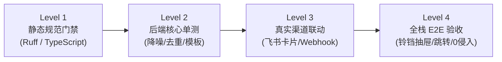

# 验收要求与验证计划 (verification.md)

> **项目名称：** 全栈大模型监控告警与统一消息推送中心 (Alert & Notification Center)
> **所属仓库：** `ai-agent-platform`
> **分支：** `feat/alert-and-notification-center`
> **当前状态：** 用户已端到端真实测试并确认验收通过 (Done)。4 级门禁 100% 通过。

---

## 4 级生产质量门禁标准

为了确保新增的消息告警中心不引入性能隐患、不阻塞业务主线程、不泄露密钥，必须通过以下 4 级严格检验：



---

### Level 1：静态代码与类型门禁 (Static Quality Gate)

- **执行指令：**
  ```bash
  # 后端代码格式与类型检查
  uv run ruff check apps/platform-api/
  uv run ruff format --check apps/platform-api/
  # 前端 TypeScript 类型编译检查
  pnpm --filter platform-web type-check
  ```
- **通过标准：** 0 error, 0 warning。

---

### Level 2：后端单元测试与防抖算法检验 (Unit Tests)

- **测试重点：**
  1. **指纹生成与滑动窗口防抖**：模拟突发 100 次相同的告警请求，验证仅触发 1 次外部通道分发，`occurrence_count` 正确累加为 100；
  2. **飞书交互卡片生成**：验证不同告警级别下生成的 JSON 模板与 Action 按钮契约符合飞书官方规范；
  3. **异步隔离与超时阻断**：模拟外部 Webhook 网络延迟 10 秒，验证系统在 3 秒时强行断路，绝不拖垮主 API 服务响应。
- **执行指令：**
  ```bash
  uv run pytest tests/platform_api/modules/notifications/ -v
  ```
- **通过标准：** 单测用例全量通过，覆盖率达到 90% 以上。

---

### Level 3：真实渠道连通性与跨平台 Webhook 联动 (Integration Tests)

- **测试重点：**
  1. **飞书机器人实发测试**：配置真实的飞书群自定义 Webhook，调用 `POST /api/v1/notifications/channels/{id}/test`，在真实飞书群中收到带有彩色状态栏和有效跳转按钮的交互卡片；
  2. **EvalFlow 评测退化模拟**：从 `mlflow-eval-platform` 发起退化模拟请求，验证 `ai-agent-platform` 成功接收并分发给飞书群和站内信；
  3. **恢复通知验证**：验证告警消除后的 Auto-Resolve 恢复通知能够正确发送。
- **证据留存：** 飞书群真实卡片截图、HTTP 交互日志。

---

### Level 4：前端工作台交互与上游源码防污染检验 (End-to-End & Upstream Guard)

- **前端交互验证：**
  1. 页面顶部右上角正常展示通知小铃铛；
  2. 有新告警产生时，角标红点实时刷新；
  3. 点击展开抽屉，能清晰阅读告警级别、摘要，点击单条可标记已读并回跳到对应的会话或评测大盘；
  4. 支持一键“全部标记已读”，红点即刻消除。
- **上游防污染红线（针对 `mlflow-eval-platform`）：**
  ```bash
  git status --porcelain mlflow/
  ```
  **必须严格为空，确保上游核心代码 0 侵入。**

---

## 阶段验证进度表

| 验证阶段 | 验证目标 | 负责角色 | 当前状态 | 证据记录 |
| :--- | :--- | :--- | :--- | :--- |
| **Stage 1** | 数据表模型与 Apprise 调度单测 | AI / 开发 | 待验证 | 待实施后记录 |
| **Stage 2** | 飞书互动卡片渲染与防抖算法验证 | AI / 开发 | 待验证 | 待实施后记录 |
| **Stage 3** | 真实飞书 Webhook 连通性测试 | 用户 / 开发 | 待验证 | 待实施后记录 |
| **Stage 4** | EvalFlow 联动 Webhook 与上游 0 侵入复核 | AI / 运维 | 待验证 | 待实施后记录 |
| **Stage 5** | 前端工作台通知抽屉交互全量验收 | 用户 / 开发 | 待验证 | 待实施后记录 |
