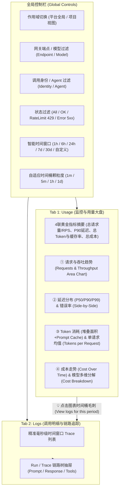

# AI 网关使用看板与综合可观测重构

> **项目状态：** 已完成（done）。全部 5 个原子任务实施完毕，前后端单测 100% 跑绿，构建 0 错误通过。
> **启动日期：** 2026-11-17
> **完成日期：** 2026-11-18
> **责任服务：** `platform-web`、`platform-api`、`runtime-service`
> **关联分支：** `feat/gateway-usage-observability` (Worktree: `gateway-observability-usage`)

---

## 业务背景与用户价值

当前 AI Agent 平台仅提供基础的“Token 看板”，从产品定义和交互逻辑上更偏向离线“财务出纳账单”，存在严重的运维与治理盲区：
1. **指标单一，缺乏网关黄金三要素**：只记录 Token 消耗与美元折算，无法感知吞吐量（RPS）、调用响应延迟分布（P50/P90/P99）以及错误率（如 429 限流、500 异常），模型供应商出现故障或限流时运维毫无感知。
2. **缺乏单请求体感与缓存洞察**：没有“单请求平均 Token 消耗（Tokens per Request）”指标，难以发现 Agent 上下文无限膨胀或大文件读取死循环；Prompt Caching（缓存读写）指标被埋没，无法直观展现缓存带来的成本与延迟红利。
3. **图表与日志深度割裂，无法排障**：现有手搓 SVG 柱状图无法缩放和交互，看到异常突发尖刺（Spike）后，用户必须人工记下时间、手动切筛选器，并在底部受限的分页表格中大海捞针。

本项目深度对标评测项目 `mlflow-eval-platform` 的 AI 网关使用情况（Gateway Usage），重构当前页面的信息架构与可视化体系，打造**“宏观指标洞察 + 微观毫秒级穿透（Overview-to-Trace Drilldown）”**的企业级 AI 网关可观测中心。

---

## 核心设计与对标能力

1. **黄金三要素看板**：吞吐趋势全宽置顶，并排展示 P50/P90/P99 延迟曲线与错误率柱状图。
2. **Tokens per Request 照妖镜**：单次请求 Token 均值与分布，成为侦测 Agent 上下文异常膨胀的杀手锏。
3. **Prompt Cache 效能高亮**：将缓存读写（Cache Read / Cache Write）作为独立面积/虚线并列呈现，直观反映降本增效成果。
4. **图表到日志毫秒级穿透**：悬停图表任意毛刺点击“查看此区间的调用日志”，一键切换至 Logs 标签页，并自动锁定起止毫秒时间与筛选条件，闭环排障。
5. **专业可视化基建**：彻底淘汰手写原生 SVG，在 `platform-web` 引入成熟轻量图表库，实现深浅主题自适应、平滑动画与图例高亮联动。

---

## 导航与文档索引

- [方案与架构设计 (plan.md)](file:///Users/lijiaxin/.codex/worktrees/gateway-observability-usage/ai-agent-platform/docs/projects/20261117-gateway-observability-usage/plan.md)：业务背景、架构方案、API 契约、前端组件解耦与非功能边界。
- [实施任务进度 (tasks.md)](file:///Users/lijiaxin/.codex/worktrees/gateway-observability-usage/ai-agent-platform/docs/projects/20261117-gateway-observability-usage/tasks.md)：各阶段原子任务分解、执行状态与验收依据。
- [验证规范与方案 (verification.md)](file:///Users/lijiaxin/.codex/worktrees/gateway-observability-usage/ai-agent-platform/docs/projects/20261117-gateway-observability-usage/verification.md)：单测、集成测试、时间桶边界与端到端真实场景验收标准。

---

## 当前进展与项目总结

- **当前进展**：已完成全部任务实施（Task 1 后端网关时序契约与聚合、Task 2 ECharts 专业组件群解耦、Task 3 智能时间控制栏与 Usage 看板、Task 4 图表到 Logs 毫秒级下钻穿透、Task 5 全链路集成回归）。
- **验证成果**：
  - 前端 5 个测试套件共 33 项用例全部通过，`pnpm typecheck` 0 错误，生产构建 24.52s 成功。
  - 后端 Platform API（30 项用例）与 Runtime Service（25 项用例）单测 100% 跑绿。
  - 成功修复了历史治理 Tab 潜在空指针缺陷，确保无论是否有调用数据系统皆稳如磐石。
