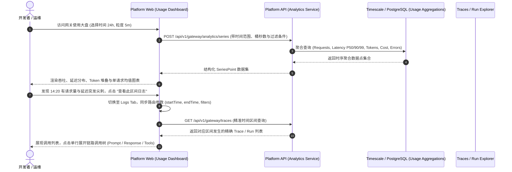

# AI 网关使用看板与综合可观测重构方案

## 1. 目标与业务价值

本项目旨在将原有的单薄“Token 财务看板”全面升级为符合现代企业级标准的**“AI 网关使用情况与综合可观测大盘（AI Gateway Observability & Usage）”**。

### 核心改进目标：
1. **构建网关三要素可观测能力**：实时掌握请求吞吐（Requests / RPS）、延迟分位数（P50/P90/P99）与错误率（429 限流 / 500 异常），保障线上高可用。
2. **落地单请求体感（Tokens per Request）与 Prompt Cache 效能**：监控 Agent 上下文是否失控膨胀，直观展示缓存命中与成本节省。
3. **实现图表到日志的秒级下钻穿透（Overview-to-Trace Drilldown）**：告别割裂查数，点击时间桶毛刺一键锁定对应 Trace 日志。
4. **提升前端可视化工业质感**：淘汰脆弱的手搓 SVG，引入标准图表库，实现丝滑动画、深浅模式自适应与图例联动。

---

## 2. 对标解构：`mlflow-eval-platform` 的核心经验

通过深度剖析 `mlflow-eval-platform` 的 `GatewayUsagePage.tsx` 与 `GatewayChartsPanel.tsx`，提炼出以下核心落地范式：

| 模块 | `mlflow-eval-platform` 优秀实践 | 本平台重构映射 |
| :--- | :--- | :--- |
| **页面骨架** | 双 Tab 结构（Usage 宏观图表 + Logs 链路日志） | 统一收拢为 Usage 监控大盘与 Logs 请求日志两层视图，消除沉重冗余的底部静态表格 |
| **筛选控制** | Endpoint + User + Status + 动态时间窗口与时间桶粒度 | 顶栏提供作用域（平台/项目）+ 模型端点 + Agent/用户 + 状态 + 智能时间选择器（1h/24h/7d/自定义）+ 桶颗粒度（1m/5m/1h/1d） |
| **关键图表** | Requests（全宽）+ Latency/Errors（双列）+ Tokens/TokenStats（双列）+ Cost（双列） | 严格对齐四大看板分区，重点突出单请求均值（Tokens per Request）与 Prompt Caching |
| **下钻联动** | 图表 Tooltip 附带 `View logs for this period` 按钮，毫秒级带参路由 | 图表悬停直接点击下钻，URL 参数同步传递起止毫秒时间戳与过滤标签，瞬间切到 Logs Tab 并自动发起精准查询 |
| **聚合模式** | 后端统一按时间桶（Bucket）返回 SUM、AVG、P50/P90/P99 分布 | 后端 `usage_analytics` 提供标准时序聚合接口，规整返回时序点数组，前端只做纯净渲染 |

---

## 3. 架构设计与系统数据流



---

## 4. API 契约设计

### 4.1 网关时序聚合接口：`POST /api/v1/gateway/analytics/series`

**请求载荷（Request）：**
```json
{
  "scope": "platform",               // or "project", 平台全局或具体项目
  "project_ids": ["uuid..."],        // 可选项目过滤
  "from": "2026-11-17T00:00:00Z",
  "to": "2026-11-17T21:00:00Z",
  "timezone": "Asia/Shanghai",
  "bucket_seconds": 300,             // 聚合桶大小：60, 300, 3600, 86400
  "endpoint_ids": ["deepseek-v4.1-flash"],
  "agent_ids": ["agent-1"],
  "status": "ALL"                    // ALL, SUCCESS, RATE_LIMIT_429, ERROR_5XX
}
```

**响应数据（Response）：**
```json
{
  "summary": {
    "total_requests": 14200,
    "total_tokens": 12500000,
    "total_input_tokens": 8500000,
    "total_output_tokens": 4000000,
    "total_cache_read_tokens": 5200000,
    "total_cache_creation_tokens": 800000,
    "cache_hit_ratio": 0.6117,
    "avg_tokens_per_request": 880.28,
    "p90_latency_ms": 1420.5,
    "error_rate": 0.0035,
    "total_cost_usd": "18.420000000000"
  },
  "series": [
    {
      "timestamp_ms": 1731801600000,
      "time_label": "11/17 08:00",
      "requests": 120,
      "errors": 2,
      "latency_p50_ms": 620.0,
      "latency_p90_ms": 1250.0,
      "latency_p99_ms": 2800.0,
      "tokens": {
        "input_tokens": 80000,
        "output_tokens": 35000,
        "cache_read_tokens": 45000,
        "cache_creation_tokens": 5000,
        "total_tokens": 115000
      },
      "tokens_per_request": 958.3,
      "cost_usd": "0.152000000000"
    }
  ],
  "breakdown": {
    "by_model": [
      { "key": "deepseek-v4.1-flash", "requests": 12000, "tokens": 10500000, "cost_usd": "12.60" },
      { "key": "gpt-4o", "requests": 2200, "tokens": 2000000, "cost_usd": "5.82" }
    ]
  }
}
```

---

## 5. 前端模块与组件架构

在 `apps/platform-web/src/modules/usage/` 进行工业级重构：

```text
apps/platform-web/src/modules/usage/
├── pages/
│   └── GatewayUsagePage.vue         # 顶层页面：双 Tab 切换、URL 参数同步与全局状态
├── components/
│   ├── GatewayFilterToolbar.vue    # 全局过滤栏：作用域、端点、身份、状态、时间跨度与颗粒度
│   ├── GatewaySummaryCards.vue     # 4 联黄金指标摘要（吞吐、P90延迟、Token/缓存率、成本）
│   ├── charts/
│   │   ├── BaseGatewayChart.vue    # ECharts 基础封装（深浅模式、Resize、Tooltip）
│   │   ├── GatewayRequestsChart.vue # ① 请求吞吐趋势（全宽面积图）
│   │   ├── GatewayLatencyChart.vue  # ② 延迟分布与错误率（双列并排）
│   │   ├── GatewayTokenUsageChart.vue # ③ Token 消耗与 Prompt Cache 面积图
│   │   ├── GatewayTokenStatsChart.vue # ③ 单请求 Token 均值（Tokens per Request）
│   │   └── GatewayCostChart.vue     # ④ 成本走势与模型占比切片
│   └── logs/
│       └── GatewayLogsTable.vue     # 精准区间 Logs 列表与 Trace 详情直达
└── composables/
    ├── useGatewayMetrics.ts        # 聚合时序数据请求与缓存管理
    └── useGatewayTimeRange.ts      # 时间窗口与自适应桶计算
```

---

## 6. 范围界定与非目标（KISS / YAGNI 原则）

### 本期实施范围（In-Scope）：
- 改造原 Token 页面，落地双 Tab（Usage 看板 + Logs 日志）交互。
- 引入轻量标准图表库，实现专业面积图、延迟折线图与双列排版。
- 落地 Tokens per Request 均值监控与 Prompt Cache 命中指标。
- 落地图表 Tooltip 一键下钻至 Logs Tab，并自动带入毫秒时间窗口与过滤条件。
- 兼容平台模式与项目模式两种作用域，保持数据安全隔离。

### 明确排除（Out-of-Scope / Non-Goals）：
- 不引入外部重型时序数据库（维持现有 PG 聚合与索引优化，不引入 ClickHouse 等高复杂度基建）。
- 不破坏现有 Trace 数据结构与 W3C traceparent 协议规范。
- 不影响现有单次 Run 的用量抽屉展示（原有 `RunUsage.vue` 继续保留作为终端详情页复用）。

---

## 7. 风险评估与应对策略

| 潜在风险 | 影响程度 | 应对与缓解策略 |
| :--- | :--- | :--- |
| **小颗粒度（1分钟）跨大时间范围导致数据点过多** | 中 | 后端实施最大点数保护（Max Buckets = 500 点），超过时自动降级提升时间桶大小并给出友好提示。 |
| **前端图表库打包体积增加** | 低 | 采用 ECharts 按需引入（仅引入 LineChart, BarChart, GridComponent, TooltipComponent），体积严格控制在合理范围内。 |
| **历史数据中缺失延迟或缓存读字段** | 低 | DTO 设置默认安全兼容值（空数据返回 `null` 或 `0`，图表展示为轻灰虚线），绝不引发前端白屏崩溃。 |
