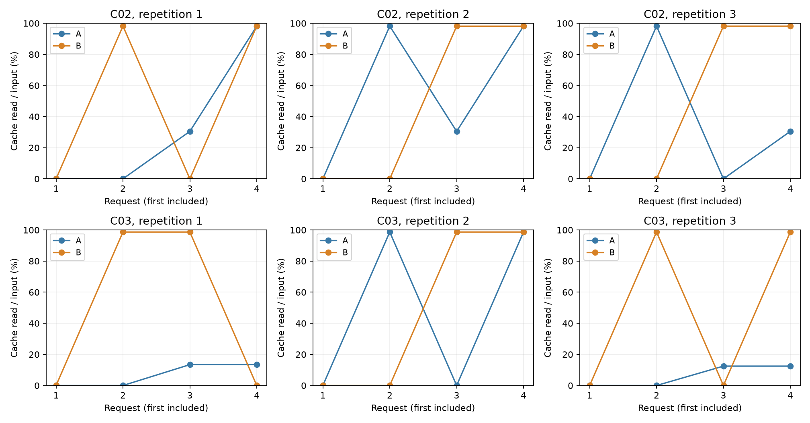
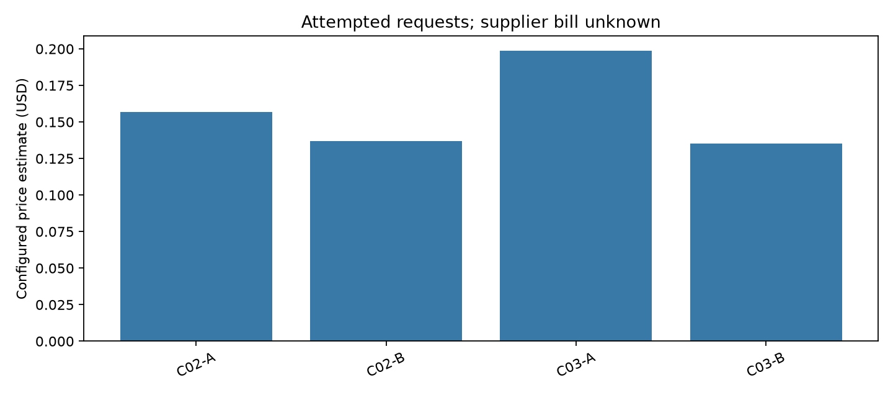
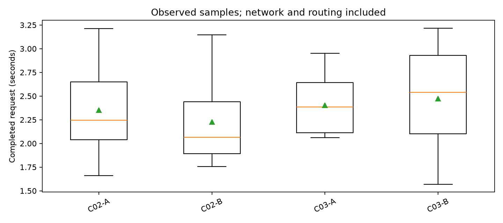
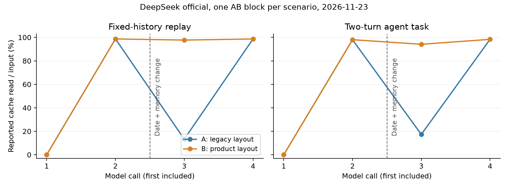
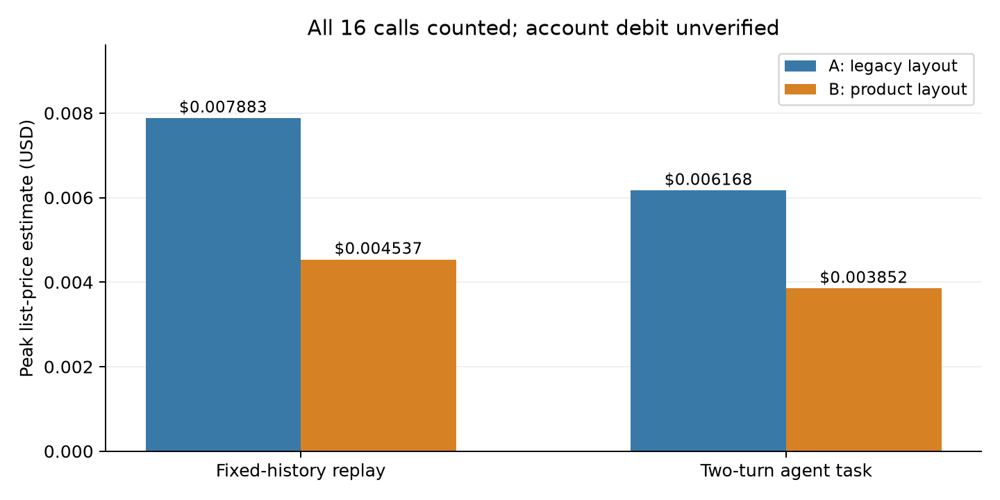
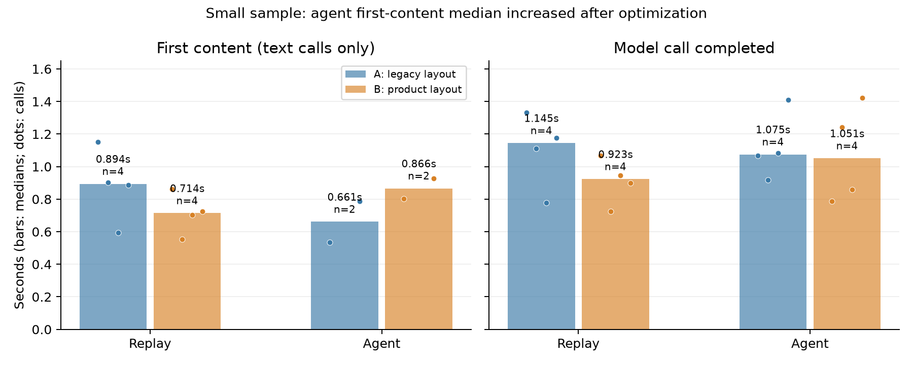
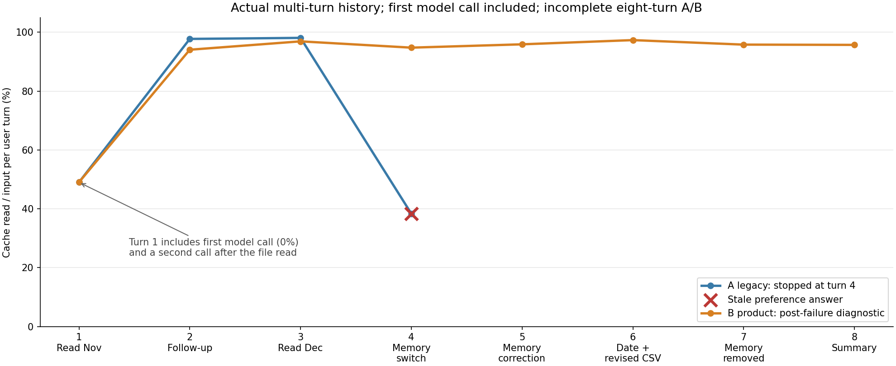

# 一次 DeepSeek Agent 前缀缓存实验：哪些改动真正省钱？

一个多轮 Agent 每次都带着系统规则、历史消息和工具定义去调用模型。于是，一个看起来很合理的判断出现了：记忆和日期放在系统提示词里，经常变化；把它们挪到后面，就能提高缓存、降低费用。

我们在 DearFlow 的实际构图和模型适配链路上做了实验。2026-11-23，通过 Xiaok 的 `deepseek-v4.1-flash` 共发出 97 次真实模型请求，比较当前布局和候选布局，并执行了少量真实读文件任务。

结果有收益，也有反例。固定历史的独立重复实验中，记忆后移的配置价格估算下降 12.55%，日期后移下降 31.97%；但记忆在一次重复中更贵，日期组完成耗时中位数增加了 6.45%。完整日期任务还出现了一个更关键的问题：请求中的日期已经更新，模型却继续回答昨天。

随后，我们在独立 Worktree 实施了临时上下文，并用官方 `deepseek-flash` 再做 16 次小样本对照。固定材料读取比例从 52.66% 到 73.75%，完整两轮任务从 53.63% 到 72.97%；按官方标价估算分别少花 42.45% 和 37.55%。但完整任务首正文中位时间反而增加 31.01%。两条线路、两代候选分开报告，不能混成一个统一优化率。

再追加八轮连续对话，问题变得更具体：旧装配在第 4 轮仍回答历史偏好，按规则停止；观察失败后另行登记的优化组诊断通过八轮，包含首次的读取比例为 87.93%，排除第一次模型调用后为 96.24%。这批共 23 次调用，包含六次检查器误判记录；没有取得完整八轮同质量 A/B 的费用降幅。

因此，这篇文章展示的是一次可复核的实验，不是“生产费用已下降三成”的上线报告。正式服务尚未加载改动，实际扣费未知；Xiaok 的底层路由也仍未知。前半部分保留 97 次首轮实验及失败，后半部分依次说明产品实现、16 次官方小批对照和新增 23 次多轮实验。

## 先分清：我们在测什么

DeepSeek 官方的[上下文缓存文档](https://api-docs.deepseek.com/zh-cn/guides/kv_cache/)用输入前缀匹配解释缓存复用，并说明可从 `prompt_cache_hit_tokens` / `prompt_cache_miss_tokens` 观察用量；文档也提示缓存建立是异步的，不保证每次都命中。这些信息帮助设计实验，不能证明 Xiaok 网关采用了完全相同的缓存实现、部署或价格。

本文的“缓存读取”始终指对应线路实际返回、且能与当前适配器核对的用量字段。没有服务端内部证据时，不声称独立验证了底层 KV 存储实现。

最容易混淆的三个量是：

- **读取比例**：本组累计缓存读取 Token，占同组累计输入 Token 的比例。
- **价格估算**：把实际用量代入冻结价格算出的金额；Xiaok 用本环境目录价，官方批次用当日官方标价。
- **任务质量**：答案、日期、记忆和工具行为是否满足预先登记的断言。

读取比例提高，不自动意味着金额下降；金额下降，也不自动意味着任务更快、答案正确。缓存读取量也不能从模型输入窗口占用中扣除。

## 怎样避免把实验做成“自己证明自己”

先核对改造前代码（基线提交 `6884f10e`）：日期装配在基础系统提示词尾部追加 UTC 日期，记忆中间件在权限允许且召回非空时向系统消息追加记忆；[技能中间件](../../../apps/runtime-service/src/runtime_service/services/dearflow_agent/middleware/skills.py)在读取规范后改变可见工具集合。它们都可能改变公共前缀，但源码本身不能推出“长期零缓存”。日期与记忆的当前产品实现已改变，见后面的追加说明；前文 97 次数据仍是改造前布局与旧回放候选的数据。

实验分两层。

第一层是**固定历史回放**。使用当前 DearFlow 工厂、系统规则、工具 Schema 和中间件，捕获适配完成后的最终 HTTP 请求。A 组保留当前布局；B 组只在独立脚本的出站副本中移动登记的内容块。每轮输入使用预设历史，不把本轮随机生成的答案继续带入下一轮，以减少执行路径差异。

记忆和日期候选都把原内容块移到最新 user 内容的前部，不写入 Checkpoint。这里虽然没有增加事实，但跨消息角色可能改变指令优先级；所以“文本相同”不代表产品语义已经等价，后面必须另外检查质量。

第二层是**进程内完整 Agent 任务**。真实模型决定调用 `read_file`，工具读取真实合成 CSV，两轮共享 Checkpoint 历史。身份、记忆数据源和空 custom/MCP 来源是合成夹具，未覆盖 Platform HTTP 认证、生产 ACL 回调或三服务端到端链路。供应商流先测量再转交本地 SDK，因此计时也不是前端流式体验测试。

所有真实材料均为合成任务和本仓公开规则，没有发送业务私有会话。固定历史实验保持温度 0、流式 usage、输出上限 512 Token、单并发、零自动重试、每请求总期限 120 秒。输出上限不是质量保证，摘要实验就因此暴露了截断限制。

A/B 使用对称的 24 字符实验标记，重复次序固定为 AB、BA、AB。无法清空或核验供应商缓存，所以首次请求不能称为严格冷启动，也不能保证两组后端缓存严格隔离。

## 当前缓存是多少：先给一个有边界的基线

C01 使用同一份较长合成材料，只改变末尾问题。四次请求的输入均为 13,364 Token，缓存读取依次为：

| 请求 | 输入 Token | 缓存读取 Token | 读取比例 |
|---|---:|---:|---:|
| 1 | 13,364 | 0 | 0% |
| 2 | 13,364 | 0 | 0% |
| 3 | 13,364 | 13,184 | 98.65% |
| 4 | 13,364 | 13,184 | 98.65% |
| 合计 | 53,456 | 26,368 | **49.33%** |

这足以否定“这条线路当前完全没有缓存读取”的说法。但 49.33% 只代表这组固定材料、四次调用，既不是生产全部任务的统一基线，也不能拿最后两次的 98.65% 代替整组比例。

本次不混入 2026-10-30 的历史 55.34% 观测。历史任务的材料、质量覆盖和计价条件不同，不能拿它当今天的 A 组。

## 探索实验：记忆后移第一次反而更贵

探索批次覆盖稳定前缀、记忆切换、日期变化、图表工具加载和长上下文，共 32 次请求。单因素 A/B 每组四次，先看合计结果：

| 场景 | A 读取比例 | B 读取比例 | A 估算费用 / USD | B 估算费用 / USD | 观察 |
|---|---:|---:|---:|---:|---|
| C02 记忆后移 | 56.71% | 49.09% | 0.0401286 | 0.0463482 | 费用增加 15.50% |
| C03 日期后移 | 28.03% | 49.35% | 0.0611364 | 0.0453972 | 费用下降 25.74% |
| C04 固定图表工具 | 39.68% | 49.49% | 0.0563367 | 0.0490404 | 费用下降，但候选不等价 |

如果只展示有利的两行，这篇文章会很漂亮，也会误导读者。记忆组的负结果说明，不能只凭“动态内容移到后面”的直觉承诺每次都省钱。未知路由、缓存建立时机、有限样本和输出差异都限制了归因。

C04 也没有入选完整任务。固定暴露增加了总输入：56,781→57,420 Token，并在读取规范之前提前暴露了图表工具。候选被标为 `execution_eligible=False`，只进行请求回放，没有真实执行这些工具。没有补齐并验证等价执行守卫，就不能把它说成可直接采用的优化。

## 独立重复：有合并收益，也保留波动

探索后，我们预先固定 C02、C03 各三次独立重复，每次每组四请求，合计 48 次，不再根据结果追加样本。两组使用相同事实、历史和问题，顺序 AB、BA、AB；探索批次不并入下面的主表。

| 候选 | 组别 | 请求数 | 输入 Token | 缓存读取 Token | 读取比例 | 输出 Token | 配置估算 / USD |
|---|---|---:|---:|---:|---:|---:|---:|
| 记忆 | A 当前 | 12 | 161,158 | 65,024 | 40.35% | 455 | 0.1566846 |
| 记忆 | B 后移 | 12 | 161,154 | 79,104 | 49.09% | 347 | 0.1370226 |
| 日期 | A 当前 | 12 | 160,288 | 33,280 | 20.76% | 562 | 0.1988760 |
| 日期 | B 后移 | 12 | 160,300 | 79,104 | 49.35% | 274 | 0.1353036 |

记忆组提高 **8.74 个百分点**，估算下降 **12.55%**；日期组提高 **28.58 个百分点**，估算下降 **31.97%**。四组预登记的数字/关键词且不调用工具的机械断言均为 12/12，不代表独立人工质量评审。

合并结果不能掩盖重复间的差异：

| 候选 | 重复 | 次序 | A 读取比例 | B 读取比例 | A 估算 / USD | B 估算 / USD |
|---|---:|---|---:|---:|---:|---:|
| 记忆 | 1 | AB | 32.17% | 49.09% | 0.0580530 | 0.0453462 |
| 记忆 | 2 | BA | 56.71% | 49.08% | 0.0404886 | 0.0455982 |
| 记忆 | 3 | AB | 32.17% | 49.09% | 0.0581430 | 0.0460782 |
| 日期 | 1 | AB | 6.71% | 49.35% | 0.0764256 | 0.0456732 |
| 日期 | 2 | BA | 49.35% | 49.35% | 0.0453912 | 0.0447252 |
| 日期 | 3 | AB | 6.23% | 49.35% | 0.0770592 | 0.0449052 |

记忆的第二次重复仍然更贵；日期的第二次重复几乎没有缓存比例差异，少量费用差主要来自输出。三个重复不足以把顺序、路由和缓存建立影响分离，也不支持统计显著或稳定生产收益的承诺。



上图按案例与重复拆开，蓝色 A、橙色 B；每个小图都包含首次请求。曲线出现零值、高值和反转，完整保留。



## 省下的钱，为什么不能全算给缓存

本次读取的模型目录价格版本更新于 2026-11-07：未缓存输入 1.5、缓存读取 0.15、输出 6 USD/百万 Token。仅在本次实际返回的用量结构下，按已有计价函数复算为：

```text
配置估算费用 = [未缓存输入 × 1.5 + 缓存读取 × 0.15 + 输出 × 6] / 1,000,000
未缓存输入 = 总输入 - 缓存读取
```

这不是 Xiaok 实际账单，也不是从 DeepSeek 官方价格直接套过来的结果。本次没有取得可逐请求关联的实扣证据，响应中的 credit/quota 单位也未核实，不能当成美元。

以记忆重复组为例，输入侧估算约少 0.019014 USD，输出侧因 455→347 Token 又少 0.000648 USD，合计少 0.019662 USD。日期组输出也从 562 降为 274 Token。因此，整组估算费用下降不能百分之百归因于输入缓存。温度为零也没有使所有输出完全一致。

读取比例按输入加权计算：`Σ缓存读取 / Σ输入`，不是平均逐请求百分比。字段缺失记未知，不补零；未完成预定请求的整组比例不宣称完整。本次公开数据经协议复算后，97 条记录都有输入、输出和缓存字段；完整任务的质量仍按任务评估，不能把没有逐请求质量分数写成零分。

## 缓存更高，并没有保证更快

| 重复实验 | A 完成耗时中位数 | B 完成耗时中位数 | B 相对变化 |
|---|---:|---:|---:|
| 记忆后移，各 12 请求 | 2.245 秒 | 2.065 秒 | 减少 8.02% |
| 日期后移，各 12 请求 | 2.387 秒 | 2.541 秒 | **增加 6.45%** |

这是模型请求完成耗时，包含网络和网关等待，不是整项 Agent 任务墙钟耗时。思考首字、正文首字、完成时间分别保存；没有对应文本时保持缺失，不把工具调用事件或保活当正文首字。



图中箱体和中位线描述这批观测，绿色三角为均值，须线和离群点保留样本分布。日期 B 的缓存比例更高，却没有更低的完成耗时中位数。仅凭缓存比例推导用户等待时间，在本次数据上行不通。

## 完整任务：日期明明更新了，模型仍回答旧值

日期任务使用两份三行 CSV，预期总和都为 60。第一轮日期为 2026-11-23；第二轮在短时间内模拟为 2026-11-24，重新构图并保留会话历史，不修改机器时钟。

A 组第一轮真实读取文件，总和和日期正确。第二轮也真实读取了新文件，总和仍正确，但回答日期为 **2026-11-23**。复核第二轮两条最终出站请求，其系统消息均明确携带 **2026-11-24**。

这证明当前任务出现了日期时效质量失败，不能简单归结为“程序没更新日期”。按预登记规则，四次模型调用后停止，没有执行 B，也没有换问法重跑到通过。所以这一组不能证明 B 的收益或质量，也不能证明失败由缓存造成。

另一个预登记的组合任务同时要求当前记忆、日期和 CSV 总和。A/B 各两轮、各四次模型调用和两次真实 `read_file`，有限断言均通过：pytest→Vue 话题切换正确、日期更新正确、总和 60。

| 组合任务 | A 当前 | B 记忆与日期后移 |
|---|---:|---:|
| 模型调用数 | 4 | 4 |
| 输入 Token | 40,935 | 40,920 |
| 缓存读取 Token | 12,032 | 20,224 |
| 读取比例 | 29.39% | 49.42% |
| 输出 Token | 280 | 367 |
| 配置估算 / USD | 0.0468393 | 0.0362796 |

组合样本提高 20.03 个百分点，估算下降 22.54%。但每组只有一个完整任务，问法也与日期单项不同；它不能覆盖之前的失败，更不能说明“组合已经修好了日期问题”。

## 长上下文：不要为了缓存取消必要整理

C05 在实际工具结果裁剪中间件中构造长历史。四次请求的真实输入依次为 102,975、132,844、162,713、137,222 Token，读取量为 0、0、132,736、14,848。最后一轮捕获到两条旧工具结果被裁剪。

离线近似输入从 112,688 降到 78,542，仅用于解释本地触发条件。各轮历史长度不同，没有同材料 B 组，因此不能把前后供应商输入差当成裁剪的精确因果收益。

本地目录窗口配置为 131,072 Token，而网关接受了本次更高输入的响应。这是需要保留的配置与观测差异，不能据此反推出实际窗口硬上限，也不能把缓存读取抵扣后再保证不会超窗。

我们还单独构造七份、每份 3,000 行的历史工具结果，触发真实摘要调用，再让主模型回答最新文件中指定记录的 units。摘要输入 4,066、输出 512 Token；主模型输入 75,621、输出 48 Token，答案为 10。两次调用缓存读取均为零，合计配置估算 0.1228905 USD。

辅助摘要不能在统计里消失。这里摘要 `finish_reason=length`，说明触及输出限制；最终一个事实答对，只能证明该事实在这个任务里仍可回答，不能证明摘要整体忠实、其他历史事实都保留或主模型已充分压缩。

## 一个差点把实验带偏的 usage 别名问题

最初 C01 第三次响应同时包含以下字段：

```json
{
  "prompt_tokens": 13362,
  "completion_tokens": 18,
  "total_tokens": 13380,
  "prompt_tokens_details": {"cached_tokens": 13184},
  "prompt_cache_hit_tokens": 13184,
  "cache_read_input_tokens": 0,
  "cache_creation_input_tokens": 0
}
```

在这条 OpenAI 兼容线路中，总输入已经包含缓存。把混合结构直接送入通用归一化，会因为另一协议的别名也存在而重复累加缓存，导致实验解析结果不完整。我们按停止规则保留三条 v1 记录，修正了独立实验工具的协议选择，再开展新批次。

现有正常流式适配器优先使用标准字段，没有出现同样问题，因此不能据此宣称生产看板算错。新工具保留实际字段，与适配器解析交叉核对；标准 `cached_tokens` 与 DeepSeek hit 冲突时判为无效并停止，缺失时保留未知。旧 v1 用新协议复算有明确标注，原停止事实不覆盖。

## 这次可以下什么结论

这条 Xiaok 线路确实报告了前缀缓存读取；“当前完全零命中”不成立。动态记忆、日期和工具集合会改变请求，值得测，但不能直接推出“全部缓存失效”。

把当前有效上下文移到较后位置，在本次固定历史重复组里有降低估算费用的潜力。收益有波动，消息角色语义、任务时效、权限新鲜度和工具前置条件仍是采用门槛。永久冻结首轮个人记忆、强制提前暴露全量工具，都不是这次数据支持的结论。

首轮可交付的是实验工具、结果和文章。后续产品实施与官方小批对照见下文；新组合任务通过仍不能认定旧日期单项失败已被修复，也不能将这 97 次小样本外推成所有模型、所有任务或实际账单的节省率。

## 产品实现：把变化放到当前轮附近

用户批准后，产品实现采用具名的临时上下文：`runtime_date` 携带本次调用的 UTC 日期，`user_memory` 携带本次允许召回的记忆，都放在当前真实用户消息前。静态系统规则说明日期来源，并要求记忆只作事实、不能改变权限、工具或审批。与首轮回放不同，当前实现不再把块拼进用户原文；原始文本、多模态消息和工具结果配对保持，临时块不进入 Checkpoint。

日期改为每次模型调用计算，避免同一个图实例跨天仍沿用构图日期。记忆仍每次召回并在调用前后检查权限；删除、更正、共享或撤权不能被永久快照遮蔽。必要的工具按需加载、历史裁剪和摘要仍保留。

产品没有固定全量工具，也没有冻结首轮个人记忆。图表规范前置、审批、工具拒绝、PII、历史裁剪和摘要仍然保留。当前完成的是对动态日期和记忆位置的改造；后续要提高缓存，也应先找新的前缀变化来源，再做同质量对照。

付费调用前还处理了一个接入差异：框架生成的 system 是纯文本块数组，[官方接口规范](https://api-docs.deepseek.com/api/create-chat-completion/)要求字符串。我们仅在 DeepSeek 的生产适配边界将这些文本块合并，保留原消息与 user 多模态，非文本 system 块则拒绝。A/B 共用相同适配器，重新冻结源码后才调用，没有把这种协议差异当成缓存收益。

## 官方直连：16 次小样本观察到了什么

2026-11-23 09:30:08–09:30:28 UTC，通过官方主机完成 16 次 `deepseek-flash` 调用，零重试、无失败。请求和返回模型一致，16 条响应返回相同的 `system_fingerprint`。当日[官方接入说明](https://api-docs.deepseek.com/)标注该模型由 DeepSeek-V4.1-Flash-1017 提供服务；响应身份与文档版本只作来源记录，不推断内部部署。

每个场景仅一个 AB 块：固定材料 A/B 各四请求；完整任务 A/B 各一个两轮任务、各四次模型调用和两次真实 `read_file`。温度 0、输出上限 512 Token、非思考模式、单并发。前两次使用日期 2026-11-23 和 pytest 记忆，后两次在短时间内模拟 2026-11-24 和 Vue 记忆。

A 在工厂和记忆包装层恢复旧装配，日期变化时重建图并保留会话历史；B 直接使用当前产品中间件，同图跨天。两组共用当前静态语义规则和工具，固定材料的静态文本归一化空白后相同，真实用户历史和工具定义相同，不声称整个请求字节相同。组间仍用对称标记近似隔离，不能清空或证明服务端缓存隔离。

先比较布局对后续复用的影响：每组都按调用顺序排除第 1 次模型请求，后续即使零缓存也保留，不按缓存数值挑样本。

| 场景 | A 后续读取比例 | B 后续读取比例 | 提升 | 样本量 |
|---|---:|---:|---:|---|
| 固定材料 | 70.20% | 98.34% | 28.13 个百分点 | 每组剩 3 次 |
| 完整两轮任务 | 71.17% | 96.82% | 25.65 个百分点 | 每组剩 3 次模型调用 |

这解释了为什么后续接近 97%–98%，而包含首次的整组只有约 73%：每组第一次实际为零，且四次输入量相近，即使后三次全命中，整组乐观上界也约为 75%。这不是供应商可缓存上限或生产稳定率，首次之后也不保证立即完全预热。每组仅剩三个观测，更不能据此承诺长期效果。

再看完整成本：下表保留首次及所有工具循环，费用计算也全部保留，不用排除首次的诊断口径算整项节省。

| 场景与组别 | 模型调用 | 输入 Token | 缓存读取 Token | 加权读取比例 | 输出 Token | 官方标价估算 / USD |
|---|---:|---:|---:|---:|---:|---:|
| 固定材料 A 旧布局 | 4 | 53,966 | 28,416 | 52.66% | 40 | 0.007883496 |
| 固定材料 B 产品优化 | 4 | 53,974 | 39,808 | 73.75% | 40 | 0.004536648 |
| 完整任务 A 旧布局 | 4 | 41,049 | 22,016 | 53.63% | 272 | 0.006168396 |
| 完整任务 B 产品优化 | 4 | 41,045 | 29,952 | 72.97% | 287 | 0.003852012 |

固定材料提高 **21.10 个百分点**，估算费用下降 **42.45%**；完整任务提高 **19.34 个百分点**，估算费用下降 **37.55%**。这些是两个场景各自的组间比较，不把它们合成统一节省率，也不和 Xiaok 比线路优劣。



最值得看的位置是第三次调用，即日期和记忆切换之后。固定材料中，A 读取 1,792 / 13,493 个 Token，B 仍读取 13,184 / 13,495。完整任务同样在切换后出现 A 1,792、B 9,728 个缓存 Token。两组首次都为零，第二次和第四次又都能较多读取缓存。优化的价值是变化发生时保留更多历史前缀，不能把现状描述成“本来没有缓存”。

固定材料的日期与偏好机械检查各 4/4 通过。完整任务两组都真实读取了 10/20/30 与 12/18/30 两份 CSV，算出总和 60，同时正确使用模拟跨天日期及 pytest→Vue 3 + TypeScript 的本轮记忆，未写文件或调用其他工具。完整任务质量按整项任务判断，工具调用请求没有独立最终答案分数。

官方原始 usage、标准 `cached_tokens` 和 SDK metadata 已交叉核对，**16/16 一致**，缓存字段覆盖率为 100%。模拟夹具中“SDK 可能未透传原生字段”的边界仍保留，但这次真实响应没有出现该缺口；不能把可能性写成已发生的采集故障。



官方定价有峰谷时段。两批均在工作日 UTC 峰时窗口，统一按当日[官方峰时标价](https://api-docs.deepseek.com/quick_start/pricing)估算：每百万 Token 未缓存输入 0.30、缓存读取 0.006、输出 1.20 USD。16 次合计 **0.022440552 USD**，实际扣费未知。完整任务 B 多生成的 15 个输出 Token 已计入，费用改善没有只挑输入侧统计。

## 官方缓存提高了，首正文仍可能更慢

| 场景 | A 首正文中位数 | B 首正文中位数 | A 调用完成中位数 | B 调用完成中位数 |
|---|---:|---:|---:|---:|
| 固定材料，各四条 | 894.17 毫秒 | 714.05 毫秒 | 1,144.86 毫秒 | 923.45 毫秒 |
| 完整任务，正文各两条、完成各四条 | 661.03 毫秒 | **866.01 毫秒** | 1,075.08 毫秒 | 1,051.01 毫秒 |

固定材料的完成中位数减少 19.34%，而完整任务仅减少 2.24%；完整任务的首正文中位数反而**增加 31.01%**。无正文的工具调用不补零，也不将工具事件当作首正文。这里是逐模型调用的时间，包含网络与供应商等待，不是整项任务墙钟耗时或前端端到端时间。



180 项本地回归与这 16 次真实模型调用分别验证了代码边界和本次有限任务。每场景只有一个 AB，不能声称统计显著、稳定收益或生产统一缓存率；模拟日期变化没有验证真实隔天缓存 TTL，合成身份/记忆也没有覆盖生产 ACL 或三服务 E2E。旧 Xiaok 日期单项失败、摘要截断继续保留，本轮组合任务通过不能证明它们全部修复。当前产品实现和官方观测支持继续验收这套布局，正式服务尚未部署。

## 多轮对话：缓存很高，当前记忆仍可能答错

两轮任务还不足以观察连续历史的影响。我们继续冻结一个八轮会话：读十一月文件、追问历史子集、读十二月文件、切换偏好、更正偏好、模拟跨天读修订文件、移除记忆、最后汇总。每组正常应有 11 次模型调用、三次真实 `read_file`；保留各自真实回答，不使用预设答案替换历史。

这个实验没有完整跑出两组八轮结果。首先暴露的是检查器问题：第 4 轮询问偏好名称，模型回答 Vue 3，检查器却额外要求 TypeScript。我们修正检查器，保留原六次调用、原停止原因及费用，明确这不是旧记忆失败，另开登记批次。

修正后的 A 组前三轮通过，第 4 轮最终出站 system 已有“前端首选 Vue 3，使用 TypeScript”，模型仍回答：

```json
{"change":15,"growth_pct":25.0,"date":"2026-11-23","preference":"pytest"}
```

数字和日期正确，偏好却停留在历史 pytest。当前记忆已进入请求，不等于模型一定采用。按失败即停规则，A 共六次模型调用后停止，没有执行后四轮或原计划 B；也不能据此认定错误由缓存引起。

为了检查产品布局，我们在明确说明这一失败后，另行预登记 **B 单独诊断**，不重跑 A。B 八轮、11 次调用全部通过，三次实际读取成功；Vue 3→React 更正正确，移除记忆后的两轮均返回 `preference: null`，历史总和 60/75/71、差额 11 和模拟跨天日期均正确。临时上下文没有进入 Checkpoint。

先单独描述 B 的完整八轮：

| 统计口径 | 模型调用数 | 输入 Token | 缓存读取 Token | 读取比例 |
|---|---:|---:|---:|---:|
| 全部调用，含首次 | 11 | 117,472 | 103,296 | **87.93%** |
| 按顺序排除第 1 次模型调用 | 10 | 107,335 | 103,296 | **96.24%** |

首次输入 10,137、缓存读取为零，原始记录保留。我们固定排除每组第一次模型调用来观察后续效率，后续再有零缓存也保留；不是挑出“命中成功”的请求。全部费用仍包含首次、工具循环及失败调用。

A 只完成前四用户轮，不能拿它的费用与 B 八轮直接比较。只看共同的前四用户轮，两组各六次模型调用：

| 指标 | A 旧装配 | B 后置诊断 |
|---|---:|---:|
| 全量读取比例 | 71.80% | 80.45% |
| 排除第一次模型调用后 | 85.74% | 96.06% |
| 质量 | 前三轮通过，第 4 轮旧偏好失败 | 四轮通过 |

共同窗口的后续读取相差 10.33 个百分点，但 B 是观察到 A 失败后追加的诊断，质量也不同。这支持继续研究布局与当前记忆遵从度，不能包装成完整八轮、同质量的省费结论或独立确认性重复。



图中第一用户轮约 49%，因为该轮包含首次零缓存调用及文件读取后的第二次调用；它不代表第一次模型调用已有缓存。A 曲线在第 4 轮停止，红叉标记质量失败，没有补画后四轮。

新增 23 次调用全部为官方 `deepseek-flash`，原生缓存、标准字段和 SDK **23/23 一致**。三批均发生在 2026-11-23 10:36–10:44 UTC，属于当时官方谷时；沿用冻结的统一峰时参考价合计估算 0.016981176 USD，按当时谷时标价估算 **0.008490588 USD**，实扣未知。检查器误判的六次也计入，不与前一批 16 次峰时调用混算优化率。

B 完整八轮首正文中位数约 652 毫秒（8 条），调用完成中位数约 964 毫秒（11 条）；进程内任务执行约 15.95 秒，非前端端到端时间。不能与 A 四轮墙钟时间直接算加速，上一批首正文变慢 31.01% 的反例仍然有效。

本轮输入只从约 10k 增长到 11k Token，静态规则和工具占比大，CSV 很短。八轮单任务不代表长 RAG、大文件历史、高并发或真实隔天缓存 TTL；合成记忆不替代生产 ACL 验收。新增八项离线测试通过，本轮没有继续修改产品中间件。

## 数据与复算

97 次请求分布如下；解析停止和任务失败照样计入费用估算：

| 批次 | 请求数 | 配置估算 / USD | 结果 |
|---|---:|---:|---|
| c01-v1 | 3 | 0.0426666 | 混合 usage 解析停止；新版离线复算 |
| all-v2 | 32 | 0.9504213 | 五案例探索 |
| repeated-v3 | 48 | 0.6278868 | 两候选各三次重复 |
| agent-date-v4 | 4 | 0.0589947 | 日期质量失败，B 未执行 |
| summary-v4 | 2 | 0.1228905 | 单事实正确；摘要截断 |
| agent-combined-v4 | 8 | 0.0831189 | 两组有限断言通过 |
| 合计 | **97** | **1.8859788** | **实际扣费未知** |

公开的[逐请求数据](implementation/evidence/measurements.json)只含用量字段、时间、合成答案、布局摘要、登记及哈希，已去除账号 credit/quota、凭据、头和完整事件。[复算摘要](implementation/evidence/summary.json)可直接核对表格。完整最终请求和 SSE 保留在实验 Worktree 的私有目录，公开数据可复算数值，不等于公开了全部请求证据。

官方小批对照单独提供 [16 条公开用量](implementation/evidence/official-measurements.json)、[官方复算摘要](implementation/evidence/official-summary.json)和[执行细节](implementation/03-official-results.md)。源码和请求哈希见[当前结构证据](implementation/evidence/official-product-layout-check.json)。

多轮追加提供 [23 条公开用量](implementation/evidence/multiturn-measurements.json)、[首次/后续摘要](implementation/evidence/multiturn-summary.json)、[共同前四轮摘要](implementation/evidence/multiturn-common-first-four-summary.json)、[结构证据](implementation/evidence/multiturn-layout-review.json)和[详细结果](implementation/04-multiturn-results.md)。旧 97 条及 16 条均未重写；首批检查器误判、第二批真实旧记忆失败和第三批 B 后置诊断各自保留。

在已安装本项目独立依赖的 Worktree，从仓库根目录运行以下命令，完全离线，不加载连接或调用模型：

```bash
apps/runtime-service/.venv/bin/python apps/runtime-service/scripts/prompt_cache_experiment.py recompute docs/projects/20261123-dearflow-prompt-cache-governance/implementation/evidence/measurements.json

# 官方 16 条单独复算。
apps/runtime-service/.venv/bin/python apps/runtime-service/scripts/prompt_cache_experiment.py recompute docs/projects/20261123-dearflow-prompt-cache-governance/implementation/evidence/official-measurements.json

# 新增 23 条多轮实验，含全量及固定排除首次的双口径。
apps/runtime-service/.venv/bin/python apps/runtime-service/scripts/prompt_cache_multiturn.py analyze docs/projects/20261123-dearflow-prompt-cache-governance/implementation/evidence/multiturn-measurements.json
```

运行与测试细节见[工具及验证说明](implementation/01-experiment-tools-and-results.md)，任务状态与人工审阅边界见[唯一任务进度](tasks.md)和[验证记录](verification.md)。
