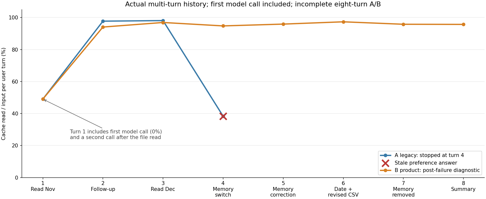

# 官方多轮对话：旧记忆失败与八轮优化组诊断

用户希望在两轮小样本之后，继续观察真实续接历史的多轮任务。本轮增加八个连续用户轮次，让 Agent 三次读取合成 CSV，追问历史数字，并切换、更正和移除当前记忆，再模拟跨天。

结果不是完整八轮 A/B 成功：旧装配 A 在第 4 轮仍回答历史 pytest 偏好，按规则停止。观察到失败后，另行登记的产品组 B 诊断通过八轮、11 次模型调用及三次实际读取；其全量读取比例为 **87.93%**，固定排除第一次模型调用后为 **96.24%**。B 是后置诊断，不能据此计算完整八轮同质量费用降幅，也不能证明所有记忆时效问题已经修复。

唯一任务进度在 [Task 9](../tasks.md#task-9官方八轮连续对话与首次后续双口径对照)，本文件保存方法、偏差、结果及复核入口。旧 97 次 Xiaok、16 次官方数据及负结果保持独立。

## 实验设计与隔离边界

- 官方 `deepseek-flash`，温度 0、非思考、输出上限 512 Token，单并发、零 HTTP 重试。
- A 在工厂及记忆包装层恢复旧装配，B 直接使用已实现的产品中间件；两组使用相同模型适配器、静态规则、工具和合成文件，真实续接各自历史。
- 每组从空历史开始，正常应有 11 次模型调用，最多 20 次；质量、工具边界或用量核对失败即停，不重跑失败组凑成功。
- 凭据仅在本项目执行进程内存使用，未写入文件；各进程结束时已移除并退出。用户可销毁临时凭据，本轮不再调用。
- Worktree 环境 `wt_9b100adcf0ef`，未启动全栈服务。合成身份、记忆与本地文件不覆盖生产 ACL 或三服务端到端验收。

调用前冻结八轮问题、三份文件、数字/日期/偏好断言、源码、模型参数及停止条件。三份文件的 units 分别为 10/20/30、15/25/35、15/21/35，总和为 60、75、71。没有为了提高缓存额外填入无关长文本。

| 用户轮次 | 操作及质量要求 |
|---|---|
| 1 | 读取十一月文件，总和 60；当前日期 2026-11-23、偏好 pytest |
| 2 | 不调用工具，回答历史 B=20、A+B=30 |
| 3 | 读取十二月文件，总和 75，较十一月增加 15 |
| 4 | 当前记忆切换到 Vue 3，回答增长 15、增长百分数 25，并使用当前偏好 |
| 5 | 当前记忆更正为 React，回答十一月 B=20、十二月原始 B=25 |
| 6 | 模拟日期 2026-11-24，读取修订文件，总和 71、修订差额 -4 |
| 7 | 移除当前记忆，偏好必须为 null；历史总和 60、修订总和 71、差额 11 |
| 8 | 汇总 60/75/71、差额 11，日期为 2026-11-24、偏好仍为 null |

移除记忆检查的是“不从历史回答恢复为当前偏好”，不代表擦除了已有对话事实。日期变化在短时间内模拟，未验证真实隔天缓存保留或 TTL。

## 三批执行经过与计划冻结

全部发生在 **2026-11-23 10:36:56–10:44:04 UTC（北京时间 18:36:56–18:44:04）**。本轮共 23 次真实调用，零重试。私有登记与完整请求留在隔离实验目录，公开材料只保留白名单用量、合成答案、动态块摘录和哈希。

| 批次 | UTC 开始–结束 | 模型调用 | 实际结果 |
|---|---|---:|---|
| official-multiturn-v1 | 10:36:56.760610–10:37:07.965074 | 6 | 检查器过严导致停止，不纳入主比较 |
| official-multiturn-v2 | 10:40:14.706208–10:40:24.252297 | 6 | A 第 4 轮旧偏好失败，原定 B 未执行 |
| official-multiturn-v3-diagnostic-b | 10:43:48.420079–10:44:04.454371 | 11 | 失败后追加的 B 单独诊断，八轮通过 |

三个预登记计划的 SHA-256 分别为（使用实验工具的规范化 JSON 序列化后计算，不是带缩进文件的原始字节哈希）：

```text
v1 / plan-v2: d42977dea4298992a52f00b10bdb200a052adac1df6af4f86df3845263797486
v2 / plan-v3: 0b2b38d876a9fd910afdd59e11720395fac8e0438fcd93497f1a093ac6721898
B diagnostic / plan-v4: 986bc3d4d4668296924f9c421b46a2616a7e1697958a2b5f68d272f535bd9991
```

第三批计划及 registration 显式保留 `diagnostic_of`，指向第二批及其失败原因。该诊断沿用第二批实验 nonce、使用 B 的对称隔离标记；没有重跑 A，也没有宣称服务端缓存已清空或严格隔离。它是在看到 A 失败后作出的追加决定，不能当成独立的确认性重复。

### 首批是检查器误判，不是旧记忆失败

第 4 轮问题要求当前偏好名称，首批 A 回答 `preference: "Vue 3"`。原检查器却要求同时出现 TypeScript，超出了题目实际要求。人工核对后将其标为检查器过严，修正判定器只核对被询问的框架名称，并增加测试。

原批次的 `quality_pass=false` 和 `answer_quality_failed` 停止记录没有改写；公开 `validation_note` 解释误判，六次调用及费用全部计入。本批不用于旧记忆失败结论，也不参与共同前四轮主对照。问题和文件没有修改，检查器和冻结脚本版本另行记录。

### 第二批是真实的记忆时效失败

修正检查器后，第二批 A 前三轮通过。第 4 轮的最终出站 system 明确含有：

```xml
<user_memory>
前端首选 Vue 3，使用 TypeScript。
</user_memory>
```

模型实际回答：

```json
{"change":15,"growth_pct":25.0,"date":"2026-11-23","preference":"pytest"}
```

数字和日期正确，偏好仍为历史 pytest。新记忆已进入最终请求，因此不能简单归结为未召回或未注入；现有证据也不能证明错误由缓存造成。六次模型调用后按规则停止，A 第 5–8 轮及原计划 B 没有执行，不填补缺失数据。

### B 后置诊断八轮通过

B 八轮答案均满足预登记的数字、日期和当前偏好断言。Vue 3→React 更正正确，第 7–8 轮返回 `preference: null`，汇总为十一月 60、十二月原始 75、修订 71、差额 11。

三次 `read_file` 均读取成功，只读取当前轮允许的合成路径；没有写文件或执行其他工具。临时日期/记忆未持久化到 Checkpoint。B 完整八轮进程内 Agent 执行耗时约 15.95 秒，含本地接线与工具，不是前端端到端时间；不能与 A 只完成四轮的约 9.49 秒直接比较。

## 首次与后续读取：两个口径都保留

读取比例统一为 `Σ缓存读取 Token / Σ输入 Token`，不平均每次请求的百分比。“排除首次”固定移除每组按顺序的第一次模型调用，而不是删除所有零缓存；第一用户轮可能含工具前后两次调用，因此不等同于排除第一用户轮。整项费用仍包含首次及全部失败调用。

| 范围 | 调用数 | 输入 Token | 缓存读取 Token | 全量读取比例 | 排除第一次模型调用后 |
|---|---:|---:|---:|---:|---:|
| A 第二批，仅完成前四用户轮 | 6 | 62,394 | 44,800 | 71.80% | 85.74%（剩 5 次） |
| B 后置诊断，完整八轮 | 11 | 117,472 | 103,296 | **87.93%** | **96.24%（剩 10 次）** |

这两行任务长度不同，只用于各自描述，不计算八轮提升幅度或费用降幅。B 排除首次后输入为 107,335 Token，缓存读取仍为 103,296 Token；首次输入 10,137、读取 0 的原始记录完整保留。

只取共同前四用户轮，可得到以下**探索性诊断对照**：

| 指标 | A 第二批前四轮 | B 诊断前四轮 |
|---|---:|---:|
| 模型调用数 | 6 | 6 |
| 输入 / 输出 Token | 62,394 / 220 | 62,370 / 222 |
| 缓存读取 Token | 44,800 | 50,176 |
| 全量读取比例 | 71.80% | 80.45% |
| 排除第一次模型调用后 | 85.74% | 96.06% |
| 统一峰时参考价估算 / USD | 0.005811000 | 0.004225656 |
| 首正文中位数，均 4 条 / 毫秒 | 635.19 | 559.55 |
| 调用完成中位数，均 6 条 / 毫秒 | 1,033.61 | 813.94 |
| 质量 | 前三轮通过，第 4 轮旧偏好失败 | 四轮通过 |

共同窗口后续读取相差 10.33 个百分点，但 B 为失败后追加、两组质量不同，不能把表中费用差宣传为同质量收益或完整八轮省费。延迟也仅描述观测，不作因果或稳定性结论。



图中第一用户轮约 49%，因为包含一次读取为零的模型调用及读取文件后的第二次调用，并非首次模型调用已有缓存。A 曲线在第 4 轮结束，红叉是旧偏好质量失败；B 为后置诊断，未补齐 A 后四轮曲线。

## 费用与耗时

冻结计划为比较沿用统一峰时参考价：每百万 Token 未缓存输入 0.30、缓存读取 0.006、输出 1.20 USD。**本轮实际执行在官方谷时**；按当时谷时半价标价另算，不能将峰时参考估算写成谷时实扣。定价依据沿用[上一批官方记录](03-official-results.md)，无可逐请求关联的实际账单。

| 批次 | 输入 / 缓存 / 输出 Token | 统一峰时参考估算 / USD | 当时谷时标价估算 / USD |
|---|---:|---:|---:|
| 检查器误判批次 | 62,360 / 44,800 / 215 | 0.005794800 | 0.002897400 |
| A 真实质量失败批次 | 62,394 / 44,800 / 220 | 0.005811000 | 0.002905500 |
| B 八轮诊断 | 117,472 / 103,296 / 419 | 0.005375376 | 0.002687688 |
| **全部 23 次** | **242,226 / 192,896 / 854** | **0.016981176** | **0.008490588** |

所有首次、工具循环、检查器误判和真实质量失败都在总额中；不使用排除首次后的费用冒充整项费用。23 次谷时估算不与前一批 16 次峰时估算或 Xiaok 目录价合并计算收益，实际扣费仍未知。

B 完整八轮首正文中位数 652.00 毫秒（8 条）、模型调用完成中位数 964.01 毫秒（11 条）。这些逐调用指标包含网络与供应商等待，工具事件不是正文，无正文调用不补零。上一批官方完整两轮任务首正文变慢 31.01% 的反例保持，本批不能将其抹掉。

## 公开证据与验证

- [23 条公开用量与冻结任务](evidence/multiturn-measurements.json)：三批均保留原始缓存字段、SDK 用量、任务答案、停止原因和版本说明。
- [全量及排除首次摘要](evidence/multiturn-summary.json)：由 `analyze` 完全离线复算；B 的 `task_complete=true`，三个批次的 `comparison_complete` 均为 false。
- [共同前四轮摘要](evidence/multiturn-common-first-four-summary.json)：只过滤第二批 A 和第三批 B 的 `conversation_turn < 4`，保留质量与探索性标识。
- [结构与源码证据](evidence/multiturn-layout-review.json)：最终 system 哈希、动态块/临时消息摘录及工具哈希；没有公开完整系统请求或 SSE。
- [新增实验入口](../../../../apps/runtime-service/scripts/prompt_cache_multiturn.py) / [离线测试](../../../../apps/runtime-service/tests/scripts/test_prompt_cache_multiturn.py)。

23 条响应均为 `deepseek-flash`，`system_fingerprint` 均为 `bc19ba97cbe016479903222bb1578db6`。原生缓存、标准 `cached_tokens` 和 SDK 值 **23/23 一致**。23 条公开记录的 552 个允许字段与私有原始记录逐项一致，原登记及任务答案也一致；CLI 与直接调用均复算一致，共同前四轮过滤后再复算一致。旧两个公开用量文件的原始字节 SHA-256 保持：

```text
旧 97 条 Xiaok: 02eaa968d1b8a8b2db55ba1b638b10c28218bfa63085e7639ac8f36b0c5e5f14
旧 16 条官方: 9bd1444602d753143817b340d5307c191fc327ca9e2271d6af326ac3208b6132
新 23 条多轮: de4613d666298565a88093d07769bda57463a862b65a45483cb27d8a90631237
```

每批冻结十份源码：原九份业务/实验基础文件均一致且未改；第十份为本轮新脚本。两个 A 批次保留当时检查器/执行器的历史哈希，只有 B 诊断的十份均匹配当前文件；不能伪称历史 A 脚本也与当前完全相同。

新增测试最终 **8 passed、5 项既有 SWIG 弃用警告，16.52 秒**，覆盖模拟完整 A/B 共 22 次模型响应与六次实际本地读取、B 独立诊断、写工具执行前拦截并只派发一次、冻结源码/官方主机、当前日期/偏好与历史数字、合理偏好名称、后续零缓存保留及分片工具参数拼合。原官方五项此前与新增七项组合 **12 passed、5 项既有警告，23.95 秒**；增加诊断分支后单独重跑上述八项。原产品 180 项是已取得证据，本轮产品源码未变，未声称重新执行。

从仓库根目录运行，完全离线，不读取连接、不调用模型：

```bash
apps/runtime-service/.venv/bin/python apps/runtime-service/scripts/prompt_cache_multiturn.py analyze docs/projects/20261123-dearflow-prompt-cache-governance/implementation/evidence/multiturn-measurements.json
```

Ruff、格式、离线双口径摘要与共同窗口复算、公开/私有白名单和源码哈希均通过。凭据候选模式扫描为零；项目九份 Markdown 的 128 处相对链接及锚点、无本地绝对路径/行尾空白、仓库 `check_docs.py` 和 `git diff --check` 通过；图已视觉检查。完整核查结论也记录在 [Phase 7](../verification.md#phase-7官方多轮实验与失败后诊断task-92026-11-23)。

## 开发中修正的问题与未覆盖范围

1. Ruff 发现循环闭包未绑定变量，已使用默认参数绑定修正。
2. 框架会包装工具守卫异常并尝试恢复，初版可能再次派发。现改为先保存停止原因，在 responder 入口检查已停止状态；模拟证明危险工具被拦截后恰好只有一次真实派发入口调用。
3. 首个真实批次的 TypeScript 检查超出问题要求，已修正，原六次记录及费用保留。
4. 第二批 A 的旧偏好回答未被修改或重跑掩盖；B 作为后置诊断明确记录，完整八轮 A/B 未完成。
5. 收尾时默认系统环境不含 Ruff/Matplotlib，验证与画图命令未能启动；改用已缓存的 `uvx --offline` / `uv run --offline --no-project --with matplotlib` 环境完成，没有修改依赖文件。另一次计划哈希核对误用了文件原始字节，随后按实验工具的规范化 JSON 算法核对通过；源码及公开数据文件仍核对原始字节哈希。

B 输入从约 10k 增长到 11k Token，静态规则与工具占比很大；短 CSV、八轮和一个 B 任务不代表长 RAG、大文件历史或高并发效果。没有生产 ACL、三服务 E2E、真实隔天 TTL、实际扣费或生产部署证据。高缓存不是质量保证，本轮也不能证明质量失败由缓存引起。

本次实验执行已结束，不再扩样。文章和证据等待用户最终审阅，项目仍部分完成（partial）；没有提交、合并、部署或资源删除。
