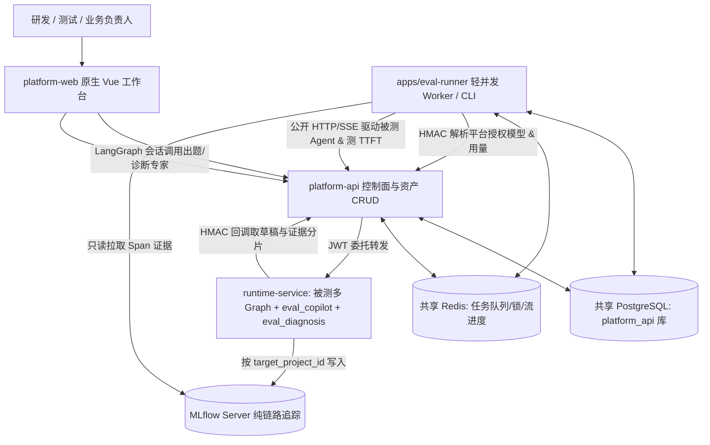

# 专题 01：总体架构、环境隔离与 Runtime 边界

> 所属项目：[独立评测中台迁移与平台原生化改造方案](README.md)｜状态：**架构方案已确认（方案 X，待开始编码）**

## 1. 业务痛点与已确认的四端职责边界

当前 `../mlflow-eval-platform` 把评测工坊寄生在 MLflow 服务端与 React 壳层中，且通过本地私有 `.env`（`XIAOK_PROXY_URL` / `BAILIAN_URL`）维护第二套模型网关与登录体系，引发了大量维护内耗。

经对齐，确定采用**方案 X（底座共享 + 职责严守边界）**：充分复用平台现有 `platform-api + PostgreSQL + Redis` 底座降低重复开发工作量，整套栈部署在 `sshmy1`，同时保持“控制面不跑图、Runner 不阻塞网关、模型直连平台目录”：

- **控制面与资产中心（改造 `apps/platform-api`）**：承载评测资产与结果表（`eval_suites` / `eval_cases` / `eval_versions` / `eval_runs` / `eval_run_cases` / `eval_human_reviews` / `eval_patrol_schedules`，通过 Alembic 建在 `platform_api` PG 库），负责用户 RBAC、多项目/多靶场权限校验、Readiness 能力预检、会话脱敏转入、版本冻结、结果与 PK 统计查询、模型连接安全解析，以及给 `runtime-service` 专家图提供的只读内部回调接口。**`platform-api` 不运行任何 LangGraph，也不在 HTTP 进程内跑耗时评测循环。**（实施前同步修订 `apps/platform-api/docs/handbook/architecture.md` 边界说明）。
- **图执行层（改造 `apps/runtime-service`）**：
  1. 放开多 Graph 评测白名单，提供被测 Agent 的隔离执行、`assert_target` / `record_execution` 证据与 MLflow Tracing；
  2. 新增 **`eval_copilot`（出题专家）** 与 **`eval_diagnosis`（诊断专家）** 两个 LangGraph 图（放入 `apps/runtime-service/src/runtime_service/services/`，对齐 `platform_assistant` 模式），直接复用平台模型路由、容灾、预算/PII 中间件与 Trace，清理空残余目录 `services/evaluation_assistant/`。
- **并发评测执行器（新增轻量 `apps/eval-runner` Worker + CLI）**：共享同一台 `sshmy1` 的 PG + Redis，承担并发 Case 调度池（默认 `3`、可调 `1~5`）、中文动态博弈多轮、流式 SSE 测 TTFT、从 MLflow 只读采集 Span、执行 L1 物理规则 + DeepEval 语义打分（通过 HMAC 签名调用 `platform-api` 解析平台网关模型与 Embedding）、定时巡检与 CI 门禁 CLI。
- **平台前端（改造 `apps/platform-web`）**：原生 Vue 3 + ECharts 6 工作台，交互与能力对齐 `../LightRAG` + Agent 动态博弈取证，视觉与组件严格遵循 `platform-web` 控制面与视觉基线规范。
- **MLflow 服务（退回纯链路追踪）**：仅作 `TRACING_PROVIDER=mlflow` 下的 Trace/Span 存储与查看。

---

## 2. 底座复用、`sshmy1` 4GB 资源评估与专家图回调设计

### 2.1 为何采用方案 X 及其单机 4GB 内存可行性实证

1. **为什么不把 `eval-runner` 与 `deepeval` 直接塞进 `platform-api` 或 `runtime-service`**：
   - `platform-api` 基于同步 SQLAlchemy（[development-playbook.md](../../../apps/platform-api/docs/handbook/development-playbook.md)），不含 `deepeval` 等评测依赖；把几十秒至数十分钟的并发多轮仿真、DeepEval 打分和 Cron 巡检塞进 `platform-api` Web 进程，不仅会导致修改评分 Prompt 就要重启在线鉴权/聊天网关，还会拖死同步工作线程。
   - `runtime-service` 基于官方 `langchain/langgraph-api:3.13` 定位为纯 LangGraph 执行节点，不宜混入 DeepEval 批处理池与调度巡检；把它拆成共用 PG+Redis 的轻量 **`apps/eval-runner`**，既保持三端职责正交，又可直接独立命令行（`eval-runner gate` / `patrol`）运行 CI 门禁。
2. **关于 `sshmy1` 4GB 宿主机内存承载力核实**：
   - 在相邻评测虚拟环境中实测 `import deepeval, deepeval.metrics`，进程 RSS 仅增加约 **79 MiB**（核心依赖为 `openai`、`opentelemetry`、`grpcio`、`pytest`、`aiohttp`，不含 `torch`/`transformers` 等重型框架），`eval-runner` 轻 Worker 单机常驻百余 MB 即可运转。
   - 依据 `docs/CONTEXT.md` 历史排障记录，此前导致 `sshmy1` 仅剩 `1.34 GB` 可用内存的关键原因在于：**Redis Run 事件流缓存曾膨胀至 `1.42 GB ~ 1.92 GB`**，加之冗余 MLflow Web/实验服务进程挤占。
   - 因此方案 X 明确增加两条硬约束：**并发度默认 `3`（上限 `5`）**；**所有评测队列/进度写入 Redis 时强制带 TTL 与条数/字节上限，严禁长驻巨型事件流**。

### 2.2 DeepEval 直连平台网关模型机制

彻底删除 `../mlflow-eval-platform/eval_platform/config.py` 中硬编码读取 `~/.my_best/.env`（`XIAOK_PROXY_URL` / `BAILIAN_URL`）的做法：
- 用户在开考配置或评测集配置中直接从**当前项目授权的平台模型目录（`runtime_catalog_models`）**选择裁判 LLM 模型 UUID 与 Embedding 模型 UUID；
- `eval-runner` 启动或按 Case 调度时，复用平台现有内部签名模式（类似 `/api/runtime/internal/model-config` 的 HMAC 校验接口 `/api/evaluation/internal/judge-model-config`），向 `platform-api` 换取解密后的 `base_url`、`api_key`、`model`、`protocol`（明文密钥不落盘、不对前端暴露），直接传给 `DeepEvalBaseLLM` 与 Embedding 客户端，并将消耗用量记入平台预算统计。

### 2.3 出题专家与诊断专家（`runtime-service/services/`）回调设计

将原 `../mlflow-eval-platform/eval_platform/agent/` 与 `diagnosis/` 重构为 `runtime-service` 中两个标准 LangGraph：
- **`eval_copilot`（出题专家）**：复用 `fetch_model_bundle`、预算/容灾/PII 中间件与 MLflow Tracing；挂载轻量计算器、Schema 校验工具，以及通过 HMAC 回调 `platform-api /api/evaluation/internal/copilot-context` 拉取脱敏源会话摘要和当前用例草稿；生成候选 `Proposal` Diff 返回前端由用户确认采纳（避免未经审阅覆盖手工编辑）。
- **`eval_diagnosis`（诊断专家）**：严格遵循 8 步有界取证与 `receipts` 防幻觉引用白名单校验；通过 HMAC 回调 `platform-api /api/evaluation/internal/diagnosis-evidence` 按 `reference` 与 **`offset` 分片翻页**读取运行概览、Case 列表、`evidence` 与版本 `compare` 摘要（规避 `platform_assistant` 256KB 单响应截断问题），输出三层 Gap 归因。
- **清理历史空目录**：开发初期同步删除 `apps/runtime-service/src/runtime_service/services/evaluation_assistant/` 遗留空目录。

---

## 3. 指定项目隔离执行机制（Source vs Asset vs Target 解耦）

针对“评测集指定跑到某个指定项目、实现与线上环境隔离”的核心诉求，彻底废除旧版 `Connection` 的四重强耦合，建立三元解耦模型：

| 抽象实体 | 职责说明 | 项目归属与隔离规则 |
|---|---|---|
| **1. 资料来源（Source）** | 线上会话（`thread_id`）、Bad Case、知识库文档或手工导入素材 | 记录 `source_project_id` 与脱敏摘要仅作溯源；来源项目的后续清理或成员变更不损坏已生成的题库资产。 |
| **2. 评测集资产（Suite / Dataset）** | 题库草稿、AI 候选修订、已发布冻结版本（含 `content_hash`） | 归属**资产管理项目**或标记为**平台通用基准**；一个题库可在不同目标项目中反复复用。 |
| **3. 执行靶场（Target Project）** | 实际运行被测 Agent、创建临时 Thread、挂载测试知识库与工具沙箱的项目 | **开考时显式选择指定项目（`target_project_id`）**，与来源项目完全解耦；要求操作者同时具备题库读/跑权限与目标项目的 `project.runtime.execute` 权限。 |

### 环境隔离的五层物理保障

1. **会话与 Workspace 隔离**：每次评测在 `target_project_id` 下新建带 `eval_` 标识的独立 `thread_id`，并写入项目可见共享范围（参考 `AgentPlatform._init_thread_session` 逻辑，禁用个人私有记忆串联），跑完后产物与文件留在目标项目隔离目录内，不影响线上业务会话。
2. **知识库与工具隔离**：目标靶场项目在 `platform-api` 中绑定专用的测试知识库（如 LightRAG 测试项目）与工具策略（`runtime_tool_restrictions`），Agent 运行时自动仅检索测试知识库并受测试权限约束。
3. **追踪实验物理隔离**：`runtime-service` 会根据传入的 `project_id` 自动将所有执行 Trace 写入 MLflow 的 `project-{target_project_id}` 实验，线上生产项目的 `project-{prod_project_id}` Trace 保持纯净。
4. **预算与速率隔离（已确认软预警机制）**：测试项目的 AI 网关预算独立核算；允许用户选择任意有 `project.runtime.execute` 权限的项目作为执行靶场，但对**非专用测试靶场项目**（未开启测试沙箱标志的普通业务项目）在开考弹窗给出明显**黄/红风险警告**，确认后方可执行。
5. **跨项目越权探针**：保留原有 `cross_project_denied` 探针，在测试完成后主动用另一个隔离项目身份尝试读取本次评测 Thread，验证服务端硬返回 403/404。

---

## 4. `runtime-service` 去掉 `dearflow_agent` 限制的源码核查结论与改动边界

已确认需要**支持 `dearflow_agent` 之外的其他平台 Agent 评测**。对 `apps/runtime-service/src/` 进行全量检索与源码核查后，实际需改动的边界比初步预期更具体：

| 核查项目 | `runtime-service` 与 `platform-api` 现状 | 开放多 Agent 评测后的处理方案 |
|---|---|---|
| 按项目写入 MLflow 链路追踪 | `observability/mlflow_tracer.py` 按 `project-{project_id}` 自动分实验写入，全 Graph 通用 | **无需修改** |
| 诊断、用量、流式运行接口 | `http/diagnostics.py`、`http/usage.py` 与标准 LangGraph `/runs/stream` 全 Graph 通用；TTFT 由评测端流式探针直接测量 | **无需修改** |
| 图范围白名单校验（2 处） | 1. `apps/platform-api/src/platform_api/modules/evaluation/targets.py` 第 65 行写死 `item.graph_id != "dearflow_agent"`； 2. `apps/runtime-service/src/runtime_service/webapp.py` 第 442 行写死 `if graph_id == "dearflow_agent":` 才返回 `"evaluation"` 能力块 | **必改**：扩展为受控可评测图集合（如 `dearflow_agent`、`showcase_demo`、`reference_agent`、`workflow_demo`，排除系统辅助图 `platform_assistant`），`webapp.py` 按各图真实能力返回结构化 `evaluation` 能力声明 |
| 目标防篡改校验与执行证据写入（此前仅 `dearflow_agent` 接入） | 全仓只有 `services/dearflow_agent/agent.py` 第 238–240 行调用了 `assert_target(config, facts)`，第 365–374 行调用了 `record_execution(...)`；`reference_agent`、`showcase_demo`、`workflow_demo` 当前均未接入 | **受控扩展**：在待开放评测的其它图（或共享启动包装层）按需接入 `assert_target` 与 `record_execution`（无工作区的图传 `workspace=None`），保证非 `dearflow_agent` 图也有不可篡改执行证据；同时删除空遗留目录 `services/evaluation_assistant/` |
| 各图异构能力适配（避免盲跑报错） | 查 `services/dearflow_agent/capabilities.py`：仅 `dearflow_agent` / `showcase_demo` 含 `workspace`/`files`/`artifacts`；仅 `dearflow_agent` 含 `clarification_field_types` 与 `execution_modes` | **分级兼容**：在评测工作台 **Readiness 守卫** 中校验用例所需能力 vs 所选图实际能力（例如给无工作区的 `reference_agent` 跑 `artifacts` 断言或追问工具断言时，开考前即清晰提示不适用或拦截） |

---

## 5. `platform-api` 整体改动清单（方案 X 确认范围）

`platform-api` 同步承担评测控制面资产 CRUD、权限校验与运行调度入队职责，**严守不运行 Graph、不在 HTTP 线程跑长阻塞打分池**：

1. **架构边界更新与 Alembic 建表**（`apps/platform-api/docs/handbook/architecture.md`、`migrations/`、`modules/evaluation/`）：
   - 修订架构文档边界说明，明确评测资产表归口 `platform-api` 管理，执行引擎由 `apps/eval-runner` 与 `runtime-service` 承载；
   - 新增 `eval_suites`、`eval_cases`、`eval_versions`、`eval_runs`、`eval_run_cases`、`eval_human_reviews`、`eval_patrol_schedules` 等表的 Alembic 迁移与同步 CRUD Service/Router。
2. **解除单项目硬编码与多图 target 放开**（`modules/evaluation/router.py`、`workbench.py`、`targets.py`）：
   - 将 `project_id == settings.evaluation_project_id` 改为基于当前请求头 `X-Project-Id` 的动态 IAM 权限校验（`PROJECT_EVALUATION_READ/EXECUTE/REVIEW/MANAGE`），支持多项目使用评测功能与跨项目指定靶场；
   - 放开 `targets.py` 中 `dearflow_agent` 单图硬编码，校验证可评测图清单并返回各图能力快照与目标项目风险提示属性。
3. **升级会话物料交付目标与内部支撑接口**（`modules/evaluation/materials.py`、`workbench.py`）：
   - 将 `forward()` 目标直接改为写入平台自身 `eval_suites`/`eval_cases` 草稿表（免除跨系统重发回调）；更新通知 `action_url` 为 `/workspace/projects/{project_id}/evaluation/{item_id}`；
   - 新增提供给 `eval-runner` 的内部模型连接解析与用量上报接口（`/api/evaluation/internal/judge-model-config`），以及提供给 `runtime-service` 专家 Graph 的 HMAC 只读分片回调接口（`/api/evaluation/internal/copilot-context`、`/diagnosis-evidence`）。

---

## 6. 本专题规划任务（待启动实施）

### Task 1.1：落实底座契约、`runtime-service` 多图扩展与内部回调桥
**状态：** 待开始（方案 X、专家图位置与多 Graph 范围均已对齐）。
**完成标准：** 更新 `architecture.md` 与跨服务/内部接口契约；完成 `targets.py` / `webapp.py` / 其他图执行证据的放开适配，并清理 `services/evaluation_assistant/` 空目录；完成 `copilot-context`、`diagnosis-evidence` 与 `judge-model-config` 接口及单元测试。
**涉及位置：** `apps/platform-api/docs/handbook/architecture.md`、`apps/platform-api/src/platform_api/modules/evaluation/`、`apps/runtime-service/src/runtime_service/`。

- [ ] 修订 `platform-api` 架构说明并完成评测表 Alembic 迁移脚本设计。
- [ ] 放开 `dearflow_agent`、`showcase_demo`、`reference_agent`、`workflow_demo` 评测白名单，补齐非沙箱图 `assert_target` / `record_execution`（`workspace=None`）并清理空目录 `services/evaluation_assistant/`。
- [ ] 实现供 `eval-runner` 解析平台网关模型连接的内部签名端点，及供 `eval_copilot` / `eval_diagnosis` 回调的 HMAC 只读接口（支持 `offset` 分片与大小保护）。

**下一步：** 随其余专题实施任务一并获准后启动编码。
