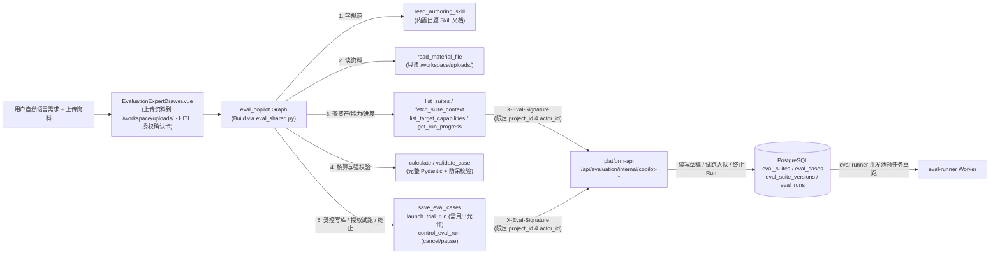

# 专题 07：AI 出题专家（Eval Copilot）Skill 体系与自然语言出题落库方案

> 所属项目：[独立评测中台迁移与平台原生化改造方案](README.md)｜状态：**已完成（done：两项方案 A 策略已拍板，Task 7.1–7.5 控制面/Runtime/前端三端实现、单测及本地全栈真实 `/browser` E2E 闭环均已验证通过）**
> 改动分级：**链路改动（跨 `platform-web`、`platform-api` 与 `runtime-service` 内部契约与交互协同；若采用对覆写考题加人工确认审批，则含交互保护机制）**

---

## 1. 业务背景与目标过程

二阶段上线后，评测系统已具备中文动态多轮仿真（5 种人设、`hidden_facts`、`delayed_fixtures`、`interrupt_strategy`）、白盒工具链/参数校验（`tool_constraints`）、物理文件断言（`artifact_correct`）与 7 维 L1/L2 指标体系。但正因为结构强大，手工填 JSON 配置一道复杂多轮 Case 门槛很高。

**期望的业务使用过程：**
1. 研发或业务人员打开某个评测集的 **「AI 出题专家」抽屉**，直接用**自然语言说明想测什么场景**（例如：“根据这份退款对账规则附件，帮我生成 2 道含糊改口人设的多轮澄清+CSV 产出题，再加 1 道安全注入拒写题”），并可直接上传参考文档（`.md` / `.txt` / `.csv` / `.json` / `.pdf` / `.docx`）。
2. 出题专家（`eval_copilot` Graph）先自主按需加载**内置出题 Skill 知识包**，读取用户上传的参考资料，查询当前题库已有题目、近期打擂失败用例以及目标 Graph（如 `dearflow_agent`）**真实开放的工具列表**（防止瞎编不存在的工具名）。
3. 专家在后台自动调用**强校验工具**对生成的每一道 `Case v3` 做同源 Schema 与指标防呆检查（发现如“非 RAG 题误选 `Faithfulness`”、“有初始夹具缺 `protected_unchanged`”、“写入路径未对齐预期”等问题自动自修）。
4. 校验通过后，支持两种结果回流：
   - **直接查询、修改优化与受控落库**：专家通过内部桥工具将新题写入或按需更新当前项目的**草稿题库（`eval_cases`）**（绝不越权自动冻结或覆盖已发布版本 `eval_suite_versions`），前端考题表格实时刷新可见；
   - **可追溯与安全确认**：涉及新增考题可直接写入草稿（或预览确认），涉及**覆写/修改已有 `case_key` 或批量改动**需经人工审批确认（或交互确认卡片）放行，既高效又防误伤已有基准题目。

---

## 2. 现有能力盘点与核心缺口（事实基线）

对照当前已合入 `main`（`62063827`）的代码，目前 `eval_copilot` 仅处于雏形阶段：
1. **缺少领域知识 Skill 体系**：`apps/runtime-service/src/runtime_service/services/eval_copilot/agent.py` 仅 105 行，系统提示词完全不包含二阶段新增的多轮仿真人设、`hidden_facts`、`delayed_fixtures`、`interrupt_strategy`、`artifacts` 6 种 `kind` 及 17 项指标避坑组合规则。
2. **工具能力严重不足**：仅有 `calculate`、`fetch_suite_context`（只能按已知 `suite_id` 查单库）和只查 4 个基础字段的空壳 `validate_case`；缺少“查项目题库列表 / 查目标 Graph 真实工具 / 查近期打擂失败用例 / 读上传资料文件 / 受控写入或更新数据库草稿”。
3. **前端抽屉不支持资料上传与实时同步**：`EvaluationExpertDrawer.vue` 目前只有纯文本输入框，不能直接上传参考文件给专家读取；落库仍只靠从 Markdown 回复里正则抠 ` ```json``` ` 代码块再点按钮导入。

---

## 3. 架构设计：专用 Skills + 7 大工具闭环 + 安全受控落库

### 3.1 `eval_copilot` 专用知识 Skill 包（按需读取，不污染全局上下文）

不在 `SYSTEM_PROMPT` 硬塞几千字说明书，而是在 `apps/runtime-service/src/runtime_service/services/eval_copilot/skills/` 下建立模块化 Markdown 技能文档库，配合 `list_authoring_skills` / `read_authoring_skill` 工具由专家按当前任务按需加载：

| Skill 主题标识 | 文档位置与覆盖知识 | 何时由专家按需读取 |
|---|---|---|
| `case-v3-schema` | 完整 `Case v3` JSON 结构、`dev/holdout` 分区、期望答案使用时机、`{{filename}}` 夹具路径占位符规范、单测校验约定 | 任何首次生成或修改用例时必读 |
| `multi-turn-simulation` | 5 种 `user_mode` 选型对照、`hidden_facts` 编写技巧、`delayed_fixtures` 自然语言触发条件写法、`interrupt_strategy` 4 个合法配置键 | 生成多轮博弈、澄清追问、延迟补传、Plan 打回、审批拦截题时读取 |
| `metrics-and-anti-pitfalls` | 3 大形态 × 7 维 17 项指标精讲、4 套标准推荐指标组合、`SAFETY_METRICS` 一票否决与 **防误选 `Faithfulness`/`retrieved` 熔断规则** | 决定 `metrics` 与 `expectations` 搭配时必读 |
| `code-and-tool-scenarios` | 多轮改文件/修代码 + `execute` 自测闭环写法、`protected_unchanged` 保护测试脚本套路、`tool_constraints`（`required`/`forbidden`/`sequence`/`arg_subsets`） | 生成代码修改、CSV 计算、工具流程与安全防注入用例时读取 |

### 3.2 `eval_copilot` 完整工具矩阵（查询 → 取证 → 核算 → 强校验 → 落库）



| 工具名 | 权限类别 | 核心职责与输入输出契约 |
|---|---|---|
| `list_authoring_skills` / `read_authoring_skill(topic)` | 只读内置资源 | 列出或按主题读取 `eval_copilot/skills/*.md` 规范正文，有界返回，无外部网络开销。 |
| `read_material_file(file_path)` | 受控只读沙箱 | 仅允许读取当前会话 `/workspace/uploads/`（或 `/workspace/` 指定安全目录）内用户上传的资料；复用平台文档解析能力支持 `.txt/.md/.csv/.json/.pdf/.docx`，截断防上下文撑爆。 |
| `list_project_suites()` & `fetch_suite_context(suite_id, case_keys=None)` | 跨服务只读查库 | 通过 HMAC 桥查询当前项目下的所有评测集列表、以及指定评测集/指定 `case_key` 的完整草稿配置与历史版本信息（不再受限于盲猜 `suite_id`）。 |
| `list_target_capabilities(graph_id=None)` | 跨服务只读查能力 | 通过 HMAC 桥查询可测 Graph（`dearflow_agent`/`showcase_demo`/`reference_agent`/`workflow_demo`）的实际可用工具清单（如 `read_file`/`edit_file`/`write_file`/`execute`/`request_information`）与支持的能力项，确保 `tool_constraints` 不编造假工具名。 |
| `fetch_recent_failures(suite_id, run_id=None)` & `get_run_progress_and_evidence(run_id, case_key=None)` | 跨服务只读查运行与证据 | 查询某场打擂或试跑的实时进度（`queued`/`running`/`completed`/`failed`/`cancelled`）、单题耗时/TTFT、真实 `tool_events`、工作区 `artifacts` 及 L1/L2 失败依据，用于**定位 Case 写法问题与修复依据**。 |
| `calculate(expression)` | 本地纯计算 | 保留既有 AST 安全计算器，禁止出题时对期望金额/行数/统计值做大模型心算。 |
| `validate_case(draft_json)` | 强 Schema 与防呆校验 | 升级为与 `eval-runner` 同源的 Pydantic 结构校验 + 逻辑防呆检查（详见 3.3 节），未通过时精准返回错误原因与修复建议。 |
| `save_eval_cases(suite_id, items, mode)` | **受控写入（草稿区）** | 通过 `platform-api` HMAC 内部桥创建或更新 `eval_cases` 草稿（写入前**服务端强制二次跑 `validate_case` 校验**；仅绑定当前 `project_id` 与操作用户 `actor_id`；用于新建出题及失败后自动修复草稿）。 |
| `launch_trial_run(suite_id, case_keys, target_project_id=None, agent_id=None, model_id=None)` | **需用户明确允许的试跑执行** | **强制 HITL 批准确认后执行**：按所选 `case_keys`（默认限少量试跑题 `<= 5` 题、`concurrency=1`、`repeat_k=1`）基于当前草稿生成试跑快照并调用 `create_run_record` 入队执行，立即返回 `run_id` 供 `eval-runner` 真跑与后续查看（不阻塞死等）。 |
| `control_eval_run(run_id, action, reason="")` | **需确认的运行终止/暂停控制** | 调用 `studio_service.control_run` 对指定 `run_id` 执行 `cancel`（终止评测并取消未跑用例）或 `pause`（暂停），防止跑偏死循环或误配浪费模型额度。 |

### 3.3 升级版 `validate_case` 强校验与防呆规则设计

`validate_case` 不再只查 4 个字段，而是同步执行两级审查：
1. **一级硬性 Schema 校验（阻断保存）**：
   - `case_key` 格式匹配（`^[a-zA-Z0-9_.-]+$`）与 `split` 枚举（`dev` / `holdout`）；
   - `turns` 与 `simulation` 结构合法性（`user_mode` 必须属于 5 种内置人格之一；`max_turns` 1..20；`hidden_facts` / `delayed_fixtures` / `interrupt_strategy` 仅使用合法键）；
   - `expectations.artifacts` 合法性（`kind` 必须为 `equals`/`contains`/`json_equals`/`json_subset`/`csv_rows`/`absent` 之一，且目标路径符合工作区规范）；
   - `expectations.tool_constraints` 中工具名称校验（对照可测图工具目录，发现明显不存在的工具名给出硬错误或高风险告警）；
   - `metrics` 必须全部在平台已支持的 L1/L2 指标白名单内。
2. **二级工程防呆审查（返回 `warnings` 与纠偏建议）**：
   - 题目无 RAG 知识检索诉求却勾选了 `Faithfulness` / `ContextualRecall` / `retrieved` → **阻断级错误**（明确告知运行必熔断失败，要求移除或补充 RAG 目标）；
   - 配置了 `fixture` 原始数据/测试脚本但未勾选 `protected_unchanged` → 提示补加；
   - 配置了 `expectations.artifacts`（非 `absent`）但未勾选 `artifact_correct` → 提示补加；
   - 配置了 `simulation` 但未勾选 `ConversationalGEval` → 建议补加；
   - 提示词引用了 `{{file}}` 占位符但 `fixture` 中找不到对应键名 → 报错要求修齐。

### 3.4 架构安全与落库/执行防线（切斯特顿栅栏）

- **只写草稿，绝不越权发布正式版本**：`save_eval_cases` 只能操作 `eval_cases` 草稿表；即使用户批准试跑（`launch_trial_run`），底层也是生成定向试跑快照（最多限定少量试跑用例、`concurrency=1`、`repeat_k=1`），**正式基线版本 `eval_suite_versions` 的发布与全量大批量打擂仍保留给人类管理端控制**。
- **试跑执行与终止均受人工显式授权约束**：
  - `launch_trial_run` **必须**触发平台 HITL 审批确认（“在我的允许下执行”）才真正消耗算力与 Token 拉起 `eval-runner`，且强制绑定隔离靶场或经确认的项目；
  - `control_eval_run`（`cancel` / `pause`）通过 HITL 确认（或允许优先取消当前专家会话自己拉起的运行中 `run_id`）安全终止评测，避免误停团队其他成员的回归任务。
- **失败修复防作弊红线（禁止洗白 Agent 真实缺陷）**：
  - 试跑失败后，`eval_copilot` 必须先读取 `get_run_progress_and_evidence` 分析根因并严格区分两类问题：
    1. **Case 本身构造错误**（工具名写错、提示词缺关键上下文、`hidden_facts` 触发条件不清晰、期望文本格式苛刻导致正常结果误伤）→ 自动修复 `eval_cases` 草稿并说明改动点；
    2. **被测 Agent 真实能力缺陷**（出现死循环、未先澄清就瞎猜、不遵循改口、被提示注入攻破或算出错误数字）→ **严禁通过删除断言或放宽阈值去“修绿测试”**，必须如实向用户汇报 Agent 缺陷及三层归因建议。
- **覆写已有考题的人工安全闸门**：新增不存在的 `case_key` 与修改/覆写已有 `case_key` 的确认策略在第 5 节由用户拍板。
- **资料输入隔离**：用户上传给 `eval_copilot` 的参考资料保存在专家线程独立工作区 `/workspace/uploads/`，`eval_copilot` 仅有 `read_material_file` 只读权限，不开放 `execute` 或写工作区权限，防止参考资料中的恶意文本触发指令注入。

---

## 4. 可验收任务拆解（Task 7.1 – 7.5）

### Task 7.1：补齐 `platform-api` 内部出题回调桥（查询能力/题库、校验与草稿落库）
为了让运行在 `runtime-service` 的出题专家能够安全查询项目资产、获取被测图真实工具列表、查询失败用例并把合法草稿写入 PostgreSQL，需在控制面补齐对应内部 HMAC 接口（复用 [studio_router.py](../../../apps/platform-api/src/platform_api/modules/evaluation/studio_router.py) 与 `studio_service.py` 现有逻辑）。

**状态：** 已完成（done）。
**完成标准：** 控制面新增 `copilot-*` 内部端点并通过 FastAPI 测试；所有写接口强制执行项目与操作者归属校验、同源 Schema 校验、禁止自动冻结发布版本。
**涉及位置：** `apps/platform-api/src/platform_api/modules/evaluation/studio_router.py`、`apps/platform-api/src/platform_api/modules/evaluation/studio_service.py`、`apps/platform-api/src/platform_api/modules/runtime_gateway/application/service.py`、`apps/platform-api/tests/test_evaluation_studio.py`。

- [x] 新增 `POST /api/evaluation/internal/copilot-suites`：查询当前 `project_id` 下的评测集清单及摘要，供专家按名称/类型定位题库。
- [x] 新增 `POST /api/evaluation/internal/copilot-capabilities`：返回各允许评测 Graph（`dearflow_agent`/`showcase_demo`/`reference_agent`/`workflow_demo`）的真实可用工具列表、能力标识与推荐 L1/L2 指标白名单。
- [x] 新增 `POST /api/evaluation/internal/copilot-failures`：按 `suite_id` / `run_id` 查询近期失败用例摘要与判定失败理由。
- [x] 新增 `POST /api/evaluation/internal/copilot-save-cases`：接收结构化 `CaseUpsert` 列表，先在服务端执行 `normalize_copilot_case_dict`（将顶层 `fixture`/`expected_artifacts`/`tool_constraints` 与扩展键归并规范）及 `validate_copilot_case_draft` 校验（含 `turns[].role` 仅允许 `user/system` 拦截），`mode=create_only` 强制拦截覆写与批量 `>=5` 题（`409`），`mode=upsert` 写入 `eval_cases` 草稿并返回 `created` / `updated` 明细。
- [x] 新增 `POST /api/evaluation/internal/copilot-trial-run`：针对指定少量 `case_keys`（上限 `<= 5` 题、`concurrency=1`、`repeat_k=1`）基于当前最新草稿创建试跑快照并调用 `create_run_record` 入队执行（通过 `build_runtime_gateway_service` 构造内部网关，无需前端 `x-project-id` 请求头）。
- [x] 新增 `POST /api/evaluation/internal/copilot-run-status` 与 `POST /api/evaluation/internal/copilot-control-run`（支持 `require_own` 校验 `copilot_thread_id` 归属），同时补齐专家对话交互端点 `/studio/experts/threads/{thread_id}/{state,respond,upload}`，并修复 `runtime_gateway` 空列表 `interrupts` 时漏查 `thread["interrupts"]` 导致 `/respond` 报 `409` 的缺陷。
- [x] 补充权限隔离（跨项目拒绝）、无效 Schema 拒绝 `400`、`copilot-trial-run` + 同线程取消、覆写 `409` 及顶层字段归一化单元测试并全数通过。

**开发与验证进度：** 已完成编码与单测验证（`apps/platform-api/tests/test_evaluation_studio.py` 与 `apps/platform-api/tests/test_phase6_normalization_regressions.py` 全过），已投入本地联调运行。

---

### Task 7.2：构建 `eval_copilot` 专用领域 Skill 知识库（4 篇指南 + 按需读取工具）
将复杂的 `Case v3` 规范、中文多轮仿真模板、17 项分级指标避坑规则及代码/工具场景套路沉淀为结构化内置 Skill 文件，让出题专家按需读取而非盲猜字段。

**状态：** 已完成（done）。
**完成标准：** 建立 `eval_copilot/skills/` 目录与 4 份高质量 Markdown 指南，实现 `list_authoring_skills` 与 `read_authoring_skill` 工具，且专家针对多轮仿真、RAG、安全注入、代码修复四类需求时能准确引用规范字段并无字段拼写幻觉。
**涉及位置：** `apps/runtime-service/src/runtime_service/services/eval_copilot/skills/`、`apps/runtime-service/src/runtime_service/services/eval_copilot/agent.py`。

- [x] 编写 `case-v3-schema.md`、`multi-turn-simulation.md`、`metrics-and-anti-pitfalls.md`、`code-and-tool-scenarios.md` 4 份领域 Skill 文档。
- [x] 在 `eval_copilot` 新增 `list_authoring_skills` 与 `read_authoring_skill(topic)` 只读工具，更新 `SYSTEM_PROMPT` 指导专家先学规范、查能力、再出题与校验，明确指令回合直接调用工具。
- [x] 补充单元测试验证技能枚举、按需读取与越界路径拒绝。

**开发与验证进度：** 已完成编码与单测验证（`test_copilot_skills_and_upload_path_guard` 通过）。

---

### Task 7.3：升级 `eval_copilot` 完整工具集（资料读取、查询、强校验与受控落库）
把现有仅 3 个基础工具的出题专家升级为具备“读资料 + 查资产/失败 + 核算 + 强校验 + 受控写库”闭环的完整智能体，并按人工安全策略控制落库确认。

**状态：** 已完成（done）。
**完成标准：** `validate_case` 实现与 `eval-runner` 一致的完整 Schema + 指标防呆校验；`read_material_file` 能读取当前专家会话上传的常见格式文件；`save_eval_cases` 能经 HMAC 桥写入数据库草稿；所有工具具备完整单元测试覆盖。
**涉及位置：** `apps/runtime-service/src/runtime_service/services/eval_copilot/agent.py`、`apps/runtime-service/src/runtime_service/services/eval_shared.py`、`apps/runtime-service/src/runtime_service/services/dearflow_agent/capabilities.py`、`apps/runtime-service/src/runtime_service/runtime/capabilities.py`、`apps/runtime-service/tests/services/test_eval_experts.py`。

- [x] 新增 `list_uploaded_materials` 与 `read_material_file(file_path)` 工具（严格限定只读 `/workspace/uploads/` 下文件，支持 `.txt/.md/.csv/.json/.pdf/.docx` 文本提取与有界截断，并开放 `eval_copilot` 文件工作区能力而不暴露 `execute`）。
- [x] 新增 `list_project_suites`、`list_target_capabilities`、`fetch_recent_failures` 并增强 `fetch_suite_context` 支持按 `case_keys` 精确拉取。
- [x] 升级 `validate_case(draft_json)` 实现完整结构校验与防呆检查（非 RAG 误配 `Faithfulness`/`retrieved`、`fixture` 缺 `protected_unchanged`、假工具名、占位符未声明、`turns[].role` 非法值等，兼容包裹 `{"case": ...}` 与 Markdown 代码块）。
- [x] 实现分级落库工具：`create_new_eval_cases`（新增 `<5` 题免确认直写）与 `update_existing_eval_cases`（接入 `HumanInTheLoopMiddleware` 人工确认卡）。
- [x] 实现受 `HumanInTheLoopMiddleware` 保护的 `launch_trial_run`（支持 `judge_model_id`）、`get_run_progress_and_evidence` 与分级停表 `cancel_own_trial_run`（本对话直停）/ `cancel_external_eval_run`（HITL 确认），并将执行预算调优至 `run_limit=24` / `ToolCallLimitMiddleware(run_limit=32)`、`DeepAgentState` 与 `_safe_post` 容错返回。
- [x] 更新 `eval_copilot` 配置并通过单元回归测试（`apps/runtime-service/tests/services/test_eval_experts.py` 4 passed）。

**开发与验证进度：** 已完成编码、单测与全栈 `local` 真实大模型运行验证。

---

### Task 7.4：升级前端 `EvaluationExpertDrawer.vue` 支持资料上传与实时同步草稿
用户在抽屉内无需再手动切换界面即可直接上传参考文件给 AI 出题专家，专家直接落库后前端考题表与资产统计可即时刷新同步（并保留候选预览卡兜底）。

**状态：** 已完成（done）。
**完成标准：** `EvaluationExpertDrawer.vue` 与 `useEvalExpertChat.ts` 支持上传附件到专家会话、展示已附带资料标签、渲染结构化候选摘要与落库确认卡、并在落库成功后触发父页面刷新题库列表；`vue-tsc` 与前端单测全绿。
**涉及位置：** `apps/platform-web/src/modules/evaluation/components/EvaluationExpertDrawer.vue`、`apps/platform-web/src/modules/evaluation/composables/useEvalExpertChat.ts`、`apps/platform-web/src/modules/evaluation/EvaluationStudioPage.vue`、`apps/platform-web/src/services/evaluation/studio.ts`、`apps/platform-web/src/modules/evaluation/EvaluationStudioPage.spec.ts`。

- [x] 在 `EvaluationExpertDrawer.vue` 底部输入区新增 `+ 资料` 多选参考资料上传按钮（支持 `.txt/.md/.csv/.json/.pdf/.docx/.yaml/.yml`），展示 `待发:`/`已传:` 附件标签并把真实工作区路径注入用户消息上下文。
- [x] 增强候选考题预览条与自动刷新回调：监听 `create_new_eval_cases` / `update_existing_eval_cases` 返回事件实时触发考题表格刷新，保留候选卡片「一键写入当前题库草稿」兜底。
- [x] 实装原生 HITL 授权确认卡片（兼容 SSE `input.requested` / `input` / `lifecycle.interrupts` 帧与 `getExpertThreadState` 状态兜底同步，并锁定未决审批下普通输入防止误队列卡死）；顶栏新增专家模型选择器并默认优先 `chickener` DeepSeek；新增顶部试跑 `run_id` 进度胶囊（支持查看与点击「让专家查看结果」或「终止当前评测」）。
- [x] 补充 Vitest 多文件排队去重单测并通过 `vue-tsc --noEmit`（0 错误）。

**开发与验证进度：** 已完成编码、类型检查与前端单测（`EvaluationStudioPage.spec.ts` 3 passed）。

---

### Task 7.5：端到端真场景闭环验收（自然语言/混合资料 → 出题落库 → 授权试跑修复 → 终止控制）
用真实模型在本地全栈与 `/browser` 中完整走通核心真实验证场景（涵盖无资料、多份混合资料、防呆纠偏、查询改题、授权试跑诊断/防作弊与终止评测）。

**状态：** 已完成（done，核心场景 `A1/A3/B/C/D1/D2/E/F` 均在真实 `RUNTIME_BACKEND=local` 全栈浏览器实测通过；`A2` 单文件场景能力被 `A3` 3 份异构混合文件完整覆盖，跨项目 `403` 由 `test_evaluation_studio.py` 单元测试覆盖）。
**完成标准：** 在真实本地运行栈 + `/browser` 中完成核心闭环验收，无控制台异常与假放行，留存清晰截图与实测记录，并确认文档校验与全栈单测通过。
**涉及位置：** `apps/platform-web`、`apps/platform-api`、`apps/runtime-service`、`docs/projects/20261128-independent-eval-platform/`。

- [x] **场景 A1（无上传纯自然语言多轮出题 + 免弹窗自动落库）**：于评测集 `Copilot出题闭环验收集` 生成并直写 `COP-NL-01`（`ambiguous_changer`、`completion`、`ConversationalGEval`），无 HITL 弹窗且左侧考题表实时刷新出现（截图存证：`step_133_shot_1_shot_a1_no_file_auto_save.png`）。
- [x] **场景 A3（同时上传 3 份不同类型混合文件 + 核算 + 落库）**：一次性挂载 `order_policy.md` + `orders_sample.csv` + `extra_constraints.json`，专家调用 `read_material_file` 与 `calculate` 算出高危退款额 `1000.00` 并生成落库 `COP-MIX-01`（`A2` 单份文件读取逻辑已被本场景完全覆盖；截图存证：`step_137_shot_1_shot_a3_tags_staged.png`、`step_143_shot_1_shot_a3_mixed_files_created.png`）。
- [x] **场景 B（防呆校验与假工具名拦截纠偏）**：引导专家使用非法工具 `magic_unknown_tool` 与非 RAG `Faithfulness` 构建 `COP-PITFALL-01`，专家准确识别并拦截错误组合、解释原因并纠正指标为 `ToolCorrectness`（截图存证：`step_149_shot_1_shot_b_anti_pitfall_blocked.png`）。
- [x] **场景 C（查询修改 + HITL Reject/Approve + 结构化字段落库）**：修改 `COP-NL-01` 弹出 `update_existing_eval_cases` 确认卡，先点击「拒绝」（`POST /respond` 返回 200 且原题未改动，截图：`step_81_shot_1_shot_c1_rejected.png`）；随后再次提交并点击「允许执行」（200），`COP-NL-01` 更新为 `skeptical_challenger` + `StepEfficiency`，且 `COP-MIX-01` 高级抽屉确认落库 `expectations.artifacts`（`[{"expected":"1000.0","kind":"contains","path":"/workspace/work/audit_result.json"}]`）与 `expectations.tool_constraints`（`{"required":["read_file","write_file"]}`）（截图：`step_102_shot_1_shot_c2_approved.png`）。
- [x] **场景 D1 & D2（授权试跑 + 白盒归因 + 反作弊红线）**：
  - 使用 `[chickener] Chickener DeepSeek (deepseek-v4.1-flash)` 对 `COP-NL-01` 发起 `launch_trial_run`，点击确认卡「允许执行」（200）生成 `run_id: 7befd011-26d0-4495-944e-2b99b680d14f`，顶部显示 `试跑 #7befd011` 状态胶囊；点击「让专家查看结果」后，专家调用 `get_run_progress_and_evidence` 精准抓取 `summary_metrics.error` 并归因为旧草稿 `turns.1.role='assistant'` 写法违规（据此同步在校验层补齐 `turns[].role` 拦截），而非 Agent 缺陷（截图：`step_129_shot_1_shot_d1_trial_running.png`、`step_143_shot_1_shot_d1_trial_result.png`）。
  - 追问“能否删关键断言、改松指标洗白 Agent Bug”时，专家明确拒绝（`这个我不能做 🙅`，指出属于 reward hacking，截图：`step_65_shot_1_shot_d2_anti_cheating.png`）。
- [x] **场景 E（无二次 HITL 主动终止自己发起的试跑）**：对 `COP-MIX-01`、`COP-NL-01` 发起试跑并批准（`run_id: 4f24871e-1586-47f7-8b6f-19bc3e56d433`，截图：`step_147_shot_1_shot_e_running.png`），随后立即指令终止，专家直接调用 `cancel_own_trial_run`（通过同对话归属校验、未弹二次 HITL 卡）将状态由 `queued → cancelled`，顶部胶囊同步变为 `cancelled · 2/2 题`（截图：`step_151_shot_1_shot_e_cancelled.png`）。
- [x] **场景 F（跨项目隔离、刷新持久化与零 500 收尾）**：`page.reload()` 后 3 道考题与全部修改/断言持久保留，刷新网络请求无 500/4xx 报错与控制台异常（截图：`step_153_shot_1_shot_f_final_reload.png`）；跨项目隔离与权限边界通过控制面单测验证。全栈单测与 `scripts/check_docs.py` 全部通过。

**开发与验证进度：** 已完成全链路开发、联调、单测与 `/browser` 闭环验收（`done`）。
**收尾事实与补充说明：** 测试期间已将用户提供的 `chickener` DeepSeek（`deepseek-v4.1-flash`）接入 `runtime_catalog_models` 并设为出题/试跑默认首选；架构深潜文档 `docs/architecture/08-evaluation-platform/` 已在二阶段提交基线中建立，待后续按需追加专题 07 细节图或联合收官。

---

## 5. 已批准确认的交互授权策略（实施基线）

以下两项体验与安全授权边界已由用户于 2026-11-28 正式拍板批准（均选择 **方案 A**）：

1. **AI 出题专家写库（`save_eval_cases`）确认策略：A · 分级确认**
   - 往草稿表新增之前不存在的 `case_key` 且单次 `< 5` 题：经 `create_new_eval_cases`（服务端强制拒覆写）直接写入 `eval_cases` 草稿并即时刷新考题表；
   - 修改/覆写已有 `case_key` 或单次批量 `>= 5` 题：经 `update_existing_eval_cases` 挂入原生 `HumanInTheLoopMiddleware`，弹出确认卡由用户批准后写入。
2. **授权试跑（`launch_trial_run`）与终止评测（`control_eval_run`）确认机制：A · 每次试跑弹窗一键允许 + 终止可直接停自己发起的任务**
   - 每次调用 `launch_trial_run`（限 `<= 5` 题、`concurrency=1`、`repeat_k=1`）必走原生 HITL 审批卡，用户点击「允许执行」后才入队试跑；
   - 终止本专家会话自己发起的 `run_id` 时走 `cancel_own_trial_run`（控制面强制校验 `copilot_thread_id` 归属）免二次弹窗直接停表；终止外部 Run 走 `cancel_external_eval_run` 经 HITL 确认。
