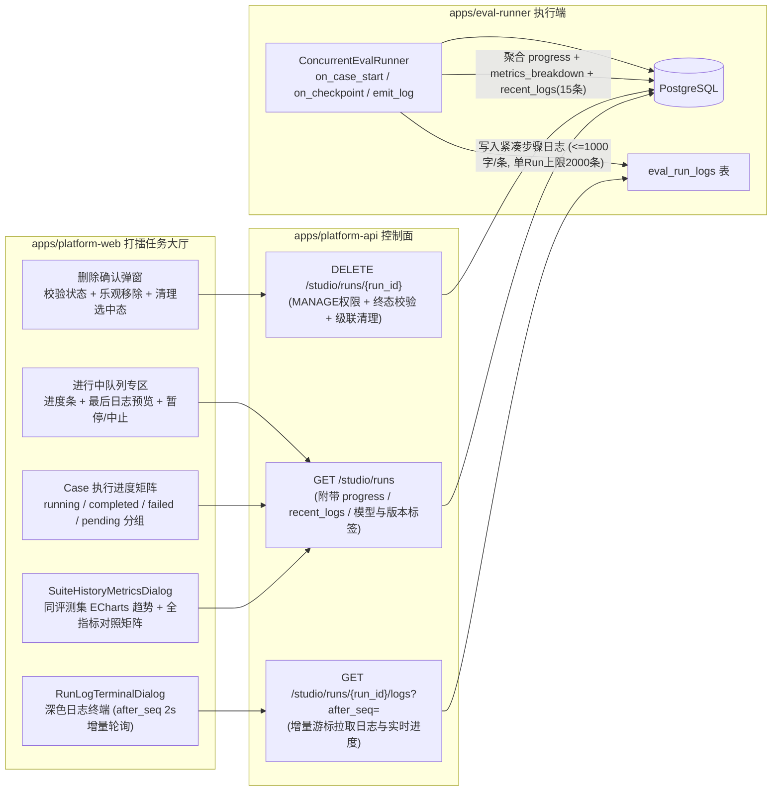

# 专题 09：打擂任务大厅深度优化（结果删除、同评测集多维历史对比与实时进度日志）

> 所属项目：[独立评测中台迁移与平台原生化改造方案](README.md)｜状态：**已完成（done：Task 9.1–9.5 编码、三端单元测试、类型检查、生产构建、本地迁移 `20261128_0017` 及 `/browser` 真实全栈端到端验收全部通过，未部署生产）**

---

## 1. 业务背景与当前缺口

在完成一至四阶段基础交付后，研发与评测人员在日常高频使用「打擂任务大厅」（`RunResultsPanel.vue`）时，对照 `../LightRAG` 评测任务中心（`EvaluationTaskCenter.tsx`）的实际体验，暴露出三项直接影响可观测性与日常运维效率的明显缺口：

1. **缺少评测运行结果的删除能力**：
   - 试跑失败、参数配错或联调产生的无效打擂记录（`EvalRun`）目前只能永远堆积在打擂历史列表里，后端 `studio_router.py` 仅有题库归档（`DELETE /studio/suites/{suite_id}`）和考题删除接口，**尚无删除评测运行结果的接口**，前端大厅也无删除入口和确认弹窗。
2. **缺少同评测集历史数据的各指标相关对比功能**：
   - 当前大厅的题库分组头部仅展示单一聚合数字（`历史最佳` 与 `最新 XX%`），`ComparisonPkDialog.vue` 仅支持任意挑 2 场做双边静态 PK。
   - 用户针对**同一个评测集**反复调优 Prompt / 模型 / Graph 时，无法在一个视角里纵览历次打擂的**各维度指标演进趋势**（综合分、TSR / Pass@1、L1 硬规则通过率、各 L1/L2 子指标如 `faithfulness`、`answer_relevancy`、`tool_called`、`artifact_correct`、TTFT P50/P95、生成耗时、Agent 均耗、Token 与费用、死循环率），也无法快速对比多场历史记录中各项具体指标的涨跌相关性。
3. **进行中的评测任务缺乏明确进度、Case 完成/未完成状态明细与实时执行日志**：
   - 当前正在执行的 `queued` / `running` 任务与已完成历史记录混杂在一起；`eval-runner/worker.py` 在批跑过程中**仅更新单题检查点表 `eval_run_cases`，未将进行中状态与统计同步刷新至 `eval_runs.summary_metrics_json`**，且单题开始执行前未标记为 `running`，导致用户在页面上无法直观看出整体进度百分比、当前正在执行哪几题、哪些 Case 已完成、哪些仍在等待。
   - 参照 `../LightRAG` 的终端实时日志体验（`EvaluationTaskCenter.tsx` 中的最近日志摘要行 + `Terminal Log Modal`），当前 `eval-runner` 的执行日志仅输出到后台进程控制台，**控制面与前端完全看不到步骤级实时日志**（如开始执行某题、首字 TTFT、触发 HITL 中断决策、L1 规则检验、L2 裁判打分、异常重试原因等），排查卡顿或长耗时问题极其困难。

**本专题核心目标：**
在不破坏现有评测版本不可变契约与隔离靶场边界的前提下，全栈打通 **`apps/eval-runner` → `apps/platform-api` → `apps/platform-web`** 的控制与观测链路，补齐打擂任务大厅的 **安全删除、同评测集多维历史指标对比与趋势分析、实时进度/Case 状态矩阵与终端级实时日志** 三大核心能力。

---

## 2. 方案与技术设计

### 2.1 整体数据流架构



---

### 2.2 能力一：评测运行结果安全删除

#### 1. 后端接口与数据清理规则（`platform-api`）
* **路由定义**：`DELETE /api/evaluation/studio/runs/{run_id}`
* **权限控制**：要求 `PermissionCode.PROJECT_EVALUATION_MANAGE`（与 `DELETE /studio/suites/{suite_id}` 对齐，仅项目管理员可删除成果，普通只读/执行成员不可误删）。
* **前置状态守卫**：
  * 校验 `run.owner_project_id == project_id`，越权或不存在返回 `404 eval_run_not_found`。
  * 若 `run.status in {"queued", "running", "rescoring"}`，返回 `409 Conflict`（`code="eval_run_active_cannot_delete"`，提示「任务正在队列或执行中，请先暂停或中止后再删除」），防止删库后 `eval-runner` 回写检查点产生孤儿或报错。
* **级联范围与隔离保护（仅清理评测域资产）**：
  * 在同一数据库事务中依次执行：
    1. 将引用该 `run_id` 的 `eval_patrol_schedules.last_run_id` 置为 `None`；
    2. 按 `run_case_id IN (SELECT id FROM eval_run_cases WHERE run_id = :run_id)` 删除 `eval_human_reviews`；
    3. 删除 `eval_run_cases` 中对应记录；
    4. 删除 `eval_run_logs` 中对应记录；
    5. 删除 `eval_runs` 主记录。
  * **明确边界**：**不删除**目标隔离靶场项目内的历史对话 `Thread`、工作区文件与 MLflow Trace，避免跨项目越权或破坏审计留痕。

#### 2. 前端交互（`platform-web`）
* 在每场打擂卡片操作区（`RunResultsPanel.vue`）及进行中暂停态卡片中增加「删除」按钮（垃圾桶图标，明确语义，禁用进行中状态）。
* 点击后打开确认弹窗（`BaseDialog`），展示：`run_id` 短号、所属评测集名称、当前状态、综合分，并明确提示「将彻底删除该场次的评分、逐题证据摘要、人工标定与执行日志记录，不可撤销」。
* 删除成功后：乐观从 `runs` 移除并刷新列表；若该 `run_id` 正处于内联展开取证状态（`activeRun` / `expandedRunId`）或已勾选在 `selectedCompareIds` 中，同步重置清除，避免页面残留无效状态。

---

### 2.3 能力二：同评测集历史数据各指标相关对比与趋势工坊

#### 1. 指标明细聚合与展示元信息补齐（`eval-runner` + `platform-api`）
* **子指标明细聚合 `metrics_breakdown`**：
  * 扩展 `apps/eval-runner/src/eval_runner/domain/metrics_summary.py` 中的 `summarize_run_cases`，遍历每道 Case 的 `results.metrics`（含 L1 硬规则与 L2 DeepEval 语义指标），按指标 `name`（连同 `layer`：`L1`/`L2`）聚合出每项子指标的 `avg_score`、`pass_rate` 与 `sample_count`，写入 `summary_metrics_json["metrics_breakdown"]`。
  * **历史兼容兜底**：针对迁移前已存在但尚未持久化 `metrics_breakdown` 的旧 `EvalRun`，控制面提供辅助只读补算或前端按需从单场详情/可用汇总中安全降级展示为 `-`，不强制重跑历史任务。
* **增强 `list_runs` 返回上下文**：
  * 在 `studio_service.list_runs` 联表补充 `version_num`（来自 `eval_suite_versions`）、`target_model_name` / `judge_model_name`（来自 `runtime_catalog_models`，缺省时回退显示短 ID），方便同一评测集多次打擂时一眼辨别“哪次用了哪个模型、哪个 Graph、哪个版本”。

#### 2. 同评测集历史指标对比与趋势工坊（`SuiteHistoryMetricsDialog.vue`）
* **入口位置**：在打擂任务大厅每个评测集分组卡片头部（「历史最佳」/「最新」右侧），新增 **「📊 历史指标对比」** 按钮（仅当该评测集历史记录 $\ge 1$ 时可点，支持将所有历史场次纳入同场对比）。
* **核心视图设计（在单一宽度充裕的工坊弹窗中分为上下/双 Tab 结构，严格遵循控制面视觉规范与深浅色主题）**：
  1. **筛选与维度控制器**：
     * 筛选当前评测集下的场次范围：按 `target_graph_id`、目标模型、`mode` 过滤，或仅看已终态完成场次；支持勾选/取消勾选特定场次参与对比。
     * 指标维度组切换（Segmented Control）：
       * **质量与核心率**：`overall_score`（综合分）、`tsr_pass_at_1`（TSR）、`l1_pass_rate`（L1 通过率）+ 选中叠加展示任意 L1/L2 子指标（如 `faithfulness`、`answer_relevancy`、`contextual_recall`、`tool_called`、`artifact_correct` 等）；
       * **时延与吞吐**：TTFT P50、TTFT P95、Agent 平均耗时、L2 裁判均耗；
       * **成本与稳定性**：Total Tokens、预估费用（USD）、死循环率（`loop_rate`）、失败/异常题数。
  2. **ECharts 6 多指标演进趋势图**：
     * 使用原生 ECharts 折线/柱状联动图（复用 `ComparisonPkDialog.vue` 的 `ResizeObserver` 生命周期防白屏模式），X 轴为该评测集按时间正序排列的各打擂场次（`#id · Graph · 模型`），支持多条指标曲线同时比对与悬浮 Tooltip 显示完整配置与指标变化。
  3. **同评测集历史多场全指标对照矩阵表**：
     * 每行为一个指标（宏观指标 + 全部出现的 `metrics_breakdown` 子指标 + 性能与成本指标），每列为一次历史打擂场次（按时间倒序或正序切换）；
     * 自动高亮**同指标最优值（🏆 徽标）**与**相较上一次打擂的红绿 Delta 涨跌幅度**；
     * 每一列顶部支持快速勾选任意 2 场，点击 **「🔍 逐题对撞 PK →」** 直接无缝切换至现有 `ComparisonPkDialog.vue` 查看具体题目的答案与 Trace 差异。

---

### 2.4 能力三：进行中评测实时进度、Case 状态追踪与实时日志流

#### 1. 数据库持久化日志表（`platform-api`）
* **禁止将完整日志或大模型正文写入 Redis**：吸取既有 Redis 内存膨胀至 1.4~1.9 GB 的经验教训，严格保持 Redis 零大体积正文；选择在共享 PostgreSQL 新增轻量表 `eval_run_logs`（通过 Alembic 迁移 `20261128_0017_eval_run_logs.py` 创建）：
  * `id`: `String(36)` 主键
  * `run_id`: `String(36)`，`index=True`
  * `seq`: `Integer`（同一 `run_id` 内严格单调递增序号，便于前端增量游标拉取；联合唯一约束 `uq_eval_run_logs_run_seq`）
  * `level`: `String(16)`（`INFO` / `WARN` / `ERROR`）
  * `case_key`: `String(128)`，可空（批次级日志为 `None`）
  * `message`: `Text`（写入侧单条截断上限 1000 字符，只记步骤摘要与关键数值，不记全量 Prompt/上下文）
  * `created_at`: `DateTime(timezone=True)`
* **有界防护**：单 `run_id` 写入日志条数设定硬上限（如 `MAX_LOGS_PER_RUN = 2000`），超出后写入一条截断提示并不再追加，防止极端异常死循环撑爆数据库。

#### 2. 执行引擎进度同步与日志发射（`eval-runner`）
* **Case 级运行态实时可见**：
  * 在 `ConcurrentEvalRunner.run_batch` 增加 `on_case_start: Callable[[str, int], None]` 与 `emit_log: Callable[[str, str | None, str], None]` 回调。
  * 工作线程领取到 `(case, attempt_idx)` 开始执行前，立即触发 `on_case_start` 将该 `eval_run_cases` 状态由 `pending` 置为 `running` 并刷新批次进度统计。
* **批次实时进度快照（写入 `eval_runs.summary_metrics_json`）**：
  * 在 `poll_and_execute_once` 中维护线程安全的进度刷盘辅助函数（`threading.Lock` 保护单 run 序号递增与进度聚合）：
  * 每次 `on_case_start`、`on_checkpoint` 及批次起止时，统计 `eval_run_cases` 当前各状态计数：
    ```json
    "progress": {
      "total": 10,
      "done": 4,
      "completed": 3,
      "failed": 1,
      "error": 0,
      "running": 3,
      "pending": 3,
      "paused": 0,
      "cancelled": 0,
      "skipped_incompatible": 0,
      "percent": 40
    },
    "recent_logs": [
      "[22:10:03] [INFO] [case_03 #1] 第 1 轮完成 · TTFT=1420ms · 耗时=5320ms",
      "..."
    ]
    ```
  * 其中 `done = completed + failed + error + skipped_incompatible`，`percent = round(done / total * 100)`；`recent_logs` 固定保留最近 15 条紧凑文本。
  * **同证据重评与暂停/取消对齐**：`rescore` / `resume` / `retry_failed` 在重置用例状态后同样同步刷新 `progress`，任务结束时由 `summarize_run_cases` 保留最终 `progress` 与 `recent_logs`（不被全量覆盖丢失）。
* **清晰可读的步骤日志内容（对齐 `../LightRAG` 终端可读性）**：
  * 批次启动：`[批次] 开始执行 · 并发=3 · 待测用例=10 题 · 目标图=dearflow_agent`
  * 用例启动：`[{case_key} #{attempt_idx}] 开始执行 (模式={fixed|simulation}, 共 {n} 轮)`
  * 对话轮次完成：`[{case_key} #{attempt_idx}] 第 {t} 轮完成 · TTFT={ttft}ms · 耗时={dur}ms · 终态={status}`
  * HITL/仿真协商：`[{case_key} #{attempt_idx}] 捕获中断({kind}) -> 决策={decision}`
  * 取证与 L1 规则：`[{case_key} #{attempt_idx}] 白盒取证完成 (工具={tc}步) · L1规则={l1_pass}/{l1_total}`
  * L2 裁判打分：`[{case_key} #{attempt_idx}] 开始 L2 裁判打分 ({metric_names})`
  * 用例收口：`[{case_key} #{attempt_idx}] 用例结束 · 状态={status} · 综合分={score} · Token={tokens} · 费用=${cost}`
  * 异常记录（`WARN`/`ERROR`）：`[{case_key} #{attempt_idx}] 异常({error_category}): {err_summary}`
  * 批次收口：`[批次] 执行收口 · 终态={final_status} · TSR={tsr}% · 综合分={overall}% · 门禁退出码={exit_code}`

#### 3. 控制面日志查询接口（`platform-api`）
* **路由定义**：`GET /api/evaluation/studio/runs/{run_id}/logs`
* **查询参数**：`after_seq: int = 0`（游标，仅拉取 `seq > after_seq` 的新日志）、`limit: int = 200`（上限 500）、`case_key: str | None = None`、`level: Literal["INFO", "WARN", "ERROR"] | None = None`。
* **权限控制**：`PermissionCode.PROJECT_EVALUATION_READ`，校验 `run.owner_project_id == project_id`。
* **返回结构**：
  ```json
  {
    "run_id": "...",
    "status": "running",
    "progress": { ... },
    "logs": [
      { "seq": 1, "level": "INFO", "case_key": null, "message": "...", "created_at": "..." }
    ],
    "last_seq": 12
  }
  ```

#### 4. 前端进行中任务专区、Case 进度看板与终端日志弹窗（`platform-web`）
1. **顶部「⚡ 正在进行的打擂队列」专区（`RunResultsPanel.vue`）**：
   * 将 `status in {"queued", "running", "rescoring", "paused"}` 的批次从历史归档中拆分出来，独立置于页面顶部（对齐 `../LightRAG` 模块 1）。
   * 每张进行中卡片展示：
     * 顶部/内置实时进度条与百分比（`已完成 X / 总数 Y 题 · 运行中 Z · 待执行 W · 异常 F`）；
     * 最新一行日志滚动预览条（`> [22:10:03] ...`）；
     * 快捷操作栏：**【📋 实时日志】**、**【详情与用例进度】**、**【⏸ 暂停】**（`running`/`queued` 时）、**【▶ 继续未完成】**（`paused` 时）、**【🛑 中止】**。
2. **「用例执行进度看板（Case Progress Matrix）」**：
   * 在任意场次展开的详情面板顶部（进行中与历史均适用），增加直观的用例状态分布条与状态筛选胶囊（`全部 (N)` / `运行中 (R)` / `待执行 (P)` / `已通过 (C)` / `未通过或异常 (F)`）。
   * 即使某个 Case 处于 `running` 或 `pending` 状态（尚未有分数），也在用例列表清晰展示其当前状态徽标、旋转指示器（`running`）与「等待执行中...」提示，让用户明确知道**哪些 Case 已经完成、哪些正在跑、哪些还没开始**。
3. **「打擂实时推流日志终端」弹窗（`RunLogTerminalDialog.vue`）**：
   * 对齐 `../LightRAG` 的终端弹窗设计，在既有或历史任何场次的卡片上都提供 **【📋 日志】** 入口按钮（历史场次也可回看完整执行过程日志）。
   * 深色终端风格视图（`bg-slate-950 text-slate-100 font-mono`），展示行号、时间戳、级别徽标着色（`INFO` 青/白、`WARN` 琥珀、`ERROR` 玫瑰红）、`case_key` 标签；
   * 顶部工具栏：实时状态与进度条、`case_key` / 关键词过滤、级别筛选、`自动滚动到底部` 开关、一键复制日志；
   * **增量轮询机制**：弹窗打开且任务处于 `queued` / `running` / `rescoring` 时，每 `2000ms` 携 `after_seq` 请求 `/studio/runs/{run_id}/logs` 追加新行；任务进入终态（`completed`/`failed`/`error`/`cancelled`/`paused`）后自动停止轮询。

---

## 3. 本专题规划任务（实施与验证清单）

### Task 9.1：数据库日志表迁移与控制面删除/日志/元数据接口实现

用户无法删除冗余或误创建的评测结果，后端也缺少持久化步骤日志的存储表、增量拉取接口以及列表中的模型/版本标识字段，前端无法安全清理数据或展示实时日志与完整配置标签。

**状态：** 已完成（done）。
**完成标准：**
1. 新增 Alembic 迁移 `20261128_0017_eval_run_logs.py` 及 `EvalRunLog` ORM 模型，通过 `alembic upgrade head` 与 `downgrade` 校验。
2. 实现 `DELETE /api/evaluation/studio/runs/{run_id}`（`PROJECT_EVALUATION_MANAGE` 权限、拒绝删除进行中任务并返回 `409`、级联清理 `eval_patrol_schedules.last_run_id` / `eval_human_reviews` / `eval_run_cases` / `eval_run_logs` / `eval_runs`、保留靶场业务会话）。
3. 实现 `GET /api/evaluation/studio/runs/{run_id}/logs`（支持 `after_seq`、`limit`、`case_key`、`level` 过滤）。
4. 增强 `studio_service.list_runs` 返回 `version_num`、`target_model_name`、`judge_model_name`；`control_run` 在 `resume` / `retry_failed` 时同步重算 `summary_metrics_json.progress`。
5. `apps/platform-api/tests/test_evaluation_studio.py` 新增对应单测并 100% 通过。

**涉及位置：**
* `apps/platform-api/migrations/versions/20261128_0017_eval_run_logs.py`
* `apps/platform-api/src/platform_api/modules/evaluation/models.py`
* `apps/platform-api/src/platform_api/modules/evaluation/studio_router.py`
* `apps/platform-api/src/platform_api/modules/evaluation/studio_service.py`
* `apps/platform-api/tests/test_evaluation_studio.py`

- [x] 新增 `EvalRunLog` ORM 模型及 Alembic 迁移脚本 `20261128_0017_eval_run_logs.py`。
- [x] 在 `studio_service.py` 与 `studio_router.py` 实现 `DELETE /studio/runs/{run_id}` 安全删除与状态守卫。
- [x] 实现 `GET /studio/runs/{run_id}/logs` 游标增量查询接口，并扩展 `list_runs` 与 `control_run` 进度同步。
- [x] 编写并跑通覆盖删除校验（正常删除、运行中 409 拒绝、级联清理、权限拦截）及日志游标查询的后端单测。

**开发与验证进度：** 已完成实施与本地单测验证。`uv run --directory apps/platform-api pytest tests/test_evaluation_studio.py -v` 2 passed；本地 PostgreSQL 执行 `20261128_0016 -> 20261128_0017` 升级成功并重启 `platform-api`。
**下一步：** 随 `Task 9.5` 一并纳入全栈联调核对。

---

### Task 9.2：评测引擎 `eval-runner` 实时进度刷新、子指标聚合与步骤日志发射

当前 `eval-runner` 执行期间不更新 `eval_run_cases` 为 `running`、不实时更新 `eval_runs.summary_metrics_json.progress`，也未聚合 L1/L2 子指标均分 `metrics_breakdown`，更没有将关键执行步骤日志持久化入库。

**状态：** 已完成（done）。
**完成标准：**
1. `metrics_summary.py` 新增 `metrics_breakdown` 聚合（各 L1/L2 指标的 `layer`、`avg_score`、`pass_rate`、`sample_count`）及 `compute_progress_summary` 统计函数。
2. `ConcurrentEvalRunner` 支持 `on_case_start` 与 `emit_log` 回调，在并发池领取任务瞬间通知控制状态流转至 `running`。
3. `worker.py` 在执行周期内实时写入 `eval_run_logs`（严格截断与单 Run 上限 2000 条保护）并实时刷新 `eval_runs.summary_metrics_json` 中的 `progress` 与 `recent_logs`（最近 15 条）；最终收口时保留 `progress` 与 `recent_logs`。
4. `apps/eval-runner/tests/test_eval_runner.py` 补齐进度刷盘、日志有界写入与 `metrics_breakdown` 聚合单测并全部通过。

**涉及位置：**
* `apps/eval-runner/src/eval_runner/domain/metrics_summary.py`
* `apps/eval-runner/src/eval_runner/engine/concurrent_runner.py`
* `apps/eval-runner/src/eval_runner/worker.py`
* `apps/eval-runner/tests/test_eval_runner.py`

- [x] 扩展 `summarize_run_cases` 输出 `metrics_breakdown`，并抽取实时 `progress` 统计纯函数。
- [x] 改造 `ConcurrentEvalRunner` 增加 `on_case_start` 与关键节点 `emit_log` 钩子。
- [x] 在 `worker.py` 实现线程安全的 `eval_run_logs` 写入（有界保护）与 `eval_runs.summary_metrics_json` 实时进度/摘要日志同步，以及 `build_platform_executors` 内对话/中断/打分步骤日志插桩。
- [x] 编写并跑通 `eval-runner` 单元测试。

**开发与验证进度：** 已完成实施与单测验证。`uv run --directory apps/eval-runner pytest tests/test_eval_runner.py -v` 15 passed（含新增 `test_worker_progress_metrics_breakdown_and_run_logs`，核实了 `running` 中间态、`metrics_breakdown` 聚合、`progress` 与序列号递增日志写入）；已重启本地 `eval-runner` 进程加载最新代码。
**下一步：** 随 `Task 9.5` 验证真实模型与并发日志流。

---

### Task 9.3：前端进行中任务队列、Case 完成度矩阵与终端日志弹窗

用户无法在大厅首页快速看到正在持续评测的实时进度、哪些 Case 已完成/未完成，也没有类似 `../LightRAG` 的终端日志窗口查看详细执行现场。

**状态：** 已完成（done）。
**完成标准：**
1. `services/evaluation/studio.ts` 与 `useEvaluationStudio.ts` 接入 `getRunLogs` 增量轮询与 `deleteRun`，并优化 `pollRunningRuns` 在存在 `queued`/`running`/`rescoring` 任务时同步刷新 `activeRun` 与 `runCases`。
2. `RunResultsPanel.vue` 顶部新增独立「正在进行的打擂队列」区块（进度条、`progress` 计数、最新日志行、暂停/继续/中止/日志/详情快捷按钮），并在单场展开取证面板（拆分为 `RunEvidenceDetail.vue`）顶部新增「用例执行进度看板」（支持按 `全部 / 运行中 / 待执行 / 已通过 / 未通过` 过滤）。
3. 新增 `RunLogTerminalDialog.vue` 组件（深色终端风格、行号、级别着色、`case_key`/关键词过滤、自动滚动、复制与 2s 增量游标自动轮询）。
4. `vue-tsc --noEmit` 与前端 Vitest 单测通过。

**涉及位置：**
* `apps/platform-web/src/services/evaluation/studio.ts`
* `apps/platform-web/src/modules/evaluation/composables/useEvaluationStudio.ts`
* `apps/platform-web/src/modules/evaluation/components/RunResultsPanel.vue`
* `apps/platform-web/src/modules/evaluation/components/RunEvidenceDetail.vue`（新增）
* `apps/platform-web/src/modules/evaluation/components/RunLogTerminalDialog.vue`（新增）
* `apps/platform-web/src/modules/evaluation/EvaluationStudioPage.vue`

- [x] 扩展前端 API Client 与 `useEvaluationStudio` 状态管理（删除、增量日志、进行中轮询）。
- [x] 在 `RunResultsPanel.vue` / `RunEvidenceDetail.vue` 实现「正在进行的打擂队列」专区与「用例执行进度看板」状态过滤。
- [x] 新增 `RunLogTerminalDialog.vue` 并接入打擂行「📋 日志」入口。
- [x] 补充前端组件单元测试并跑通 `vue-tsc --noEmit`。

**开发与验证进度：** 已完成实施与单测验证。`TaskHallOptimization.spec.ts` 4 项单测与评测模块全量 7 套件 27 项 Vitest 单测、`vue-tsc --noEmit` 及 `vite build` 均已通过（首次运行 `EvaluationStudioPage.spec.ts` 因缺少 `ConfirmDialog` stub 报 `useI18n` 异常，补齐 stub 后通过）。
**下一步：** 见 `Task 9.5` 全栈浏览器验收结果。

---

### Task 9.4：前端评测结果删除弹窗与「同评测集历史指标对比工坊」

当前大厅缺少删除打擂记录按钮与确认弹窗，且同一评测集分组仅能看最新一个总分，无法横向/纵向对比历次打擂在各个指标（质量分、TSR、L1、各子指标、TTFT、耗时、Token 与费用）上的相关性与变化趋势。

**状态：** 已完成（done）。
**完成标准：**
1. `RunResultsPanel.vue` 每场历史记录与暂停态记录增加「删除」按钮及二次确认弹窗，删除后自动清理展开态与对比勾选态。
2. 在每个评测集分组头新增「📊 历史指标对比」按钮，点击打开 `SuiteHistoryMetricsDialog.vue`。
3. `SuiteHistoryMetricsDialog.vue` 支持按 Graph/模型/状态筛选、ECharts 多指标演进趋势折线图（质量与子指标 / 时延与吞吐 / 成本与稳定性 三组切换，含 `ResizeObserver` 自适应与深浅色主题）、同评测集多场全指标对照矩阵表（标出最高值与逐场 Delta），并支持勾选任意 2 场一键跳转 `ComparisonPkDialog.vue` 做逐题 Diff PK。
4. `vue-tsc --noEmit`、`pnpm build` 与前端 Vitest 单测通过。

**涉及位置：**
* `apps/platform-web/src/modules/evaluation/components/RunResultsPanel.vue`
* `apps/platform-web/src/modules/evaluation/components/SuiteHistoryMetricsDialog.vue`（新增）
* `apps/platform-web/src/modules/evaluation/EvaluationStudioPage.vue`
* `apps/platform-web/src/modules/evaluation/components/TaskHallOptimization.spec.ts`（新增）

- [x] 实现评测结果删除按钮、确认弹窗与状态同步清理逻辑。
- [x] 实现 `SuiteHistoryMetricsDialog.vue`：同评测集 ECharts 多指标历史趋势图与全指标对照矩阵表，联动双场 PK 弹窗。
- [x] 编写单元测试覆盖删除确认流程、历史指标对比聚合计算与子指标矩阵展示，跑通类型检查与生产构建。

**开发与验证进度：** 已完成实施与单测/构建验证。后续在 `/browser` 实测中发现从题库全景弹窗发起打擂时 `handleLaunchSubmit` / `handleMatrixSubmit` 未同步路由 URL 至 `/evaluation/runs`，已顺手修正为调用 `switchTab("runs")` 并完成复验。
**下一步：** 见 `Task 9.5` 全栈浏览器验收结果。

---

### Task 9.5：全栈联调验证、真实评测跑通与 `/browser` 端到端验收

需在本地/测试隔离全栈环境下启动 `platform-api`、`eval-runner`、`runtime-service` 与 `platform-web`，用真实并发评测任务验证全部新能力在真实运行态与历史态下无报错且留存截图证据。

**状态：** 已完成（done，本地隔离全栈与 `/browser` 端到端验收通过，未部署生产）。
**完成标准：**
1. 全量静态与单元测试通过：`apps/platform-api` Pytest、`apps/eval-runner` Pytest、`apps/platform-web` `vue-tsc --noEmit` / Vitest / `pnpm build`、`python3 scripts/check_docs.py`。
2. 启动真实全栈服务跑通至少 1 场多题并发评测（及同评测集多次历史记录）：
   - 评测进行中验证顶部「正在进行的打擂队列」实时进度条跳动、展开详情看到 `running`/`completed`/`pending` 用例状态分布；
   - 打开「实时日志终端弹窗」验证增量日志实时滚动与 `case_key` 过滤；
   - 评测完成后打开「同评测集历史指标对比工坊」验证 ECharts 多指标趋势图、子指标对照表与双场 PK 跳转；
   - 对无效或测试场次执行「删除」，确认运行中任务被阻止、终态任务删除成功且刷新页面后持久化清除。
3. 通过 `/browser` 完成真实浏览器端到端检查（0 控制台/网络报错）并留存关键截图至 `implementation/`。

**涉及位置：**
* `apps/platform-api/`、`apps/eval-runner/`、`apps/platform-web/`

- [x] 运行三端全部单测、类型检查、前端构建与文档规范校验。
- [x] 在本地全栈真实发起并发评测，验证进行中进度、Case 状态矩阵与增量日志流。
- [x] 验证同评测集多场历史指标对比图表与删除结果全流程，通过 `/browser` 完成端到端检查。

**开发与验证进度：**
* **本地服务与迁移**：执行 `scripts/local-stack.sh restart-one platform-api && scripts/local-stack.sh restart-one eval-runner`，完成 `20261128_0016 -> 20261128_0017` 数据库升级，`platform-api`（健康检查 `200`）与 `eval-runner` 正常在线。
* **自动化测试与构建**：
  * `uv run --directory apps/platform-api pytest tests/test_evaluation_studio.py -v` -> `2 passed`（含运行中 409 拒绝删除、member 403 越权拦截、级联清理 `eval_run_logs`/`eval_human_reviews`/`eval_run_cases` 并置空巡检引用、日志游标过滤）。
  * `uv run --directory apps/eval-runner pytest tests/test_eval_runner.py -v` -> `15 passed`（含 `running` 中间态、`metrics_breakdown`、`progress` 与有序日志写入）。
  * `pnpm --dir apps/platform-web typecheck && pnpm --dir apps/platform-web test:run src/modules/evaluation/ && pnpm --dir apps/platform-web build` -> `vue-tsc` 0 错，Vitest `7 passed (27 tests)`，`vite build` 成功（在补齐 `switchTab("runs")` 路由同步修正后已完整复跑）。
* **真实浏览器全链路验收（`browser` 子代理，`http://127.0.0.1:3000`）**：
  * 使用 `admin` 登录进入工作区，基于 `E2E-workflow_demo-闭环验证集`（2 题，`v1`）选用 `[xiaok] deepseek-v4.1-flash`（`concurrency=2`）发起并发打擂 `#7f541dff`。
  * 观察到顶部「正在进行的打擂队列」实时进度条、最新日志行预览及「用例执行进度明细」状态过滤胶囊；打开「打擂实时执行日志终端」确认渲染 14 条步骤日志及 `case_002` 关键词过滤正常。
  * 打擂完成后（综合分 `100%`、`TTFT P50 11151 ms`、`991 tok`），打开「📊 历史指标对比」工坊验证 3 场历史记录的 ECharts 折线/柱状图切换（「质量与子指标」「时延与吞吐」「成本与稳定性」均为正常尺寸 `1076x288` 非空白）及全指标对照矩阵（含 `completion` 子指标、`🏆` 最优标与涨跌幅）。
  * 对 `#7f541dff` 执行删除确认弹窗并点击「彻底删除」，刷新页面后验证记录已持久化清除（控制台 ConsoleErrors 为 0，无 4xx/5xx 请求异常）。
* **未覆盖边界**：未部署远端生产环境 `sshmy1`，单 Run 超过 2000 条日志截断保护仅靠逻辑核对及单测规模内推演。
**下一步：** 当前需求范围已闭环，等待用户后续指示（如提交 Git 或部署远端）。

---

## 4. 验收要求与边界确认

* **阶段验证（Phase）**：`Task 9.1–9.4` 每项完成后先跑通各自所属服务单测与契约校验（不把单测等价于全栈联调）。
* **整体验收（Final）**：`Task 9.5` 需在真实 PG + Redis + `eval-runner` + `platform-api` + `platform-web` 联动下走完「发起评测 → 实时观察进度/Case 状态/终端日志 → 同评测集历史指标多维对比 → 安全删除记录」完整闭环。
* **需要用户确认的默认决策**：
  1. **删除语义与权限**：`DELETE /studio/runs/{run_id}` 采用物理删除评测记录（`eval_runs`/`eval_run_cases`/`eval_human_reviews`/`eval_run_logs`，并置空巡检引用），**保留**隔离靶场项目中的 Agent 对话历史与 MLflow Trace；仅允许 `PROJECT_EVALUATION_MANAGE` 权限删除，且禁止直接删除 `queued`/`running`/`rescoring` 状态任务。
  2. **日志存储选型**：选用 PostgreSQL `eval_run_logs` 轻量表（含 Alembic `20261128_0017` 迁移 + 单条 1000 字截断 + 单 Run 2000 条上限），**不引入 Redis 日志缓存**，避免 4GB 主机内存风险。
  3. **交互承载位置**：同评测集历史多维对比直接在「打擂任务大厅」各题库分组内通过工坊弹窗（`SuiteHistoryMetricsDialog.vue`）打开，**不新增侧边栏一级菜单**，保持现有 3 栏导航极简结构。
