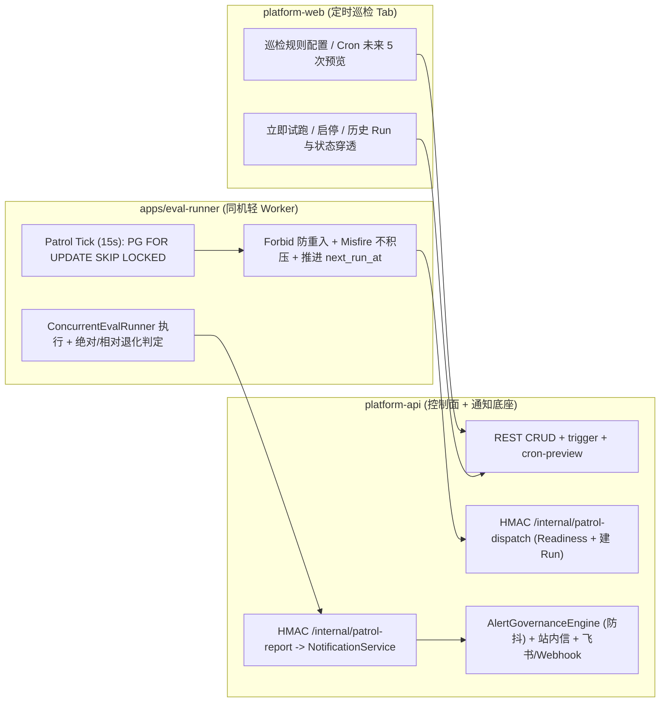

# 专题 10：定时巡检调度、退化基线门禁与平台告警闭环

> 所属项目：[独立评测中台迁移与平台原生化改造方案](README.md)｜状态：**已完成（done：Task 10.1–10.4 编码、三端单测、类型检查、生产构建、本地迁移 `20261128_0018` 及两轮 `/browser` 全链路端到端验收与 9 张关键截图留存全部通过，未部署生产）**

---

## 1. 业务背景与当前缺口

在完成专题 01–09 交付后，研发与评测团队已经能够手动勾选考题发起打擂、查看实时日志并横向对比历史趋势，但一旦上线新版 Prompt、调整模型路由或变更知识库，仍需人工记得去点「发起打擂」，缺乏无人值守的**自动化回归巡检与退化主动告警**闭环。

对现有代码库核查后，发现 `eval_patrol_schedules` 目前仅处于最小占位状态，存在四类工程缺口：

1. **数据库契约残缺，调度器无法独立建跑**：
   - `eval_patrol_schedules` 表缺少 `target_agent_id`、`target_model_id`、`embedding_model_id`，无法构建不可篡改 `target_snapshot_json` 并创建 `EvalRun`。
   - 缺少 `timezone`（默认须为 `Asia/Shanghai`）、`version_policy`（跟随最新冻结版 vs 锁定指定版）、`case_keys_json`（核心冒烟子集）、`concurrency` / `repeat_k`、`gate_config_json`（绝对门禁与相对基线退化阈值）、`next_run_at`、`last_triggered_at`、`last_status` 与 `consecutive_failures`。
   - `eval_runs` 缺少 `trigger_type`（`manual` / `patrol` / `gate`）与 `patrol_schedule_id`，任务大厅无法区分布置来源。
2. **控制面缺少全生命周期管理与内部调度桥**：
   - `studio_router.py` 目前仅有 `GET /studio/patrols` 和 `POST /studio/patrols`，缺少编辑（`PATCH`）、删除（`DELETE`）、Cron 表达式与未来执行时间预览（`cron-preview`）、手动「立即试跑一次（`trigger`）」，以及供 `eval-runner` 触发入队和上报巡检结果的内部 HMAC 接口。
3. **执行端尚无 Cron 调度循环与告警闭环**：
   - `eval-runner/worker.py` 仅轮询 `status = 'queued'` 的运行记录，尚无 Cron 解析、DB 事务抢锁（`FOR UPDATE SKIP LOCKED`）、并发防重入（`Forbid`）、Misfire 不积压推进，以及 Run 终态后的「绝对门禁 + 相对历史基线退化对比」和告警/恢复通知派发。
4. **前端缺少巡检配置界面**：
   - `EvaluationStudioPage.vue` 仅提供 3 个主标签页（题库资产全景、考题表格汇总、打擂任务大厅），虽然 `useEvaluationStudio.ts` 已预留 `listPatrols` / `addPatrol`，但页面上没有定时巡检管理列表、配置弹窗或大厅「定时巡检」来源标签。

**本专题核心目标：**
沿用方案 X 架构底座，在 **`apps/platform-api` → `apps/eval-runner` → `apps/platform-web`** 全栈落地工业级定时巡检与退化告警能力，并直接复用平台既有的 `notifications`（站内信 + `AlertGovernanceEngine` 防抖 + 飞书交互卡片/Apprise 渠道），补齐「配置巡检 → 自动/手动触发 → 防重入执行 → 绝对/相对门禁判定 → 告警与恢复闭环 → 趋势追踪」完整链路。

---

## 2. 方案与技术设计（已确认基线）

### 2.1 工业级定时调度与防呆机制

1. **调度载体（已确认）**：
   - 在 `eval-runner/worker.py` 主循环内复用轻量巡检 Tick（默认每 `15s` 扫描一次到期调度），不额外引入 Celery Beat 或独立 APScheduler 进程，严守 `sshmy1` 4GB 宿主机内存约束；
   - 通过 `croniter` + Python 标准库 `zoneinfo` 按配置的 IANA 时区（默认 `Asia/Shanghai`）精确计算 `next_run_at`（统一以 UTC 落库比较）。
2. **分布式抢锁与并发防重入（`Forbid`）**：
   - 扫描条件：`enabled = true AND next_run_at IS NOT NULL AND next_run_at <= NOW()`，SQL 使用 `SELECT ... FOR UPDATE SKIP LOCKED` 防止多 Worker 重叠触发；
   - **防重入守卫**：入队前检查该巡检的 `last_run_id` 对应 `EvalRun` 是否仍处于 `queued` / `running` / `rescoring` / `paused`；若是，则跳过本次调度（更新 `last_status = 'skipped_overlap'`、记一条调度日志事件，并按 `now()` 推进下一个 `next_run_at`），避免夜间长任务叠罗汉打爆宿主机与模型网关；
   - **Misfire 不补跑策略**：若系统停机恢复后 `next_run_at` 已大幅落后当前时间，仅以当前时间 `now()` 触发（或跳过积压窗口直接计算下一个未来触发点），绝不连续补跑历史积压次数。
3. **版本策略与开考前自检（已确认）**：
   - `version_policy` 支持 **`latest_published`（默认，始终追踪该评测集最新已发布冻结版本）** 与 **`pinned`（锁定创建/编辑时指定的 `version_id`）**；
   - 触发建 Run 由 `eval-runner` 通过 HMAC 调用 `platform-api /api/evaluation/internal/patrol-dispatch`，控制面在服务端用 `created_by` 身份执行权限/Readiness 与不可篡改 `target_snapshot_json` 构造；若目标模型禁用、版本缺失或能力不兼容（且未设跳过），将 `last_status` 置为 `blocked`，并立即上报告警通知。

---

### 2.2 数据库模型扩展（迁移 `20261128_0018_eval_patrol_upgrade.py`）

1. **`eval_patrol_schedules` 新增列**：
   - 执行目标：`target_agent_id` (`String(64)`, nullable=True 兼容历史占位行，新创建必填)、`target_model_id` (`String(64)`, nullable=True)、`embedding_model_id` (`String(64)`, nullable=True)；
   - 版本与范围：`version_policy` (`String(32)`, default `"latest_published"` — `latest_published` / `pinned`)、`case_keys_json` (`JSON`, default `[]` 空数组表示全量)、`concurrency` (`Integer`, default `2`, 约束 `1..5`)、`repeat_k` (`Integer`, default `1`, 约束 `1..5`)；
   - 调度与状态：`timezone` (`String(64)`, default `"Asia/Shanghai"`)、`next_run_at` (`DateTime(timezone=True)`, index=True)、`last_triggered_at` (`DateTime(timezone=True)`)、`last_status` (`String(32)`, default `"idle"`: `idle`/`running`/`passed`/`degraded`/`failed`/`infra_error`/`blocked`/`skipped_overlap`)、`last_message` (`Text`, default `""`)、`consecutive_failures` (`Integer`, default `0`)；
   - 门禁与告警策略：`gate_config_json` (`JSON`, default `{}`，含 `min_tsr`、`min_l1_pass_rate`、`max_loop_rate`、`max_p95_ttft_ms`、`regression_drop_threshold` 默认 `0.05` 即 5%、`ttft_spike_ratio` 默认 `0.50` 即暴涨 50%、`consecutive_alert_threshold` 默认 `1`)、`notify_on_recovery` (`Boolean`, default `True`)、`updated_at` (`DateTime(timezone=True)`).
2. **`eval_runs` 新增列**：
   - `trigger_type` (`String(32)`, default `"manual"`, index=True：`manual` / `patrol` / `gate`)；
   - `patrol_schedule_id` (`String(36)`, nullable=True, index=True)。
   - 同步更新 `studio_service.delete_run` 与 `delete_patrol` 关联一致性（删除巡检规则时置空历史 Run 的 `patrol_schedule_id` 或保留 `trigger_type="patrol"` 标签；删除 Run 时置空巡检 `last_run_id`）。

---

### 2.3 双层门禁与退化基线判定 + 平台通知底座复用

1. **双层判定逻辑（在 `eval-runner` Run 收口阶段触发）**：
   - **层 1（绝对门禁）**：调用 `evaluate_gate(summary, case_records, limits)`，获取 `exit_code`（`0` 通过、`1` 业务/安全退化、`2` 基础设施全量异常）与 `reasons`；
   - **层 2（相对基线退化）**：查询同 `patrol_schedule_id`（或同 `suite_id` + `target_graph_id` + `target_model_id`）最近一次通过（`status = 'completed' AND gate_exit_code = 0` 且非本场）的 `EvalRun` 作为基线：
     - 若基线存在且当前 `overall_score` 或 `tsr_pass_at_1` 较基线下降幅度 `>= regression_drop_threshold`（默认 `0.05`），判定为退化（`degraded`）；
     - 若基线与当前均有 `ttft_ms.p95` 且当前 P95 较基线涨幅 `>= ttft_spike_ratio`（默认 `0.50`），记入退化告警原因。
2. **复用平台 `notifications` 模块（已确认）**：
   - `eval-runner` 不直接访问飞书 Webhook，而是通过内部 HMAC 接口 `/api/evaluation/internal/patrol-report` 将巡检结果上报给 `platform-api`；
   - `platform-api` 根据判定结果调用 `NotificationService`：
     - **故障 / 退化**：若 `consecutive_failures >= consecutive_alert_threshold`，构造 `AlertIncomingPayload(source="eval_patrol", alert_type="eval_degraded" | "eval_infra_error", target_id=schedule_id, level=ERROR/WARNING, project_id=owner_project_id, action_url=f"/workspace/projects/{owner_project_id}/evaluation/runs?runId={run_id}", details={...})`；由 `NotificationService.process_incoming_alert` 写入站内信（`NotificationCategory.EVAL`），经 `AlertGovernanceEngine` 冷却防抖后推送至项目或全局已启用的且订阅了 `eval_degraded`（或通配）的飞书/Webhook/Apprise 渠道；
     - **自愈恢复**：若配置了 `notify_on_recovery = True` 且上一次巡检处于失败/退化状态、本次恢复 `passed`，调用 `NotificationService.resolve_alert(source="eval_patrol", alert_type=..., target_id=schedule_id)` 同步发送恢复站内信与绿色恢复通知。
   - **关键兼容核查**：`NotificationService._normalize_alert_action_url` 对不含 `thread_id` 且非 `/chat` 的自定义 `action_url` 会原样透传，可直接让飞书卡片「查看详情」按钮精准跳转至本次巡检打擂页。

---

### 2.4 前端「定时巡检」工作台（`platform-web`）

1. **导航与路由（已确认）**：
   - 在 `apps/platform-web/src/router/routes.ts` 新增路由 `workspace-evaluation-patrols`（路径 `projects/:projectId/evaluation/patrols`，`meta.evalTab = "patrols"`，权限 `project.evaluation.read`，侧边栏「评测中心」分组追加「定时巡检」，同步更新 `routes.spec.ts`）；
   - 在 [EvaluationStudioPage.vue](../../../apps/platform-web/src/modules/evaluation/EvaluationStudioPage.vue) 顶部操作栏增加第 4 个标签页按钮 **「定时巡检」**。
2. **巡检配置与管理面板（`PatrolSchedulesPanel.vue` + `PatrolScheduleModal.vue`）**：
   - 列表展示：巡检名称、关联评测集与版本策略（始终最新 / 锁定 `vN`）、靶场项目与 Agent/模型、Cron 频率与下一次预计执行时间、最近状态徽标（通过 / 退化 / 阻塞 / 跳过 / 运行中）、连续失败次数、启停开关、**【立即试跑】**、**【查看最近 Run】**、**【编辑】**、**【删除】**；
   - 权限收口：创建 / 编辑 / 启停 / 立即触发 / 删除统一校验项目 `project.evaluation.manage` 权限；
   - 弹窗配置：频率预设药丸（每小时 / 每天 03:00 / 工作日 09:00 / 自定义 5 段 Cron）+ 实时调用 `cron-preview` 显示未来 5 次中文执行时间；双栏或分组表单配置靶场、Agent、模型、裁判模型、版本策略、用例范围（全量或指定 `case_keys`）、门禁/退化阈值（TSR 下限、L1 下限、相对退化百分比、连续失败阈值、恢复通知开关）。
3. **打擂任务大厅与历史对比联动**：
   - 在 [RunResultsPanel.vue](../../../apps/platform-web/src/modules/evaluation/components/RunResultsPanel.vue) 中为 `trigger_type === "patrol"` 的场次展示「定时巡检」徽标与关联巡检名称，支持跳转筛选。

---

## 3. 本专题规划任务（实施与验证清单）

### Task 10.1：巡检模型升级、控制面 CRUD 与内部触发/告警回调（`platform-api`）

当前 `eval_patrol_schedules` 缺少执行靶场 Agent/模型字段、时区与状态字段，且控制面缺少编辑、删除、Cron 预览、立即触发以及供 `eval-runner` 触发入队和上报告警的内部桥接。

**状态：** 已完成（done）。
**完成标准：**
1. 新增 Alembic 迁移 `20261128_0018_eval_patrol_upgrade.py` 与 ORM 模型扩展，支持 `upgrade` 与 `downgrade`。
2. 补齐控制面路由：`GET /studio/patrols`、`POST /studio/patrols`、`PATCH /studio/patrols/{id}`、`DELETE /studio/patrols/{id}`、`POST /studio/patrols/{id}/trigger`（支持 `PROJECT_EVALUATION_MANAGE` 权限校验）、`POST /studio/patrols/cron-preview`（使用 `croniter` + `ZoneInfo` 校验并输出未来 5 次时间）。
3. `auth_context.py` 白名单放行并实现 HMAC 内部端点：`/api/evaluation/internal/patrol-dispatch`（Readiness 校验 + 解析最新版本或锁定版本 + 构造 `target_snapshot_json` 创建 `EvalRun(trigger_type="patrol")`）与 `/api/evaluation/internal/patrol-report`（更新巡检统计并调用 `NotificationService` 写入站内信及触发防抖告警/恢复通知）。
4. `apps/platform-api/tests/test_evaluation_studio.py` 新增巡检 CRUD、Cron 预览、触发入队、权限拦截及告警/恢复通知单测并全部通过。

**涉及位置：**
* `apps/platform-api/pyproject.toml`（新增 `croniter>=3,<8`）
* `apps/platform-api/migrations/versions/20261128_0018_eval_patrol_upgrade.py`（新增）
* `apps/platform-api/src/platform_api/modules/evaluation/models.py`
* `apps/platform-api/src/platform_api/modules/evaluation/patrol_service.py`（新增）
* `apps/platform-api/src/platform_api/modules/evaluation/studio_schemas.py`
* `apps/platform-api/src/platform_api/modules/evaluation/studio_service.py`
* `apps/platform-api/src/platform_api/modules/evaluation/studio_router.py`
* `apps/platform-api/src/platform_api/entrypoints/http/middleware/auth_context.py`
* `apps/platform-api/tests/test_evaluation_studio.py`

- [x] 补齐 `EvalPatrolSchedule` 与 `EvalRun` 模型列及 Alembic `20261128_0018` 迁移脚本。
- [x] 实现巡检 CRUD、`cron-preview`、`trigger` 控制面接口及 `list_runs` 巡检来源字段透传。
- [x] 实现 HMAC `/internal/patrol-dispatch` 与 `/internal/patrol-report`（复用 `NotificationService` 站内信与告警/恢复分发）。
- [x] 编写并跑通 `platform-api` 巡检与告警单测。

**开发与验证进度：** 已完成实施、迁移与单测验证。`uv run --directory apps/platform-api pytest tests/test_evaluation_studio.py -v` 返回 `3 passed`（覆盖 Cron 预览、动态/锁定版本策略、`Forbid` 并发重叠跳过、告警站内信写入、恢复通知及 `project_member` 403 越权拦截）；本地 PostgreSQL 执行 `bash scripts/local-stack.sh migrate` 从 `20261128_0017` 升级至 `20261128_0018` 成功。
**下一步：** 随 `Task 10.4` 完成全栈联调核对。

---

### Task 10.2：`eval-runner` 定时调度循环、并发防重入与退化基线判定

当前 `eval-runner` 仅轮询 `queued` 批次，没有 Cron 到期扫描、分布式抢锁、并发防重入、Misfire 处理以及 Run 终态的相对基线退化判断与告警上报。

**状态：** 已完成（done）。
**完成标准：**
1. `apps/eval-runner/pyproject.toml` 引入 `croniter` 依赖，并实现基于 `ZoneInfo` 的严格 Cron 计算与 Misfire 不积压推进函数。
2. `worker.py` 新增 `run_patrol_tick` 逻辑（在 `run_worker_loop` 中按周期扫描 `enabled = true AND next_run_at <= now()`，使用 `FOR UPDATE SKIP LOCKED` 抢锁，检测在途 Run 实施 `Forbid` 跳过或调用 `/internal/patrol-dispatch` 创建任务，普通 Run 领取同步升级为 `FOR UPDATE SKIP LOCKED`）。
3. 实现巡检终态收口评估器：合并 `evaluate_gate` 绝对门禁与「同巡检/同配置上一次通过 Run」相对基线退化计算（TSR / 综合分下降、TTFT P95 暴涨），调用 `/internal/patrol-report` 上报控制面。
4. 新增 `eval-runner` 单元测试覆盖：时区跨日 Cron 计算、Misfire 不补跑、`Forbid` 并发重叠跳过、相对基线退化触发、故障恢复判定。

**涉及位置：**
* `apps/eval-runner/pyproject.toml`
* `apps/eval-runner/src/eval_runner/engine/patrol.py`（新增纯逻辑模块：Cron、Misfire、基线退化判定）
* `apps/eval-runner/src/eval_runner/targets/platform_client.py`
* `apps/eval-runner/src/eval_runner/worker.py`
* `apps/eval-runner/src/eval_runner/cli.py`（补充 `patrol-tick` 单次调度 CLI 命令）
* `apps/eval-runner/tests/test_eval_runner.py`

- [x] 引入 `croniter` 并实现时区感知 Cron、Misfire 跳过与基线退化对比纯函数。
- [x] 在 `worker.py` 接入 `poll_due_patrols_once`（含 PostgreSQL `FOR UPDATE SKIP LOCKED`、`Forbid` 防重入）及 Run 终态巡检汇报钩子。
- [x] 在 `cli.py` 提供 `eval-runner patrol-tick` 独立诊断触发命令。
- [x] 编写并跑通 `eval-runner` 定时调度与退化对比单测。

**开发与验证进度：** 已完成实施与单测验证。`uv run --directory apps/eval-runner pytest tests/test_eval_runner.py -v` 返回 `17 passed`（含 `test_patrol_cron_misfire_baseline_regression_and_worker_tick` 验证 `Asia/Shanghai` 时区、`tsr_regression` / `ttft_p95_spike` 相对基线退化、到期巡检领锁推进及 Run 终态上报）；真实 `eval-runner` 后台进程已于 `local-stack` 实测自动触发 `*/1 * * * *` 调度并调用 `/internal/patrol-dispatch` 与 `/internal/patrol-report` 返回 `200 OK`。
**下一步：** 随 `Task 10.4` 完成全链路核对。

---

### Task 10.3：前端「定时巡检」工作台与任务大厅联动（`platform-web`）

用户目前在界面上看不到任何定时巡检入口，也无法配置 Cron 频率、选择版本策略或立即试跑巡检任务。

**状态：** 已完成（done）。
**完成标准：**
1. 路由 `routes.ts` 新增 `workspace-evaluation-patrols` 并同步更新 `routes.spec.ts`；`EvaluationStudioPage.vue` 顶栏新增「定时巡检」Tab。
2. `services/evaluation/studio.ts` 与 `useEvaluationStudio.ts` 补齐巡检列表、创建、编辑、启停、删除、立即触发与 Cron 未来 5 次预览 API 调用（遵守 `useAuthorization` 权限判断）。
3. 新增 `PatrolSchedulesPanel.vue` 与 `PatrolScheduleModal.vue`（遵循 `frontend-development-playbook.md` 规范：使用 `BaseSelect`、`BaseDialog`、双分组表单 + Cron 未来 5 次时间实时预览、空态/错误态/加载态、支持从 `EvaluationRun` 跳转查看详情）。
4. `RunResultsPanel.vue` 展示 `trigger_type === 'patrol'` 的「定时巡检」标签与关联巡检名称；支持在打擂大厅按触发来源过滤并结合 `SuiteHistoryMetricsDialog.vue` 查看巡检趋势。

**涉及位置：**
* `apps/platform-web/src/router/routes.ts`
* `apps/platform-web/src/router/routes.spec.ts`
* `apps/platform-web/src/services/evaluation/studio.ts`
* `apps/platform-web/src/modules/evaluation/composables/useEvaluationStudio.ts`
* `apps/platform-web/src/modules/evaluation/EvaluationStudioPage.vue`
* `apps/platform-web/src/modules/evaluation/components/PatrolSchedulesPanel.vue`（新增）
* `apps/platform-web/src/modules/evaluation/components/PatrolScheduleModal.vue`（新增）
* `apps/platform-web/src/modules/evaluation/components/RunResultsPanel.vue`
* `apps/platform-web/src/modules/evaluation/components/PatrolSchedules.spec.ts`（新增）

- [x] 注册路由 `workspace-evaluation-patrols`、更新 `routes.spec.ts` 与页面顶栏「定时巡检」Tab。
- [x] 扩展 `studio.ts` 与 `useEvaluationStudio.ts` 的巡检状态管理与动作。
- [x] 实现 `PatrolSchedulesPanel.vue`、`PatrolScheduleModal.vue` 及 `RunResultsPanel.vue` 巡检来源标识与过滤。
- [x] 编写前端组件与路由 Vitest 单测并跑通 `vue-tsc --noEmit` 与 `vite build`。

**开发与验证进度：** 已完成实施、单测与构建验证。`pnpm --dir apps/platform-web typecheck`（`vue-tsc` 0 错）、`pnpm --dir apps/platform-web test:run src/modules/evaluation/ src/router/routes.spec.ts`（`9 passed (38 tests)`，含 `PatrolSchedules.spec.ts` 3 项与 `routes.spec.ts` 7 项）及 `pnpm --dir apps/platform-web build` 均已通过。
**下一步：** 见 `Task 10.4` `/browser` 实测证据。

---

### Task 10.4：全栈联调、真实执行与 `/browser` 全链路端到端截图验收

需在本地 `local-stack` 真实全栈环境下重启加载新迁移与三端服务，用真实评测集与真实模型验证「创建巡检 → Cron 预览 → 立即试跑 / 调度触发 → 任务大厅实时跟踪与巡检标识 → 退化/完成站内信通知留痕 → 启停与删除」全链路，并通过 `/browser` 逐点检查且留存关键步骤截图。

**状态：** 已完成（done，本地隔离全栈与两轮 `/browser` 全链路验收通过，未部署生产）。
**完成标准：**
1. 三端测试与静态检查全过：`platform-api` pytest、`eval-runner` pytest、`platform-web` `vue-tsc --noEmit` + Vitest + `pnpm build`、`python3 scripts/check_docs.py`。
2. 本地 `local-stack` 执行数据库迁移 `20261128_0018` 并重启 `platform-api`、`eval-runner`、`platform-web` 健康就绪。
3. 使用 `/browser` 对已开发功能逐点进行真实全链路操作验证（0 控制台/网络报错）并将关键步骤截图保存至 `docs/projects/20261128-independent-eval-platform/implementation/screenshots-patrol/`，验证场景包含：
   - 进入「定时巡检」Tab 与新建巡检弹窗（频率预设 + Cron 未来 5 次实时预览 + 门禁与退化阈值配置）；
   - 创建巡检并点击「立即试跑」，在大擂任务大厅观测带「定时巡检」徽标的实时运行进度与结果；
   - 触发或模拟门禁/退化告警，验证平台顶部通知中心（🔔 站内信）收到评测告警/结果通知且可点击跳转回对应 Run；
   - 切换巡检启停开关、编辑巡检策略、删除测试巡检并刷新页面确认持久化。

**涉及位置：**
* `apps/platform-api/`、`apps/eval-runner/`、`apps/platform-web/`
* `docs/projects/20261128-independent-eval-platform/implementation/screenshots-patrol/`

- [x] 执行三端自动化测试、类型检查、生产构建与文档链接校验。
- [x] 升级本地数据库迁移并重启 `local-stack` 服务。
- [x] 通过 `/browser` 完成全部新增交互的端到端实测并保存 9 张关键步骤截图。
- [x] 同步更新专题进度、项目 `README.md`、`docs/CONTEXT.md`、`docs/FEATURES.md` 与 `docs/CHANGELOG.md`。

**开发与验证进度：**
* **自动化测试与构建**：
  * `uv run --directory apps/platform-api pytest tests/test_evaluation_studio.py -v` → `3 passed`。
  * `uv run --directory apps/eval-runner pytest tests/test_eval_runner.py -v` → `17 passed`。
  * `pnpm --dir apps/platform-web typecheck && pnpm --dir apps/platform-web test:run src/modules/evaluation/ src/router/routes.spec.ts && pnpm --dir apps/platform-web build` → `vue-tsc` 0 错、`9 passed (38 tests)`、`vite build` 成功。
  * `python3 scripts/check_docs.py` → `Documentation checks passed.`。
* **本地全栈与数据库迁移**：`bash scripts/local-stack.sh migrate` 升级 `20261128_0017 -> 20261128_0018`，`platform-api`（`2142`）、`eval-runner`、`platform-web`（`3000`）全部重启就绪。
* **两轮 `/browser` 端到端真实浏览器验收（`http://127.0.0.1:3000`）**：
  * **第一轮（巡检配置、Cron 预览、立即试跑、大厅筛选、启停/编辑/删除与留痕）**：使用 `admin` 进入「定时巡检」Tab（[01-patrols-tab.png](implementation/screenshots-patrol/01-patrols-tab.png)），打开弹窗配置 `E2E 自动化巡检验证`（`E2E-workflow_demo-闭环验证集`、`case_001` 局部冒烟、预览未来 5 次 `03:00:00` 时间戳：[02-create-modal-cron-preview.png](implementation/screenshots-patrol/02-create-modal-cron-preview.png)），创建卡片（[03-created-patrol-card.png](implementation/screenshots-patrol/03-created-patrol-card.png)）后点击「▶ 立即试跑」触发 `#dd5d6385`；大厅展示「定时巡检」徽标与「定时巡检 (1)」筛选过滤（[04-runs-hall-patrol-filter.png](implementation/screenshots-patrol/04-runs-hall-patrol-filter.png)）；因上游模型调用超时（`134138ms`，`runtime_error`）触发 `infra_error` 上报，巡检卡片回写「基础设施异常」「连续异常 1 次」与最近回执，随后完成停用持久化、启用、编辑重命名（[05-updated-patrol-receipt.png](implementation/screenshots-patrol/05-updated-patrol-receipt.png)）及删除规则（保留历史 Run 后手动清理：[06-cleaned-up.png](implementation/screenshots-patrol/06-cleaned-up.png)）。全程 ConsoleErrors=0、FailedNetworkRequests=0。
  * **第二轮（站内信告警跳转与真实后台 Cron 自动到期触发）**：点击顶栏带 `1` 红点通知铃铛，确认弹出 `eval_patrol` 告警并点击「立即前往查看 →」跳转 `/evaluation/runs?runId=...`（[07-notification-bell-alert.png](implementation/screenshots-patrol/07-notification-bell-alert.png)）；新建 `*/1 * * * *` 巡检规则 `Cron 自动触发验证`（`E2E 多图回归验证集` / `reference_agent`），未点击「立即试跑」，等待 `eval-runner` 后台 Tick 于 `23:37:08` 自动调用 `/internal/patrol-dispatch` 入队 `#206c696b`（[08-auto-cron-triggered-card.png](implementation/screenshots-patrol/08-auto-cron-triggered-card.png)）并在大厅归档展示（[09-auto-cron-run-in-hall.png](implementation/screenshots-patrol/09-auto-cron-run-in-hall.png)），随后完成规则与临时 Run 清理。全程 ConsoleErrors=0。
* **未覆盖边界**：外部飞书/Webhook 真实机器人公网投递与远端 `sshmy1` 生产部署未在本轮执行；本地活体模型因上游 `xiaok` 响应超时均落入 `infra_error` / `failed` 路径，正常 `passed` 恢复通知与相对基线 `degraded` 判定通过后端与 Runner 自动化测试覆盖。
**下一步：** 当前专题范围已全部交付并本地闭环，待后续窗口视需要合并与部署远端。

---

## 4. 验收要求与已确认决策

* **阶段验证（Phase）**：`Task 10.1–10.3` 每项完成后先跑通各自所属服务单测与类型构建校验。
* **整体验收（Final）**：`Task 10.4` 在本地真实 PG + Redis + `platform-api` + `eval-runner` + `runtime-service` + `platform-web` 联动下跑通完整闭环并留存 `/browser` 关键截图。
* **已确认的核心设计决策（2026-11-28）**：
  1. **调度引擎载体**：沿用 `eval-runner` 内置轻量 Tick 循环 + PostgreSQL `FOR UPDATE SKIP LOCKED` 与 `Forbid` 防重入，不额外引入 Celery/APScheduler 独立进程。
  2. **版本追踪策略**：同时支持 `latest_published`（默认，始终跟随评测集最新已发布版本）与 `pinned`（锁定指定冻结版本）。
  3. **退化判定与通知渠道**：开启「绝对门禁 + 相对上次通过巡检退化对比 + 恢复通知」；外部通知与站内信**直接复用平台现有 `notifications` 模块**（`NotificationService` + `AlertGovernanceEngine` + 飞书卡片/Webhook 渠道），不在巡检页面重造通知渠道管理。
  4. **前端入口与权限边界**：在 `EvaluationStudioPage.vue` 顶栏新增第 4 个 Tab「定时巡检」并注册独立路由；创建、编辑、启停、立即触发与删除统一要求 `PROJECT_EVALUATION_MANAGE` 权限。
